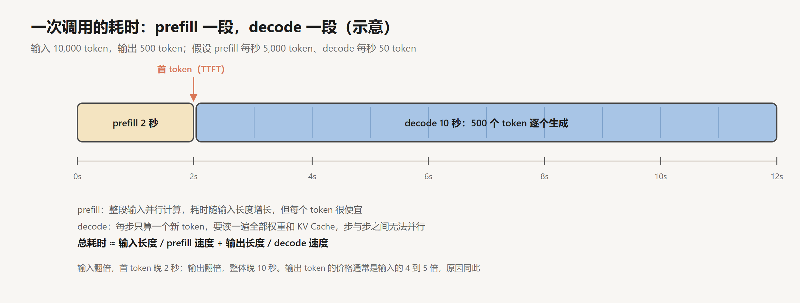
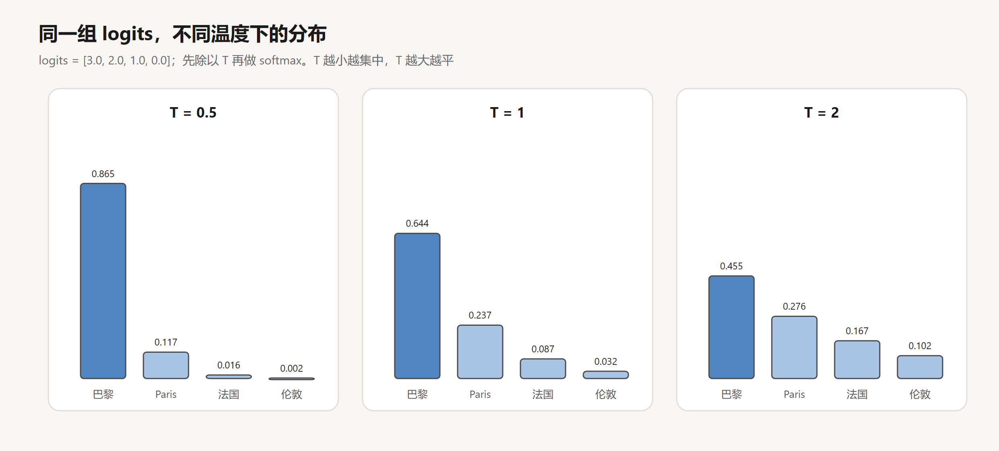

# 一次 API 调用里发生了什么

创建日期：2026-10-17

agent 能读代码、改文件、连续工作几个小时，但拆到最底层，它每一步做的都是同一件事：调用一次模型 API，拿回一段文本。后面各篇讨论的工具、循环、上下文管理、记忆，都是围绕这一次调用搭起来的。

一次调用可以看成一个确定的数据变换，加上一个随机的采样过程。调用方组装一个消息列表，服务端用模板把它拼成一段文本，切成 token；模型先并行读完这段输入，再一个 token 一个 token 地往后生成，每一步按采样规则从概率分布里抽一个，直到满足某个停止条件。这个过程决定了一次调用的三个基本性质：

- **输入完全由调用方组装。** 模型看到的只有这一次请求里的 token。system prompt、对话历史、工具结果，都是调用方放进去的，也都可以被调用方改写。
- **输出是采样出来的。** 同样的输入，输出由采样参数和数值计算的细节共同决定，不保证每次相同，也不保证符合任何格式，除非在采样时加以约束。
- **两次调用之间没有状态。** 服务端处理完一次请求，不保留任何与这次对话有关的信息。

这篇文章逐一分析这个过程的各个环节：请求怎样变成 token，计算的耗时和费用由什么决定，无状态带来的 token 增长，采样怎样从分布里取出一个 token，生成在什么时候停下，以及怎样让输出符合指定的格式。模型内部怎样算出下一个 token 的分布，在[深度学习系列](../深度学习/README.md)里讲过，这里从调用方的角度看。文中的 token 数、速度和价格，除特别注明的以外，都是示意。

## 1. 请求与响应

### 1.1 请求的结构

不管用哪家的 SDK，一次调用的形状都差不多：

```text
response = model.call(
    system      = "你是一个简洁的助手。",
    messages    = [ {role: "user", content: "法国的首都是哪里？"} ],
    max_tokens  = 1024,
    temperature = 0.7,
)
```

返回的结果是：

```text
response = {
    content:     [ {type: "text", text: "巴黎。"} ],
    stop_reason: "end_turn",
    usage:       { input_tokens: 31, output_tokens: 5 },
}
```

请求里有三类东西：system prompt，消息列表，控制生成的参数。响应里也是三类：生成的内容，停止的原因，消耗的 token 数。


### 1.2 模板：消息列表变成一段文本

模型的输入是一个 token 序列，不是消息列表。服务端第一步是用 chat 模板把 system 和每条消息拼成一段文本，消息之间用特殊标记隔开。开源模型常见的是 ChatML 一类的格式，上面那个请求渲染出来大致是：

```text
<|im_start|>system
你是一个简洁的助手。<|im_end|>
<|im_start|>user
法国的首都是哪里？<|im_end|>
<|im_start|>assistant
```

最后一行只有 `assistant` 的开头标记，没有内容。模型的任务就是从这里往后续写，写到它生成结束标记 `<|im_end|>` 为止。

`<|im_start|>`、`<|im_end|>` 在词表里是单独的特殊 token，不是普通字符拼起来的。模型在训练中见过大量这种格式的对话，学会了标记之间的文字分别扮演什么角色。开源模型的模板随分词器一起发布，是一段 Jinja 代码，存在 tokenizer 的 `chat_template` 字段里，连工具定义怎样渲染进 prompt 也写在其中，`print(tokenizer.chat_template)` 就能看到原文。Anthropic 和 OpenAI 使用的模板不公开，但原理相同。模板为什么必须和训练时一致、特殊 token 怎样防注入，在 [SFT 与 Chat 模板](../深度学习/大模型训练/02-SFT与Chat模板.md)第 3 节讲过。

这解释了响应里的 `input_tokens` 为什么比用户写的字多。“你是一个简洁的助手。”和“法国的首都是哪里？”加起来不到 20 个汉字，31 个输入 token 里还包含了模板的特殊标记、角色名、换行，以及服务端可能附加的内容。计费和上下文长度都按模板渲染之后的 token 数算。

### 1.3 分词

渲染好的文本再被分词器切成 token id。分词器是一张固定的词表，加上一套切分规则，常见的是 BPE 一类的子词算法：高频的字符组合合并成一个 token，低频的拆成更小的片段。

同一段意思，用不同语言、不同写法，token 数可能差很多。英文常见单词通常是一个 token；中文一个汉字可能是一个 token，也可能被拆成两三个字节级的片段，取决于分词器的训练语料里中文占多少。代码里的缩进、长变量名、JSON 里大量的引号和括号，都会占用 token。估算成本时，以服务端返回的 `usage` 为准，不要按字数推算。

## 2. 计算：prefill 与 decode

token 序列送进模型以后，计算分成两个阶段，它们的瓶颈不同，耗时和价格也不同。

### 2.1 两个阶段

**prefill**：把整段输入一次性送进模型，算出每个位置的 K 和 V，存进 KV Cache，同时得到最后一个位置上下一个 token 的概率分布。输入的所有位置可以并行计算。

**decode**：从第一个输出 token 开始，每一步只为新生成的那个 token 算一次 Q、K、V，和缓存里之前所有位置的 K、V 做注意力，得到下一个 token 的分布，采样，追加，再算下一步。每一步依赖上一步的结果，步与步之间无法并行。

KV Cache 为什么能让 decode 只算新 token、为什么只缓存 K 和 V，见 [KV Cache 与 Attention QKV](../深度学习/Transformer与大模型/03-KV-Cache与Attention-QKV.md)。

### 2.2 两种瓶颈

两个阶段的瓶颈可以粗略估算。以一个 70 亿参数的模型为例，用 16 位精度存储，权重约 14 GB；每处理一个 token，大约要做 $2N = 1.4 \times 10^{10}$ 次浮点运算。

prefill 阶段，所有输入 token 一起算，权重读一次就能用于全部 token，瓶颈在计算量。一张峰值 300 TFLOPS 左右的 GPU，理论上每秒能处理两万个 token 量级，实际利用率打个折扣，也有每秒几千个。

decode 阶段，每一步只算一个 token，计算量很小，但要把 14 GB 权重从显存完整读一遍，再加上全部的 KV Cache。按每秒 2 TB 的显存带宽算，光读权重就要约 7 毫秒，单个请求的上限约为每秒 140 个 token。瓶颈在显存带宽，不在计算。服务端会把很多用户的请求拼成一批同时 decode，让读一次权重服务多个请求，这提高了整体吞吐，但每个用户看到的生成速度通常只有每秒几十个 token。

KV Cache 也在随输入变长。在 Llama-2-7B 这样的结构里，每个 token 的 K 和 V 合计占 0.5 MB（32 层，每层 K、V 各 4,096 维，16 位精度），一万个 token 的上下文就要 5 GB。上下文越长，decode 每一步要读的数据越多，速度越慢，一张卡能同时服务的请求也越少。

### 2.3 耗时与价格



于是一次调用的耗时可以近似为：

$$
t \approx \frac{L_{\text{in}}}{v_{\text{prefill}}} + \frac{L_{\text{out}}}{v_{\text{decode}}}
$$

假设 prefill 每秒 5,000 token、decode 每秒 50 token，输入 10,000 token、输出 500 token，首个 token 出现在 2 秒后，全部生成完要 12 秒。输入翻倍，首 token 晚 2 秒；输出翻倍，整体晚 10 秒。界面上等第一个字的那段时间，主要花在 prefill 上。

价格反映的也是这个差别。主流 API 的输出单价一般是输入的 4 到 5 倍：一个输入 token 和其他几千个 token 共享一次权重读取，一个输出 token 要独占一步串行的 decode。

这对 agent 有两个直接的含义。第一，agent 每一轮都要输入整个上下文，输出却只是一个简短的工具调用，输入 token 远多于输出，第 05 篇提到 Manus 的数字是约 100 比 1，所以 agent 的成本主要花在输入上。第二，让模型输出大段内容（比如整个文件）既慢又贵，这也是编辑文件的工具通常只要求模型输出修改的那一小段的原因之一（第 02 篇）。

## 3. 无状态

### 3.1 历史由调用方重发

服务端处理完一次请求，不保留这次对话的任何内容。多轮对话之所以能接上，是因为客户端每一轮都把之前的全部消息重新发一遍。一个最简单的聊天程序：

```text
history = []
loop:
    history.append({role: "user", content: 读取用户输入})
    reply = model.call(system = SYSTEM, messages = history)
    history.append({role: "assistant", content: reply.text})
    显示 reply.text
```

服务端看到的每一个请求都是独立的、完整的。第 10 轮的请求里，前 9 轮的内容是作为输入的一部分重新送进来的，模型在 prefill 阶段把它们重新读一遍。

### 3.2 token 的增长

设 system prompt 为 $S$ 个 token，每轮用户说 $u$ 个，模型答 $a$ 个。第 $k$ 轮的输入是：

$$
\text{input}_k = S + (k-1)(u+a) + u
$$

输入随轮数线性增长。$n$ 轮的累计输入是：

$$
\sum_{k=1}^{n} \text{input}_k = n(S + u) + (u+a)\,\frac{n(n-1)}{2}
$$

第二项随 $n^2$ 增长。取 $S = 1000$、$u = 100$、$a = 300$、$n = 10$：

$$
10 \times 1100 + 400 \times 45 = 11000 + 18000 = 29000
$$

累计输出只有 $10 \times 300 = 3000$。


聊天场景里输入和输出的比例约为 10 比 1。agent 每一轮追加的不是一句话，而是一个文件的内容、一段测试日志，$u$ 往往是几千 token，$a$ 却只有几百，平方项增长得快得多。

服务端的前缀缓存能把重复部分的价格降到约十分之一：第 $k$ 轮的输入里，前面和第 $k-1$ 轮完全相同的部分可以直接复用。这样一来，累计费用的主要部分从平方项变回了线性项。代价是任何改写历史的操作都会让缓存失效。缓存的机制和成本推导在[第 05 篇](05-上下文工程.md)。

### 3.3 历史是调用方的数据

无状态的另一面是：整段历史是调用方手里的一份数据，可以任意修改，而模型无从分辨。

调用方可以删掉中间几轮，可以把一段很长的工具输出换成一句摘要，甚至可以伪造一条 assistant 消息，让模型以为自己之前说过某句话。对模型来说，输入就是一段 token 序列，里面哪些是它“真的”生成过的，它没有任何办法知道。

有的接口允许只写 assistant 消息的开头，让模型从那里接着写，通常叫作预填（prefill，和 2.1 节计算意义上的 prefill 不是一回事）。比如把开头写成 `{`，模型几乎只会接着写 JSON。并非所有模型和配置都支持预填，但它说明了一件事：模型做的是续写，开头是什么，它就顺着什么往下写。

后面讲到的上下文压缩、记忆、子 agent，都是在利用这一点：决定下一次调用的输入里放什么。

## 4. 采样

### 4.1 从 logits 到分布

prefill 或 decode 的每一步，模型输出的是一个长度等于词表大小的向量，叫 logits。第 $i$ 个分量 $z_i$ 越大，第 $i$ 个 token 越可能是下一个。采样前先把 logits 除以温度 $T$，再做 softmax：

$$
p_i = \frac{\exp(z_i / T)}{\sum_j \exp(z_j / T)}
$$

以四个候选 token 为例，logits 为 $[3.0, 2.0, 1.0, 0.0]$，分别对应“巴黎”“Paris”“法国”“伦敦”。$T = 1$ 时：

$$
e^{3} = 20.09,\quad e^{2} = 7.39,\quad e^{1} = 2.72,\quad e^{0} = 1,\quad \text{合计 } 31.19
$$

分布为 $[0.644, 0.237, 0.087, 0.032]$。$T = 0.5$ 时，logits 先变成 $[6, 4, 2, 0]$，分布为 $[0.865, 0.117, 0.016, 0.002]$；$T = 2$ 时变成 $[1.5, 1, 0.5, 0]$，分布为 $[0.455, 0.276, 0.167, 0.102]$。



除以 $T$ 改变的是 logits 之间的差距。$T < 1$ 放大差距，分布变尖；$T > 1$ 缩小差距，分布变平。$T \to 0$ 时，最大的那个概率趋于 1，相当于每次都选概率最高的 token，即贪心解码。推导见 [Transformer 结构详解](../深度学习/Transformer与大模型/02-Transformer结构详解.md)第 7.2 节。

### 4.2 截断：top_p 与 top_k

即使最可能的 token 概率很高，长尾里成千上万个低概率 token 加起来也有不小的概率质量，偶尔抽到一个离谱的 token，后面的生成就会被带偏。截断采样把候选范围限制在头部。

top_k 只保留概率最高的 $k$ 个 token。top_p 按概率从高到低累加，保留累计概率刚好达到 $p$ 的那些 token。上面 $T = 1$ 的分布取 $p = 0.9$：前两个累计 0.881，不到 0.9，再加上第三个达到 0.968，于是保留前三个，重新归一化为 $[0.665, 0.245, 0.090]$，“伦敦”被排除。

温度和截断一般只调其中一个。开启扩展思考时，有些接口不允许修改这些参数，使用服务端固定的设置。

### 4.3 温度为 0 也不确定

一个常见的误解是：温度设成 0，输出就完全确定。实际上同样的请求发两次，结果仍可能不同。

原因在浮点运算。浮点加法不满足结合律，以 32 位浮点为例，$(10^8 + 1) - 10^8 = 0$，而 $(10^8 - 10^8) + 1 = 1$：第一种算法里，1 在和 $10^8$ 相加时因为精度不够被舍掉了。矩阵乘法、注意力里的求和，换一种累加顺序，结果的最后几位就可能不同。

2025 年 Thinking Machines 的一篇文章分析了推理服务里这种差异的主要来源：服务端把多个用户的请求拼成一批来算，批的大小每次都不一样，而很多 GPU 算子在不同的批大小下会采用不同的累加顺序。于是同一个请求，因为和不同的请求拼在一起，logits 的最后几位就有了差别。当两个候选 token 的 logits 非常接近时，这点差别足以改变最大值是哪一个，从这一步开始，后面的生成就分岔了。

这件事对 agent 的影响在于评估：同一个任务跑一次成功，不能说明它每次都成功。第 12 篇会讲怎样用多次试验来衡量这种随机性。

## 5. 停止

### 5.1 decode 循环

decode 是一个循环，写成伪代码：

```text
tokens = render_and_tokenize(request)
prefill(tokens)                                  # 算出输入的 KV Cache
output = []
loop:
    probs = next_token_distribution()
    t = sample(probs, temperature, top_p)
    if t == END_OF_TURN:          return output, "end_turn"
    output.append(t)
    if ends_with_stop_sequence(output): return output, "stop_sequence"
    if len(output) == max_tokens:  return output, "max_tokens"
    if t == TOOL_CALL_END:        return output, "tool_use"     # 第 02 篇
    decode_step(t)                               # 把 t 的 K、V 追加进缓存
```

循环有四个出口，对应响应里的 `stop_reason`（OpenAI 叫 `finish_reason`）：

| 停止原因 | Anthropic | OpenAI | 含义 |
|---|---|---|---|
| 自然结束 | `end_turn` | `stop` | 模型生成了结束标记 |
| 达到上限 | `max_tokens` | `length` | 输出被 max_tokens 截断 |
| 命中停止序列 | `stop_sequence` | `stop` | 生成了调用方指定的字符串 |
| 要调用工具 | `tool_use` | `tool_calls` | 模型输出了一个完整的工具调用，等调用方执行 |

### 5.2 自然结束是学出来的

`end_turn` 意味着模型在某一步采样到了结束标记。模型之所以会在回答完的时候生成它，是因为 SFT 时结束标记也被算进了 loss（[SFT 与 Chat 模板](../深度学习/大模型训练/02-SFT与Chat模板.md)第 4.3 节）。这是一个统计上的倾向：模型可能在该停的时候没停，一直写到 max_tokens；也可能在没说完的时候就停了。

### 5.3 max_tokens 截断

max_tokens 只是上限，模型不会为了用满它而多写。但一旦写到上限，生成就被硬截断，哪怕一句话说到一半，一个 JSON 少了右括号。输入和输出合起来也不能超过模型的上下文窗口，输入越长，留给输出的空间越小。

agent 代码里一个常见的错误，就是没有检查 `stop_reason`，把一段被截断的输出当成完整结果去解析。截断的 JSON 解析失败还算容易发现；截断的代码片段如果恰好语法正确，就会被当成完整的修改写进文件。

## 6. system prompt

### 6.1 位置与训练

system prompt 在模型结构里没有任何特殊的待遇，它就是模板渲染后序列开头的一段 token。它能起作用，是因为后训练的数据里有大量带 system prompt 的对话，回答都遵守了 system 里的设定，模型学会了把这个位置的文字当成规则。

训练还进一步规定了优先级。2024 年 OpenAI 的 Wallace 等人提出“指令层级”：system 优先于 user，user 优先于工具返回的内容，并且大量构造三者冲突的训练样本。训练后，模型对藏在网页、文档里的恶意指令有了明显的抵抗力（[SFT 与 Chat 模板](../深度学习/大模型训练/02-SFT与Chat模板.md)第 6 节）。

由此可以推出 system prompt 的两个性质。

第一，它的约束力是统计上的，没有硬性保证。模型在绝大多数情况下遵守 system 的要求，但不是每次都遵守。某条要求如果绝对不能被违反，就不能只写在 system prompt 里，还需要模型之外的检查（第 04 篇、第 11 篇）。

第二，它位于序列的最前面，每次调用都要重发。它越长，每一轮的输入越多；它一旦改动，前缀缓存从第一个 token 开始全部失效。所以在 system prompt 里放随时间变化的内容（比如当前时间），代价是每一轮都无法命中缓存。

## 7. 结构化输出

只给人看的输出，格式无所谓。一旦输出要交给程序处理，比如抽出一个日期写进数据库，或者解析成一个工具调用，就需要严格的格式，通常是 JSON。

### 7.1 提示与预填

最直接的做法是在 prompt 里描述格式、给一两个示例。这样做大多数时候能成功，但从 4.1 节的采样过程可以看出它为什么不可靠：格式只是让符合格式的 token 概率变高，并没有让不符合格式的 token 概率变成零。于是总有少数情况出岔子：外面多包一层 Markdown 代码块，结尾加一句说明，少一个字段，字符串里的引号没有转义。

预填 `{` 能把出错率再降一些，但仍然只是改变了概率。

### 7.2 约束解码

要保证格式，就要在采样这一步直接限制候选范围。做法是把 JSON Schema 编译成一个语法，再转换成一个状态机。生成的每一步，状态机根据已经生成的内容处在某个状态，这个状态决定了哪些 token 可以出现在下一个位置。不合法的 token，logit 直接设为 $-\infty$，softmax 之后概率为 0：

$$
p_i = \frac{m_i \exp(z_i / T)}{\sum_j m_j \exp(z_j / T)}, \qquad m_i = \begin{cases} 1 & \text{token } i \text{ 在当前状态下合法} \\ 0 & \text{其他} \end{cases}
$$


图里的例子：已经生成了 `{"temp": `，schema 规定 `temp` 是数字。状态机此时只允许数字和负号。原始分布里概率最高的是双引号（0.41），说明模型正准备写一个字符串；它和汉字“二”、`null` 一起被屏蔽，剩下的 `2`（0.22）和 `1`（0.12）重新归一化：

$$
\frac{0.22}{0.22 + 0.12} \approx 0.65, \qquad \frac{0.12}{0.22 + 0.12} \approx 0.35
$$

实现上有一个难点：token 和语法单位不对齐。一个 token 可能包含好几个字符，比如 `":` 或者 `"}`，它可能跨越两个语法单位，也可能只有前半截合法。逐个检查词表里的几万个 token 是否合法，每一步都做一遍代价太高。2023 年 Willard 和 Louf 的做法（后来成为开源库 Outlines）是预先计算：对状态机的每一个状态，提前算好词表里哪些 token 从这个状态出发是合法的，建成索引，生成时每一步只需查表。XGrammar 等后来的实现在这个思路上进一步优化了速度。

OpenAI 在 2024 年 8 月给 API 加上了 Structured Outputs，Anthropic 在 2025 年 11 月以公测形式跟进。打开之后，输出一定能被解析，一定符合 schema。下一篇会看到，工具调用的参数也可以用同样的方式约束。

### 7.3 约束改变了分布

约束解码保证的是形状，不是内容。上面的例子里，模型原本想写一个字符串，也许是“25度”，被强行限制成数字以后，它从 `2` 和 `1` 里选。选了 `2`，后面多半接 `5`，结果碰巧是对的；如果它原本想写的是“零下三度”，被逼着以正数开头，写出来的数就不对了。

从公式看，屏蔽之后的分布是原分布在合法集合上的条件分布。当模型原本最想走的路径被屏蔽时，剩下的路径可能都是它认为不太对的路径，只是被迫在里面选一个。2024 年的一项研究（Tam et al.）发现，对输出格式限制得越严，模型在推理类任务上的表现越差。

两个做法可以减轻这个问题。一是让 schema 本身贴合模型想表达的内容，比如允许 `temp` 是字符串，由程序再做转换。二是利用生成的顺序：模型是从左往右生成的，在 schema 里把一个 `reasoning` 字段放在 `answer` 字段前面，模型写 `answer` 的时候，前面的推理已经在上下文里了。字段的顺序会影响答案的质量。开启扩展思考时，也可以让模型先在思考里推理，最后只输出受约束的 JSON。

## 8. 扩展思考

推理模型会在正式回答之前先生成一段思考，它是怎样用强化学习训练出来的，见[推理模型与强化学习](../深度学习/大模型训练/04-推理模型与强化学习.md)。

从调用方看，思考也是 decode 出来的 token，和回答走的是同一个循环，只是被放在一个单独的内容块里。它按输出 token 计费，计入 max_tokens，速度也受 decode 速度的限制：思考 5,000 token，按每秒 50 token 算就要 100 秒。各家接口允许设置思考的预算或强度。有的接口返回完整的思考内容，有的只返回摘要，有的完全不返回。

思考能提高很多任务的正确率，但它受制于第 3 节的无状态和第 1 节的输入组装：它只能处理这次请求里已经有的信息。模型在思考里可以把一道数学题推得很细，却没法在思考的途中查一下今天的汇率，或者运行一下刚写的代码。要拿到新信息，必须先结束这次调用，由调用方去取，再发起下一次调用。第 03 篇的交错思考，就是在多次调用之间保留并延续思考。

## 9. 结论

一次调用的行为由三件事决定：调用方组装的输入，服务端的采样规则，以及两次调用之间不存在的状态。

输入完全由调用方控制，这既是限制也是手段。模型只能使用这一次输入里的信息，知识有截止日期，不知道调用方没有放进来的私有数据；但调用方也可以自由地删改、压缩、伪造历史，决定模型下一次看到什么。agent 的上下文管理和记忆，都建立在这一点上。

输出是从分布里采样出来的。格式、停止时机、对 system prompt 的遵守，都是训练出来的统计倾向，而不是保证。需要保证的地方，要在采样阶段约束（约束解码），或者在模型之外检查（验证与权限）。即使温度为 0，同样的输入也可能得到不同的输出，所以对 agent 的评估要多次试验。

没有状态，意味着多轮交互的成本随轮数增长。累计输入有一个随轮数平方增长的项，前缀缓存能把它压回接近线性，前提是历史只追加、不改写。

这三件事也划出了一次调用的边界：它只能输出文本，不能对外部世界做任何事；它只能使用输入里已有的信息，不能在调用途中获取新信息；它不知道自己的输出对不对。下一篇给模型一个能够“做事”的接口：工具调用。

## 参考

- Anthropic. *Messages API*. [文档](https://docs.claude.com/en/api/messages)
- Anthropic. *Prompt caching*. [文档](https://docs.claude.com/en/docs/build-with-claude/prompt-caching)
- Hugging Face. *Chat Templates*. [文档](https://huggingface.co/docs/transformers/chat_templating)
- He, H. & Thinking Machines Lab, 2025. *Defeating Nondeterminism in LLM Inference*. [博客](https://thinkingmachines.ai/blog/defeating-nondeterminism-in-llm-inference/)
- OpenAI, 2024. *Introducing Structured Outputs in the API*. [博客](https://openai.com/index/introducing-structured-outputs-in-the-api/)
- Willard & Louf, 2023. *Efficient Guided Generation for Large Language Models*. [arXiv:2307.09702](https://arxiv.org/abs/2307.09702)
- Tam et al., 2024. *Let Me Speak Freely? A Study on the Impact of Format Restrictions on Performance of Large Language Models*. [arXiv:2408.02442](https://arxiv.org/abs/2408.02442)
- Wallace et al., 2024. *The Instruction Hierarchy: Training LLMs to Prioritize Privileged Instructions*. [arXiv:2404.13208](https://arxiv.org/abs/2404.13208)
