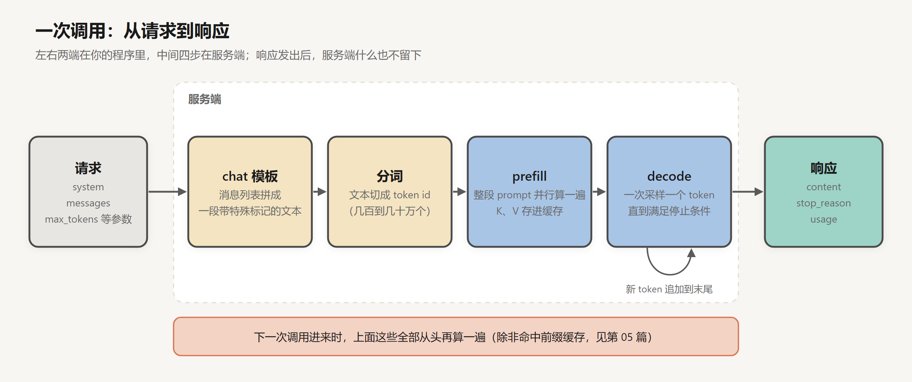
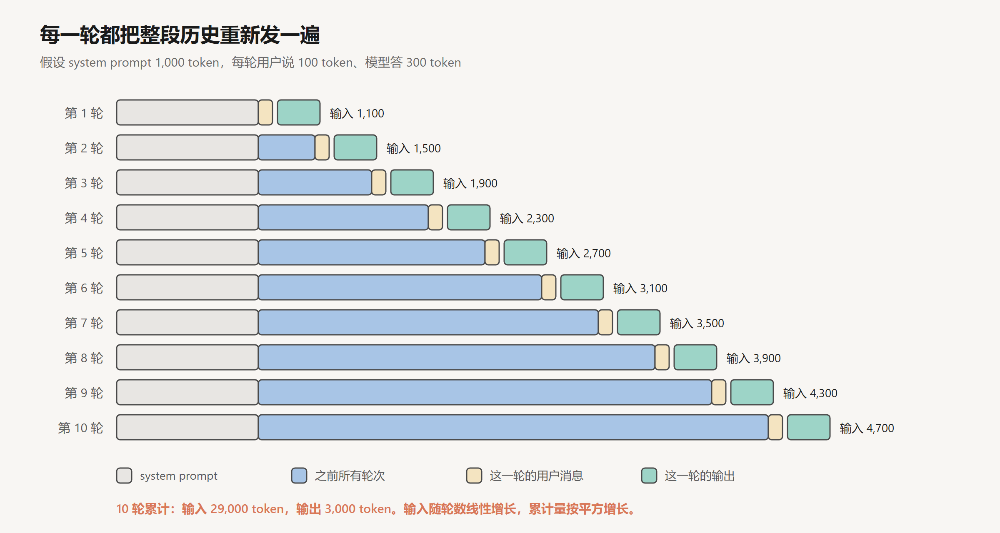
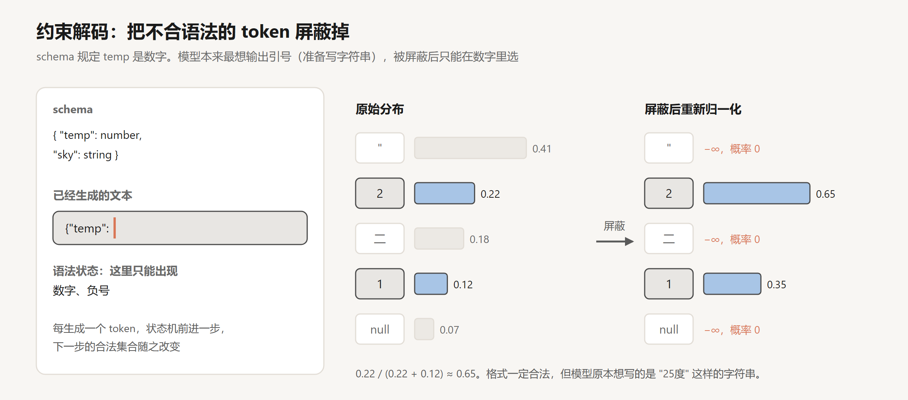

# 一次 API 调用里发生了什么

创建日期：2026-10-17

现在说起 agent，一般指能自己读代码、改文件、跑测试，一口气干几个小时的程序。把它拆到最底层，每一步其实都在做同一件事：调一次模型 API，拿回一段文本。

这个系列从这一次调用写起，一层一层往外加东西。这一篇只讲一次调用本身：请求里有什么，服务端做了什么，响应里有什么，以及光靠这一次调用，模型有哪些事做不到。后面十二篇，每一篇都在补其中的一项。

模型内部怎么算出下一个 token，[深度学习系列](../深度学习/README.md)里已经讲过。这里换到 API 调用方的角度来看。

## 1. 请求与响应

不管用哪家的 SDK，一次调用的形状都差不多。写成伪代码：

```text
response = model.call(
    system      = "你是一个简洁的助手。",
    messages    = [ {role: "user", content: "法国的首都是哪里？"} ],
    max_tokens  = 1024,
    temperature = 0.7,
)
```

返回的东西大致是：

```text
response = {
    content:     [ {type: "text", text: "巴黎。"} ],
    stop_reason: "end_turn",
    usage:       { input_tokens: 31, output_tokens: 5 },
}
```

（数字是示意。）请求里有三类东西：一段 system prompt，一个消息列表，几个控制生成的参数。响应里也是三类：生成的内容，停下来的原因，用了多少 token。

请求发出去以后，服务端做了下面这些事。



**拼模板。** 消息列表不会原样喂给模型。服务端先用 chat 模板把 system、user、assistant 这些消息拼成一段文本，每条消息的边界用特殊标记隔开。开源模型常见的是 ChatML 一类的格式，Anthropic 和 OpenAI 用的格式不公开，但做法是一样的。模板长什么样、为什么必须和训练时一致，在 [SFT 与 Chat 模板](../深度学习/大模型训练/02-SFT与Chat模板.md)第 3 节讲过。

**分词。** 文本切成 token id。一个汉字对应几个 token，各家分词器不一样，计费和上下文长度都按 token 算。

**prefill。** 整段 prompt 一次性送进模型，并行算完每个位置的 K 和 V，存进 KV Cache。prompt 越长，这一步算得越久，但它能并行，摊到每个 token 上很便宜。你在界面上等第一个字蹦出来的那段时间，主要花在这里。

**decode。** 从 prompt 末尾开始，一次生成一个 token：算出下一个位置的概率分布，按采样参数抽一个，追加到末尾，再算下一个。每一步只需要为新 token 算一次 Q、K、V，之前的 K、V 都从缓存里取（细节见 [KV Cache 与 Attention QKV](../深度学习/Transformer与大模型/03-KV-Cache与Attention-QKV.md)）。这一步没法并行，生成 500 个 token 就要串行走 500 步。

**组装响应。** 生成停下来以后，token 转回文本，连同停止原因和用量一起返回。

prefill 和 decode 的这个差别直接体现在价格上。主流 API 的输出单价一般是输入的 4 到 5 倍，因为输出的每个 token 都要单独占一次串行的前向计算，输入可以成批算。

## 2. 无状态：每轮重发全部历史

上面这张图里，最重要的是底下那行字：响应发出去以后，服务端什么也不留。

模型 API 是无状态的。你和 ChatGPT 聊了二十轮，它看起来记得前面说过的话，那是因为客户端每一轮都把前面的对话完整地再发一遍。一个最简单的聊天程序是这样的：

```text
history = []
loop:
    user_text = 读取用户输入
    history.append({role: "user", content: user_text})
    reply = model.call(system = SYSTEM, messages = history)
    history.append({role: "assistant", content: reply.text})
    显示 reply.text
```

这已经是一个循环了，只不过每一轮都由人来推动。到第 03 篇，推动循环的会换成模型自己。

### 2.1 输入随轮数增长

假设 system prompt 有 1,000 token，每轮用户说 100 token，模型答 300 token。第 $k$ 轮要发送的输入是：

$$
\text{input}_k = 1000 + 400(k-1) + 100
$$

第 1 轮是 1,100，第 10 轮是 4,700。十轮加起来：

$$
\sum_{k=1}^{10} \text{input}_k = 10 \times 1100 + 400 \times (0 + 1 + \cdots + 9) = 11000 + 18000 = 29000
$$

输出一共只有 $10 \times 300 = 3000$。



每一轮的输入随轮数线性增长，所以累计的输入按平方增长。聊天场景里，输入和输出的比例大约是 10 比 1。到了 agent 这里，每一轮塞进来的不是一句人话，而是一整个文件的内容、一大段测试日志，这个比例会大得多。第 05 篇会看到 Manus 给出的数字：大约 100 比 1。

这也说明了为什么服务端会做“前缀缓存”（prompt caching）：如果这一轮的开头和上一轮完全一样，那一段的 K、V 就不用重新算了。它能省多少钱，怎么让前缀尽量保持不变，是第 05 篇的主要内容之一。

### 2.2 历史由调用方掌控

无状态还有另一面：整段对话历史是调用方手里的一份数据，想怎么改就怎么改。

你可以删掉中间几轮，可以把一段很长的工具输出换成一句摘要，甚至可以伪造一条 assistant 消息，假装模型之前说过某句话。模型分不出来。对它来说，传进来的就是一段文本，哪些是它“真的”说过的，它没有任何办法知道。

有的接口允许你只写 assistant 消息的开头，让模型接着往下写，这叫预填（prefill，和上面计算意义上的 prefill 不是一回事）。比如把回答的开头写成 `{`，模型基本就只会接着写 JSON。不是所有模型和配置都支持这个功能，但它背后的道理是通用的：模型做的事就是续写，你给它什么开头，它就顺着什么往下写。

后面讲上下文工程、压缩、记忆，都是在决定这份历史里留什么、删什么、改成什么样。

## 3. 生成参数

几个最常用的参数。

**max_tokens。** 这次最多生成多少 token。它只是一个上限，模型不会为了凑够这个数而多写。写到上限就硬截断，哪怕一句话说到一半、一个 JSON 少了右括号。另外，输入加上输出不能超过模型的上下文窗口。

**temperature。** 采样前，把 logits 除以温度 $T$ 再做 softmax：

$$
p_i = \frac{\exp(z_i / T)}{\sum_j \exp(z_j / T)}
$$

$T$ 越小分布越尖，$T \to 0$ 时几乎总是选概率最大的那个；$T$ 越大分布越平，输出越发散。推导和例子见 [Transformer 结构详解](../深度学习/Transformer与大模型/02-Transformer结构详解.md)第 7.2 节。

有一个常见的误会：temperature 设成 0，输出就完全确定。实际并不是。同样的输入发两次，结果可能不一样。2025 年 Thinking Machines 的一篇文章追查过原因：服务端会把多个用户的请求拼成一批来算，批的大小每次都不同，而有些 GPU 算子在不同批大小下的浮点累加顺序不一样，结果就差了最后几位。这几位的差别足以让某一步的最大概率换一个 token，后面的输出就分岔了。所以评估 agent 的时候，同一个任务要跑多次，这个第 12 篇再细说。

**top_p、top_k。** 把候选范围限制在概率最高的那一部分 token 里，避免抽到长尾里很离谱的 token。一般和 temperature 二选一调整就够了。

**stop。** 停止序列。生成到这些字符串就停下。

开启扩展思考的时候，有些接口不允许改 temperature 等采样参数，用的是服务端固定的设置。

### 3.1 停止原因

响应里的 `stop_reason`（OpenAI 叫 `finish_reason`）是写 agent 时最该检查的字段：

| 停止原因 | Anthropic | OpenAI | 含义 |
|---|---|---|---|
| 自然结束 | `end_turn` | `stop` | 模型生成了结束标记，它认为自己说完了 |
| 达到上限 | `max_tokens` | `length` | 被 max_tokens 截断，内容可能不完整 |
| 命中停止序列 | `stop_sequence` | `stop` | 生成了你指定的某个字符串 |
| 要调用工具 | `tool_use` | `tool_calls` | 模型想调用工具，等你执行完把结果发回来 |

很多 agent 的 bug 出在第二行：没检查 `max_tokens`，把一段被截断的输出当成完整结果去解析。最后一行是下一篇的主角。

## 4. system prompt

system prompt 在模型结构里没有任何特殊待遇，它就是拼在序列开头的一段 token。它之所以管用，是因为 SFT 和后续训练的数据里有大量带 system prompt 的对话，回答都遵守了 system 里的设定。模型从这些样本里学到：这个位置的文字，要当成规则来遵守。[SFT 与 Chat 模板](../深度学习/大模型训练/02-SFT与Chat模板.md)第 6 节讲了这件事，也讲了指令层级（instruction hierarchy）：训练时专门让模型在 system 和 user 冲突时听 system 的，在 user 和工具返回的内容冲突时听 user 的。

这有两个后果。

一是遵守程度靠训练，不靠规则。模型大多数时候听 system 的，但不是每次都听。如果某条要求绝对不能被违反，就不能只把它写进 system prompt，还得在模型之外加一道检查。

二是 system prompt 每次调用都要重发，而且它在最前面。它写得越长，每一轮的成本越高；它一旦改动，后面的缓存就全部失效。对 agent 来说，system prompt 是 harness 里最早出现、也最常被调整的那部分，第 05 篇会讲它写到多细比较合适。

## 5. 结构化输出

只给人看的时候，输出是什么格式无所谓。一旦输出要交给程序处理，比如抽出一个日期写进数据库，或者判断要不要执行下一步，就需要它严格按某种格式来，通常是 JSON。

### 5.1 在提示里要求格式

最直接的做法是在 prompt 里写清楚格式，再给一两个例子。大多数时候能成功，但总有少数情况会出岔子：外面多包了一层 Markdown 代码块，结尾加了一句“希望对你有帮助”，少了一个字段，字符串里的引号没转义。于是调用方要写一层容错解析，解析失败就重试。

用预填把开头写成 `{` 能好一些，但仍然只是让出错的概率变小，没法保证不出错。

### 5.2 约束解码

要保证格式，就得在采样这一步动手。

做法是：服务端把 JSON Schema 编译成一个语法状态机。生成每一个 token 之前，先根据当前状态算出哪些 token 是合法的，把所有不合法 token 的 logit 设成 $-\infty$，再做 softmax 和采样。



图里的模型已经写到了 `{"temp": `，schema 规定 `temp` 是数字。原始分布里概率最高的是一个双引号，说明模型正准备写一个字符串，大概是“25度”之类。双引号、汉字“二”和 `null` 都被屏蔽，剩下 `2` 和 `1`，重新归一化后变成 0.65 和 0.35。

这样生成出来的东西一定能解析，一定符合 schema。OpenAI 在 2024 年 8 月给 API 加上了 Structured Outputs，Anthropic 在 2025 年底也支持了。开源推理框架里，Outlines、XGrammar 等库实现的是同一个思路。下一篇会看到，工具调用的参数也可以用这种方式约束。

### 5.3 约束解码的局限

上面那张图里还藏着一个问题：模型本来想写字符串，被强行掰成了数字。它这时候抽出 `2`，后面多半会接 `5`，结果凑巧是对的；但如果它原本想写的是“零下三度”，被逼着从数字开头，写出来的数就未必对了。

约束解码保证的是形状，不保证内容。而且已经有研究发现，对输出格式限制得越严，模型在推理类任务上的表现越差（Tam et al., 2024）。

一个实用的办法是先让模型想，再让它填。比如在 schema 里把一个 `reasoning` 字段放在 `answer` 字段前面。模型是从左往右生成的，写 `answer` 的时候，前面的推理已经在上下文里了。字段的顺序在这里是有影响的。如果模型支持扩展思考，也可以让它先在思考里推理，最后只输出受约束的 JSON。

## 6. 扩展思考

推理模型会在正式回答之前先生成一段思考。它是怎么用强化学习训练出来的，见 [推理模型与强化学习](../深度学习/大模型训练/04-推理模型与强化学习.md)。从调用方的角度看，思考本质上也是 decode 出来的 token，和回答走的是同一个自回归过程，只是模型写给自己看的。它按输出 token 计费，也算在 max_tokens 里。各家接口一般允许你设置思考的预算或强度。有的接口返回完整的思考内容，有的只返回摘要，有的完全不返回。

思考能提高很多任务的正确率，但它有一个根本的限制：它只能处理上下文里已有的信息。模型在思考里可以把一道数学题推导得很仔细，却没法在思考的途中查一下今天的汇率，也没法运行一下自己写的代码看看对不对。要拿到新信息，必须先停下来，让外面的程序去取。第 03 篇会讲到“交错思考”：模型在两次工具调用之间接着思考，这时候思考才真正和外部世界接上。

## 7. 一次调用的局限

做几个简单的实验，就能摸到一次调用的边界。

问它“今天上海天气怎么样”，它要么说不知道，要么根据季节编一个听起来合理的答案。让它“把 config.yaml 里的端口改成 8080”，它会输出一段修改后的文件内容，或者告诉你怎么改，但你磁盘上的文件一个字都没变。给它一篇三千字的文章，问里面有几个“的”字，它给出的数字多半是错的，而且说得很肯定。明天开一个新对话，它不记得今天聊过什么。

把这些归一下类：

| 做不到 | 原因 | 在哪一篇补上 |
|---|---|---|
| 不知道训练截止之后的事，也不知道你的私有数据 | 知识存在权重里，训练完就固定了 | 02 工具调用 |
| 不能对外部世界做任何事 | 它的输出只是一段文本 | 02 工具调用 |
| 精确计算、计数、长文本里找东西 | token 化把字符打包了，生成又是概率性的 | 02 工具调用（代码执行） |
| 一步做不完的任务 | 一次调用只有一次输出 | 03 Agent 循环 |
| 不知道自己做得对不对 | 输出之后没有任何反馈 | 04 反馈与验证 |
| 上下文有限，越长越贵，也越容易出错 | 无状态，每次都要全量重发 | 05 上下文工程、06 Skills |
| 跨会话不记得任何事 | 无状态 | 07 记忆 |
| 会一本正经地编 | 训练目标是写出像样的文本，不是说出真话 | 04 反馈与验证、10 模型这一侧 |

前面三行可以归成一句话：模型只能说，不能做。下一篇给它一个能“做”的接口。

## 小结

- 一次调用的请求里有 system prompt、消息列表和生成参数，响应里有内容、停止原因和用量。服务端依次做模板拼接、分词、prefill 和 decode。
- 模型 API 是无状态的。多轮对话靠客户端每次重发全部历史，累计的输入按轮数的平方增长。历史是调用方手里的数据，可以删、可以改，模型分辨不出来。
- temperature 为 0 也不能保证输出完全一样。`stop_reason` 一定要检查，尤其是被 max_tokens 截断的情况。
- system prompt 靠训练起作用，没有硬性保证。
- 约束解码通过屏蔽不合法 token 来保证输出格式，但不保证内容正确。需要推理的字段放在答案前面。
- 思考只能处理上下文里已有的信息。只靠一次调用，模型能说不能做，也不记得任何事。

## 参考

- Anthropic. *Messages API*. [文档](https://docs.claude.com/en/api/messages)
- Anthropic. *Prompt caching*. [文档](https://docs.claude.com/en/docs/build-with-claude/prompt-caching)
- Hugging Face. *Chat Templates*. [文档](https://huggingface.co/docs/transformers/chat_templating)
- He, H. & Thinking Machines Lab, 2025. *Defeating Nondeterminism in LLM Inference*. [博客](https://thinkingmachines.ai/blog/defeating-nondeterminism-in-llm-inference/)
- OpenAI, 2024. *Introducing Structured Outputs in the API*. [博客](https://openai.com/index/introducing-structured-outputs-in-the-api/)
- Willard & Louf, 2023. *Efficient Guided Generation for Large Language Models*. [arXiv:2307.09702](https://arxiv.org/abs/2307.09702)
- Tam et al., 2024. *Let Me Speak Freely? A Study on the Impact of Format Restrictions on Performance of Large Language Models*. [arXiv:2408.02442](https://arxiv.org/abs/2408.02442)
- Wallace et al., 2024. *The Instruction Hierarchy: Training LLMs to Prioritize Privileged Instructions*. [arXiv:2404.13208](https://arxiv.org/abs/2404.13208)
