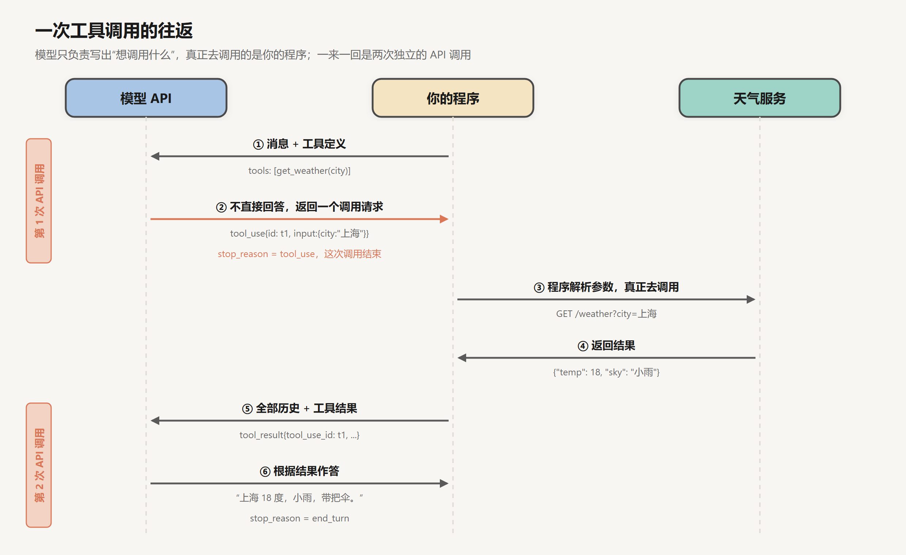
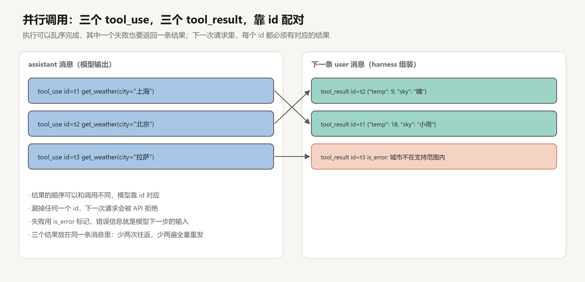
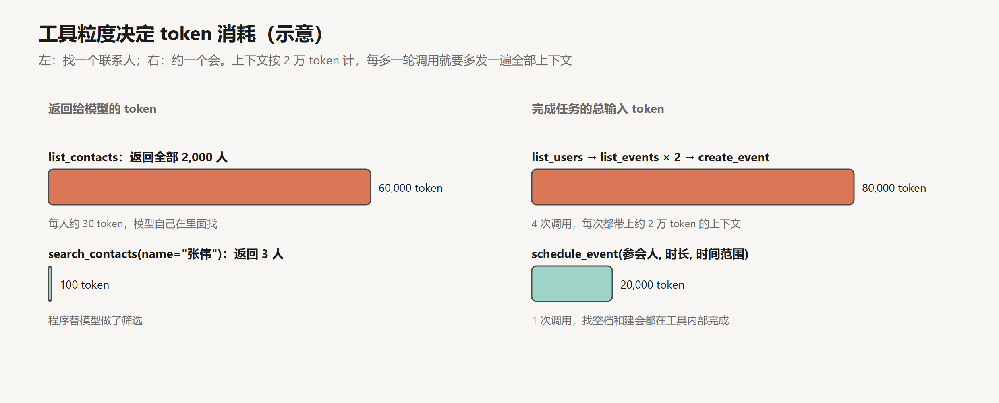
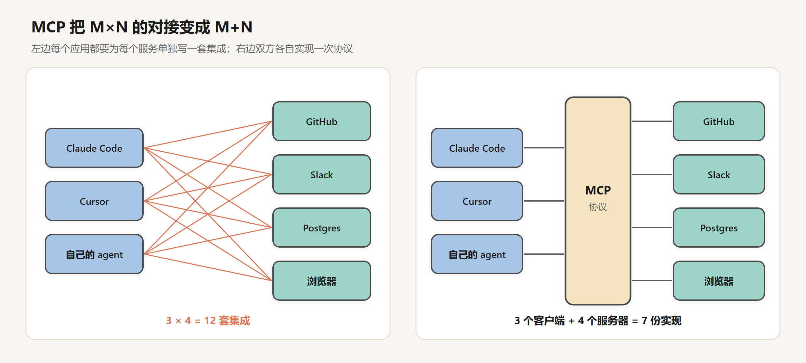

# 工具调用：协议、设计与 MCP

创建日期：2026-10-17

[上一篇](01-一次API调用.md)的结论是：一次调用只能输出文本，只能使用输入里已有的信息。工具调用没有改变这一点。模型仍然只输出文本，只不过有一部分文本是按约定格式写成的“动作描述”：要调用哪个工具，参数是什么。真正执行这个动作的，是调用方的程序。

这个分工决定了工具调用的全部性质。模型负责决定做什么，harness 负责执行、校验、限制权限、处理错误，并把结果写回上下文。工具的定义、调用和结果，最终都是上下文里的 token。所以设计一个工具，本质上是在设计模型的输入和输出接口：它决定模型能做什么，每做一次要消耗多少上下文，出了错能不能自己恢复。

这篇文章先把协议拆到消息层面，看每一步消息列表怎样变化；再看工具在 token 序列里的样子，以及调用方能在哪些环节施加约束；然后分析工具接口的设计怎样影响 token 消耗和出错率；最后讨论两类特殊的工具（Bash 和 computer use）和把工具标准化的 MCP。

## 1. 协议：消息列表的变化

### 1.1 工具定义

调用方在请求里多传一个 `tools` 字段。每个工具有三样东西：名字、说明、参数的 JSON Schema。

```text
tools = [
  {
    name: "get_weather",
    description: "查询某个城市当前的天气。只支持中国大陆的城市。",
    input_schema: {
      type: "object",
      properties: { city: {type: "string", description: "城市名，如“上海”"} },
      required: ["city"]
    }
  }
]
```

### 1.2 一来一回

用户问“上海现在天气怎么样”。整个过程分两次 API 调用，消息列表的变化如下。

第一次调用发出的消息：

```text
messages = [
  {role: user, content: "上海现在天气怎么样"}
]
```

模型判断需要查天气，不输出普通文本，而是输出一个 `tool_use` 块。这次调用结束，`stop_reason` 是 `tool_use`：

```text
{role: assistant, content: [
  {type: tool_use, id: "toolu_01", name: "get_weather", input: {city: "上海"}}
]}
```

harness 解析出名字和参数，去请求天气服务，拿到 `{"temp": 18, "sky": "小雨"}`。然后把模型的这条消息和一条新的 user 消息追加进历史，发起第二次调用：

```text
messages = [
  {role: user,      content: "上海现在天气怎么样"},
  {role: assistant, content: [tool_use(id="toolu_01", get_weather, {city: "上海"})]},
  {role: user,      content: [tool_result(tool_use_id="toolu_01",
                                          content='{"temp": 18, "sky": "小雨"}')]}
]
```

模型读到结果，输出“上海现在 18 度，小雨，出门带伞。”，`stop_reason` 是 `end_turn`。



几个细节值得逐一说明。

**模型从不接触外部系统。** 它做的只是写出一段格式正确的文本。执行什么、拦不拦、出错怎么处理，全部由 harness 决定。第 11 篇讲的权限和沙箱，都作用在这一步。

**一次工具调用至少是两次 API 调用。** 上一篇说过 API 没有状态，第二次调用要把第一次的全部内容连同工具结果重新发一遍。工具调用的轮数越多，累计的输入就越多。

**工具结果放在 user 消息里。** 从对话的角色看，工具结果是外部世界提供的信息，由调用方带进来，和用户的话属于同一侧。这也意味着工具结果和用户的话一样，是模型的输入而不是模型自己的输出，它的可信程度要另外判断（第 11 篇）。

### 1.3 为什么需要 id

`tool_use` 带着一个 id，`tool_result` 用 `tool_use_id` 指回它。只调用一个工具时，这看起来多余。一旦有多个调用，id 就是唯一能把结果和调用对应起来的东西。

模型可以在一次响应里输出多个 `tool_use`，比如同时查三个城市的天气。harness 可以并发执行它们，结果完成的先后顺序不确定，其中一个还可能失败。



三个结果放在同一条 user 消息里返回，顺序可以和调用不同，模型靠 id 对应。失败的那个也要返回一条结果，用 `is_error` 标记，内容是错误信息。API 对此有硬性要求：一条 assistant 消息里的每个 `tool_use`，在下一条 user 消息里都必须有对应的 `tool_result`，漏掉任何一个，下一次请求就会被拒绝。harness 的执行逻辑因此必须保证每个调用都有结果，不管成功、失败还是超时。

并行调用的收益可以直接算出来。三个调用如果串行进行，需要三次往返；并行只需要一次。设上下文为 $C$ 个 token，串行比并行多发送 $2C$ 个输入 token，也多两次 prefill 的等待。前提是这几个调用互相独立。第二个调用的参数如果依赖第一个的结果，比如先搜索文件、再读搜到的文件，就只能串行。

## 2. 序列里的工具调用

### 2.1 工具定义占上下文

服务端用模板把工具定义渲染进序列的开头，和 system prompt 放在一起，每次调用都要发送。一个工具的名字、说明和参数 schema，渲染后通常是一两百到几百个 token；说明写得详细、参数多的，可以到上千。

按每个工具平均 300 token 估算，30 个工具就是 9,000 token。这部分在每一轮都存在，是上下文里的固定成本。前缀缓存能让它的费用降到约十分之一，但它仍然占着窗口，也仍然在稀释模型的注意力：工具越多，模型在其中选错的概率越高。工具数量的问题在第 06 篇还会继续讨论。

### 2.2 调用也是生成出来的

模型输出的 `tool_use`，在 token 序列里是一段夹在特殊标记之间的结构化文本，里面是工具名和 JSON 参数。生成到工具调用的结束标记时，服务端停止 decode，把这段文本解析成 `tool_use` 块返回。上一篇 decode 循环里的 `tool_use` 出口就是这样来的。

模型会调用工具，是后训练教出来的：训练数据里有大量示范，教它什么时候该输出工具调用，参数怎么按 schema 填，拿到结果之后怎么继续（[SFT 与 Chat 模板](../深度学习/大模型训练/02-SFT与Chat模板.md)第 5 节）。工具结果在训练时不计算 loss，因为它是外部世界给的。

既然调用是采样出来的，上一篇讲的采样性质对它全部适用。模型可能少填一个必填字段，可能把数字写成字符串，可能调用一个不存在的工具名，也可能在该调用的时候直接回答，或者在不该调用的时候调用。

### 2.3 调用方能施加的约束

调用方可以在采样阶段约束工具调用，手段和上一篇的约束解码同源。

**严格模式。** 给工具打开 strict 选项，参数的生成就按 schema 做约束解码，生成出来的参数一定能解析，一定符合 schema。Anthropic 和 OpenAI 的接口都支持。

**tool_choice。** 控制模型是否调用、调用哪个：`auto` 由模型自己决定；`any` 要求必须调用某个工具；指定工具名要求必须调用那一个；`none` 禁止调用。“必须调用”在实现上等价于把输出的开头限定为工具调用，其他开头的 token 被屏蔽。有的接口在开启扩展思考时只允许 `auto` 和 `none`，因为强制调用会和“先思考”的开头冲突。

这些约束解决的都是格式问题。模型选了哪个工具、参数的值对不对，仍然取决于模型的判断，而判断的依据就是工具的名字、说明和参数说明。这是下一节的内容。

## 3. 执行侧

### 3.1 harness 的执行逻辑

模型输出 `tool_use` 之后，harness 要做的事远不止“调用函数”：

```text
for call in response.tool_uses:
    if call.name not in TOOLS:
        result = error(call.id, "没有名为 {call.name} 的工具，可用的工具有：……")
    elif not valid(call.input, TOOLS[call.name].schema):
        result = error(call.id, "参数不符合要求：{具体哪个字段，期望什么，收到什么}")
    elif not permitted(call):                         # 第 11 篇
        result = error(call.id, "这个操作需要用户批准，已被拒绝")
    else:
        try:
            out = run_with_timeout(call, seconds = 120)
            full_path = save_to_file(out)             # 原文落盘
            result = ok(call.id, truncate(out, 25000) + "\n完整输出见 " + full_path)
        except Timeout:
            result = error(call.id, "执行超过 120 秒，已终止。可以缩小范围后重试")
        except Exception as e:
            result = error(call.id, describe(e))
    results.append(result)
```

每一个分支都产生一条 `tool_result`，满足 1.3 节说的配对要求。原文落盘、上下文里只放截断后的内容，是第 05 篇讨论过的外存做法在工具层的落实。

### 3.2 错误信息是模型的下一个输入

工具出错时，harness 不应该抛出异常、终止循环，而应该把错误包成一条 `tool_result` 交还给模型。这条错误信息就是模型下一步决策的全部依据，它写得好不好，直接决定模型能不能自己恢复。

对比两种写法：

```text
is_error: true
content: "Error 400"
```

```text
is_error: true
content: "date 参数格式错误：需要 YYYY-MM-DD，收到的是“下周三”。
          今天是 2026-10-17（周六），请换算成具体日期后重试。"
```

第一种，模型只能猜：是日期错了，是城市错了，还是服务挂了。它可能换一个参数重试，也可能放弃，也可能把同样的请求再发一遍。第二种，错误的位置、期望的格式、换算需要的信息都给出来了，模型下一轮几乎一定能改对。

Python 的 traceback 介于两者之间。它包含了位置信息，但大量篇幅是调用栈，模型要从几十行里找出真正有用的那一行，还要花上下文。把异常翻译成一两句可以直接据以行动的话，是工具实现的一部分。

## 4. 工具接口的设计

Anthropic 在 2025 年 9 月的《Writing effective tools for agents》里有一个说法：传统的 API 是两个确定性系统之间的契约，工具是确定性系统和一个不确定的 agent 之间的契约。agent 会选错工具、填错参数，也会完全没想到要用某个工具。这一节从 token 消耗和出错率两个角度，分析几条设计原则背后的原因。

### 4.1 粒度

最省事的做法是把现成的 API 一个个包成工具：有 `list_contacts` 接口就做一个 `list_contacts` 工具。这对程序是合理的，程序遍历两千条记录几乎不花时间。对 agent 来说，这两千条记录要全部进入上下文。



按每个联系人 30 token 算，`list_contacts` 一次返回 60,000 token，而且这 60,000 token 会留在历史里，此后每一轮都要重新发送。换成 `search_contacts(name)`，程序先做筛选，返回三个同名的人，约 100 token。工具设计在这里做的事情，是把筛选这类确定性的工作留在程序里，只把需要判断的部分交给模型。

几个总是连在一起用的操作，合并成一个工具也有类似的效果。约一个会议，如果拆成 `list_users`、两次 `list_events`（查两个人的日程）、`create_event`，至少要 4 次调用，每次都要带上全部上下文。上下文按 2 万 token 计，就是 8 万输入 token，还没算日程数据本身。合并成 `schedule_event(参会人, 时长, 时间范围)`，找空档和建会议都在工具内部完成，一次调用、2 万输入 token。

Anthropic 那篇文章里的例子都是这个思路：用 `search_logs` 只返回相关的日志行，而不是用 `read_logs` 把整个日志倒出来；用 `get_customer_context` 一次汇总客户资料、最近的交易和备注，而不是让 agent 分别调用三个工具再自己拼起来。

粒度也不是越粗越好。工具做得太多，参数就多，模型更难填对；一个工具内部包含多个步骤，中间某一步出错时，返回的信息也更难让模型判断该怎么办。判断的标准是：这一组操作是否总是一起出现，中间是否需要模型的判断。总是一起出现、中间不需要判断的，合并；中间需要判断的，拆开。

### 4.2 返回值

工具返回什么，决定了模型下一步能做什么，也决定了上下文的增长速度。

**用有意义的标识。** 返回 `{"assignee": "张三"}` 比返回 `{"assignee_id": "a7f3c9e2-41b8-4d0e-9f6a-2c5e8b1d7a90"}` 好。一个 UUID 有 36 个字符，切成 token 往往有二三十个，而且是一串没有语义的字符。模型在后续调用里需要原样抄写它时，抄错一位就会查不到。只有后续调用确实需要 id 时，才把 id 带上。

**让模型选择详细程度。** Anthropic 的做法是给工具加一个 `response_format` 参数，取值 `concise` 或 `detailed`。他们用 Slack 的一条消息线程测过：详细格式 206 个 token，带着 `thread_ts`、`channel_id` 这些后续操作需要的 id；精简格式 72 个 token，约为三分之一。只想看讨论内容时用精简版，要回复某条消息时再用详细版。

**分页、过滤、截断，并且说明。** 任何可能返回大量数据的工具，都要有分页或过滤参数，并设一个合理的默认上限。Claude Code 默认把单次工具返回限制在 25,000 token。截断时要明确告诉模型内容被截断了，以及怎样拿到需要的部分，比如“共 3,200 条，只显示前 50 条，可以用 `query` 参数缩小范围”。没有这句话，模型会把前 50 条当成全部结果。

### 4.3 命名与说明

模型决定调用哪个工具、怎样填参数，依据只有工具的名字、说明和参数说明。

工具多了以后，名字容易冲突，功能也容易混淆。一个 agent 同时接了 Asana 和 Jira，两边都有“搜索”，叫 `search` 就分不清。加上前缀，`asana_search`、`jira_search`，再细一点，`asana_projects_search`、`asana_users_search`。Anthropic 提到，前缀还是后缀对评估结果有影响，而且不同模型的偏好不一样。

说明要写得像给一个刚入职的同事解释这个工具。那些写的人觉得理所当然的东西，比如查询语法、某个术语的含义、几个资源之间的关系，新同事不知道，模型也不知道。参数名要直白，用 `user_id` 而不是 `user`。

这件事的影响可以很大。Anthropic 提到，他们在 SWE-bench Verified 上测 Claude 3.5 Sonnet 时，对工具说明做了一些精确的修改，错误率大幅下降，拿到了当时的最好成绩。另一个例子是，Claude 在调用网页搜索时总在 `query` 后面加上“2025”，把搜索结果带偏了，修改工具说明之后问题就消失了。他们还让 Claude 读评估运行的记录，找出工具哪里让它困惑，再改写说明和实现；在 Slack 和 Asana 两组内部工具的留出测试集上，改写后的版本比人写的版本表现更好。

## 5. 通用工具：Bash 与代码执行

前面讨论的都是功能专一的工具。另一类工具只有一个，什么都能做：Bash。

有了执行 shell 命令的能力，agent 可以用 `ls` 看目录，`grep` 搜代码，`cat` 读文件，`git` 看历史，`curl` 访问网络，`python` 跑一段脚本。这些命令在预训练语料里出现了无数次，模型早就会用，不需要逐个写工具定义。上一篇说模型数不准一篇文章里有几个“的”，交给一行 Python 就解决了。LangChain 的 Trivedy 在讨论 harness 的文章里把 Bash 和代码执行称为通用工具：与其预先设计好 agent 需要的每一个动作，不如给它一个能自己造工具的工具。

Bash 什么都能做，编程 agent 却仍然提供读文件、编辑文件、搜索这些专用工具。原因在下面的比较里：

| 方面 | 用 Bash | 用专用工具 |
|---|---|---|
| 权限 | `cat` 可以读任何文件，权限只能按命令整体判断 | `read_file` 可以限定在项目目录内，按路径判断 |
| 输出 | `cat` 一个大文件，全部内容进入上下文 | 可以带行号、按范围读取、超长自动截断 |
| 编辑 | `sed` 的正则写错一个字符，可能改坏多处 | 字符串替换要求原文精确唯一出现，否则报错 |
| 结果 | 输出的格式由命令决定，五花八门 | 返回格式固定，错误信息可以专门设计 |

所以 Claude Code、Codex 这类编程 agent 的工具集，通常以 shell 为核心，再加上少数专用工具，覆盖最频繁、最需要控制的那几类操作。

Bash 的代价是风险。能执行任意命令的 agent，也能执行 `rm -rf`，也能把密钥发到任何地方。能力越通用，越难在工具层面控制，控制就只能下沉到操作系统层面，也就是第 11 篇讲的沙箱。

## 6. computer use

还有一类工具不需要对方提供任何 API：直接操作图形界面。

computer use 的工具很简单：一个截图动作，加上一组鼠标和键盘动作（移动、点击、拖拽、输入文字、按快捷键）。模型看到截图，判断该点哪里，输出一个带像素坐标的点击动作；harness 执行后再截一张图发回去。Anthropic 在 2024 年 10 月随 Claude 3.5 Sonnet 推出了这个功能的公测，OpenAI 随后推出了 Operator。

这种方式的成本可以估算。Anthropic 的文档给出的图片 token 估算公式是 $\text{宽} \times \text{高} / 750$。一张 1280×800 的截图约 1,365 个 token。一个 30 步的任务，每步一张截图，光截图就有约 4 万 token。而且按上一篇的无状态推导，每张截图进入历史后，后面每一轮都要重新发送，累计输入同样按平方增长：

$$
\sum_{k=1}^{30} 1365\,k = 1365 \times 465 \approx 63 \text{ 万 token}
$$

这还没算模型的输出和其他内容。harness 通常会只保留最近几张截图，把更早的替换成文字描述，这正是第 05 篇讨论的清除旧工具结果。

衡量这类能力的常用基准是 OSWorld：在真实的操作系统里完成几百个任务，比如把一个表格里的数据做成图表。2024 年的 OSWorld 论文里，人类的完成率约为 72%，当时最好的模型约为 12%。之后进步很快，但截图加点击仍然比调用 API 慢得多、贵得多。实际做法通常是能用 API 就用 API，能读网页的 DOM 或无障碍树（accessibility tree）就不看截图，没有别的办法时才用截图。DOM 是结构化的文本，按钮、链接、输入框都有明确的标识，模型不需要从像素里认出它们，token 也少得多。

## 7. MCP

### 7.1 M×N 的集成

工具多了，就有一个工程问题。3 个 agent 应用（Claude Code、Cursor、自己写的 agent）要接 4 个服务（GitHub、Slack、Postgres、浏览器），如果每个应用都为每个服务单独写一套集成，就是 12 套，而且写法各不相同。



MCP（Model Context Protocol）是 Anthropic 在 2024 年 11 月开源的协议。服务方按协议实现一个 MCP server，把能力暴露出来；应用方实现一个 MCP client，就能接入任何 MCP server。3 个应用加 4 个服务，只需要 7 份实现。这和语言服务器协议（LSP）的思路一样：LSP 让一个编辑器支持所有语言，一种语言的支持也能用在所有编辑器上。

### 7.2 协议的内容

MCP 的消息格式是 JSON-RPC 2.0。一次典型的交互是：

```text
client → server:  initialize            # 交换协议版本和各自支持的能力
client → server:  tools/list            # 获取工具列表：名字、说明、参数 schema
...
（模型输出 tool_use）
client → server:  tools/call {name, arguments}
server → client:  {content: [...], isError: false}
```

server 除了工具（tools），还可以提供资源（resources，可以读取的数据，比如文件、数据库记录）和提示模板（prompts）。传输方式有两种：本地进程之间用标准输入输出（stdio），远程服务用 HTTP。

从模型这一侧看，MCP 没有引入任何新机制。client 连上 server 后，把 `tools/list` 拿到的工具列表转换成普通的工具定义，放进请求的 `tools` 字段；模型输出 `tool_use`，client 把它转发成 `tools/call`，再把结果包成 `tool_result`。模型不知道、也不需要知道某个工具来自 MCP。MCP 标准化的是工具的提供方式，不是工具调用本身。

### 7.3 代价

接入 MCP server 很容易，所以也很容易接多。每个 server 带来一批工具，按 2.1 节的估算，接五六个 server、几十个工具，定义就可能占掉上万 token，而一次任务用到的只有其中几个。Claude Code 的应对办法是延迟加载：工具很多时，一部分工具只把名字放进上下文，模型需要时再调用一个搜索工具，把完整的定义取回来。这和第 06 篇讲的 skill 三级加载是同一个思路。

另一个代价是安全。MCP server 是第三方的代码，它提供的工具说明和返回结果都会原样进入模型的上下文。一个恶意的或者被攻破的 server，可以在工具说明里藏指令，让模型在调用其他工具时做额外的事；也可以在用户批准之后修改工具定义。说明和结果都是模型的输入，第 11 篇讲的注入攻击对它们同样适用。

### 7.4 现状

MCP 推出一年里被广泛采用，ChatGPT、Gemini、VS Code、Cursor 等都支持了。2025 年 12 月，Linux 基金会成立了 Agentic AI Foundation（AAIF），首批项目是 Anthropic 捐出的 MCP、Block 的 agent 框架 goose，以及 OpenAI 的 AGENTS.md（一种给编程 agent 写项目说明的文件约定，第 07 篇会讲）。按 Linux 基金会的公告，当时已有超过一万个 MCP server。

## 8. 结论

工具调用的核心是分工：模型生成对动作的描述，harness 执行动作并把结果写回上下文。这个分工带来了几条可以直接推出的结论。

协议层面，每个 `tool_use` 都要有一条对应的 `tool_result`，成功、失败、超时都不例外；id 是并行调用时唯一的对应关系。每多一轮工具调用，就多一次往返和一遍全量输入，能并行的调用应该放在同一轮。

采样层面，工具调用和普通输出一样是生成出来的。格式可以用严格模式和 tool_choice 保证，选择哪个工具、填什么值，只能靠工具的名字和说明去影响。

设计层面，工具是模型的输入和输出接口。它的粒度决定了有多少数据进入上下文、要多少轮调用才能完成任务；它的返回值决定了上下文的增长速度和后续调用的出错率；它的错误信息决定了模型能否自行恢复。确定性的筛选和组合应该留在工具内部，需要判断的部分交给模型。

通用工具和标准化协议扩大了 agent 的能力范围，也把成本和风险一起带了进来：Bash 让权限只能在操作系统层面控制，computer use 让每一步都带上一张截图，MCP 让工具定义和第三方内容不断涌入上下文。

到这里，模型能通过工具做一件事了。但真实任务很少一步就能完成，下一步做什么，取决于上一步看到了什么。把这里的一次调用放进循环，就是下一篇的 agent。

## 参考

- Anthropic, 2025. *Writing effective tools for agents — with agents*. [博客](https://www.anthropic.com/engineering/writing-tools-for-agents)
- Anthropic. *Tool use with Claude*. [文档](https://docs.claude.com/en/docs/agents-and-tools/tool-use/overview)
- Anthropic. *Vision*（图片 token 估算）. [文档](https://docs.claude.com/en/docs/build-with-claude/vision)
- Anthropic, 2024. *Introducing the Model Context Protocol*. [博客](https://www.anthropic.com/news/model-context-protocol)
- Model Context Protocol. *Specification*. [文档](https://modelcontextprotocol.io/)
- Linux Foundation, 2025. *Linux Foundation Announces the Formation of the Agentic AI Foundation*. [公告](https://www.linuxfoundation.org/press/linux-foundation-announces-the-formation-of-the-agentic-ai-foundation)
- Anthropic, 2024. *Introducing computer use, a new Claude 3.5 Sonnet, and Claude 3.5 Haiku*. [博客](https://www.anthropic.com/news/3-5-models-and-computer-use)
- Xie et al., 2024. *OSWorld: Benchmarking Multimodal Agents for Open-Ended Tasks in Real Computer Environments*. [arXiv:2404.07972](https://arxiv.org/abs/2404.07972)
- Trivedy, V. (LangChain), 2026. *The Anatomy of an Agent Harness*. [博客](https://www.langchain.com/blog/the-anatomy-of-an-agent-harness)
