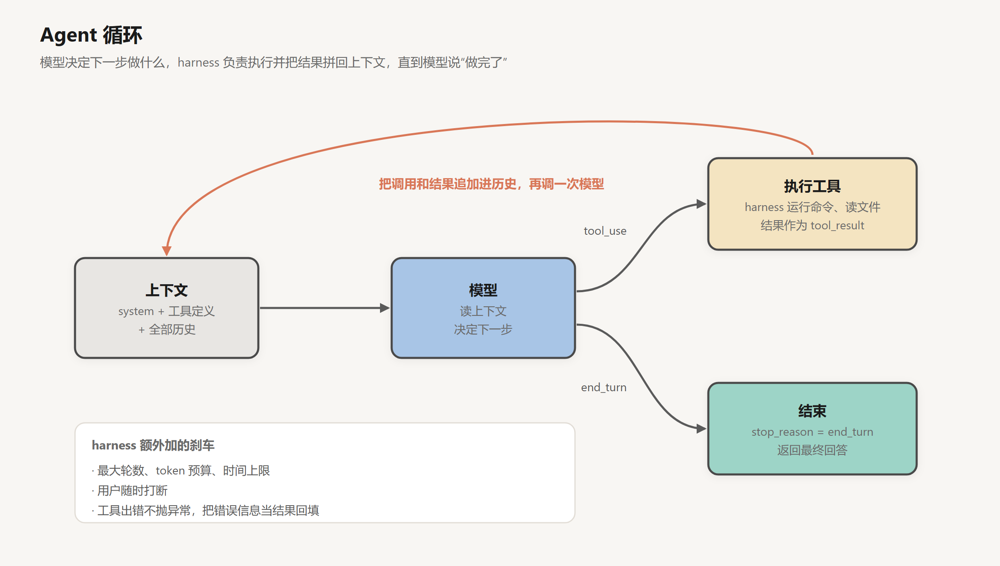
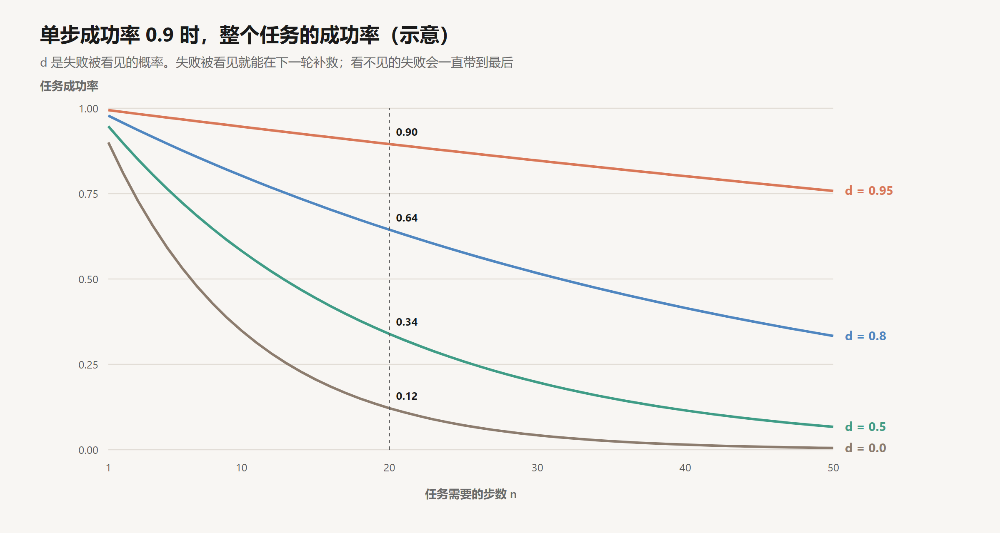
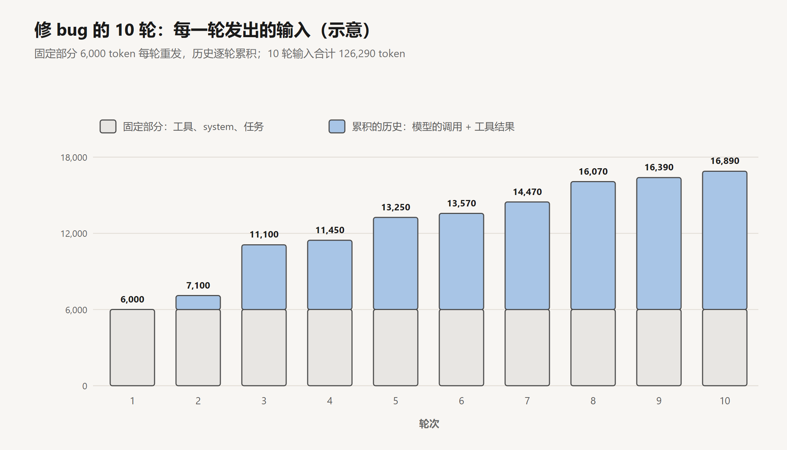
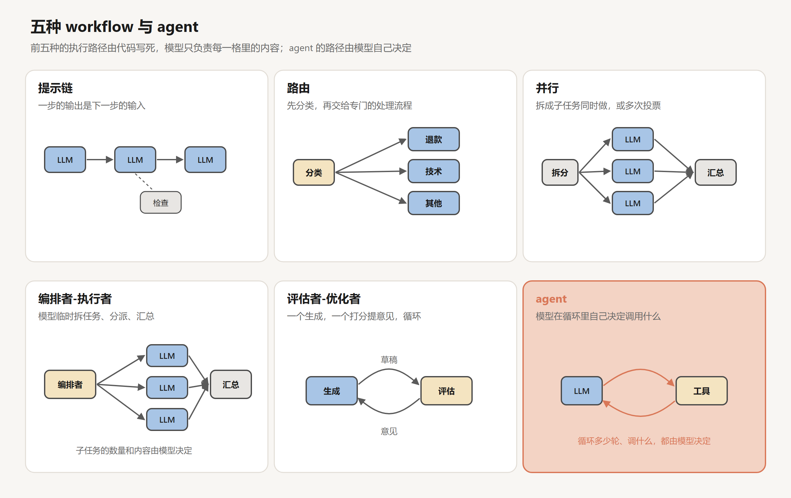
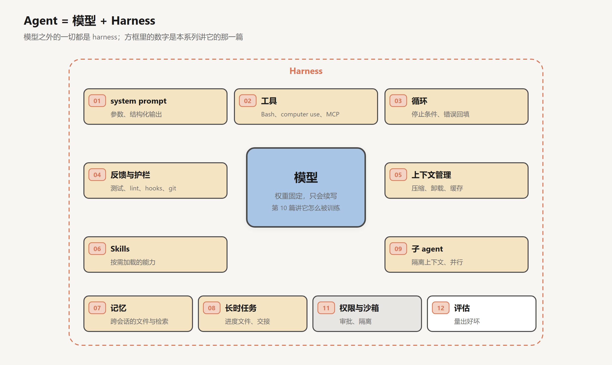

# Agent 循环与 Harness

创建日期：2026-10-17

[上一篇](02-工具调用.md)的工具调用里，路径是调用方写死的：调一次模型，执行它要的工具，把结果交回去，拿到回答。agent 循环只改了一件事，把“下一步做什么”和“什么时候停”交给模型决定。代码只多了一个 `while`，系统的性质却变了。

控制流交出去以后，有四件事随之成立。第一，要执行多少轮不再确定，取决于模型每一轮看到了什么。第二，模型每一轮的决定只能依据消息列表里的内容，消息列表就是这个系统的全部状态。第三，每一步的错误都会沿着后面的轮次传下去，除非它在某一轮被看见并被纠正。第四，“任务完成了”本身也是模型的一次判断，和其他输出一样可能出错。

所以 agent 的可靠性不取决于循环本身，循环谁来写都是十几行。它取决于循环外面那层代码：给模型的决定提供什么信息，在哪里拦住它，让哪些错误能被看见，花费怎样增长。这层代码就是 harness。这篇文章先把循环拆开，看它的状态、终止条件和错误处理；再计算每轮的成本和错误在多步任务里的累积，说明 harness 的基本部件是从哪些约束里推出来的；然后讨论 workflow 和 agent 的分界；最后给出这个系列使用的定义：Agent = 模型 + Harness。文中构造的例子和数字都是示意，可以手算核对。

## 1. 循环的结构

### 1.1 伪代码

```text
messages = [ {role: user, content: task} ]
turns, spent = 0, 0

while true:
    if turns >= MAX_TURNS or spent >= BUDGET or user_interrupted():
        return stop("刹车", messages)

    r = model.call(system = SYSTEM, tools = TOOLS, messages = messages)   # 带重试
    turns += 1
    spent += cost(r.usage)
    messages.append({role: assistant, content: r.content})

    switch r.stop_reason:
        case "end_turn":                       # 模型认为做完了，或需要问用户
            return r.text
        case "tool_use":
            results = []
            for call in r.tool_uses:
                results.append(run_tool(call))  # 每个调用都必须有一条结果
            messages.append({role: user, content: results})
        case "max_tokens":                     # 输出被截断
            messages = handle_truncation(messages, r)
        case "pause_turn":                     # 服务端工具执行时间较长，原样续上
            continue
        case "refusal":
            return stop("模型拒绝", messages)
```

`run_tool` 就是上一篇第 3 节那段执行逻辑：查工具名、校验参数、检查权限、执行、截断，任何一步失败都包成一条带 `is_error` 的 `tool_result` 返回，不抛异常。



和上一篇相比，变化有两处。`if` 换成了 `while`，循环可以跑任意多轮；退出循环的主出口是 `end_turn`，这个值由模型的输出决定。其余几个出口，刹车、截断、拒绝，都是 harness 为这个交出去的控制流补的边界。

### 1.2 状态：消息列表

这个循环里，跨轮次保存的东西只有两类。

一类是消息列表。上一轮发生了什么、读到了什么、改了什么，全部以消息的形式写在这里。第 01 篇说过 API 没有状态，模型每一轮都是从头读完整个列表再做决定，它对任务进度的全部了解都来自这份列表。列表里没有的信息，对模型来说就不存在。

另一类是 harness 自己的账：轮数、累计花费、每个文件最后一次被读取时的内容（第 05 篇提到的编辑校验就靠这个）、已经批准过的权限。这些状态模型看不到，除非 harness 把它们写成文本放进消息里。比如预算快用完时插一句“剩余预算约 5 轮”，模型才可能据此收尾。

“状态全在消息列表里”有几个直接的工程后果。

**可以中断和恢复。** 把消息列表序列化存盘，之后读回来接着调用模型，循环就从断点继续，模型分不出中间是否停过。Claude Code 的 `--continue` 和 `--resume` 就是这样恢复会话的。

**可以分叉。** 复制一份消息列表，在副本上尝试另一种做法，失败了就丢掉副本。

**人可以插话。** 用户在任务中途补充要求，harness 把它作为一条 user 消息追加，下一轮模型就会读到。这里有一个协议上的约束：如果模型上一条消息里有 `tool_use`，下一条 user 消息里必须先给出全部对应的 `tool_result`，用户的话只能排在它们后面。用户在工具执行到一半时按下中断，harness 也要为没跑完的调用补一条结果，比如“用户中断了这次调用”，否则下一次请求会被 API 拒绝。

**状态的质量就是决策的质量。** 消息列表只追加、不更新，它记录的是按时间排列的观察，而不是世界的当前状态（第 05 篇第 1.3 节）。模型据此做的每个决定，都受这份记录的完整性和时效限制。

### 1.3 一轮里发生了什么

一轮循环在时间上分三段。

**prefill。** 服务端读入整个输入，计算 KV cache。输入越长越慢，命中前缀缓存的部分可以跳过。

**decode。** 模型逐个生成输出 token：思考、简短的说明、工具调用的 JSON。这一段按输出长度线性增长，开启思考时通常是一轮里最慢的部分。

**工具执行。** harness 运行工具。`grep` 和读文件是毫秒级，跑一遍测试可能要几秒到几分钟，安装依赖或编译可能更久。

三段串行，下一轮必须等这一轮的工具结果回来才能开始。一个十几轮的小任务，每轮几秒，加起来就是一两分钟；同一轮里的多个独立调用可以并发执行（上一篇第 1.3 节），这是缩短总时间最直接的办法。

## 2. 一次修 bug 的过程

任务是：“用户反馈注册接口在邮箱带大写字母时报错，修一下。”下表是循环跑完的 10 轮。“输入”列是这一轮发给模型的 token 数，“新增”列是这一轮结束时追加进历史的 token 数（模型的调用约 200，加上工具结果）。

| 轮 | 模型的动作 | 拿到的结果 | 输入 | 新增 |
|---|---|---|---|---|
| 1 | `grep -rn "register" src/` | 十几行匹配，定位到 `src/api/auth.py` | 6,000 | 1,100 |
| 2 | 读 `src/api/auth.py` | 注册函数调用了 `validate_email()` | 7,100 | 4,000 |
| 3 | `grep -rn "def validate_email" src/` | 在 `src/utils/validators.py` | 11,100 | 350 |
| 4 | 读 `validators.py` | 正则是 `^[a-z0-9._]+@[a-z0-9.]+\.[a-z]+$`，不含大写字母 | 11,450 | 1,800 |
| 5 | 给正则加上忽略大小写的标志 | 修改成功 | 13,250 | 320 |
| 6 | `pytest tests/test_validators.py` | 2 个通过，1 个失败：测试期望邮箱存成小写 | 13,570 | 900 |
| 7 | 读这个失败的测试 | 系统的约定是校验时忽略大小写、存储时统一转小写 | 14,470 | 1,600 |
| 8 | 在注册函数里加上 `email.lower()` | 修改成功 | 16,070 | 320 |
| 9 | 再跑一遍测试 | 全部通过 | 16,390 | 500 |
| 10 | 不再调用工具，汇报改了什么 | `end_turn` | 16,890 | — |

第 1 轮的 6,000 是固定部分：工具定义、system prompt 和用户的任务。之后每一轮的输入，等于上一轮的输入加上上一轮的新增。

这张表可以从三个角度读。

**前四轮都在定位。** 模型一开始对代码库一无所知，只能从搜索开始，一步步缩小范围。这四轮的质量主要取决于工具：`grep` 返回多少行、读文件能不能只读一段，决定了要几轮才能找到目标，也决定了这几轮往历史里加了多少 token。第 2 轮读入整个 `auth.py`，一次新增 4,000，而后面真正用到的只有其中一行函数调用。

**第 6 轮的失败带来了新信息。** 测试告诉模型一件它从代码里看不出来的事：存储时要转小写。没有这个测试，模型在第 5 轮之后就会结束，留下一个隐藏的 bug，而它的汇报会写得和第 10 轮一样笃定。这个失败之所以有价值，是因为它被看见了。第 4 节会把这一点算出来。

**每一轮都比上一轮贵。** 第 10 轮的输入是第 1 轮的 2.8 倍，而这只是一个两处修改的小 bug。第 5 节计算这种增长。

## 3. 终止

### 3.1 正常终止是一次判断

循环的主出口是 `end_turn`：模型这一轮不再调用工具，直接输出文字。它表示两种情况之一，模型认为任务完成了，或者认为缺少信息、需要问用户。

这个出口和其他输出一样，是采样出来的。它有两种错法。

**过早结束。** 模型认为做完了，其实没有。上表第 5 轮之后如果没有测试，就是这种情况。过早结束不会触发任何报错，循环正常退出，汇报读起来也很完整，只有在后续检查或者用户使用时才会暴露。

**迟迟不结束。** 模型反复做同样的事：读同一个文件，重试同一个失败的命令，在两种改法之间来回切换。这种情况容易发现，代价是钱和时间。

两种错误的处理方式不同。迟迟不结束可以用刹车兜住；过早结束只能靠在模型宣布完成之前或之后做验证，这是第 04 篇的主题。harness 也可以拦截 `end_turn`：模型想结束时，先跑一遍检查，检查不通过就把结果作为新消息追加进去，让循环继续。Claude Code 的 Stop hook 就提供了这个时机。

### 3.2 刹车

harness 至少要设四道刹车：最大轮数、token 或费用预算、墙钟时间上限、用户随时打断。它们都在每轮开始前检查，任何一道触发就退出循环。

刹车的阈值是一个权衡。设得太紧，正常的长任务做到一半被掐断，前面花的钱白花；设得太松，失控时的损失大。比较合理的做法是看历史运行的分布：成功完成的任务一般跑多少轮，把上限设在这个分布的高分位之外，比如成功任务轮数的 95 分位再乘一个系数。这要求先有足够多的运行记录，第 12 篇讲评估时会再提到。

刹车触发时，直接退出不是唯一的选择。harness 可以先追加一条消息，告诉模型“已接近上限，请总结当前进展和剩余工作”，再给它一两轮收尾。这样即使任务没做完，留下的也是一份可以接着做的交接，而不是一段戛然而止的历史。第 08 篇讲长时任务时，会把这种交接做成标准流程。

### 3.3 卡住的检测

最大轮数能兜住所有的死循环，但要等到上限才触发。有些循环可以更早识别出来：

- 同一个工具、同样的参数，在最近几轮里出现了多次；
- 同一条报错信息连续出现；
- 两次编辑互相撤销，文件内容回到之前的某个版本。

检测的办法很直接，把最近若干轮的（工具名，参数）或者报错文本做哈希，统计重复次数。命中以后，比起直接终止，更有用的做法是追加一条提示，指出重复本身，比如“这个命令已经以同样的方式失败了三次”。模型陷入重复，往往是因为同样的失败信息被淹没在长长的历史里，它没有意识到自己在原地打转。把重复指出来，相当于把这个事实放到它注意得到的位置。

### 3.4 其他停止原因

`stop_reason` 除了 `end_turn` 和 `tool_use`，还有几个值需要单独处理。

**max_tokens。** 输出达到了请求里设的 `max_tokens` 上限。如果截断发生在普通文本里，可以把截断的输出留在历史中，让模型接着写。如果截断发生在工具调用的 JSON 中间，这个调用是残缺的，无法执行，常见的处理是丢掉这条残缺的消息，调大 `max_tokens` 重新请求。这种情况常见于模型一次性写入一个大文件，工具的参数本身就很长。

**pause_turn。** 用的是服务端执行的工具（比如服务端的网页搜索）时，服务端可能在一轮执行时间过长时先暂停并返回。harness 把这条响应原样追加，再发一次请求，服务端就会接着做。

**refusal。** 模型出于安全原因拒绝继续。这时继续循环没有意义，应该退出并把情况交给人。

模型调用本身也会失败：限流（HTTP 429）、服务端过载（Anthropic 的 529）、网络超时。这些错误发生在模型之外，和任务无关，harness 应该带退避地重试，不要写进消息列表让模型看到。

## 4. 错误回填

### 4.1 错误的四种去向

循环里出现的错误可以按“谁发现、怎么处理”分成四类。

| 类别 | 例子 | 谁发现 | 怎么处理 | 模型看得到 |
|---|---|---|---|---|
| 基础设施错误 | 限流、过载、网络超时 | harness | 重试，超过次数后退出 | 否 |
| 调用错误 | 工具名不存在、参数不合 schema、权限被拒、命令返回非零 | harness 或工具 | 包成 `is_error` 的 `tool_result` 回填 | 是 |
| 结果错误 | 测试失败、编译报错、页面上找不到预期的元素 | 环境 | 作为普通的工具结果回填 | 是 |
| 静默错误 | 改错了但没有任何检查覆盖到 | 无 | 无 | 否 |

前三类会被看见，最后一类不会。对一个只追加的消息列表来说，看不见的错误不会被纠正，它会变成后面所有决定的前提。上表第 5 轮如果没有测试，“正则已修好”就会作为一个事实留在历史里，模型后面的每一步都建立在这个错误的事实上。

调用错误和结果错误都回填给模型，这是 agent 能自我纠正的前提。上一篇第 3.2 节讲过错误信息的写法：它是模型下一轮的输入，写得越具体，模型越容易在一轮之内改对。

### 4.2 错误在多步任务里怎样累积

可以用一个简单的模型估算回填的效果。

设任务需要 $n$ 步，每一步独立地以概率 $p$ 做对，以概率 $q = 1 - p$ 做错。做错时，错误以概率 $d$ 被看见（报错、测试失败），以概率 $1 - d$ 不被看见。被看见的错误在下一轮重做这一步，重做的成功率仍然是 $p$；没被看见的错误一直留到最后，任务失败。

不回填错误，相当于 $d = 0$，任务成功率是 $p^n$。

有回填时，每一步可能经过若干次尝试。每次尝试有三种结果：成功（概率 $p$），失败且被看见、再试一次（概率 $qd$），失败且没被看见、任务就此注定失败（概率 $q(1-d)$）。一步最终成功的概率是一个几何级数的和：

$$
s = p + qd \cdot p + (qd)^2 p + \cdots = \frac{p}{1 - qd}
$$

整个任务的成功率是 $s^n$，平均每一步要尝试 $1/(1 - qd)$ 次。

取 $p = 0.9$，代入几组 $d$：

| $d$ | 单步最终成功率 $s$ | $n=10$ | $n=20$ | $n=50$ | 每步平均尝试次数 |
|---|---|---|---|---|---|
| 0 | 0.900 | 0.35 | 0.12 | 0.005 | 1.00 |
| 0.5 | 0.947 | 0.58 | 0.34 | 0.07 | 1.05 |
| 0.8 | 0.978 | 0.80 | 0.64 | 0.33 | 1.09 |
| 0.95 | 0.995 | 0.95 | 0.90 | 0.76 | 1.11 |



这个模型很粗糙：它假设每一步独立，假设重试的成功率不变，也没有考虑模型被错误信息误导、越改越错的情况。但它说明了三件事。

**多步任务对单步错误率极其敏感。** 单步 90% 的成功率看上去不低，20 步不回填只剩 12%。这就是为什么一个在单轮问答上表现很好的模型，直接放进循环里做长任务，结果可能很差。

**提高 $d$ 的效果和提高 $p$ 相当，而且代价小得多。** 把 $d$ 从 0 提高到 0.8，20 步的成功率从 12% 升到 64%，代价只是平均每步多 0.09 次尝试。要靠提高 $p$ 达到同样的效果，单步成功率需要从 0.9 升到 $0.64^{1/20} \approx 0.978$，也就是把单步错误率降到原来的五分之一，这通常意味着换一个强得多的模型。$p$ 主要由模型决定，$d$ 主要由 harness 决定：工具会不会报错、报错信息是否清楚、有没有测试和检查可跑。

**终止判断是最后一步，也适用这个公式。** 模型说“做完了”，这一步同样有做错的概率。如果做完之后没有任何验证，这一步的 $d$ 就是 0，前面的回填做得再好，也会在这里漏掉一部分。

第 04 篇讲的测试、lint、类型检查、浏览器截图、独立的评审，从这个模型看都是在提高 $d$。

## 5. 成本与延迟

### 5.1 每轮输入线性增长，总输入二次增长

第 2 节的表里，每一轮的输入是固定部分加上之前全部的历史。设固定部分为 $C_0$，每轮平均新增 $g$ 个 token，第 $k$ 轮的输入是：

$$
I_k = C_0 + (k - 1)\,g
$$

$n$ 轮的总输入是：

$$
T_n = \sum_{k=1}^{n} I_k = n\,C_0 + g\,\frac{n(n-1)}{2}
$$

第一项随轮数线性增长，第二项是二次的。当 $n > 2C_0 / g + 1$ 时，第二项超过第一项，累积的历史就成了成本的主体。



代入第 2 节的例子：10 轮的输入依次是 6,000、7,100、11,100、11,450、13,250、13,570、14,470、16,070、16,390、16,890，合计 126,290 token，其中历史部分约占一半。如果换成一个 50 轮的任务，$C_0 = 6{,}000$，$g = 2{,}000$，总输入是 $50 \times 6{,}000 + 2{,}000 \times 1{,}225 = 275$ 万 token，其中 89% 来自历史的重复发送；100 轮时是 1,050 万，历史占 94%。

### 5.2 缓存改变单价，不改变数量

按第 05 篇用过的单价计算：输入原价每百万 token 3 美元，写入缓存 3.75 美元，命中缓存 0.30 美元，输出 15 美元。第 2 节的例子里，模型 10 轮共输出约 2,100 token。

不开缓存时，126,290 个输入 token 全部按原价，约 0.38 美元，加上输出约 0.03 美元，共约 0.41 美元。

开缓存时，每一轮的输入中，上一轮已经发过的部分命中缓存，只有上一轮新增的部分需要写入。10 轮里命中的合计 109,400 token，写入的合计 16,890 token（第 1 轮写入 6,000 的固定部分，之后每轮写入上一轮的新增）。输入约 0.10 美元，加上输出共约 0.13 美元，是不开缓存的三分之一。

这个结果和第 05 篇的结论一致：只追加的消息列表正好符合前缀缓存的复用条件，缓存把历史的重复发送变得很便宜。但缓存只改变计价，没有减少 token 的数量。第 10 轮的上下文仍然是 16,890 个 token，模型仍然要在这些 token 里找到它需要的信息，窗口占用也照样增长。当 $T_n$ 的二次项让上下文逼近窗口上限时，问题就从钱变成了能不能继续，这是第 05 篇处理的问题。

### 5.3 延迟

每一轮的时间是 prefill、decode 和工具执行三段之和。命中缓存的 prefill 很快，decode 的时间约等于输出 token 数除以生成速度，工具执行时间取决于工具。按每轮输出 200 token、生成速度每秒 50 个 token 计算，每轮 decode 约 4 秒；加上首个 token 的等待和测试的运行时间，第 2 节的 10 轮大约需要一分钟。

延迟和成本有一个共同的结论：减少轮数比减少每轮的 token 更有效。每少一轮，就少一次 decode 的等待、少一次完整的输入。上一篇讲的几种做法都作用在这里：把确定性的筛选放进工具内部，一次返回模型需要的结果；把互相独立的调用放在同一轮并发执行；读文件时只读需要的那一段。

## 6. 推理与行动的交替

### 6.1 ReAct

让模型在推理和行动之间交替，这个想法最早系统地出现在 2022 年的 ReAct 论文里（Yao et al.）。当时还没有原生的工具调用接口，循环的协议是在 prompt 里约定的文本格式：

```text
Thought: 我需要先找到注册函数在哪里
Action: search[register]
Observation: src/api/auth.py 第 42 行 ...
Thought: 它调用了 validate_email，接下来看这个函数
Action: ...
```

模型按格式续写，写到 `Action` 那一行停下（靠 stop sequence），程序解析出动作并执行，把结果作为 `Observation` 拼回去，再让模型接着写。这已经是一个完整的 agent 循环，只是协议靠文本格式维持。

ReAct 比较了三种做法：只推理（chain-of-thought）、只行动（只有 Action 和 Observation）、推理和行动交替。在 ALFWorld（文字版的家务任务）和 WebShop（模拟网购）上，交替的做法比模仿学习和强化学习的基线分别高出 34 和 10 个百分点的成功率。只行动的版本容易走一步看一步，忘记子目标，或者在一个失败的动作上反复尝试；`Thought` 让模型在每次行动前写下当前的判断和计划，这些文字留在历史里，成为后面决策的依据。从 1.2 节的角度看，`Thought` 是模型主动往状态里写入的计划和推断，没有它，消息列表里只有动作和观察，模型每一轮都要从观察里重新推出自己在做什么。

### 6.2 交错思考

今天的模型不再需要 prompt 约定格式：工具调用是训练进模型的原生能力，`Thought` 也变成了推理模型的思考块。但推理模型最初的设计是“先想，再答”，放进 agent 循环会出现一个问题。

Claude 3.7 Sonnet 的扩展思考里，思考只出现在一个 assistant 回合的开头。这里的“回合”从一条用户消息开始，到 `end_turn` 结束，中间的多次工具调用都属于同一个回合。所以模型只在收到任务后想一次，之后拿到工具结果，会直接输出下一个工具调用，不再思考：

```text
user:      任务
assistant: [thinking: 先搜注册函数……], [tool_use: grep]
user:      [tool_result]
assistant: [tool_use: read_file]                # 没有新的思考
user:      [tool_result: 测试 1 个失败]
assistant: [tool_use: ...]                      # 测试失败后也没有思考
```

交错思考（interleaved thinking）允许模型在每次拿到工具结果之后先思考，再决定下一步：

```text
user:      任务
assistant: [thinking: 先搜注册函数……], [tool_use: grep]
user:      [tool_result]
assistant: [thinking: 注册函数调用了 validate_email……], [tool_use: read_file]
user:      [tool_result: 测试 1 个失败]
assistant: [thinking: 失败的测试期望存小写，说明约定是……], [tool_use: read_file]
```

Anthropic 在 2025 年 5 月随 Claude 4 推出了这个功能，通过 beta 头 `interleaved-thinking-2025-05-14` 开启。从第 4 节的模型看，交错思考作用在错误被看见之后的那一步：测试失败的输出回来时，模型先分析失败的原因、修正原来的假设，再动手，重试的成功率更高。

这对 harness 有两个要求。一是思考块必须原样放回历史。思考块带有签名，API 会校验，harness 不能删改或者重新排列它们，否则请求会被拒绝。二是开启思考时，`tool_choice` 只能用 `auto` 或 `none`，不能强制调用某个工具，因为强制调用要求输出以工具调用开头，和“先思考”冲突。

从 ReAct 到交错思考，做法一致：每次行动前先推理，每次看到结果后再推理。变化在于这件事从 prompt 里约定的格式，变成了模型训练出来的行为。第 10 篇会讲这种行为是怎么训练出来的。

## 7. Workflow 与 agent：控制流归谁

### 7.1 区别在控制流

不是所有用到模型和工具的系统都需要做成 agent。Anthropic 在 2024 年 12 月的《Building effective agents》（Schluntz & Zhang）里做了一个区分：

- **workflow**：模型和工具按照代码里预先写好的路径编排。
- **agent**：模型动态地决定流程和工具的使用，自己掌控怎样完成任务。

用控制流的语言说，workflow 是一张写在代码里的图，每个节点是一次模型调用或一段程序，边由代码决定；模型只负责每个节点里的内容。agent 是一个只有一个节点、带一条自环的图，每一轮走不走这条自环、走的时候调用什么，由模型的输出决定。

这个区别决定了两者在工程上的一系列差异：

| | workflow | agent |
|---|---|---|
| 下一步由谁决定 | 代码 | 模型 |
| 调用次数 | 固定，或有明确的上界 | 不确定，取决于运行时的观察 |
| 成本和延迟 | 可预测 | 有方差，长尾明显 |
| 测试 | 每个节点可以单独测试 | 只能端到端地统计成功率 |
| 典型的失败 | 输入超出了预设的路径 | 走偏、过早结束、原地打转 |
| 能处理的任务 | 路径能事先列出 | 路径要在执行中才能确定 |

### 7.2 五种 workflow

这篇文章列出了五种常见的 workflow 模式：



| 模式 | 代码决定什么 | 模型决定什么 | 例子 |
|---|---|---|---|
| 提示链 | 步骤和顺序，步骤之间可以插入程序检查 | 每一步的内容 | 先写大纲，检查大纲，再写全文 |
| 路由 | 有哪些分支，每个分支怎么处理 | 输入属于哪一类 | 客服把退款、技术问题、一般咨询分开处理 |
| 并行 | 拆分方式和汇总方式 | 每个子任务的内容 | 一个调用回答问题，另一个同时检查内容是否合规 |
| 编排者-执行者 | “拆分、分派、汇总”这个结构 | 拆成多少个子任务、每个做什么 | 一个需求要改哪些文件，由编排者临时决定 |
| 评估者-优化者 | “生成、评估、修改”的循环和退出条件 | 内容和评估意见 | 翻译，评估者指出不准确的地方 |

从上到下，模型决定的东西越来越多。编排者-执行者已经让模型决定子任务的数量和内容，但“拆分、分派、汇总”这个骨架仍然是写死的；评估者-优化者有循环，但循环的形状是固定的，模型只决定内容和“通过不通过”。到了 agent，连骨架也交给了模型。

### 7.3 什么时候用 agent

这篇文章的建议是：先找最简单的方案，只在必要的时候增加复杂度。一次调用加上检索和示例就能解决的，不要做成 workflow；路径能事先写出来的，不要做成 agent。

这条建议可以从控制流的角度推导。设一个任务有 $k$ 个决策点，每个决策点平均有 $m$ 种可能的走法，可能的路径数是 $m^k$。workflow 要求把需要支持的路径写进代码。$m$ 和 $k$ 都很小时，比如路由只有一个决策点、三个分支，写死路径是最可靠的做法：每个分支可以单独测试，成本固定，出了问题能定位到具体的节点。修 bug 这样的任务，下一步做什么取决于上一步读到的代码和测试输出，决策点的数量和每个点的分支都无法事先列举，只能把控制流交给模型。

把控制流交给模型的代价，就是第 3 到 5 节分析的那些：终止不可靠，错误会累积，轮数和成本有方差，行为只能统计地评估。所以适合 agent 的任务通常有三个特征：路径无法事先列出；有清晰的成功标准，最好能自动检查，这样 $d$ 才能高；出错的代价可控，或者有人在旁边看着。编程同时满足这三点：任务开放，测试和编译器提供了大量自动的检查，代码有版本控制可以回退。这也是编程 agent 成为目前最成熟的一类 agent 的原因。

实际系统里两者经常嵌套。workflow 的某个节点可以是一个 agent，比如 CI 流水线在测试失败时调用一个无交互运行的编程 agent（Claude Code 的 `claude -p`）去尝试修复，修复结果再交给流水线后面固定的检查步骤。agent 的某个工具也可以是一段 workflow，比如一个“发布”工具内部按固定顺序执行构建、测试、上传，模型只决定什么时候调用它。这种嵌套的原则是：能确定的部分写成代码，需要判断的部分交给模型。上一篇讲工具粒度时得出的也是同一个结论。

## 8. Agent = 模型 + Harness

### 8.1 定义

“agent”这个词的用法一直很乱。2025 年 3 月 TechCrunch 有一篇文章，标题就是“没人知道 AI agent 到底是什么”，列举了各家公司的不同定义：有的指能自主完成任务的系统，有的指带工具的模型，有的把一个流程预设好的聊天机器人也叫 agent。

这个系列采用 Simon Willison 在 2025 年 9 月总结的定义：

> An LLM agent runs tools in a loop to achieve a goal.

一个 LLM agent 在循环里调用工具，以达成一个目标。工具、循环、目标三个要素，第 1.1 节的伪代码就是这句话的直接实现。按这个定义，第 7.2 节的五种 workflow 都不是 agent：它们即使有循环，循环的形状也由代码决定。

### 8.2 Harness

第 1.1 节的伪代码里，模型只出现在一行：`model.call(...)`。其余的一切，system prompt 写什么，提供哪些工具，工具怎么执行，结果怎么拼回去，什么时候停，出错怎么办，都是模型之外的代码。

LangChain 的 Vivek Trivedy 在 2026 年 3 月的文章《The Anatomy of an Agent Harness》里把这部分叫作 harness（原意是马具，套在马身上，让它的力气能用来拉车）：

> Agent = Model + Harness. If you're not the model, you're the harness.

按他的列举，harness 包括 system prompt；工具、skills、MCP 以及它们的说明；捆绑的基础设施，如文件系统、沙箱、浏览器；编排逻辑，如启动子 agent、交接、模型路由；以及在固定时机执行的 hooks 和中间件，如压缩上下文、自动续写、跑 lint。他推导这些部件的方式是：从希望 agent 做到什么出发，看模型本身做不到什么，再看 harness 要补什么。模型不能执行代码，所以要有 Bash 和沙箱；模型不能跨会话记住东西，所以要有文件系统；模型的上下文有限，所以要有压缩和卸载。

把这个推导和本文前面的分析放在一起，harness 的部件可以直接对应到循环里的位置：

| 循环里的位置 | harness 要做的事 | 推出它的约束 | 篇 |
|---|---|---|---|
| 组装请求 | system prompt、工具定义、项目说明 | 模型只知道输入里有的东西 | 01、02、06、07 |
| 组装请求 | 压缩、外存、缓存 | 输入随轮数增长，总量二次增长 | 05 |
| `model.call` | 重试、模型选择 | 调用本身会失败；不同步骤需要的能力不同 | 01、10 |
| 执行工具 | 校验、权限、沙箱、hooks | 模型的输出是采样出来的，可能是错的或有害的 | 02、11 |
| 回填结果 | 截断、错误格式化 | 结果是下一轮的输入，错误要能被看见 | 02、04 |
| 判断终止 | 刹车、卡住检测、完成前验证 | 终止是一次可能出错的判断 | 03、04 |
| 跨越窗口和会话 | 进度文件、记忆、交接 | 一个窗口装不下长任务 | 07、08 |
| 拆分任务 | 子 agent | 一份上下文同时承载太多子任务 | 09 |
| 整体 | 评估 | 行为只能统计地衡量 | 12 |



这张图是这个系列的地图，方框里的数字是讲它的那一篇。中间的模型是第 10 篇的主题，其余都是 harness。第 13 篇会拿一个真实的产品对照这张图，看每个部件在实际中是什么样子。

### 8.3 Harness 的分量

第 4.2 节的模型里，$p$ 主要由模型决定，$d$ 主要由 harness 决定，而任务成功率对两者同样敏感。这意味着同一个模型，换一个 harness，表现可以差很多。

Trivedy 的文章给了两个例子。一是 Terminal-Bench 2.0 的排行榜上，同一个 Opus 4.6 模型，在 Claude Code 里的得分明显低于在另一些 harness 里的得分。二是他们自己的编程 agent，只改 harness、不换模型，排名从 30 名开外升到了前 5。

反过来，模型也会适应 harness。模型在后训练时是在某个具体的 harness 里跑任务的，用的是那个 harness 的工具、参数格式和错误信息。换到工具设计不同的 harness 里，表现可能下降。这种共同演化留到第 10 篇讨论。

### 8.4 优化对象的外移

回头看这几年工程实践关注的重点，优化的对象一层层往外移：

- **提示词工程**（大约 2022 到 2024 年）：优化一次调用的输入，让模型一次答好。
- **上下文工程**（2025 年）：agent 跑起来以后，上下文是一轮轮累积出来的，里面有 system prompt、工具定义、历史、工具结果、检索到的文档。优化的对象变成每一轮放进窗口的全部内容。
- **Harness 工程**（2026 年）：再往外一层，优化的对象是模型之外的整个系统：工具、循环、验证、权限、环境。OpenAI 在 2026 年 2 月发表的一篇文章就叫《Harness engineering》，据转述，讲的是他们怎样让 agent 写出一个百万行代码量级的产品，第 04 篇会讲到。

后一层包含前一层。prompt 仍然要写好，只是它已经只是 harness 的一个部件。

## 9. 结论

agent 循环把控制流交给了模型。循环本身只有十几行，它带来的性质却决定了整个系统的设计：状态全部在只追加的消息列表里，模型的每个决定只能依据这份记录；轮数不确定，总输入随轮数二次增长；每一步的错误会传到后面所有的轮次；结束本身也是一次可能出错的判断。

harness 的部件都是从这些性质里推出来的。刹车和卡住检测，处理的是轮数不确定；压缩和缓存，处理的是输入的二次增长；错误回填和验证，处理的是错误的累积。其中错误能否被看见最关键：在单步成功率不变的情况下，把失败被看见的概率从 0 提高到 0.8，20 步任务的成功率能从 12% 升到 64%，而单步成功率主要由模型决定，失败能否被看见主要由 harness 决定。

是否把控制流交给模型，取决于任务的路径能否事先列出。路径能列出时，workflow 更便宜、更可预测，也更容易测试；路径要在执行中才能确定时，只能用 agent，这时任务需要有能自动检查的成功标准，错误的代价也要可控。两者可以嵌套：能确定的部分写成代码，需要判断的部分交给模型。

## 参考

- Schluntz, E. & Zhang, B. (Anthropic), 2024. *Building effective agents*. [博客](https://www.anthropic.com/engineering/building-effective-agents)
- Yao et al., 2022. *ReAct: Synergizing Reasoning and Acting in Language Models*. [arXiv:2210.03629](https://arxiv.org/abs/2210.03629)
- Anthropic. *Extended thinking: interleaved thinking*. [文档](https://docs.claude.com/en/docs/build-with-claude/extended-thinking)
- Anthropic. *Handling stop reasons*. [文档](https://docs.claude.com/en/api/handling-stop-reasons)
- Anthropic. *Claude Code: Hooks reference*. [文档](https://code.claude.com/docs/en/hooks)
- Trivedy, V. (LangChain), 2026. *The Anatomy of an Agent Harness*. [博客](https://www.langchain.com/blog/the-anatomy-of-an-agent-harness)
- Willison, S., 2025. *I think "agent" may finally have a widely enough agreed upon definition to be useful jargon now*. [博客](https://simonwillison.net/2025/Sep/18/agents/)
- Wiggers, K. (TechCrunch), 2025. *No one knows what the hell an AI agent is*. [文章](https://techcrunch.com/2025/03/14/no-one-knows-what-the-hell-an-ai-agent-is/)
