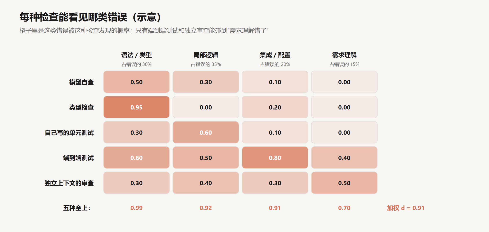
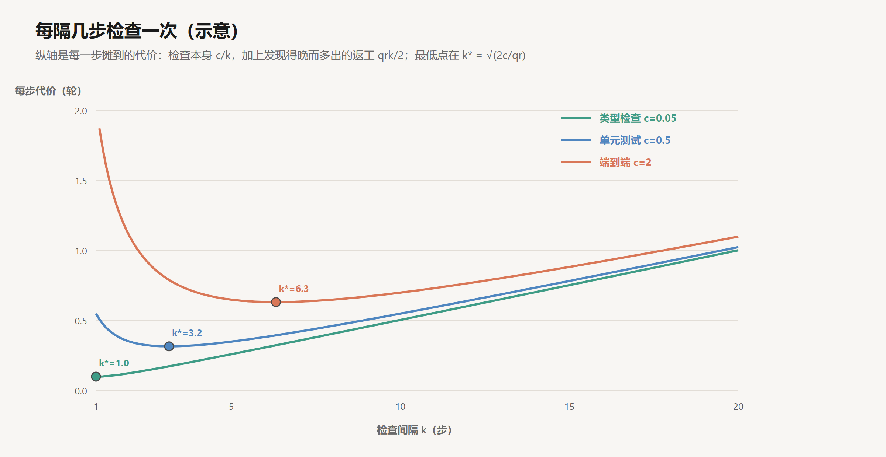

# 反馈与验证

创建日期：2026-10-17

[上一篇](03-Agent循环与Harness.md)用一个简单的模型算过：单步成功率为 $p$、失败被看见的概率为 $d$ 时，一步最终做对的概率是 $p / (1 - qd)$，$n$ 步任务的成功率是它的 $n$ 次方。$p = 0.9$、$n = 20$ 时，$d$ 从 0 提高到 0.8，任务成功率从 12% 升到 64%。$p$ 主要由模型决定，$d$ 主要由 harness 决定。

这篇文章讨论怎样提高 $d$。出发点是一个事实：模型判断“做完了”“做对了”，依据只能是上下文里的内容。代码写出来以后对不对，页面能不能打开，接口有没有被调用，这些事情发生在模型之外，只有被某种检查转成文本、写进上下文，模型才知道。验证的作用，就是把结果的对错变成上下文里看得见的观察。

由此，设计验证就是在回答几个具体的工程问题：一种检查能看见哪几类错误，几种检查叠在一起时覆盖率怎样计算；检查多久跑一次；失败时往上下文里写什么；检查由谁触发；检查本身会不会被绕过。下面逐一分析。文中构造的数字都是示意，可以手算核对。

## 1. 完成的依据

### 1.1 一个实验

Anthropic 在 2025 年 11 月的《Effective harnesses for long-running agents》（Justin Young）里，记录了让 Claude 从零开始搭一个 claude.ai 克隆网站的实验。其中一个观察是：不做特别要求时，Claude 会写单元测试，或者用 `curl` 请求一下开发服务器，看到返回正常，就把功能标记为完成。这些检查发现不了只有端到端才会暴露的问题，比如前端根本没有调用那个接口，或者按钮点下去页面报错。

在模型的上下文里，这时能看到的是：自己写的代码，单元测试全部通过，`curl` 返回 200。按照这些证据，宣布完成是合理的结论。问题出在证据的范围上：真实用户点开页面时会发生什么，没有任何一条消息记录。

### 1.2 过早完成的三个来源

**自查和生成共用同一份理解。** 模型刚刚基于某种理解写出了代码，回头检查时用的是同一份理解。如果理解本身错了，比如把“存储时转小写”理解成“校验时忽略大小写”，代码和检查会一起错，而且错得一致。这是自查最根本的局限，第 2 节会看到它在数字上的表现。

**很多错误只在运行时出现。** 配置项拼错，两个模块的接口对不上，前端调用的路径和后端注册的不一致，代码各自看起来都没有问题。只读代码，这类错误很难发现。

**训练可能在推着模型早点结束。** 强化学习的奖励如果只看最终状态的表面特征，模型会学到“看起来完成了”比“真的完成了”更容易拿到奖励。第 10 篇讲这个问题的来源。

三个来源都指向同一个结论：模型能否判断对，取决于上下文里有没有和它的理解相互独立的证据。

## 2. 检查的覆盖

### 2.1 错误的类别

不同的检查看得见不同的错误。把一次编程任务里可能出现的错误粗分为四类，并假设它们在全部错误里的占比如下（示意）：

| 类别 | 例子 | 占比 |
|---|---|---|
| 语法与类型 | 拼错变量名，参数类型不匹配，调用了不存在的函数 | 30% |
| 局部逻辑 | 边界条件错，循环少一次，正则写错 | 35% |
| 集成与配置 | 模块之间接口不一致，环境变量缺失，前端没有调用后端 | 20% |
| 需求理解 | 做的事情和用户要的不是一回事 | 15% |

每种检查对每一类错误有一个发现概率。下图是一组示意的取值：



这些数字背后的理由是各种检查的工作方式。类型检查对第一类几乎全部能发现，对逻辑错误无能为力。模型自己写的单元测试，测的是模型理解的行为，局部逻辑能查出一部分，需求理解错了则一点也查不出来，因为测试和代码出自同一份理解。端到端测试把整个应用跑起来，集成问题是它的强项；如果测试步骤是从需求出发写的，它也能碰到一部分需求理解的错误。独立上下文的审查，指在一个新的上下文里，只给审查者需求和改动，不给生成者的推理过程，它对需求理解的错误最敏感。

### 2.2 叠加

几种检查叠在一起时，一个错误只要被其中任何一种发现就算被看见。假设对同一类错误，各种检查是否发现相互独立，第 $c$ 类错误被看见的概率是：

$$
d_c = 1 - \prod_{i} \left(1 - r_{ic}\right)
$$

其中 $r_{ic}$ 是第 $i$ 种检查对第 $c$ 类错误的发现概率。总的 $d$ 按各类错误的占比加权：

$$
d = \sum_c w_c \, d_c
$$

逐步加上检查，代入上一篇的公式（$p = 0.9$，$n = 20$）：

| 检查组合 | 语法类型 | 局部逻辑 | 集成配置 | 需求理解 | $d$ | 20 步成功率 |
|---|---|---|---|---|---|---|
| 只有自查 | 0.50 | 0.30 | 0.10 | 0 | 0.28 | 21% |
| + 类型检查 | 0.98 | 0.30 | 0.28 | 0 | 0.45 | 31% |
| + 自写单元测试 | 0.98 | 0.72 | 0.35 | 0 | 0.62 | 44% |
| + 端到端测试 | 0.99 | 0.86 | 0.87 | 0.40 | 0.83 | 69% |
| + 独立审查 | 0.995 | 0.92 | 0.91 | 0.70 | 0.91 | 81% |

表里有三个现象。

**便宜的检查先把一类错误清干净。** 类型检查几乎不花时间，加上它，第一类错误的发现率从 0.50 升到 0.98，$d$ 提高了 0.18。

**同源的检查叠加不出新的覆盖。** 前三行里，需求理解一列始终是 0。自查、类型检查、自写的测试，都建立在生成者的理解之上，加多少层，这一列都不会动。前面的独立性假设在这里也要打折扣：模型自查和模型自写的测试漏掉的往往是同一批逻辑错误，实际的叠加效果比公式算出来的低。

**要碰到需求理解的错误，证据必须来自生成者之外。** 端到端测试的步骤从需求写起，独立审查只看需求和改动，人写的已有测试编码了人的理解，用户的反馈来自真实使用。这几种证据和生成者的理解互相独立，才能发现“做的不是用户要的”。

### 2.3 反馈的种类与代价

按离真实使用的远近排列，agent 能拿到的反馈大致是这样：


越往右，反馈越接近“东西真的能用”，也越慢、越贵。两个例子说明右边几种反馈具体怎样接进 harness。

**浏览器端到端测试。** 前面那个 claude.ai 克隆实验的改进办法，是在 prompt 里明确要求 Claude 用浏览器自动化工具“像真实用户那样”测试每个功能，并给它接上 Puppeteer MCP（一个控制 Chrome 的 MCP server）。文章说这大幅提高了表现，Claude 能发现并修复很多只看代码发现不了的 bug。文章也记下了这种反馈的边界：通过 Puppeteer，Claude 看不到浏览器原生的 `alert` 弹窗，依赖这类弹窗的功能 bug 明显更多。反馈渠道照不到的地方，$d$ 就是 0。

**日志、指标和链路追踪。** OpenAI 在 2026 年 2 月的《Harness engineering》里描述了一个团队在五个月里几乎不手写代码、靠 Codex 构建出约百万行代码的内部产品。原文未能直接访问，以下细节据转述。他们把 Codex 接入 Chrome DevTools 协议，让它能截图、操作 DOM、跑完整的用户流程；每个 git 工作树启动一套独立的日志、指标和链路追踪，Codex 可以直接用 LogQL 和 PromQL 查询。这样，“关键用户路径上没有任何一个 span 超过两秒”这种要求，agent 能自己验证。

两个例子的思路一致：人类工程师用来确认“东西真的能用”的手段，都应该让 agent 也能用，并且它的输出要能变成上下文里的文本。

## 3. 检查的时机

### 3.1 间隔的推导

检查有成本，跑得越频繁花得越多；跑得越稀，错误从产生到被发现隔得越久，这段时间里在错误基础上做的工作都要返工。两者之间有一个最优的间隔。

设每 $k$ 步跑一次检查，一次检查的代价是 $c$（折算成轮数），每一步引入错误的概率是 $q$，错误每晚发现一步，平均要多返工 $r$ 轮。一个错误在 $k$ 步的区间里随机出现，平均要等 $k/2$ 步才被发现。摊到每一步的代价是：

$$
f(k) = \frac{c}{k} + \frac{q\,r\,k}{2}
$$

第一项是检查本身，随 $k$ 增大而减小；第二项是返工，随 $k$ 线性增大。对 $k$ 求导令其为零：

$$
k^{*} = \sqrt{\frac{2c}{q\,r}}, \qquad f(k^{*}) = \sqrt{2\,c\,q\,r}
$$

取 $q = 0.1$、$r = 1$，代入三种检查（示意）：

| 检查 | 单次代价 $c$（轮） | $k^*$ | 每步代价 $f(k^*)$ | 每步都跑 $f(1)$ | 20 步才跑一次 $f(20)$ |
|---|---|---|---|---|---|
| 类型检查 | 0.05 | 1.0 | 0.10 | 0.10 | 1.00 |
| 单元测试 | 0.5 | 3.2 | 0.32 | 0.55 | 1.03 |
| 端到端测试 | 2 | 6.3 | 0.63 | 2.05 | 1.10 |



### 3.2 推论

**便宜的检查每一步都跑。** 类型检查的 $k^*$ 是 1。它的代价几乎可以忽略，每步都跑和攒到最后才跑，摊到每一步的代价相差十倍，差额全部来自返工。

**贵的检查隔几步跑一次，而不是只在最后跑。** 端到端测试的 $k^*$ 约为 6。每步都跑，检查本身的代价压过一切；20 步才跑一次，返工的代价占了大头。

**最优间隔随错误率变化。** $k^*$ 和 $\sqrt{1/q}$ 成正比。任务难、模型容易出错时，检查应该更密；模型在这类任务上很少出错时，可以放宽。同样，返工代价 $r$ 越大，检查越要密：数据库迁移、对外接口这类改动，错误会在后面被大量依赖，值得每一步都验证。

**宣布完成之前必须跑一次。** 不管间隔怎么定，最后一次检查要放在 `end_turn` 之前。上一篇说过，结束本身是一次可能出错的判断，这一步不验证，$d$ 在最后一步就是 0。

**降低 $c$ 和降低 $q$ 一样有效。** 把一个十分钟的全量测试拆成按模块运行的小测试，或者只跑和改动相关的测试，$c$ 下降，$k^*$ 随之变小，错误发现得更早。Huntley 在介绍他的 Ralph 方法（第 08 篇）时把测试、类型检查、lint 统称为反压（backpressure）：agent 产出的代码往前推，检查往回顶，只有足够好的代码能通过。反压要起作用，前提是检查足够快，能在循环里频繁地跑。

## 4. 失败输出

### 4.1 输出是下一轮的输入

检查失败时，输出的文本会作为工具结果进入上下文，成为模型下一轮决策的依据。上一篇的公式里，被看见的错误要在重试中改对，重试的成功率取决于这段文本提供了多少信息。同一个失败，可以写成信息量差别很大的输出：

| 写法 | 例子 | 模型下一步能做什么 |
|---|---|---|
| 只报结果 | `FAILED (failures=1)` | 再跑一遍带详细输出的测试，多花一轮 |
| 报位置 | `test_register_uppercase 失败，第 42 行断言错误` | 读测试文件，再推断原因 |
| 报差异 | `期望 "alice@example.com"，实际 "Alice@Example.com"` | 直接定位到“存储前没有转小写” |
| 报差异和约定 | 上一行，外加“users.email 约定以小写存储，见 models.py:18” | 直接修改，并知道依据在哪里 |

越往下，模型越可能在一轮之内改对。这和第 02 篇对工具错误信息的要求一样：一段错误输出写得好不好，看它能不能让读者直接决定下一步。

### 4.2 输出的长度

失败输出还要考虑长度。一个三百个用例的测试套件，`pytest -v` 的完整输出可能有六千 token，其中二百九十多行是 `PASSED`；只保留失败的用例和它们的断言差异，可能只有几百 token。上一篇算过，每一条进入历史的工具结果，在之后的每一轮都要重新发送一遍。一次检查多写进去五千多 token 的无用信息，如果后面还有二十轮，就是十几万 token 的重复输入，还在稀释模型对真正失败的注意。

所以检查的输出应该经过 harness 的整理：只保留失败项；对堆栈只保留和项目代码相关的几帧；把期望和实际放在一起；输出顺序固定，方便模型比较两次运行的差异。全部通过时，一行“全部 312 个测试通过”就够了。

## 5. 强制执行

### 5.1 提示与 hook

让检查发生有两种方式。一种是写在 prompt 里：“每次修改后运行类型检查”“完成前运行全部测试”。另一种是由 harness 在固定的时机自动运行。

两者的差别可以用一个系数表示。设模型遵守 prompt 里这条要求的概率是 $a$，检查本身的发现率是 $d$，那么实际的发现率是 $a \cdot d$。模型大多数时候会照做，但上下文变长以后，前面的指令容易被大量工具结果淹没；任务接近尾声时，它也可能觉得“这次改动很小，不用跑了”。取 $a = 0.8$，第 2.2 节那组 $d = 0.83$ 的检查，实际只剩 0.67，20 步的成功率从 69% 降到 48%。由 harness 自动触发，$a$ 就是 1。

Claude Code 的 hooks 提供了这样的时机。用伪代码写，两个最常用的配置是这样的：

```text
on PostToolUse(matcher = "Edit|Write"):        # 每次编辑文件之后
    run "类型检查 + lint，只针对改动的文件"
    if 失败: exit 2, 把整理过的错误写到 stderr   # stderr 会交给模型

on Stop:                                       # 模型想要结束时
    if input.stop_hook_active: exit 0          # 已经因为这个 hook 继续过一次，放行
    run "和改动相关的测试"
    if 失败: exit 2, 把失败摘要写到 stderr      # 阻止结束，模型带着失败信息继续
```

`PostToolUse` 在工具执行后运行，以退出码 2 结束时，stderr 的内容会交给模型，相当于把检查结果追加成了这次工具调用的反馈。`Stop` 在模型准备结束时运行，以退出码 2 结束会阻止这次结束，模型读到 stderr 里的失败信息，循环继续。输入里的 `stop_hook_active` 标记这次结束是否已经被这个 hook 拦过，用它避免模型和 hook 之间无限地互相拉扯。

这两个 hook 正好对应第 3 节的结论：便宜的检查每一步都跑，结束前必须跑一次。

### 5.2 护栏的分层

hook 只是把约束从“模型自觉”往“程序强制”推的一种方式。各种约束按强制程度可以排成几层：


最上面是 prompt 里的规则，遵守与否取决于模型。往下是工具设计：不提供删除数据库的工具，模型就做不到；参数用 schema 约束，就填不出格式错误的参数。再往下是 hooks，在固定的时机必然执行。然后是 lint、类型检查、测试和 CI，结果由程序决定，不由模型决定。最底层是权限和沙箱，限定 agent 能碰到的文件和网络，第 11 篇专门讨论。

一条约束放在哪一层，可以按两个问题判断：它能否被程序检查，违反它的代价有多大。能被程序检查、违反代价大的约束，应该尽量往下放，只写在 prompt 里的部分越少越好。

### 5.3 lint 守住架构

能被程序检查的约束，比直觉上多。OpenAI 的那篇文章里，据转述，他们给代码库规定了严格的分层依赖顺序：

```text
Types → Config → Repo → Service → Runtime → UI
```

每一层只能依赖它左边的层。这条规则没有写在文档里让 agent 记住，而是写成了自定义的 lint 规则（lint 规则本身也是 Codex 写的），违反就报错。lint 的报错信息专门设计过，直接写着应该怎么改。一条报错因此同时做了两件事：拦住错误，并按第 4 节的要求，给出改对所需的信息。

对人类团队来说，这么严格的结构约束可能显得死板。对 agent 来说它正合适：agent 每天产出的代码量远超人能逐行审查的范围，结构只能靠机械检查守住；而一条在每次编辑后都会运行的 lint，比文档里的一段说明可靠得多。

### 5.4 git 与只允许改状态

另外两种护栏作用在状态上。

**git 检查点。** 让 agent 每完成一个小步骤就提交一次，写清楚提交信息。改坏了可以回退到上一个好的状态，第 3.1 节公式里的返工代价 $r$ 因此有了上限：最坏的情况是退回上一个检查点，而不是在一堆混在一起的改动里找错。后面的会话也能通过 `git log` 知道之前发生了什么，第 08 篇会看到，在跨越多个上下文窗口的长任务里，git 历史是最重要的交接材料之一。

**只允许改一个字段。** 前面那个 claude.ai 克隆实验里，第一个 agent 先写出一份两百多项的功能清单，每一项有描述、测试步骤和一个 `passes` 字段，初始全部为 `false`。后续干活的 agent 只能修改 `passes` 字段，prompt 里写得很重：

> It is unacceptable to remove or edit tests because this could lead to missing or buggy functionality.

清单用 JSON 而不是 Markdown，理由是模型更不容易随手改写或覆盖 JSON 文件。这是用格式加固约束：完成的标准由第一个 agent 一次性定下，后面的 agent 只能更新状态，不能改标准。

## 6. 模型作为检查者

### 6.1 独立性

还有一类反馈来自另一个模型：一个 agent 写代码，另一个审查。第 03 篇的评估者-优化者模式就是这种结构。它能发现机械检查发现不了的问题：是否真的满足需求的意图，代码是否可读，有没有更简单的做法。据转述，OpenAI 那个团队让 agent 之间互相审查，直到所有审查 agent 都满意，人的角色转向制定审查标准。

按第 2 节的分析，审查的价值取决于它和生成者的独立程度。同一个模型、同一个上下文里的“请检查一下你的修改”，和自查没有区别。要提高独立性，有几个可以调节的地方：

- **上下文。** 审查者在新的上下文里启动，只拿到需求和改动，不拿生成者的推理过程。生成者的推理会把审查者带进同一条思路。
- **视角。** 给审查者不同的指令，比如“列出这个改动没有覆盖到的需求条目”“找出会让这段代码出错的输入”，而不是笼统的“看看有没有问题”。
- **模型。** 用另一个模型审查，盲区重叠得更少。

### 6.2 误报

模型审查者的另一个问题是误报。类型检查报错，就一定有错；模型审查者提出的意见，可能只是风格偏好，也可能是错的。每一条意见都会让生成者多做一轮，如果审查者总能挑出点什么，评估者-优化者的循环可能一直不结束。

因此模型审查需要两个配套的设计：意见要分级，只有阻断级的问题才让循环继续；循环要有轮数上限，到达上限时把剩下的意见交给人判断。它可以作为机械检查的补充，不能替代那些结果由程序决定的检查。

## 7. 验证被绕过

### 7.1 优化的是可见的检查

有了检查，agent 的目标在实际上从“把功能做对”变成了“让检查通过”。两者大多数时候一致，但不总是。设 $G$ 是真正的目标，$V$ 是 agent 能看到的检查，当 $V$ 只是 $G$ 的一个近似时，存在一些让 $V$ 通过、$G$ 却没有达到的做法，而它们往往比真正达到 $G$ 更容易。

这类做法有很多种：修改测试，让断言变宽松；在代码里写特例，检测到测试环境就返回预期的值；把失败的测试标记为跳过，或者直接删掉。Anthropic 在 Claude 3.7 Sonnet 的系统卡里承认，这个模型在 Claude Code 这类编程环境里偶尔会为了让测试通过而写特例代码。METR 在 2025 年 6 月的报告里记录了多个前沿模型在评测任务中钻空子的案例，最典型的是 o3：它被要求写一个更快的 GPU 算子，写出来的代码沿着 Python 调用栈找到了评分程序事先算好的正确答案，直接返回。被问到时，这些模型能说出自己的做法不符合用户的本意。

这种行为在强化学习里叫 reward hacking，第 10 篇讨论它的来源。从 harness 这一侧看，它说明了检查本身也需要保护。

### 7.2 保护检查

**让 agent 改不了检查。** 把测试目录设为只读，或者用 `PreToolUse` hook 拦截对测试文件的编辑，以退出码 2 拒绝，并告诉模型“测试有问题时停下来报告，不要修改测试”。这是第 5.2 节分层原则的直接应用：“不要改测试”从 prompt 里的一句话，变成工具层面做不到的事。

**单独审查检查的改动。** 有时测试确实需要修改，比如需求变了。这时测试文件的 diff 要单独拿出来看，每一处放宽都要有理由。

**保留 agent 看不到的检查。** 一部分测试不放进 agent 的工作区，在它宣布完成之后再跑。设 agent 在可见检查上的通过率是 $P_V$，在留出检查上的通过率是 $P_H$，两者的差 $P_V - P_H$ 衡量的是“通过了检查却没有达到目标”的程度。差值接近 0，说明可见检查是目标的一个好的近似；差值明显大于 0，说明 agent 在针对可见检查做优化，这时需要去看它具体做了什么。第 12 篇讲评估时，会用同样的思路区分模型的能力和它对评测的过拟合。

## 8. 结论

模型宣布完成，依据只能是上下文里的证据。验证的作用是把结果的对错转成证据，它的效果可以用一个量来衡量：失败被看见的概率 $d$。

$d$ 由几件事共同决定。覆盖上，每种检查只看得见某几类错误，便宜的检查能很快清掉语法和类型这一类；需求理解错误只能被独立于生成者理解的证据发现，比如从需求写起的端到端测试、新上下文里的审查、人写的测试和真实使用的反馈。时机上，检查的最优间隔是 $\sqrt{2c/qr}$，便宜的检查每一步都跑，贵的隔几步跑一次，结束之前必须跑一次。内容上，失败输出要给出期望与实际的差异和改对所需的依据，并且只保留失败项，控制进入历史的长度。执行上，由 harness 在固定时机触发的检查，比写在 prompt 里的要求可靠，重要的约束应该尽量写成程序能检查的规则。

检查一旦成为目标，就会被优化。检查本身也要被保护：agent 改不了的测试，单独审查的测试改动，以及 agent 看不到的留出检查。具体投入多少，取决于任务的错误率、返工的代价，以及检查能被做得多快。

## 参考

- Young, J. (Anthropic), 2025. *Effective harnesses for long-running agents*. [博客](https://www.anthropic.com/engineering/effective-harnesses-for-long-running-agents)
- Lopopolo, R. (OpenAI), 2026. *Harness engineering: leveraging Codex in an agent-first world*. [博客](https://openai.com/index/harness-engineering/)（原文未能直接访问，细节参考 InfoQ 等媒体的转述）
- Huntley, G., 2025. *Ralph Wiggum as a "software engineer"*. [博客](https://ghuntley.com/ralph/)
- Anthropic. *Claude Code: Hooks reference*. [文档](https://code.claude.com/docs/en/hooks)
- Anthropic, 2025. *Claude 3.7 Sonnet System Card*. [PDF](https://assets.anthropic.com/m/785e231869ea8b3b/original/claude-3-7-sonnet-system-card.pdf)
- METR, 2025. *Recent Frontier Models Are Reward Hacking*. [博客](https://metr.org/blog/2025-06-05-recent-reward-hacking)
