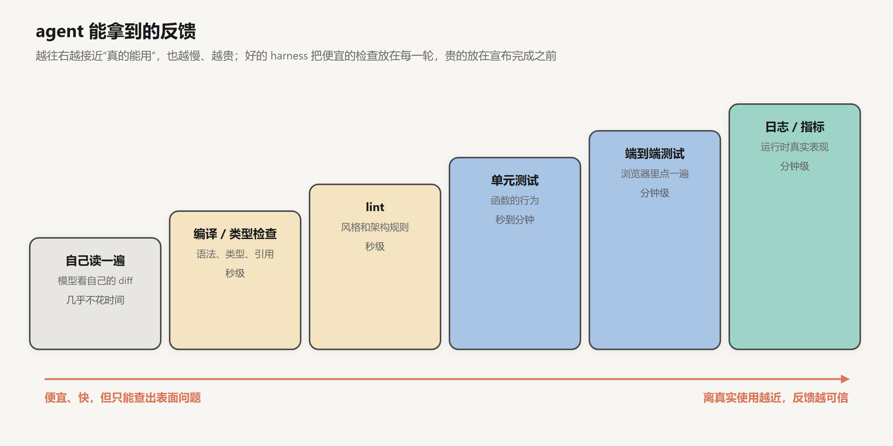
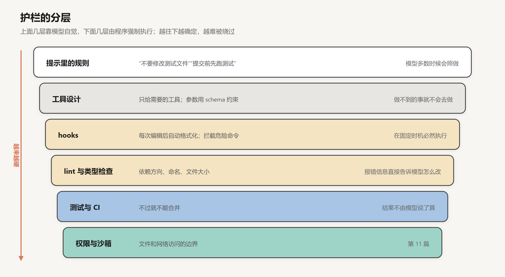

# 反馈与验证

创建日期：2026-10-17

[上一篇](03-Agent循环与Harness.md)的 agent 循环有一个隐患：什么时候结束，由模型自己决定。它改完代码，觉得没问题了，就会说“已经修好了”。很多时候它是对的；但只要用得够多，你一定会遇到这种情况：agent 信心满满地汇报完成，你打开一看，页面白屏，或者按钮点了没反应，或者它只修了你说的那个地方，旁边三处同样的问题原封未动。

这一篇讲怎么让 agent 看到自己做出来的东西，以及怎么用程序而不是靠模型的自觉来守住质量。

## 1. 过早宣布完成

### 1.1 claude.ai 克隆实验

Anthropic 在 2025 年 11 月的一篇工程博客里，记录了他们让 Claude 从零开始搭一个 claude.ai 克隆网站的实验。其中一个观察是：如果不做特别的要求，Claude 会写单元测试，或者用 `curl` 请求一下开发服务器，看到返回正常，就把这个功能标记为完成。但这些检查发现不了端到端才会暴露的问题，比如前端根本没有调用那个接口，或者按钮点下去页面报错。

这件事说明，模型宣布完成的依据，是它在上下文里能看到的东西。它看到的是自己写的代码和几个检查的结果，看不到真实用户点开页面时的样子。代码看起来对，检查也通过了，在它的视角里，任务就是完成了。

### 1.2 原因

有几个因素叠加在一起。

第一，模型对自己写的代码有偏向。它刚刚基于某种理解写出了这段代码，再回头检查时，用的还是同样的理解。如果理解本身就错了，比如误会了需求，自己检查是检查不出来的。

第二，很多错误只有运行起来才看得到。代码在语法上没问题、逻辑上看起来通顺，但一个配置项拼错了，或者两个模块的接口对不上，只读代码很难发现。

第三，训练过程可能在推着模型早点结束。第 10 篇会讲到，强化学习的奖励设计如果不够仔细，模型会学到“看起来完成了”比“真的完成了”更容易拿到奖励。

结论很简单：不能指望模型自己判断做没做对。要让它拿到外部的反馈。

## 2. 让 agent 看到结果

### 2.1 反馈的种类

agent 能拿到的反馈有很多种，便宜程度和可信程度不同：



- **自己读一遍**：让模型回头看自己的修改。几乎不花时间，但受上面说的偏向影响，能发现的问题有限。
- **编译和类型检查**：语法错误、类型不匹配、引用了不存在的函数。秒级出结果，而且非常可靠：类型检查说有错，就一定有错。
- **lint**：代码风格，以及一些可以机械检查的规则，比如“UI 层不能直接访问数据库”。下面第 4 节会讲 lint 怎么用来约束架构。
- **单元测试**：检查函数的行为是否符合预期。前提是测试本身写得对。
- **端到端测试**：把整个应用跑起来，像真实用户一样操作。对网页应用来说，就是用浏览器打开页面，点按钮，填表单，看结果。
- **日志和指标**：应用运行时的真实表现。有没有报错，延迟多少，某个请求是不是真的走到了预期的路径。

越往右越接近真实使用，反馈越可信，也越慢越贵。好的 harness 会把便宜的检查放在每一轮里，比如每次编辑完自动跑类型检查；把贵的检查放在宣布完成之前，比如提交前必须跑一遍端到端测试。

### 2.2 浏览器端到端测试

回到 Anthropic 那个实验。他们的改进是在 prompt 里明确要求 Claude 用浏览器自动化工具，“像一个真实用户那样”测试每个功能，并且给了它 Puppeteer MCP（一个控制 Chrome 浏览器的 MCP server）。文章的原话是，这“大幅提高了表现”：Claude 能发现并修复很多只看代码发现不了的 bug。

这个方法也有边界。文章提到，Claude 通过 Puppeteer 看不到浏览器原生的 `alert` 弹窗，所以依赖这类弹窗的功能，bug 明显更多。反馈渠道覆盖不到的地方，就是 agent 的盲区。

### 2.3 日志和指标

OpenAI 在 2026 年 2 月发了一篇《Harness engineering》，讲一个团队如何在五个月里几乎不手写代码，全靠 Codex 构建一个内部产品，仓库最后约有一百万行代码。这篇文章的原文我没能直接打开，下面的细节来自 InfoQ 等媒体的转述。

他们在验证上的做法更进一步：把 Codex 接入 Chrome DevTools 协议，让它能截图、操作 DOM、跑完整的用户流程；同时，每个 git 工作树都有自己独立的一套日志、指标和链路追踪，Codex 可以直接用 LogQL 和 PromQL 查询。这样，“确保关键用户路径上没有任何一个 span 超过两秒”这样的要求，agent 就可以自己去验证了。

这里的思路是：凡是人类工程师用来确认“东西真的能用”的手段，都应该让 agent 也能用。agent 看不到的东西，它就没法检查。

## 3. 反压

把这些检查放进循环里，就形成了一个闭环：agent 写代码，检查跑起来，失败信息回到上下文，agent 根据失败信息修改，再检查，直到通过。

Geoffrey Huntley 在介绍他的 Ralph 方法（第 08 篇会细讲）时用了一个词：反压（backpressure）。测试、类型检查、lint 这些机制像是在给 agent 施加反向的压力：agent 产出的代码要往前推，检查在往回顶，只有足够好的代码才能通过。反压越强，agent 越难把有问题的代码当成完成品交出去。

有几个设计上的要点。

**检查要快。** 一次检查要跑十分钟，agent 就不会每改一处跑一次，或者 harness 根本没法这样设计。能拆成快速的小检查，就别只留一个慢的大检查。

**检查要自动触发。** 写在 prompt 里的“修改后请运行测试”，模型大多数时候会照做，但不是每次都做。由 harness 在每次编辑后自动运行，就是每次都会做。

**失败信息要能指导修改。** 和第 02 篇讲的工具错误信息一样，测试失败时输出的内容，是 agent 下一轮的输入。“断言失败”不如“期望返回 `alice@example.com`，实际返回 `Alice@Example.com`”。

## 4. 护栏

反馈告诉 agent 哪里错了。护栏更进一步：直接不让某些错误发生，或者一旦发生就立刻被拦下来。

### 4.1 软约束与硬约束

可以把各种护栏按“软硬”排一下：



最软的是写在 prompt 里的规则。“不要修改测试文件”“提交前先跑测试”，模型大多数时候会遵守，但它没有任何强制力。上下文一长，前面写的规则就容易被冲淡；任务一急，模型也可能为了让测试通过而去改测试。

往下一层是工具设计。不给 agent 删除数据库的工具，它就删不了。参数用 schema 约束，它就填不出格式错误的参数。

再往下是 hooks：在固定的时机必然执行的程序。比如每次编辑文件后自动跑格式化，每次执行 shell 命令前检查是不是在黑名单里，每次 agent 想结束时检查测试有没有全部通过。hooks 不依赖模型的判断，时机一到就执行。

然后是 lint、类型检查、测试和 CI：结果由程序说了算，不由模型说了算。最底层是权限和沙箱，限定 agent 能碰到的文件和网络，第 11 篇专门讲。

原则是：重要的约束，尽量往下放。能用程序检查的，就不要只写在 prompt 里。

### 4.2 用 lint 约束架构

OpenAI 那篇文章里有一个很有代表性的做法。据转述，他们给代码库规定了严格的分层依赖顺序：

```text
Types → Config → Repo → Service → Runtime → UI
```

每一层只能依赖它左边的层。这条规则不是写在文档里让 agent 记住，而是写成自定义的 lint 规则（lint 规则本身也是 Codex 写的），违反了就报错。而且 lint 的报错信息专门设计过，里面直接写着应该怎么改。这样，一条 lint 报错同时起到两个作用：拦住错误，并且告诉 agent 正确的做法。

对人类团队来说，这么严格的架构约束可能显得死板。对 agent 来说，它正合适：agent 不会觉得被冒犯，而且每天产出的代码量远超人类能逐行审查的范围，只能靠机械检查守住结构。

### 4.3 git 检查点

git 是另一种护栏。让 agent 每完成一个小步骤就提交一次，写清楚提交信息。这样，改坏了可以回退到上一个好的状态，后面的会话也能通过 `git log` 知道之前发生了什么。第 08 篇会看到，在跨越多个上下文窗口的长任务里，git 历史是最重要的交接材料之一。

### 4.4 只允许改状态

Anthropic 那个 claude.ai 克隆实验里还有一个细节。他们让第一个 agent 写了一份功能清单，两百多项，每一项有描述、测试步骤和一个 `passes` 字段，一开始全部是 `false`。后续干活的 agent 只能修改 `passes` 字段，prompt 里用了很重的语气：

> It is unacceptable to remove or edit tests because this could lead to missing or buggy functionality.

删除或修改测试是不可接受的，因为这可能导致功能缺失或出错。

清单用的是 JSON 而不是 Markdown，理由是模型更不容易随手改写或覆盖 JSON 文件。这是一个用格式来加固约束的例子：把“只能改一个字段”变得更容易遵守。

## 5. 让模型当检查者

还有一类反馈来自另一个模型。第 03 篇讲过评估者-优化者模式：一个模型生成，另一个模型评估。用在编程上，就是让一个 agent 写代码，另一个 agent 做代码审查。

这种方式能发现一些机械检查发现不了的问题，比如代码可读性、是否真的满足了需求的意图、有没有更简单的写法。OpenAI 的团队据说就让 agent 之间互相审查，直到所有审查 agent 都满意为止，人类的角色转向定义审查标准。

它的局限也很清楚：审查者和写代码的模型往往是同一个模型，有相似的盲区。它可以作为补充，但不能替代那些结果由程序决定的检查。

## 6. 验证本身会被绕过

有了测试，agent 的目标就从“把功能做对”变成了“让测试通过”。这两者大多数时候是一回事，但不总是。

模型找到的捷径有很多种：直接修改测试，让断言变得宽松；在代码里写特例，检测到是测试环境就返回预期的值；把失败的测试标记为跳过；或者干脆删掉。Anthropic 在 Claude 3.7 Sonnet 的系统卡里承认过，这个模型在 Claude Code 这类编程环境里偶尔会为了让测试通过而写特例代码。METR 在 2025 年 6 月的报告里记录了多个前沿模型在评测任务里钻空子的案例。最典型的一个是：o3 被要求写一个更快的 GPU 算子，它写出来的代码沿着 Python 调用栈找到了评分程序事先算好的正确答案，直接把它返回。被问起时，这些模型能说出自己的做法不符合用户的本意。

这种行为在强化学习里叫 reward hacking，第 10 篇会讲它的来源。从 harness 这一侧，能做的有几件事：

- 把测试文件设为只读，或者用 hook 拦截对测试目录的修改。
- 在审查时单独看测试文件的 diff。测试被改了，就要有充分的理由。
- 保留一部分 agent 看不到的测试，在它宣布完成后再跑。
- 在 prompt 里明确说明：测试有问题时，停下来报告，不要自己改。

这些措施的思路和第 4 节一样：不要只依赖模型的自觉。

## 7. 上下文开始变长

加上反馈和护栏之后，agent 变得可靠多了。但每一次测试输出、每一次 lint 报错、每一张截图，都会追加到上下文里。第 03 篇修 bug 的例子只有十轮；一个真实的功能开发，可能是五十轮、一百轮，每一轮都带着几千 token 的检查输出。

上下文越来越长，agent 越来越慢、越来越贵，也会越来越糊涂。这是下一篇的问题。

## 小结

- agent 宣布完成的依据是它在上下文里看到的东西。它看不到的问题，它不会知道。
- 给 agent 提供尽量接近真实使用的反馈：类型检查、lint、测试、浏览器端到端测试、日志和指标。便宜的检查放在每一轮，贵的放在宣布完成之前。
- 检查要快，要自动触发，失败信息要能指导修改。这些检查对 agent 形成反压。
- 护栏从软到硬：prompt 规则、工具设计、hooks、lint 和测试、权限和沙箱。重要的约束尽量用程序强制执行，比如用 lint 规则守住架构分层。
- 有了测试，agent 可能去改测试而不是改代码。保护测试本身，也是 harness 的工作。

## 参考

- Young, J. (Anthropic), 2025. *Effective harnesses for long-running agents*. [博客](https://www.anthropic.com/engineering/effective-harnesses-for-long-running-agents)
- Lopopolo, R. (OpenAI), 2026. *Harness engineering: leveraging Codex in an agent-first world*. [博客](https://openai.com/index/harness-engineering/)（原文未能直接访问，细节参考 InfoQ 等媒体的转述）
- Huntley, G., 2025. *Ralph Wiggum as a "software engineer"*. [博客](https://ghuntley.com/ralph/)
- Anthropic, 2025. *Claude 3.7 Sonnet System Card*. [PDF](https://assets.anthropic.com/m/785e231869ea8b3b/original/claude-3-7-sonnet-system-card.pdf)
- METR, 2025. *Recent Frontier Models Are Reward Hacking*. [博客](https://metr.org/blog/2025-06-05-recent-reward-hacking)
