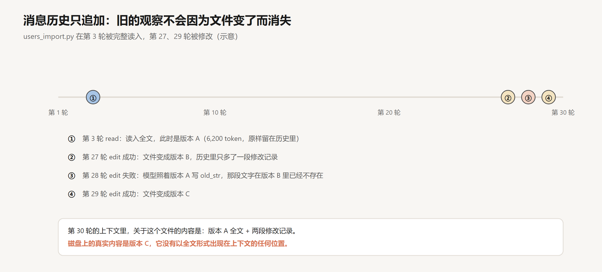
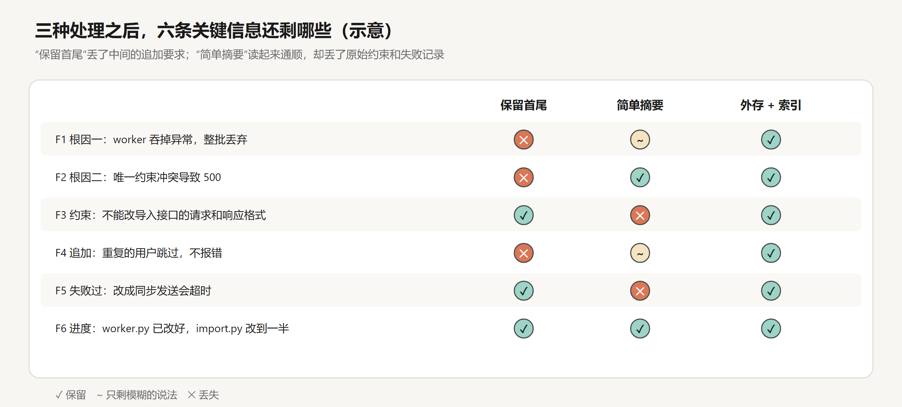
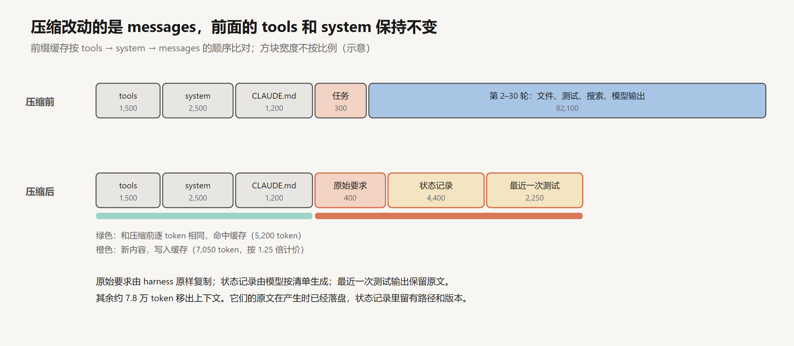
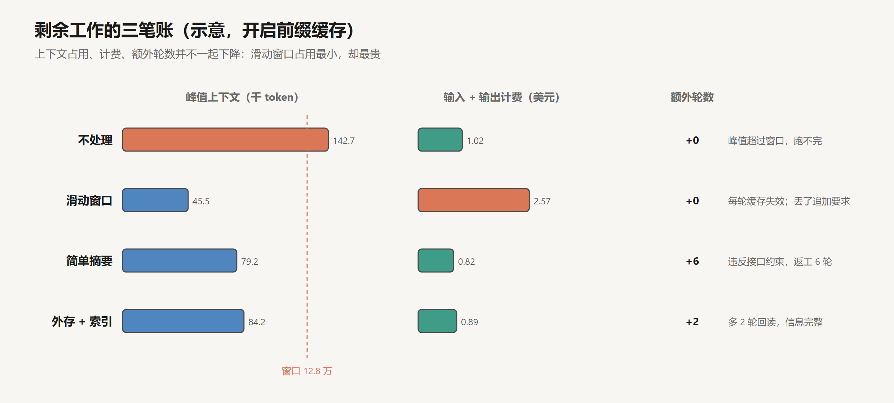

# 上下文工程

创建日期：2026-10-17

agent 每一轮调用模型时发出去的上下文，装着三类性质不同的信息。

**任务约束**：用户要做什么，不能做什么。它很短，从第一轮一直有效到任务结束。

**环境观察**：读到的文件、测试的输出、搜索的结果。它占了上下文的大头，而且会过期：文件改了，之前读到的内容就不再是事实；代码修好了，之前的报错就不再成立。

**执行历史**：模型自己的推理和工具调用。它记录了做过什么、为什么这样做，大部分只在当时有用，少数结论要一直带着。

任务刚开始时，这三类信息混在一起不成问题。随着轮数增加，它们的有效期和使用频率越分越开：约束始终要用，但被越来越多的观察淹没在中间；早期的观察大多已经消化成结论，或者已经过期，却仍然原样留在上下文里，每一轮都重新发送、重新计算一遍。

所以上下文管理要分开处理三件事：哪些信息必须持续可见（保留），移出去的信息怎样可靠地找回来（恢复），不变的部分怎样不必每轮重新计算（复用）。这篇文章围绕一个修 bug 的 agent 在第 30 轮时的上下文，逐一分析这三件事的机制和取舍。例子里的运行过程、token 数和费用都是构造的示意，数字可以手算核对。

## 1. 上下文的组成与增长

### 1.1 每一轮的请求怎样组装

第 03 篇的 agent 循环里，每一轮都调用一次 `model.call(...)`。展开来看，harness 每次组装的请求是这样的：

```text
request = {
  tools:    [read_file, edit_file, bash, grep, ...]      # 工具定义，固定
  system:   SYSTEM_PROMPT                                  # 固定
  messages: [
    user:      CLAUDE.md 内容 + 用户任务                    # 第 1 轮
    assistant: [thinking, tool_use(grep "import")]        # 第 2 轮模型输出
    user:      [tool_result(grep 的输出)]                  # 第 2 轮工具结果
    assistant: [thinking, tool_use(read_file users_import.py)]
    user:      [tool_result(文件全文)]
    ...                                                    # 每轮追加一对
  ]
}
```

服务端把它渲染成一个 token 序列，顺序是工具定义、system、messages。这个顺序后面讨论缓存时很关键。

messages 是一个只追加的列表。每一轮，模型的输出（思考和工具调用）作为一条 assistant 消息追加，工具的执行结果作为一条 user 消息追加。harness 不会回头改动已有的消息，模型也没有办法改动它们。

### 1.2 第 30 轮的账本

例子是一个修批量导入接口的任务。用户第 1 轮的要求是：

> 批量导入用户（`POST /api/users/import`）有两个问题：一是部分新用户收不到欢迎邮件；二是同一个文件导入两次会报 500。请修复。注意：这个接口有外部客户在调用，请求和响应的格式都不能改。

第 12 轮用户补充：

> 补充一下：重复的用户直接跳过就行，不要报错，也不要覆盖已有用户的资料。

到第 30 轮，agent 已经确认了两个根因：邮件队列的 worker 在一封邮件出错时吞掉了整批任务；`email` 字段有唯一约束，重复插入直接抛出 500。worker 已经改好，导入接口改到一半，有一个测试还没通过。中途它试过把发邮件改成在请求里同步完成，结果大批量导入超时，已经回退。

把第 30 轮的上下文按来源分类，每一类占多少、下一步还用不用得到：


8 个文件分别是 6,200、7,800、3,400、5,600、2,900、4,800、1,500、5,800 token，合计 38,000。6 次测试中两次是全量测试，各 6,000；四次是单个测试，各 2,250；合计 21,000。模型输出平均每轮 450，30 轮共 13,500。全部加起来 87,600。

按开头的三类信息归一下：

| 类别 | 内容 | token |
|---|---|---|
| 固定部分 | 工具定义、system、CLAUDE.md | 5,200 |
| 任务约束 | 第 1 轮和第 12 轮的用户原话 | 400 |
| 环境观察 | 文件、测试输出、搜索结果、报错 | 68,500 |
| 执行历史 | 模型的推理和工具调用 | 13,500 |

环境观察占了将近八成。账本右列显示，下一步还用得到的只有约 2.1 万：正在修改的两个文件、最近一次测试输出、各类结论，以及固定部分和用户原话。

假设模型窗口为 12.8 万，按每轮新增约 2,900 token 计算，剩下 20 轮做完会涨到 14 万以上，超出窗口。

### 1.3 过期的观察

只追加的列表有一个直接后果：观察一旦进入上下文，就不会因为外部世界变了而更新。



`users_import.py` 在第 3 轮被完整读入，这 6,200 token 是当时的版本 A。第 27 轮和第 29 轮各成功修改了一次，文件先后变成版本 B 和版本 C。编辑工具的返回值通常只是一句“修改成功”加上改动附近的几行，所以上下文里留下的是版本 A 的全文，加上两段局部的修改记录。磁盘上的真实内容（版本 C）没有以全文的形式出现在上下文的任何地方。

模型要知道文件现在长什么样，只能在脑子里把两段修改叠加到版本 A 上。这一步很容易出错。第 28 轮那次失败的编辑就是这样来的：编辑工具要求给出一段要替换的原文（`old_str`），并且这段原文必须在文件里精确出现。模型照着第 3 轮读到的版本 A 抄了一段，而这段文字在第 27 轮已经被改掉了，于是工具报错“找不到匹配的文本”。

测试输出也一样。第 10 轮的全量测试报了两个失败，第 17 轮修好其中一个之后，第 10 轮那份输出仍然完整地留在上下文里，说有两个测试失败。

所以上下文不是对当前状态的描述，而是一份按时间排列的观察日志。日志里的每一条都只在它被记录的那一刻成立。这件事 harness 可以部分地兜底。比如 Claude Code 的编辑工具会记录每个文件最后一次被读取时的状态，如果文件在那之后被改过，就拒绝编辑，要求先重新读取，避免模型基于过期的内容动手。

## 2. 信息的有效期

### 2.1 四类信息

从“还要不要用”和“能不能找回”两个角度看，上下文里的信息可以分成四类：

| 类别 | 例子 | 有效期 | 能否重新取得 | 保留方式 |
|---|---|---|---|---|
| 持续生效的约束 | 第 1、12 轮的用户原话 | 整个任务 | 不能，只存在于对话里 | 原文常驻 |
| 阶段性结论 | 两个根因；“同步发送会超时” | 直到任务结束 | 能重新推导，但要重做一遍调查 | 结论加证据位置 |
| 可重新读取的材料 | 当前的源文件；可以重跑的测试和搜索 | 很短，随时过期 | 能，只要环境状态没变 | 只留位置，用时再取 |
| 无法重现的现场 | 已回退的那次超时日志；修改前的文件版本 | 视情况而定 | 不能，或者代价很高 | 落盘保存，留下路径 |

这张表里最容易被忽视的是第四类。第 20 轮那次同步发送的超时日志，就属于无法重现的现场：代码已经回退，要重现它，就得把那次修改再做一遍、再跑一遍测试。修改前的 `users_import.py`（版本 A）也是：文件已经被改成了版本 C，只留一个路径，读到的就是版本 C。如果后面需要分析“原来的代码为什么会 500”，路径不够用，还需要版本信息，比如任务开始时的 git 提交号。

对“可重新读取的材料”来说，能不能找回取决于环境状态有没有变。当前的源文件可以随时重读；外部 API 的一次返回、一次偶发的报错、一个已经关掉的网页会话，看上去和普通的工具输出没什么两样，其实属于第四类。

### 2.2 关键信息清单

具体到这个例子，第 30 轮之后必须保住的信息有六条：

- **F1** 根因一：worker 发一批邮件时，一封出错就吞掉整批（阶段性结论）。
- **F2** 根因二：`email` 唯一约束冲突导致 500（阶段性结论）。
- **F3** 约束：不能改导入接口的请求和响应格式（持续生效的约束）。
- **F4** 追加要求：重复的用户跳过，不报错，不覆盖（持续生效的约束）。
- **F5** 失败过的做法：在请求里同步发送会超时（阶段性结论，原始日志属于无法重现的现场）。
- **F6** 当前进度：worker 已改好，导入接口改到一半，`test_import_duplicates` 未通过。

后面比较各种处理方式，就看这六条还剩几条。

### 2.3 可见的位置

保留在上下文里，不等于模型会注意到。

F3 位于第 1 轮的用户消息里，前面是 5,200 token 的固定部分，后面是八万多 token 的观察和历史。F4 夹在第 11 轮和第 13 轮的两次读文件中间。2023 年的“Lost in the Middle”实验（Liu et al.）发现，模型对上下文开头和结尾的信息最敏感，同样的信息放在中间时，准确率明显下降。2025 年 Chroma 的“Context Rot”报告测了 18 个模型，连复述一段重复文本这样简单的任务，表现也会随输入变长而下滑。

Manus 团队的做法是让 agent 维护一个 `todo.md`，每完成一步就重写一遍。在这个例子里，第 30 轮的清单是：

```text
# 修复批量导入
约束：接口的请求和响应格式不能改；重复用户跳过、不报错、不覆盖
- [x] 找到收不到邮件的原因（worker 吞掉整批）
- [x] worker 改为逐封发送、单封重试
- [x] ~~同步发送~~：会超时，已放弃
- [ ] users_import.py：捕获唯一约束冲突，跳过该用户，计数不变
- [ ] test_import_duplicates 通过
- [ ] 跑全量测试
```

每次重写，这份清单都作为最新的工具调用出现在上下文末尾。约束被复述到注意力最集中的位置，失败过的做法也留在清单里。Manus 还特别强调后一点：失败的尝试和报错应该留在上下文里，模型看到自己试过某个做法并且失败了，再做同样尝试的概率会降低。

## 3. 前缀缓存的复用条件

### 3.1 机制

模型处理输入时，要为每个 token 算出 K 和 V（见 [KV Cache 与 Attention QKV](../深度学习/Transformer与大模型/03-KV-Cache与Attention-QKV.md)）。在一次生成内部，KV Cache 让已经算过的 token 不必重算。前缀缓存把这个复用延伸到了两次请求之间：服务端把一段输入的 K、V 存一段时间，下一个请求的开头如果和它逐 token 完全相同，这一段就直接复用。

比对从第一个 token 开始，遇到第一个不同的 token 就停止。原因在 Transformer 的计算方式里：因果注意力让每个位置的 K、V 都依赖它前面的全部 token，前面任何一个 token 变了，后面所有位置的 K、V 都会跟着变，没法复用。


以 Anthropic 的 API 为例：调用方在请求里标记缓存断点，最多四个，服务端按工具定义、system、messages 的顺序比对前缀；缓存默认保存 5 分钟，每次命中会刷新计时；写入缓存的部分按输入价的 1.25 倍计费，从缓存读取的部分按 0.1 倍计费。

### 3.2 追加与改写

agent 循环天然适合缓存。每一轮只是在上一轮的末尾追加一对消息，前面的部分逐 token 不变。第 31 轮请求的前 87,600 token 和第 30 轮完全相同，可以全部命中，需要新写入缓存的只有第 30 轮新增的 2,900 token。

任何改动已有内容的操作都会打断这个过程，失效的范围是从改动点到末尾：

- **在 system 开头放会变的东西**，比如精确到秒的当前时间。每一轮从第一个 token 就失效。
- **修改或删除一条旧消息。** 那条消息之后全部失效。滑动窗口式的截断每轮都删掉最前面的一段，等于每轮都在改动前缀。
- **序列化不稳定。** 同一个对象，这一轮序列化成 `{"a":1,"b":2}`，下一轮成了 `{"b":2,"a":1}`。
- **中途增删工具。** 工具定义在最前面，一改全部失效。Manus 的做法是工具定义始终完整保留，需要禁用某些工具时，在解码阶段把对应工具名的 token 概率压成零（第 01 篇讲的约束解码），并给工具名统一加前缀，比如 `browser_`、`shell_`，方便按组屏蔽。

还有一个时间上的条件。如果某一轮的工具执行得很久，比如一次全量测试跑了 8 分钟，超过了 5 分钟的保存期限，下一轮的缓存就过期了，整段上下文要重新写入。

### 3.3 缓存解决的问题

Manus 团队把 KV 缓存的命中率称为生产环境里的 agent 最重要的指标，并给出过一个数字：他们的 agent 输入和输出的 token 比约为 100 比 1。输入远多于输出，命中率直接决定账单。

但缓存只解决重复计算。命中缓存的 87,600 token 仍然占着窗口里的 87,600 个位置，模型仍然要在这么长的上下文里找到 F3 和 F4。容量和注意力的问题，缓存一点也没有缓解。这两件事要靠压缩和外存来解决，而压缩和外存都要改动上下文，又会和缓存产生冲突。第 6 节会把这个冲突算清楚。

## 4. 历史压缩

### 4.1 截断

最简单的压缩是截断：保留固定部分和第 1 轮的任务，再保留最近 4 万 token 的历史（大约第 17 轮到第 30 轮），中间全部删掉。

按时间截断，实现最简单，但消息的新旧不能代表信息的价值。持续生效的约束可能出现在会话的任何位置：F3 在第 1 轮，被“保留任务”的规则保住了；F4 在第 12 轮，被删掉了。早期的观察可能已经过期，也可能是定位问题时留下的唯一证据：F1 和 F2 的确认过程在第 6 到 15 轮，也被删掉了。统一截断，把这两类性质完全不同的信息一起删除了。



F1、F2 丢了还能补救，修复已经写进了代码，测试也会再报一次。F4 丢了，后果在于模型的选择空间变了。接着处理重复用户时，“已存在就更新”是一个合理的做法，`test_import_duplicates` 只断言了不返回 500、用户数量不变，这个做法能通过；但它违反了“不要覆盖已有用户的资料”。截断还有缓存上的代价：窗口每轮向后移动，任务之后的部分每轮都要重新计算。

### 4.2 摘要

摘要按内容而不是按位置取舍。最直接的做法是让模型“总结到目前为止的进展，以便继续工作”，得到的结果通常是这样的：

```text
## 进展摘要
用户报告批量导入时部分新用户收不到欢迎邮件，重复导入同一文件会报 500。
已完成：
- 定位到 queue/worker.py 中发送欢迎邮件的异常处理有问题，
  已改为逐封发送、失败单独重试，test_worker_retry 已通过。
- 发现重复导入时数据库唯一约束冲突导致 500 错误。
进行中：
- 修改 api/users_import.py 以处理重复用户，test_import_duplicates 仍失败。
下一步：
- 完成重复用户的处理，然后运行完整测试。
```

这份摘要约 1,500 token，结构清楚，每句话都对。对照六条关键信息：F2 和 F6 完整保留；F1 只剩“异常处理有问题”；F4 只剩“处理重复用户”，怎么处理没有写；F3 和 F5 完全丢失。

丢失有规律可循。F3 是用户原话的一部分，摘要里的任务描述是模型的转述，转述时把“注意”后面的那句当成了背景。F5 是一次失败，摘要倾向于记录已经做成的事，失败的过程被当成噪声省略了。

F3 丢失的后果和 F4 类似，也是模型的选择空间变了。处理重复用户时，在响应里告诉调用方哪些用户被跳过，是一个周到的设计，比如把响应从 `200 {"created": 3, "failed": 0}` 改成 `207 {"created": 3, "failed": 0, "skipped": [...]}`。测试只检查状态码小于 500，能够通过；外部客户的程序判断的是状态码等于 200，会把每次导入都当成失败。这类错误测试拦不住，因为约束只存在于对话里，没有被写成测试。

### 4.3 结论与证据

上面这份摘要的问题，在于它是为了让人读懂发生了什么而写的。接手工作需要的东西不一样：

**约束需要原话。** 摘要可以转述，约束不行。“格式不能改”和“尽量保持兼容”允许的做法完全不同。

**结论需要证据位置。** “异常处理有问题”是一个结论，“`worker.py` 第 88 到 97 行，`except` 吞掉了整批任务”是带证据的结论。后者在需要时可以回去核对，也能让模型判断这个结论在文件修改之后是否仍然成立。

**已确认和未验证需要分开。** “worker 已修好”和“`test_worker_retry` 通过，但还没有用真实的邮件服务验证过”是两回事。摘要倾向于把后者写成前者的样子。接手的 agent 读到“已修好”，就不会再去验证。这正是第 04 篇说的过早宣布完成。

**失败的路线需要单独记录。** 它们不出现在最终的代码里，却决定了哪些方案不必再试。

Anthropic 在讲上下文工程的文章里描述过 Claude Code 的压缩：保留架构上的决定、没解决的 bug、实现细节，丢掉重复的工具输出，压缩后再把最近访问过的五个文件重新读进来。他们给的调试顺序是先追求召回，确认该留的都留下了，再追求精简。少留一条关键约束的代价，比多留几百个 token 大得多。

### 4.4 状态记录

据此，压缩的产物应该是一份结构化的状态记录，而不是一段摘要。它由两部分组成，分别由 harness 和模型负责：

```text
[原始要求：harness 从消息历史中原样复制，不经过模型]
  第 1 轮 用户：批量导入用户（POST /api/users/import）有两个问题：……
               注意：这个接口有外部客户在调用，请求和响应的格式都不能改。
  第 12 轮 用户：补充一下：重复的用户直接跳过就行，不要报错，
               也不要覆盖已有用户的资料。

[状态记录：模型按清单填写]
  已确认
  - worker 发一批邮件时一封出错就吞掉整批。
    证据：src/queue/worker.py 88–97 行（任务开始时的提交 a1b2c3d）
  - email 唯一约束冲突导致 500。证据：src/models/user.py 31 行；第 15 轮复现
  已验证 / 未验证
  - test_worker_retry 通过；真实邮件服务未验证
  - test_import_duplicates 未通过（最近一次输出附在下方）
  失败过的做法
  - 在导入请求里同步发送邮件：test_import_large 超时（30 秒上限），已回退。
    日志：.agent/logs/turn-20-pytest.txt
  当前修改
  - src/queue/worker.py：已改为逐封发送、单封重试（已完成）
  - src/api/users_import.py：已捕获唯一约束异常，未实现“跳过且计数不变”
  待决定
  - 被跳过的用户不能出现在响应里（格式不能改），只能不计入 created
  文件索引
  | 路径                         | 读取原因   | 结论       | 原文位置                       |
  | src/api/users_import.py      | 导入入口   | 正在修改   | 当前文件                       |
  | src/services/user_service.py | 建用户逻辑 | 无需修改   | .agent/logs/turn-04-read.txt   |
  | src/mail/mailer.py           | 发信       | 无问题     | .agent/logs/turn-07-read.txt   |
  | ……（其余 5 个）

[最近一次测试输出：原文]
```

用户原话交给 harness 复制，是因为“逐字照抄”是一个纯机械的操作，交给模型做，就有被改写和遗漏的风险，交给 harness 做则不会出错。harness 本来就持有完整的消息列表，知道哪些消息来自用户，复制它们不需要任何判断。

这份记录约 4,800 token，六条关键信息全部在内。“待决定”一栏里，模型已经从约束推出了一个具体的设计限制：被跳过的用户只能不计入，不能出现在响应里。

### 4.5 压缩改动的范围



压缩只改写 messages 部分。工具定义、system、CLAUDE.md 共 5,200 token 原样放在最前面，压缩之后的第一轮仍然命中缓存；原始要求、状态记录和最近一次测试输出共 7,050 token 是新内容，需要写入缓存。整个上下文从 87,600 降到 12,250。

压缩本身是一次模型调用：输入是完整的 87,600 token（大部分命中缓存），输出是 4,400 token 的状态记录。

### 4.6 压缩后的核实

状态记录描述的是压缩那一刻的状态，而且是模型写的。压缩之后，有几件事需要先核实再继续：

- **重新读取正在修改的文件。** 记录里写的是“改到一半”，具体改成了什么样，要以磁盘上的文件为准。这一步同时消除了 1.3 节说的过期观察问题：压缩之后，上下文里关于 `users_import.py` 的内容只有一份，就是刚读到的当前版本。
- **重跑最近失败的测试**，确认记录里的验证状态仍然成立。
- **核对约束。** 让模型复述当前的约束，和 harness 复制的原话比对，确认它确实读到了。

压缩是否成功，从压缩之后的行为上最容易看出来。下面这些现象，都说明状态记录里缺了东西：重新尝试已经失败过的做法；把还没验证的事情当成已经通过；违反了用户明确提出的限制；根据旧版本的代码做推理；给出一个结论，却找不到支撑它的证据。

## 5. 文件外存与按需读取

### 5.1 内容、索引、路径、版本

状态记录能这样精简，前提是被移出的原文能找回来。把一段原文移出上下文、日后再找回，涉及四样东西：

- **内容**：原文本身，存放在上下文之外，比如 `.agent/logs/` 下的文件。
- **路径**：内容在哪里。
- **版本**：内容对应哪一个时刻的状态。对源文件来说是 git 提交号或内容哈希，对测试输出来说是产生它的那一轮。
- **索引**：上下文里关于这段内容的一行说明，包括为什么读它、得出了什么结论、原文在哪里。

缺了任何一样，找回都可能失败。只有路径没有版本：文件被改过，读到的是新内容，旧的证据就没有了。只有内容没有索引：原文存在磁盘上，模型却不知道什么时候该去读，也不知道读哪个。索引写得太含糊，比如只写“读过 mailer.py”：模型不知道上次得出了什么结论，只好重新读一遍，或者重新搜索。第 08 篇讲 Ralph 时会提到，搜索结果不可靠时，agent 甚至会误以为某段代码不存在，又重写一遍。

Manus 团队把满足这些条件的压缩称为“可恢复的压缩”：网页的内容可以从上下文中拿掉，只要 URL 还在；文件的内容可以拿掉，只要路径还在。在这个基础上还要补一句：内容可能变化的，还要留下版本。

### 5.2 在产生时落盘

外存最好在内容产生时就完成，而不是等到压缩时再处理。工具层在返回大输出时，把完整内容写进文件，上下文里只放开头和结尾的几行，加上文件路径。第 02 篇讲工具设计时提过，Claude Code 默认把单次工具返回限制在 25,000 token 以内，截断时会告诉 agent 内容被截断了。

这样做有两个好处。一是压缩时不需要模型判断哪些原文要存，原文早就存好了，状态记录里直接引用路径即可。二是“无法重现的现场”在产生的那一刻就被保存了下来，不会因为后面代码回退而丢失。

### 5.3 清除旧的工具结果

比整体压缩更轻的做法，是把早期的工具结果原地替换成一行占位，比如“已清除，原文见 `.agent/logs/turn-05-read.txt`”。被替换的那条结果后面的缓存会失效，所以清除应该成批进行，比如每 10 轮清理一次，而不是每轮清理一点。Anthropic 在 API 里把这个做成了现成的功能，叫作 context editing。

### 5.4 一开始就少放

外存是把已经进来的原文移出去，更好的做法是让大部分原文一开始就不进来。

回看账本：8 个文件里有 5 个只是为了确认“这里没问题”或者“代码在这里”。先用 `grep -n` 定位相关的行，再按行号范围读几十行，文件部分可以从 38,000 降到 14,000 左右。测试只输出失败的用例和简短的回溯，完整输出写进文件，可以从 21,000 降到 6,000 左右。搜索结果设上默认条数，可以从 7,500 降到 3,000 左右。

三项合计少进来 43,500 token，第 30 轮的上下文约为 44,100。每轮的增长也会相应变小，剩下 20 轮做完大约到七万多，在窗口之内，不需要压缩。

Anthropic 在文章里把这种做法称为及时加载（just-in-time）：上下文里只放轻量的线索，比如文件路径、查询语句、链接，需要的时候再用工具读取。Claude Code 在任务开始时把 CLAUDE.md 放进上下文，代码则不预先检索，由 agent 用 `glob` 和 `grep` 现场查找。

### 5.5 找回的代价

外存不是免费的。这个例子里，压缩之后 agent 需要重新读取 `users_import.py`（6,200 token）和测试文件（4,800 token），多出 2 轮调用。每次找回都是一次往返的延迟，加上读入内容的输入费用。索引写得越清楚，找回的次数越少；材料越难重新取得，越要在落盘时就把关键部分摘出来。

## 6. 策略组合与工程取舍

### 6.1 成本公式

讨论上下文的成本时，有四个量经常被混为一谈：

- **上下文占用**：某一轮发给模型的 token 数，决定会不会超出窗口，也影响注意力。
- **请求 token**：剩余工作里每一轮输入的总和。
- **计费**：按缓存状态分别计价。
- **额外调用**：压缩本身的调用、外存后的回读、信息丢失导致的返工。

单轮的计费可以写成：

$$
C_{\text{轮}} = p_r H + p_w W + p_b U + p_o O
$$

其中 $H$ 是命中缓存的输入 token，$W$ 是新写入缓存的 token，$U$ 是不经过缓存的 token，$O$ 是输出 token。下面按 Claude Sonnet 一类模型的公开单价计算：$p_b = 3$ 美元每百万 token，$p_w = 1.25 p_b = 3.75$，$p_r = 0.1 p_b = 0.30$，$p_o = 15$。每轮输出 450 token，上下文每轮增长 $g = 2{,}900$。

**不处理。** 从 $S = 87{,}600$ 开始做完剩下的 20 轮。每一轮，上一轮的全部内容命中缓存，只有上一轮新增的 $g$ 需要写入。20 轮的命中量合计约 224.8 万，写入量合计 $19 \times 2{,}900 = 55{,}100$：

$$
C \approx 0.30 \times 2.248 + 3.75 \times 0.0551 + 15 \times 0.009 = 0.674 + 0.207 + 0.135 \approx 1.02 \text{ 美元}
$$

不开缓存时，同样 230 万输入全部按原价计算，约 7.04 美元。

**滑动窗口。** 固定保留 5,500 token（固定部分加任务），加上最近 4 万 token 的历史。固定部分命中缓存，窗口部分每轮都变，按原价计费：

$$
C_{\text{轮}} = 0.30 \times 0.0055 + 3 \times 0.04 + 15 \times 0.00045 \approx 0.128 \text{ 美元}
$$

20 轮共约 2.57 美元，是不处理的两倍半。

这个结果可以推广。设历史的平均长度为 $h$，滑动窗口的长度为 $w$，只看输入部分，滑动窗口更便宜的条件是：

$$
p_b \, w < p_r \, h + p_w \, g \quad\Longrightarrow\quad w < 0.1\,h + 1.25\,g
$$

代入 $h \approx 11.5$ 万、$g = 2{,}900$，窗口要小于约 1.5 万 token 才能省钱，相当于只保留最近五六轮。这时丢掉的信息比保留 4 万 token 时还要多。只要服务端有前缀缓存，滑动窗口在成本上几乎不可能划算。

**压缩加外存。** 在第 30 轮压缩一次，上下文从 87,600 降到 12,250，之后多花 2 轮回读两个文件，共 22 轮。和不处理相比：缓存命中量减少，省下约 0.34 美元；压缩后的新内容、回读的文件需要写入缓存，多花约 0.09 美元；压缩调用本身约 0.09 美元；多出的两轮约 0.02 美元。净省约 0.13 美元，总计约 0.89 美元。

不开缓存时，同样的压缩方案约 3.97 美元，比不处理的 7.04 美元省了四成多。

### 6.2 比较



| 做法 | 峰值占用 | 请求 token 累计 | 计费（有缓存） | 计费（无缓存） | 额外轮数 | 信息保留 |
|---|---|---|---|---|---|---|
| 不处理 | 142,700 | 230 万 | 1.02 美元 | 7.04 美元 | 0 | 完整，但超出窗口 |
| 滑动窗口 | 45,500 | 91 万 | 2.57 美元 | — | 0 | 丢失 F1、F2、F4 |
| 简单摘要 | 79,200 | 112 万 | 0.82 美元 | — | 返工 | 丢失 F3、F5 |
| 压缩 + 外存 | 84,200 | 117 万 | 0.89 美元 | 3.97 美元 | +2 | 完整 |

这张表说明了几件事。

**四个量不会一起下降。** 滑动窗口的占用和请求 token 都最小，计费却最高。简单摘要的计费最低，代价是返工，而返工的成本不在这张表里：它包括额外的调用，也包括人发现问题、解释问题的时间；如果问题到上线后才暴露，代价更高。

**开缓存时，压缩的主要收益不是钱。** 压缩加外存只比不处理便宜 12% 左右，因为不处理时那八万多 token 的历史本来就按 0.1 倍计费。它真正的作用是让任务能在窗口内跑完，并且让约束和当前状态不被大量过期的观察淹没。

**不开缓存时，压缩的经济意义大得多。** 同样的方案能省四成多的费用。压缩能省多少钱，没有固定的答案，取决于服务端的缓存机制和价格。

**压缩之后要保住前缀。** 压缩方案里，工具定义、system、CLAUDE.md 原样放在最前面，压缩后第一轮就能命中这 5,200 token。如果压缩时顺手调整了 system 的内容，或者改变了工具定义的顺序，这部分也要重新写入。

### 6.3 条件变化时的取舍

上面的数字建立在几个条件上：任务还要进行 20 轮，服务端有前缀缓存，大部分材料可以重新读取。条件变了，取舍也要相应调整。

任务很短时，留着全部历史是最简单、也最划算的做法，缓存几乎覆盖了全部成本。服务端没有缓存时，每轮都按原价计费，压缩可以更早、更频繁地进行。用户的约束很多时，比如一份几十条要求的需求文档，“原文常驻”的部分本身就很大，更合适的做法是把需求整理成一个文件，压缩后重新读入，同时把能自动检查的要求写成测试（第 04 篇）。

材料能否重新取得，是最容易被忽视的条件。修代码时，源文件和测试几乎都能重新读取、重新运行，外存的风险很低。调查一次已经结束的线上故障时，情况就反过来了：当时的日志可能已经轮转，当时的请求无法重放，监控数据会过期，大部分观察都属于无法重现的现场。这类任务需要在观察产生时就保存原文，压缩时只能把它们移到外存，不能只留结论。

## 7. 结论

上下文管理首先是信息取舍，其次才是成本优化。

任务约束、关键决定、失败过的做法和未完成的状态，要始终留在上下文里，并且放在模型注意得到的位置。用户的原话交给 harness 原样复制，不经过模型转述。环境观察在产生时就落盘，上下文里只保留结论、路径和版本；能可靠找回的大块材料可以移出当前输入，无法重现的现场则必须保留证据。压缩产出的是一份区分了已确认和未验证、带有证据位置的状态记录，压缩之后要重新读取当前文件，确认状态记录仍然成立。

前缀缓存在这些取舍之上减少重复计算。它让只追加的历史变得便宜，让任何改写都变得昂贵，所以清理和压缩要成批进行，并保住不变的前缀。缓存不能代替信息取舍：它既不腾出窗口，也不帮模型找到被淹没的约束。

具体采用哪种策略，取决于三个条件：材料能否重新读取，信息丢失后返工的代价有多大，服务端的缓存机制是什么。

## 参考

- Rajasekaran, P. et al. (Anthropic), 2025. *Effective context engineering for AI agents*. [博客](https://www.anthropic.com/engineering/effective-context-engineering-for-ai-agents)
- Ji, Y. (Manus), 2025. *Context Engineering for AI Agents: Lessons from Building Manus*. [博客](https://manus.im/blog/Context-Engineering-for-AI-Agents-Lessons-from-Building-Manus)
- Liu et al., 2023. *Lost in the Middle: How Language Models Use Long Contexts*. [arXiv:2307.03172](https://arxiv.org/abs/2307.03172)
- Hong, K. et al. (Chroma), 2025. *Context Rot: How Increasing Input Tokens Impacts LLM Performance*. [报告](https://www.trychroma.com/research/context-rot)
- Anthropic. *Prompt caching*. [文档](https://docs.claude.com/en/docs/build-with-claude/prompt-caching)
- Anthropic. *Context editing*. [文档](https://docs.claude.com/en/docs/build-with-claude/context-editing)
