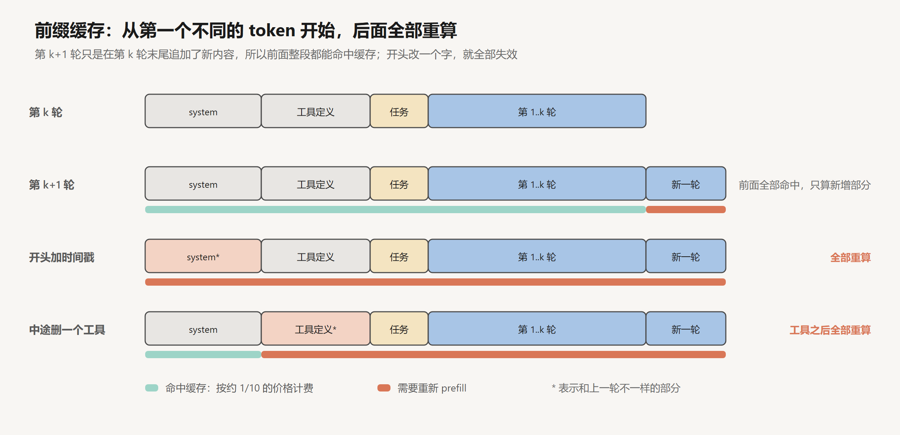
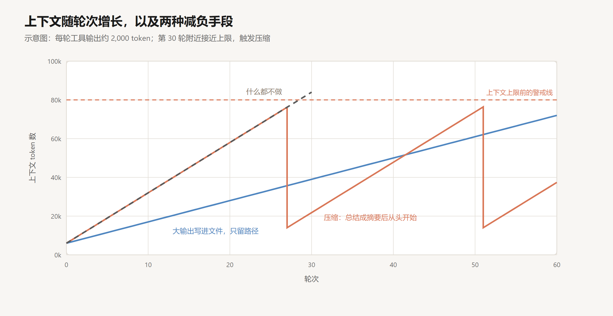

# 上下文工程

创建日期：2026-10-17

[上一篇](04-反馈与验证.md)给 agent 加上了测试、lint、浏览器检查。每一项检查的输出都会追加到上下文里。第 03 篇修 bug 的例子只有十轮，一个真实的功能开发可能要五十轮、一百轮，每一轮都带着文件内容、搜索结果和几千 token 的测试日志。

跑到后面，agent 会出现三个问题：变慢，变贵，变糊涂。前两个好理解，第三个更麻烦：它开始忘记最初的要求，重复已经做过的事，或者把早先的一个错误假设当成事实。

这一篇讲怎么管理上下文。Anthropic 在 2025 年 9 月的一篇文章里给“上下文工程”下过一个定义：在模型推理的过程中，挑选并维护一组最合适的 token。和提示词工程的区别在于，提示词是写一次的，上下文是每一轮都在变的，所以“挑选”这件事每调用一次模型就要做一次。

## 1. 上下文的容量

### 1.1 上下文腐化

上下文窗口标称的长度，不等于模型能在这个长度上保持同样的表现。

2023 年的“Lost in the Middle”论文（Liu et al.）做过一个实验：把答案所在的文档放在一组文档的不同位置，看模型能不能找到。结果是一条 U 形曲线，答案在开头或结尾时准确率最高，在中间时明显下降。2025 年 7 月，Chroma 发了一份叫“Context Rot”（上下文腐化）的研究报告，测了 18 个模型，发现即使是非常简单的任务，比如从文本里复述一句话，模型的表现也会随着输入变长而下降。

Anthropic 那篇文章给了两个解释。一是 Transformer 里每个 token 都要和其他所有 token 计算注意力，$n$ 个 token 就有 $n^2$ 对关系（见 [Attention 与 QKV 入门](../深度学习/Transformer与大模型/01-Attention与QKV入门.md)），上下文越长，注意力被摊得越薄。二是训练数据里短序列远多于长序列，模型在长上下文上的经验相对少。

文章的说法是，这是一个“性能梯度，而不是一道悬崖”：模型在长上下文里依然能干活，但对信息的检索和推理会变得不那么精确。所以上下文要当作一种有限的预算来花，每加进来一段内容，都要问一下值不值。

### 1.2 成本

第 01 篇算过一笔账：多轮对话里，每轮的输入随轮数线性增长，累计输入按平方增长。agent 比聊天严重得多。

Manus 团队在 2025 年 7 月的一篇文章里给过一个数字：在他们的 agent 里，输入 token 和输出 token 的比例平均约为 100 比 1。agent 每一轮只输出一个很短的工具调用，却要读进整个上下文。他们也给出了一个任务的规模：平均要调用约 50 次工具。

所以 agent 的成本几乎全在输入上，降低成本的关键，是让输入里尽量多的部分能复用上一轮的计算结果。

## 2. 前缀缓存

### 2.1 原理

第 01 篇讲过，模型处理输入的 prefill 阶段要为每个 token 算出 K 和 V。如果这一轮输入的前面一大段和上一轮完全一样，这些 K、V 就可以直接复用，不用再算一遍。这就是前缀缓存（prompt caching），它的底层就是 [KV Cache 与 Attention QKV](../深度学习/Transformer与大模型/03-KV-Cache与Attention-QKV.md) 里讲的 KV Cache，只不过是在两次请求之间复用。

各家 API 对命中缓存的部分都有折扣。Manus 文章里举的例子是 Claude Sonnet：缓存命中的输入每百万 token 0.30 美元，没命中的 3 美元，差了 10 倍。命中缓存的部分也不需要重新计算，首 token 的延迟会明显降低。

关键在于“前缀”两个字：缓存是从第一个 token 开始逐个比对的，一旦遇到第一个不同的 token，从那里往后全部失效。

agent 循环天然适合缓存：每一轮都只是在上一轮的末尾追加新内容，前面的部分原封不动。但这个性质很容易被无意中破坏。

### 2.2 保持前缀稳定

Manus 那篇文章把 KV 缓存的命中率称为生产环境里的 agent 最重要的一个指标。他们总结了几条做法。

**前缀里不放会变的东西。** 一个常见的错误是在 system prompt 开头写上当前时间，精确到秒。时间每次都不一样，于是每一轮的缓存从第一个 token 就失效了。确实需要时间的话，放在末尾，或者只精确到天。

**只追加，不修改。** 不要回头修改之前的消息和工具结果。哪怕只是删掉一条历史消息，那条消息之后的缓存全部失效。

**序列化要确定。** 把一个对象转成 JSON 放进上下文时，很多语言默认不保证键的顺序。同样的内容，这一轮是 `{"a":1,"b":2}`，下一轮是 `{"b":2,"a":1}`，缓存就断了。

**工具定义不要中途改。** 工具定义通常放在上下文的最前面。根据当前状态动态增删工具，看起来能节省上下文，代价是每次变动后整段缓存失效。而且，如果历史消息里有对某个工具的调用，而这个工具已经从定义里删掉了，模型会被搞糊涂。Manus 的做法是不删工具，而是在解码时屏蔽：工具定义始终完整保留，需要禁用某些工具时，在采样阶段把对应工具名的 token 概率压到零（就是第 01 篇讲的约束解码）。为了方便按组屏蔽，他们给工具名统一加前缀，比如浏览器相关的都以 `browser_` 开头，命令行相关的都以 `shell_` 开头。

## 3. 上下文里放什么

一个 agent 的上下文大致由几部分组成：system prompt、工具定义、示例、任务描述、历史（模型的调用和工具的结果）。前面几部分是每次都带上的固定成本，历史是随轮数增长的可变成本。

### 3.1 system prompt 的详细程度

Anthropic 的文章用了一个说法：system prompt 要写在“合适的高度”。

一种失败是写得太细：把复杂的判断逻辑硬编码进 prompt，“如果用户说了 A，就做 B；如果同时出现 C，就改做 D”。这样的 prompt 很脆，遇到没写到的情况就不知道怎么办，维护起来也越来越难。

另一种失败是写得太空：只有“你是一个乐于助人的编程助手”这种笼统的话，没有给出具体的信号，或者默认模型知道一些它其实不知道的背景。

合适的写法介于两者之间：说清楚目标、原则和背景，给出足够具体的指引，但把具体情况下怎么做的判断留给模型。文章建议的做法是先用最好的模型、写一个最简的 prompt 跑起来，看它在哪里出错，再针对性地补充。

### 3.2 工具和示例

工具定义每次都要带上，所以工具集要精简，功能之间不要重叠。文章里的判断标准是：如果一个人类工程师都说不清某个场景该用哪个工具，就不能指望 agent 做得更好。

示例（few-shot）仍然很有用，但不要把一长串边界情况都塞进去。挑几个多样的、有代表性的例子，让模型理解预期的行为模式就够了。

## 4. 按需加载

### 4.1 只放线索，用到再取

一种直觉的做法是：任务开始前，先把可能相关的资料都检索出来放进上下文，就像 RAG 那样。对 agent 来说，还有另一种选择：上下文里只放轻量的线索，比如文件路径、查询语句、网页链接，等 agent 需要时再用工具去读。

这和人的工作方式很像。一个工程师接手一个项目，不会先把所有代码打印出来读一遍，而是先看看目录结构，知道东西大概在哪，需要时再打开具体的文件。文件名、目录结构、文件大小、修改时间，这些元信息本身就能告诉 agent 很多东西。

### 4.2 预加载与现查

两种做法各有利弊。预先检索快，agent 一开始就拿到了资料，但检索的结果可能不准，可能过时，还会占用上下文。按需加载更灵活、更省上下文，但慢，而且 agent 要有能力判断该去哪里找。

实际中常常两者结合。Anthropic 文章里描述了 Claude Code 的做法：项目说明文件 `CLAUDE.md` 在一开始直接放进上下文；具体的代码则不预先检索，由 agent 在需要时用 `glob`（按文件名匹配）和 `grep`（按内容搜索）去找。代码库是不断变化的，预先建好的索引容易过时，而 `grep` 每次查到的都是当前的真实内容。第 13 篇还会回到这个取舍。

## 5. 卸载与压缩

即使按需加载，agent 读进来的东西还是会越来越多。这时候要想办法把已经在上下文里的东西拿出去。

### 5.1 大输出写进文件

一次工具调用可能返回非常大的输出：一个几千行的日志，一个大网页，一次大范围搜索的结果。第 02 篇讲过要在工具层面做截断和分页。另一种做法是把完整的输出写进一个文件，上下文里只保留开头和结尾几行，再附上文件路径。agent 需要看更多细节时，自己去读那个文件，或者 `grep` 一下。

这种做法的好处是可恢复。Manus 的文章强调了这一点：压缩可以做，但要保证需要时能找回来。网页内容可以从上下文里拿掉，只要 URL 还在；文件内容可以拿掉，只要路径还在。文件系统在这里成了上下文的外延：容量不限，持久保存，agent 可以自己读写。

### 5.2 清除旧的工具结果

再轻一点的做法是清除很久以前的工具结果。第 5 轮读进来的一个文件，到第 40 轮多半已经不需要原文了，只要知道当时读过这个文件就够了。把旧的工具结果替换成一行占位说明，是最安全的一种压缩，Anthropic 在他们的 API 里把它做成了一个现成的功能。

### 5.3 压缩

当上下文快要满的时候，还有一个更彻底的办法：让模型把到目前为止的对话总结成一份摘要，然后用这份摘要开一个新的上下文，接着干。

难点在于摘要里留什么。Anthropic 描述了 Claude Code 的做法：保留架构上的决定、还没解决的 bug、实现上的细节，丢掉重复的工具输出；压缩之后，再把最近访问过的五个文件重新读进来。他们的建议是，调压缩用的 prompt 时，先保证该留的都留下了，再慢慢去掉不必要的内容。漏掉一个关键细节造成的损失，比多留几百个 token 大得多。

压缩是有损的，而且压缩完之后，前缀缓存也全部失效了。所以它是兜底的手段，不是首选。

## 6. 引导注意力

上下文不只是容量的问题，还关系到模型把注意力放在哪里。

### 6.1 反复写下目标

Manus 观察到，一个需要调用 50 次工具的任务里，模型很容易在中途偏离最初的目标，原因之一就是最初的任务描述被埋在了长长的上下文中间，正是“Lost in the Middle”说的那个位置。

他们的做法是让 agent 维护一个 `todo.md` 文件，每完成一步就更新它，把已完成的勾掉。每次更新，这份清单都会被重新写到上下文的末尾。这样，整体的计划和目标总是出现在模型注意力最集中的位置。这个技巧不需要改模型，也不需要改架构，只是利用了模型本来就对上下文末尾更敏感的特点。

Anthropic 的文章里有一个类似的例子：让 Claude 玩宝可梦游戏时，它会自己记笔记，比如“过去 1,234 步我一直在 1 号道路练级，皮卡丘已经升了 8 级，目标是 10 级”。笔记存在上下文之外，需要时再读回来。几千步之后，即使中间的上下文被清空过，它还知道自己在做什么。第 07 篇讲记忆时还会回到这种做法。

### 6.2 保留错误

直觉上，失败的尝试是噪声，应该清理掉，让上下文保持干净。Manus 的经验恰恰相反：把失败的动作和报错留在上下文里。模型看到自己尝试过某个做法并且失败了，就会降低再做同样尝试的概率。把错误抹掉，模型就失去了从错误里学习的证据，很可能再犯一次。

这和第 03 篇讲的错误回填是一个道理：错误信息是有用的输入。

### 6.3 避免被自己带偏

模型很擅长模仿上下文里的模式。这在 few-shot 里是优点，在长任务里可能变成缺点。

Manus 举的例子是批量审阅 20 份简历。agent 处理完前几份之后，上下文里积累了好几组非常相似的“读简历、写评价”的动作，它就开始按惯性重复这个模式，动作越来越机械，有时会过度泛化，甚至出现幻觉。他们的办法是在格式上引入一点受控的变化，比如换用不同的措辞模板、调整一下顺序，打破上下文里过于整齐的重复。

## 7. 固定成本

这一篇讲的方法主要针对随轮数增长的那部分上下文：历史、工具结果。但上下文里还有一部分是每次都要带上的固定成本：system prompt 和工具定义。

一个 agent 如果要应付很多种任务，就会想给它很多工具、很多领域知识。写 PPT 要一套规范，处理 PDF 要一套脚本，做数据分析又要一套流程。全塞进 system prompt，还没开始干活，上下文就去掉了一大块，而一次任务里真正用到的可能只有其中一种。

下一篇讲怎么让这些能力也做到按需加载。

## 小结

- 上下文越长，模型的检索和推理越不精确，这是逐渐下降的，不是到某个长度突然失效。上下文要当作有限的预算来花。
- agent 的输入输出比约 100 比 1，成本几乎全在输入上。前缀缓存命中的部分便宜约 10 倍，所以要保持前缀稳定：不在开头放时间戳，只追加不修改，序列化保证顺序，工具定义不中途改动。
- system prompt 写在合适的高度，工具精简不重叠，示例少而有代表性。
- 上下文里只放线索，用到再用工具去读。大输出写进文件只留路径，旧的工具结果可以清除，快满时再压缩。压缩要可恢复、宁多勿漏。
- 用 todo 清单把目标反复写到上下文末尾；保留失败的记录；避免上下文里过于整齐的重复把模型带偏。

## 参考

- Rajasekaran, P. et al. (Anthropic), 2025. *Effective context engineering for AI agents*. [博客](https://www.anthropic.com/engineering/effective-context-engineering-for-ai-agents)
- Ji, Y. (Manus), 2025. *Context Engineering for AI Agents: Lessons from Building Manus*. [博客](https://manus.im/blog/Context-Engineering-for-AI-Agents-Lessons-from-Building-Manus)
- Liu et al., 2023. *Lost in the Middle: How Language Models Use Long Contexts*. [arXiv:2307.03172](https://arxiv.org/abs/2307.03172)
- Hong, K. et al. (Chroma), 2025. *Context Rot: How Increasing Input Tokens Impacts LLM Performance*. [报告](https://research.trychroma.com/context-rot)
- Anthropic. *Prompt caching*. [文档](https://docs.claude.com/en/docs/build-with-claude/prompt-caching)
