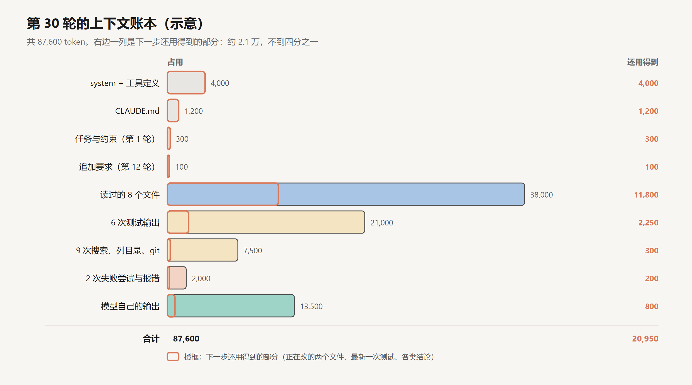
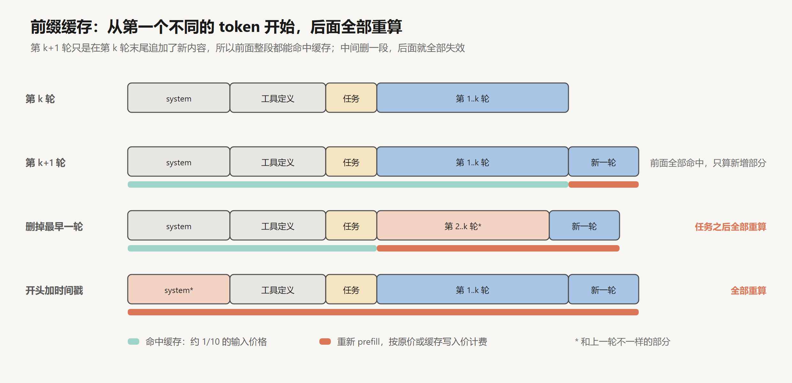
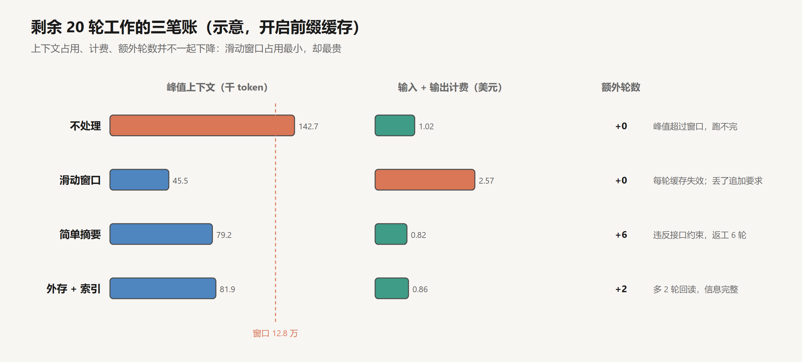

# 上下文工程

创建日期：2026-10-17

[上一篇](04-反馈与验证.md)给 agent 加上了测试和检查。代价是每一次测试输出、每一次读文件，都会原样留在上下文里。第 03 篇修邮箱 bug 只用了十轮；稍微大一点的任务，跑三五十轮很常见。

这一篇只追一个问题：

> 一个修 bug 的 agent 跑了 30 轮，读过 8 个文件，跑过 6 次测试，上下文快满了。怎样让它继续干下去，而且不忘掉已经确认的事？

先把第 30 轮的上下文摊开看清楚，再依次试三种办法：删掉旧内容，让模型写摘要，把原文存到外面、上下文里只留索引。每种办法都在同一个例子上看它留下了什么、丢了什么、花了多少钱。最后整理出一套保留规则。

文中的运行过程、token 数和费用都是构造的示意，数字可以手算核对，但不是实测记录。

## 1. 第 30 轮的上下文

### 1.1 任务

还是第 03 篇那个项目。这次用户报了一个大一点的问题：

> 批量导入用户（`POST /api/users/import`）有两个问题：一是部分新用户收不到欢迎邮件；二是同一个文件导入两次会报 500。请修复。注意：这个接口有外部客户在调用，请求和响应的格式都不能改。

到第 12 轮，用户又补了一句：

> 补充一下：重复的用户直接跳过就行，不要报错，也不要覆盖已有用户的资料。

前 30 轮大致是这样过的：

| 轮次 | 做了什么 | 得到什么 |
|---|---|---|
| 1 | 收到任务 | |
| 2–5 | 搜索 `import`，读 `users_import.py`、`user_service.py` | 导入时先建用户，再往队列里塞发邮件的任务 |
| 6–9 | 读 `worker.py`、`mailer.py` | **确认根因一**：worker 发一批邮件时，只要一封出错，`except` 就把整批任务吞掉了 |
| 10–11 | 跑全量测试 | 两个测试失败 |
| 12 | 用户追加要求 | 重复用户跳过，不报错，不覆盖 |
| 13–15 | 读 `models/user.py`，复现第二个问题 | **确认根因二**：`email` 有唯一约束，重复插入抛异常，接口直接 500 |
| 16–17 | 改 `worker.py`，改成逐封发送、单封失败只重试那一封 | `test_worker_retry` 通过 |
| 18–21 | 试着把发邮件改成在导入请求里同步完成 | `test_import_large` 超时，**回退** |
| 22–25 | 读 `templates.py`、`config.py`、`tests/test_import.py` | 了解测试怎么造数据 |
| 26–29 | 改 `users_import.py` 处理重复用户，中途两次编辑失败 | 改到一半 |
| 30 | 跑 `test_import_duplicates` | 仍然失败 |

### 1.2 账本

把第 30 轮发给模型的上下文按来源分类，每一类占多少、下一步还用不用得到，列成一本账：



几个数字是这样来的：8 个文件分别是 6,200、7,800、3,400、5,600、2,900、4,800、1,500、5,800 token，加起来 38,000。6 次测试里有两次是全量测试，每次 6,000，四次是单个测试，每次 2,250，加起来 21,000。模型自己的输出（思考、工具调用、说明）平均每轮 450，30 轮共 13,500。

总共 87,600 token。假设模型的窗口是 12.8 万，harness 设定用到七成左右就要处理，现在已经到线了。按每轮新增约 2,900 token 算，剩下的 20 轮做完会涨到 14 万以上，超出窗口。

右边那一列更要紧。下一步还用得到的只有 2 万出头：

- 正在改的两个文件 `users_import.py` 和 `worker.py`，共 11,800。
- 最近一次测试输出，2,250。
- 各类结论：9 次搜索得出的“东西在哪”，约 300；两次失败尝试的教训，约 200；模型在过程中做出的决定，约 800。
- 每次都要带的 system、工具定义、CLAUDE.md，以及用户的两条原话。

剩下的六万多 token，是已经消化过的原材料：读完得出结论的文件，过时的测试输出，搜索列表，以及模型一路上的自言自语。

### 1.3 长度带来的三个问题

这本账同时暴露了三个问题，它们的性质不同。

**容量。** 窗口是硬上限，超了就发不出去。这个最直观，但它其实是三个问题里最好解决的。

**成本。** 第 01 篇算过，agent 每一轮都要把全部上下文重新发一遍。这 87,600 token，剩下每一轮都要再发一次。第 6 节细算。

**注意力。** 最关键的那条约束“请求和响应的格式都不能改”，在第 1 轮的用户消息里，只有几十个 token，前面是 5,000 多 token 的 system、工具定义和 CLAUDE.md，后面是八万多 token 的文件和日志。第 12 轮那句追加要求，被夹在两次读文件中间。

2023 年的“Lost in the Middle”实验（Liu et al.）把答案所在的文档放在一组文档的不同位置，发现模型对开头和结尾的信息最敏感，放在中间时准确率明显下降。2025 年 Chroma 的“Context Rot”报告测了 18 个模型，在“复述一段重复文本”这种极其简单的任务上，表现也会随输入变长而下滑。Anthropic 的说法是，这是一条逐渐下降的曲线，不是到了某个长度突然失效。

所以即使窗口够大、钱也不在乎，把这六万多 token 的原材料留着，也会让那两条最重要的要求更难被注意到。

## 2. 第一种办法：删掉旧内容

最直接的想法：上下文太长，就删掉一部分。

### 2.1 删最早的

从最早的消息开始删，删到够用为止。

问题马上就出来了：最早的消息就是第 1 轮的用户任务。删掉它，agent 连自己在修什么都不知道了。所以任何删除策略都得先把用户的任务钉住。

### 2.2 保留首尾

改进一下：保留 system、工具定义、CLAUDE.md、第 1 轮的任务，再保留最近 4 万 token 的历史，中间的全删。

最近 4 万 token 大约是第 17 轮到第 30 轮。对照图里 F1 到 F6 这六条关键信息：


保住了：第 1 轮的约束（F3），第 18 到 21 轮同步发送失败的经过（F5），当前进度（F6）。

丢掉了：第 6 到 9 轮确认的根因一（F1），第 15 轮确认的根因二（F2），以及第 12 轮的追加要求（F4）。

F1 和 F2 丢了还能补救。F1 的修复已经写在 `worker.py` 里了，F2 下一次跑测试还会再报出来，无非多花几轮。F4 丢了就是另一回事。agent 接着改 `users_import.py`，看到唯一约束冲突，一个很自然的做法是“已存在就更新”。测试 `test_import_duplicates` 只检查了不再返回 500、用户数量没变，于是通过了。用户明确说过“不要覆盖已有用户的资料”，这条要求没有任何测试覆盖，在上下文里也已经被删掉了。

### 2.3 删除还会打掉缓存

还有一个不那么显眼的问题。第 01 篇提到过前缀缓存：如果这一轮请求的开头和上一轮完全一样，那一段就不用重新算，按大约十分之一的价格计费。缓存是从第一个 token 开始逐个比对的，遇到第一个不同的 token，从那里往后全部失效。



“保留最近 4 万 token”实际上是一个滑动窗口：每过一轮，窗口就往后挪一点，最前面被删掉的那段每轮都不一样。于是每一轮从任务描述之后就全部失效，4 万多 token 都要按原价重新算。第 6 节会看到，这样做比什么都不删还要贵。

删除的问题可以归结为一句：它按位置决定去留，而一条信息重不重要，和它在什么位置没有关系。

## 3. 第二种办法：让模型写摘要

那就按内容来决定去留：让模型把前 30 轮总结一下，用摘要代替原来的历史。

### 3.1 一份读起来很好的摘要

给模型的指令很简单：“请总结到目前为止的进展，以便继续工作。”它写出来的东西大概是这样：

```text
## 进展摘要

用户报告批量导入时部分新用户收不到欢迎邮件，重复导入同一文件会报 500。

已完成：
- 定位到 queue/worker.py 中发送欢迎邮件的异常处理有问题，
  已改为逐封发送、失败单独重试，test_worker_retry 已通过。
- 发现重复导入时数据库唯一约束冲突导致 500 错误。

进行中：
- 修改 api/users_import.py 以处理重复用户，test_import_duplicates 仍失败。

下一步：
- 完成重复用户的处理，然后运行完整测试。
```

这份摘要大约 1,500 token（实际会比上面这段长一些，带着更多文件和函数名），结构清楚，没有一句是错的。人读了会觉得写得挺好。

### 3.2 拿关键信息逐条核对

再拿那六条核对一遍（见上一节的图）：

- F1 根因一：只剩“异常处理有问题”，具体是“一封出错整批被吞”没写，算模糊。
- F2 根因二：在。
- F3 不能改接口格式：**没了**。摘要里的任务描述是模型转述的，转述时把“注意”后面那句当成背景丢掉了。
- F4 重复用户跳过、不覆盖：只剩“处理重复用户”，怎么处理没写。
- F5 同步发送会超时：**没了**。摘要只写成功的事，失败的尝试被当成噪声省略了。
- F6 当前进度：在。

### 3.3 一次返工

压缩之后，agent 接着处理重复用户。它的思路很合理：既然要跳过重复的，最好告诉调用方哪些被跳过了。于是它把响应从

```text
200  {"created": 3, "failed": 0}
```

改成了

```text
207  {"created": 3, "failed": 0, "skipped": ["a@x.com", "b@x.com"]}
```

207 是 HTTP 里表示“部分成功”的状态码，`skipped` 列出被跳过的邮箱。`test_import_duplicates` 断言的是状态码小于 500、数据库里没有重复用户，全部满足。全量测试也通过了。agent 汇报完成。

问题在代码审查时才被发现：外部客户的程序判断的是 `status == 200`，状态码一变，他们会把每次导入都当成失败。撤销修改、恢复原来的响应格式、重新跑测试、重新解释，前后又花了 6 轮。

这次返工的根源不在模型的判断，在于它做判断时手里已经没有“不能改格式”这条信息了。还有一个隐患暂时没发作：如果后面有人抱怨邮件发得慢，F5 已经不在了，agent 很可能会再试一次同步发送，再撞一次超时。

### 3.4 通顺不等于够用

这份摘要的问题，在于它是为“读懂发生了什么”写的，而接下来需要的是“能接着干活”。两者要的东西不一样：

- 读懂只需要大意；接着干活需要约束的原话，因为一个字的差别就可能决定做法。
- 读懂只关心结果；接着干活更需要知道哪些路走不通。
- 读懂可以省略证据；接着干活需要知道每个结论是从哪里来的，有疑问时可以回去查。

Anthropic 在讲上下文工程的文章里描述过 Claude Code 的压缩：保留架构上的决定、没解决的 bug、实现细节，丢掉重复的工具输出，压缩后再把最近访问过的五个文件重新读进来。他们给的调试建议是先追求召回，确认该留的都留下了，再慢慢精简。漏掉一条关键约束的代价，远大于多留几百个 token。

把这个建议落实到摘要指令上，可以改成一份清单：

```text
请为接手的人写一份工作笔记，按以下各项填写，没有的写“无”：
1. 用户的原始任务和全部约束，逐字照抄，不要改写
2. 用户在过程中追加或修改的要求，逐字照抄，注明是第几轮
3. 已确认的事实，每条写明证据（文件和行号、测试名）
4. 尝试过但失败的做法，以及失败的原因
5. 当前改到哪里：改了哪些文件，哪些测试还没过
6. 还没解决的问题，下一步打算
7. 读过的文件：路径、为什么读、得出什么结论
```

这已经好很多了。但第 1、2 项还是交给模型去“逐字照抄”。照抄的东西，其实不该经过模型的手。

## 4. 第三种办法：原文外存，上下文里留索引

### 4.1 分工

换一个思路：不让模型决定什么该扔，而是让 harness 把所有原文都存到上下文之外，上下文里只留下“去哪找”。

具体分三件事：

1. **用户消息由 harness 原样搬运。** 第 1 轮和第 12 轮的用户原话，harness 直接复制进压缩后的上下文，不经过模型。这是一个纯机械的操作，不会改写，也不会遗漏。
2. **大输出在产生时就落盘。** 读文件、跑测试、搜索的完整输出，工具层在返回时就写进 `.agent/logs/` 下的文件，记下路径。上下文里本来就可以只放开头几行、结尾几行和路径（第 02 篇讲过截断）。
3. **模型按清单写笔记。** 第 3 到第 7 项由模型填，但每一条都要附上证据的位置。

### 4.2 压缩后的上下文

第 30 轮压缩之后，新的上下文是这样的：

```text
[system + 工具定义]                                       4,000
[CLAUDE.md]                                               1,200
[原始要求，harness 原样搬运]
  第 1 轮 用户：批量导入用户（POST /api/users/import）有两个问题：……
               注意：这个接口有外部客户在调用，请求和响应的格式都不能改。
  第 12 轮 用户：补充一下：重复的用户直接跳过就行，不要报错，
               也不要覆盖已有用户的资料。
[工作笔记，模型按清单填写]
  已确认的事实
  - worker 发一批邮件时一封出错就吞掉整批。证据：src/queue/worker.py 88–97 行
  - email 唯一约束冲突导致 500。证据：src/models/user.py 31 行，第 15 轮复现
  失败过的做法
  - 把发邮件改成导入请求里同步完成：test_import_large 超时（30 秒上限）
    已回退。完整输出 .agent/logs/turn-20-pytest.txt
  当前进度
  - worker.py 已改为逐封发送、单封重试，test_worker_retry 通过
  - users_import.py 改到一半：已捕获唯一约束异常，还没实现“跳过且计数不变”
  - test_import_duplicates 失败，见下方最近一次输出
  未解决
  - 跳过的用户要不要计入响应？接口格式不能改，只能不计入
  文件索引
  | 路径                         | 为什么读       | 结论                        | 原文 |
  | src/api/users_import.py      | 导入入口       | 正在改                      | 需重读 |
  | src/services/user_service.py | 建用户的逻辑   | 无需改动                    | logs/turn-04-read.txt |
  | src/mail/mailer.py           | 发信           | 无问题                      | logs/turn-07-read.txt |
  | ……（其余 5 个）
[最近一次测试输出原文]                                     2,250
```

工作笔记约 4,800 token，整个上下文从 87,600 降到 10,000 左右。

对照六条关键信息，全部都在。而且“未解决”那一栏里，模型已经顺着约束想到了一个具体的设计问题：跳过的用户只能不计入响应，因为格式不能改。上一节那次返工，在这里根本不会发生。

### 4.3 代价

正在改的 `users_import.py` 不在上下文里了，测试文件也不在了。接下来第 31、32 轮，agent 要先把这两个文件重新读一遍，多了 2 轮，多读了 11,000 token。

这是这种做法固有的代价：省下的是“可能用不上”的原文，用得上的时候要花一次工具调用取回来。笔记里的索引写得越清楚，取回的次数越少；写得含糊，agent 就会重新去搜，第 08 篇讲 Ralph 时会看到，搜索结果不可靠时，agent 甚至会误以为某段代码不存在，又写一遍。

Manus 团队把这叫作“可恢复的压缩”：网页的内容可以从上下文里拿掉，只要 URL 还在；文件的内容可以拿掉，只要路径还在。文件系统在这里成了上下文的延伸，容量不限，而且 agent 可以自己读写。

### 4.4 更轻的一步：清除旧的工具结果

不一定要等到快满了才做一次大压缩。更轻的做法是持续地清理：第 5 轮读进来的文件，到第 25 轮多半只需要知道“读过、结论是什么”。把旧的工具结果替换成一行占位（“已清除，原文见 logs/turn-05-read.txt”），是风险最小的一种压缩，Anthropic 在 API 里把它做成了现成的功能（context editing）。

它的代价也要算清楚：被替换的那条结果后面的缓存全部失效。所以清理最好成批做，比如每 10 轮清理一次，而不是每轮清理一点。

## 5. 成本账

### 5.1 四个量

讨论成本时，常常把几件事混在一起。这里拆成四个量：

- **上下文占用**：某一轮发给模型的 token 数。决定会不会超出窗口，也影响注意力。
- **请求 token 累计**：剩下的工作里，每一轮的输入加起来。
- **计费**：命中缓存的部分按 0.1 倍计，新写入缓存的部分按 1.25 倍计，没开缓存的按原价计，再加上输出。
- **额外的调用**：压缩本身要调用一次模型；外存之后要回读；返工要多跑几轮。

### 5.2 算一遍

价格按 Claude Sonnet 一类模型的公开单价：输入每百万 token 3 美元，缓存写入是输入价的 1.25 倍，缓存读取是 0.1 倍，输出每百万 15 美元。剩余工作 20 轮，每轮上下文增长 2,900 token，每轮输出 450 token。

以“不处理”为例验算一遍。第 31 轮输入 87,600，其中上一轮已缓存的部分按 0.30 美元每百万计，新增部分按 3.75 美元每百万计；第 32 轮输入 90,500，以此类推。20 轮的输入加起来：

$$
\sum_{k=0}^{19} (87600 + 2900k) = 20 \times 87600 + 2900 \times 190 = 2{,}303{,}000
$$

其中新写入缓存的只有每轮的增量，绝大部分按 0.1 倍读取，最后计费约 1.02 美元。如果不开缓存，同样 230 万 token 全按原价，要 7.04 美元。

四种做法放在一起：



| 做法 | 峰值上下文 | 请求 token 累计 | 计费（有缓存） | 额外轮数 | 结果 |
|---|---|---|---|---|---|
| 不处理 | 142,700 | 230 万 | 1.02 美元 | 0 | 超出窗口，实际跑不完 |
| 滑动窗口（保留首尾） | 45,500 | 91 万 | 2.57 美元 | 0 | 覆盖了已有用户，违反追加要求 |
| 简单摘要 | 79,200 | 112 万 | 0.82 美元 | +6 | 改了接口格式，返工 |
| 外存 + 索引 | 81,900 | 112 万 | 0.86 美元 | +2 | 完成 |

### 5.3 几个反直觉的地方

**占用最小的最贵。** 滑动窗口每轮只发 4.6 万 token，计费却是不处理的两倍半。原因在 2.3 节：窗口每轮都在挪，缓存每轮都失效，那 4 万 token 的历史每轮都按原价算。请求 token 只有不处理的四成，计费反而是它的两倍半。

**开了缓存，压缩省的钱有限。** 外存 + 索引把峰值占用从 14 万多降到 8 万出头，计费只从 1.02 降到 0.86 美元，少了 15% 左右。因为在开缓存的情况下，不处理时那 8 万多 token 的历史本来就是按 0.1 倍计费的，压掉它们省不了多少。压缩在这里的主要价值是让任务能在窗口里跑完，以及让关键信息不被淹没，省钱是次要的。

**不开缓存时，账完全不同。** 同样的外存 + 索引，不开缓存要 3.83 美元，不处理要 7.04 美元，省了将近一半。所以“压缩能省多少钱”这个问题没有固定答案，要看服务端有没有缓存、缓存的价格是多少。

**便宜的方案可能最贵。** 简单摘要的计费最低，0.82 美元。但这个数字没有算上返工里人的时间，也没有算上如果没在审查时发现、上线以后外部客户出问题的代价。

### 5.4 让缓存一直命中

既然缓存对账单影响这么大，压缩方案本身也要照顾缓存。Manus 团队把 KV 缓存的命中率称为生产环境里的 agent 最重要的一个指标，并且给过一个数字：他们的 agent 输入和输出的 token 比约为 100 比 1。几条做法：

- **前缀里不放会变的东西。** 比如在 system prompt 开头写上精确到秒的当前时间，每一轮的缓存都会从第一个 token 失效（见上图最后一行）。
- **只追加，不修改。** 回头改一条旧消息，那条消息之后全部失效。需要清理就成批清理。
- **序列化要确定。** 同样的对象，这一轮序列化成 `{"a":1,"b":2}`，下一轮成了 `{"b":2,"a":1}`，缓存就断了。
- **工具定义不要中途增删。** 工具定义在上下文最前面，一改全部失效。Manus 的做法是工具定义始终完整保留，需要禁用某些工具时，在解码阶段把对应工具名的概率压成零（第 01 篇讲的约束解码）。为了方便按组屏蔽，他们给工具名统一加前缀，比如 `browser_`、`shell_`。

对压缩来说，这意味着压缩后的上下文要把 system、工具定义、CLAUDE.md 原样放在最前面。这样压缩完的第一轮，这 5,200 token 仍然能命中缓存，需要重新写入的只有后面的笔记部分。

## 6. 一开始就少放

前面三种办法都是事后处理。回头看那本账，很多 token 一开始就不该进来。

- **读文件读需要的部分。** 8 个文件里有 5 个只是为了确认“这里没问题”或者“东西在这里”。先用 `grep -n` 找到相关的行，再按行号范围读那几十行，而不是整个文件读进来。38,000 可以降到 14,000 左右。
- **测试输出只要失败的部分。** 用安静模式只输出失败的测试和简短的回溯，完整输出写进文件。21,000 可以降到 6,000 左右。
- **搜索结果限制条数。** 第 02 篇讲工具设计时说过，可能返回大量结果的工具要有默认上限，并告诉 agent 怎么缩小范围。7,500 可以降到 3,000 左右。

三项加起来少进来 43,500 token，第 30 轮的上下文是 44,100 左右。每轮的增长也会小一些，剩下 20 轮做完大概到七万多，不用压缩就能跑完。

Anthropic 在文章里把这叫作“及时加载”：上下文里只放轻量的线索，比如文件路径、查询语句、链接，需要的时候再用工具去取。Claude Code 的做法是 CLAUDE.md 一开始就放进上下文，代码则不预先检索，由 agent 用 `glob` 和 `grep` 现查。人接手一个项目也是这样，先看目录结构，知道东西大概在哪，需要时再打开具体的文件。

这和第 4 节的外存是一回事的两面：外存是把已经进来的原文挪出去，按需加载是让原文一开始就留在外面。

## 7. 引导注意力

容量和成本解决了，还剩注意力的问题。上下文里的东西都对，模型也可能看漏。

### 7.1 把目标反复写到末尾

Manus 的经验是，一个任务平均要调用约 50 次工具，模型很容易在中途偏离最初的目标，因为最初的任务描述被埋到了上下文中间。他们让 agent 维护一个 `todo.md`，每完成一步就重写一遍。在我们的例子里，第 30 轮的这份清单是这样的：

```text
# 修复批量导入
约束：接口的请求和响应格式不能改；重复用户跳过、不报错、不覆盖
- [x] 找到收不到邮件的原因（worker 吞掉整批）
- [x] worker 改为逐封发送、单封重试
- [x] ~~同步发送~~：会超时，放弃
- [ ] users_import.py：捕获唯一约束冲突，跳过该用户，计数不变
- [ ] test_import_duplicates 通过
- [ ] 跑全量测试
```

每次更新，这份清单都作为最新的工具调用出现在上下文末尾，正是模型注意力最集中的位置。约束写在清单的第二行，每重写一次就被提醒一次。这个做法不需要改模型，只是利用了模型本来就对末尾更敏感这一点。

### 7.2 保留失败

直觉上，失败的尝试是噪声，应该清掉。Manus 的经验相反：失败的动作和报错要留在上下文里。模型看到自己试过某个做法并且失败了，再做同样尝试的概率会降低。

前面简单摘要的例子里，F5 被当成噪声省掉了，就埋下了重复失败的隐患。外存 + 索引的笔记里专门有“失败过的做法”一栏，todo 清单里也保留了划掉的那一项，都是这个道理。

### 7.3 避免被自己带偏

模型很擅长模仿上下文里的模式。Manus 举的例子是批量审阅 20 份简历：处理完前几份之后，上下文里堆了好几组几乎一样的“读简历、写评价”，agent 就开始按惯性重复，越来越机械，甚至编出简历里没有的内容。他们的办法是在格式上加一点受控的变化，比如换几种措辞模板，打破过于整齐的重复。

在修 bug 的场景里也有类似的现象：连续几轮“改一行、跑测试、失败”之后，agent 容易陷入小修小补的循环，而不是停下来重新想。交错思考（第 03 篇）和定期重写 todo 清单，都能在一定程度上打断这种惯性。

## 8. 保留规则

把前面的分析收拢，得到一套可以直接用的规则：

| 类别 | 处理方式 | 理由 |
|---|---|---|
| 用户的原始任务、约束、中途追加的要求 | **原文保留**，由 harness 搬运，不经过模型 | 一个字的改写都可能改变做法；它们很短，留着几乎不花钱 |
| 正在修改的文件 | 原文保留，或者在压缩后立即重读 | 下一步就要用到精确的内容 |
| 最近一次检查（测试、lint）的输出 | 原文保留 | 下一步的修改就是根据它来的 |
| 已确认的事实 | **只留结论**，附证据的位置 | 结论是消化过的，原文可以按位置找回 |
| 失败的尝试 | **只留结论，但必须单独列出** | 摘要最容易把它当噪声丢掉，丢了就会重复犯错 |
| 读过但不再修改的文件、旧的测试输出、搜索结果 | **只留可恢复的位置**：路径、行号、日志文件 | 多半用不上，用得上时花一次工具调用取回 |
| system、工具定义、项目说明 | 原样放在最前面，不改动 | 保住前缀缓存 |

### 8.1 怎样知道它管用

规则写出来了，还要能检查它有没有起作用。几个办法：

- **压缩后做一次核对。** 让模型在压缩后列出当前所有的约束，harness 和用户消息的原文比对。用户消息本来就是 harness 搬运的，这一步主要检查模型有没有真正读到、理解到。
- **看压缩后的行为。** 统计压缩之后有多少次重复执行了已经失败过的命令，多少次重新读取了刚刚压缩掉的文件，多少次重新搜索已经找到过的东西。这几个数字高，说明笔记写得不够。
- **把约束写进评估。** 第 12 篇会讲评估。像“不能改接口格式”这样的要求，最好变成一个检查，比如对比修改前后的响应格式。这次的返工，就是因为这条约束只存在于对话里，没有任何测试覆盖。

### 8.2 条件变了怎么办

这套规则是在“修 bug、30 轮、有前缀缓存”这个条件下得出来的。条件变了，取舍也要跟着变：

- **任务短。** 十几轮就能做完的任务，什么都不用做，留着全部历史最简单，缓存也最划算。
- **服务端没有缓存。** 每一轮都按原价计费，压缩的省钱效果明显得多，可以更早、更频繁地压缩。
- **约束多而细。** 比如一份几十条要求的需求文档，“原文保留”的部分本身就很大。这时要么把需求整理成一份结构化的清单文件，压缩后重新读入，要么把能变成检查的要求都变成检查（第 04 篇）。
- **信息很难找回。** 外存的前提是原文能按位置找回。如果信息来自一次性的环境，比如某个已经关闭的网页会话、一次无法复现的报错，那就要在上下文里多留一些，或者在落盘时就把关键部分摘出来。

## 9. 下一个问题

这一篇处理的是随轮数增长的那部分上下文。但账本里还有一类成本是固定的：system prompt 和工具定义，每一轮都在，每一轮都要算。

一个只修 bug 的 agent，这部分只有 4,000 token。想让它再会做 PPT、处理 PDF、按团队流程写周报，每一项都要一段说明、几个注意事项、几个脚本。全塞进 system prompt，固定成本很快会涨到几万，而一次任务用到的只是其中一项。

下一篇讲怎么让这些能力也做到按需加载。

## 小结

- 上下文变长同时带来容量、成本和注意力三个问题。先做一本账：每一类内容占多少，下一步还用不用得到。例子里 87,600 token 中真正还用得到的只有约 2.1 万。
- 按位置删除（删最早的、保留首尾）不看内容重要不重要，会删掉夹在中间的要求；滑动窗口还会让缓存每轮失效，比不处理更贵。
- 让模型写摘要能按内容取舍，但摘要是为“读懂”写的，容易丢掉约束的原话和失败的尝试。通顺不等于够用。摘要指令应该是一份清单，并且先保证召回。
- 更稳的做法是分工：用户原话由 harness 原样搬运，大输出在产生时落盘，模型只写带证据位置的结论。代价是需要时要回读。
- 上下文占用、请求 token、计费、额外调用这四个量不一起下降。开了缓存时，压缩主要是为了装得下、看得清，省钱是次要的；没有缓存时，压缩省钱明显得多。压缩后要把不变的前缀原样放在最前面。
- 很多 token 一开始就不必进来：按行读文件、只看失败的测试、限制搜索条数。
- 检查规则是否管用：压缩后核对约束，统计重复失败和重复读取，把重要的约束变成测试。

## 参考

- Rajasekaran, P. et al. (Anthropic), 2025. *Effective context engineering for AI agents*. [博客](https://www.anthropic.com/engineering/effective-context-engineering-for-ai-agents)
- Ji, Y. (Manus), 2025. *Context Engineering for AI Agents: Lessons from Building Manus*. [博客](https://manus.im/blog/Context-Engineering-for-AI-Agents-Lessons-from-Building-Manus)
- Liu et al., 2023. *Lost in the Middle: How Language Models Use Long Contexts*. [arXiv:2307.03172](https://arxiv.org/abs/2307.03172)
- Hong, K. et al. (Chroma), 2025. *Context Rot: How Increasing Input Tokens Impacts LLM Performance*. [报告](https://www.trychroma.com/research/context-rot)
- Anthropic. *Prompt caching*. [文档](https://docs.claude.com/en/docs/build-with-claude/prompt-caching)
- Anthropic. *Context editing*. [文档](https://docs.claude.com/en/docs/build-with-claude/context-editing)
