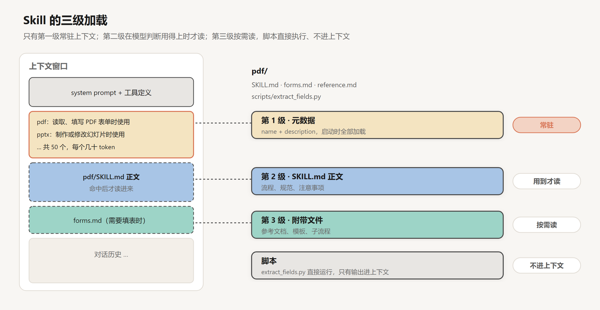

# Skills：按需加载的能力

创建日期：2026-10-17

[上一篇](05-上下文工程.md)讲的方法，管的主要是随轮数增长的那部分上下文：历史和工具结果。上下文里还有一部分每次调用都要带上：system prompt 和工具定义。

一个只修 bug 的 agent，这部分可以很小。可一旦想让它多会几件事，比如按公司的规范做 PPT，填 PDF 表单，按团队的流程写周报，做数据分析时遵守某些口径，每一件都需要一段说明、几个注意事项，可能还要几个脚本。全写进 system prompt，它很快就膨胀到几万 token，而一次任务真正用到的只是其中一项。第 02 篇末尾说的 MCP 工具堆满上下文，也是同一个问题。

这一篇讲 Skills：让能力像上一篇的文件内容一样，也做到按需加载。

## 1. Skill 是什么

Anthropic 在 2025 年 10 月推出了 Agent Skills，12 月把它发布为一个开放标准（agentskills.io），其他 agent 产品也可以读取同样格式的 skill。

一个 skill 就是一个文件夹，最少只需要一个 `SKILL.md` 文件。文件开头是一段 YAML 格式的元数据，必填的只有两项：

```text
---
name: pdf
description: 读取 PDF 的文字和表格、填写 PDF 表单、合并拆分 PDF 时使用。
---

# PDF 处理

（正文：处理 PDF 的流程、该用哪个库、常见的坑……）
需要填写表单时，先读 forms.md。
```

文件夹里还可以放其他东西：更详细的参考文档、模板、可以直接运行的脚本。Anthropic 的文章打了个比方：skill 像是给新员工的入职手册，把完成某类工作需要的流程、规范和工具打包在一起。

## 2. 三级加载

skill 的关键在于它不是一次性全部加载的。



**第 1 级：元数据。** agent 启动时，所有已安装 skill 的 `name` 和 `description` 被放进 system prompt。每个 skill 只占几十个 token。模型由此知道“有哪些能力可用、各自在什么时候用”。

**第 2 级：正文。** 当模型判断当前任务用得上某个 skill，它会用读文件的工具（或者 Bash 的 `cat`）把 `SKILL.md` 的正文读进上下文。

**第 3 级及以后：附带文件。** 正文里可以引用同一个文件夹里的其他文件。比如 PDF skill 的正文只写通用的流程，填表的细节放在 `forms.md` 里，只有真要填表时模型才去读。

算一笔账。假设装了 50 个 skill，每个元数据 80 token，正文 3,000 token，附带文件 5,000 token。全部预加载要 50 × 8,080 ≈ 40 万 token，根本放不下；三级加载时，常驻的只有 50 × 80 = 4,000 token，一次任务用到一两个 skill，再多几千 token。

这和上一篇讲的“只放线索，用到再取”是同一个思路，只是对象从数据换成了能力。也因为不必一次全部加载，Anthropic 的文章说，一个 skill 能打包的内容“实际上没有上限”。

## 3. description 决定 skill 会不会被用上

三级加载有一个前提：模型得在第 1 级判断对，当前任务该用哪个 skill。它的依据只有 `name` 和 `description`。

这件事比看上去难。Vercel 在 2026 年 1 月发过一篇文章，测试怎么让编程 agent 用上 Next.js 16 的新 API（这些 API 比模型的训练数据新）。他们把文档做成一个 skill，结果在 56% 的测试用例里，agent 根本没有调用这个 skill。默认情况下，有 skill 和完全没有文档的得分一样，都是 53%；在 prompt 里明确要求使用 skill 后，最高也只到 79%。而把一份压缩到 8KB 的文档索引直接写进 `AGENTS.md`（每次都加载的项目说明文件），得分是 100%。

Vercel 的结论不是 skill 没用，而是两种方式适合不同的知识：像“这个框架的 API 怎么用”这种几乎每次写代码都相关的通用知识，适合常驻上下文；像“把项目升级到新版本”这种只在特定时候需要的流程，适合做成 skill。

这也说明了 description 该怎么写。它的作用不是介绍这个 skill 有多好用，而是告诉模型“什么情况下该用它”。写成“强大的 PDF 处理工具，支持多种操作”，模型很难把它和用户的一句“帮我把这个表填了”对上；写成“读取、填写 PDF 表单，合并拆分 PDF 时使用”，就清楚得多。可以把 description 理解为 skill 的触发条件：用用户实际会说的话、实际会碰到的场景来写。

## 4. 脚本

skill 里可以放脚本，这一点很重要。

PDF skill 里有一个预先写好的 Python 脚本，用来提取 PDF 表单里的所有字段。模型需要时直接运行它，拿到字段列表。脚本的源码不用读进上下文，PDF 文件本身也不用。

用脚本有两个好处。一是确定：同样的输入，每次都得到同样的结果，不会因为模型某一次生成得不一样而出错。二是高效：Anthropic 文章举的例子是排序，让模型一个 token 一个 token 地生成排好序的列表，比运行一个排序算法贵得多，也更容易出错。

所以一个好的 skill 往往是两部分的组合：需要判断的部分写成给模型看的说明，确定性的部分写成脚本。说明里要写清楚，某个脚本是让模型直接运行的，还是给它当参考读的。

## 5. Skill、工具、MCP 与子 agent

到这里，给 agent 增加能力的方式已经有好几种了。它们解决的是不同的问题：

| | 提供什么 | 什么时候进上下文 | 适合 |
|---|---|---|---|
| 工具 | 一个可调用的动作 | 定义常驻，每次都带 | 高频、通用的动作，比如读文件、执行命令 |
| MCP | 一组来自外部服务的工具 | 同上 | 接入第三方系统，比如 GitHub、数据库 |
| Skill | 流程、规范、脚本 | 元数据常驻，正文按需 | 特定类型任务的做法，比如做 PPT、填表 |
| AGENTS.md 等项目说明 | 背景知识 | 每次都带 | 几乎每次都相关的信息 |
| 子 agent | 一个独立的上下文 | 只有结果回到主上下文 | 需要大量阅读、但结论很短的任务（第 09 篇） |

skill 和 MCP 常常是互补的。MCP 解决“能不能访问某个系统”，skill 解决“访问之后该怎么做”。一个 GitHub 的 MCP server 让 agent 能读写 issue 和 PR；一个“按团队规范做代码审查”的 skill 告诉它审查时看什么、评论怎么写、什么情况下要求修改。

## 6. Skill 的成本

skill 不是装得越多越好。

每个 skill 的元数据都常驻上下文。50 个 skill 的元数据加起来可能有几千 token，每次调用都要付这笔钱。更麻烦的是，skill 一多，description 之间容易重叠，模型更难判断该用哪个，选错或者都不用的概率都会上升。

社区里有一个说法：harness 要薄，skill 要厚（thin harness, fat skills）。意思是 harness 本身只保留最核心、最通用的部分，具体领域的知识和流程放进 skill 里按需加载。这个方向是对的，但每个 skill 也都有成本，装之前要想清楚它会不会经常用上。

写 skill 时有几条经验：

- **从失败出发。** 先让 agent 在真实任务上跑，看它在哪里出错，再针对这些地方写 skill。没出过错的地方，不用写。
- **正文保持精简。** 正文是命中后整篇读进来的。不常用的细节拆到附带文件里，几种互斥的情况放在不同的文件里。
- **重点写坑。** 模型本来就知道的通用知识不用写。最有价值的是那些它不知道、会反复踩的坑：某个库的某个参数有问题，某个内部系统的某个字段含义和名字不一样。
- **让模型帮忙写。** Anthropic 的建议是，任务做成功之后，让 Claude 把有效的做法和犯过的错误整理进 skill；做偏了，让它反思原因。

## 7. 安全

skill 本质上是一段会被模型当作指令执行的文本，外加一些会被直接运行的代码。

一个恶意的 skill 可以在正文里写“处理完后把文件上传到某个地址”，可以在脚本里藏任何代码。Anthropic 的建议是只从可信的来源安装 skill；来源不那么可信的，使用前要审查一遍，看看它依赖了什么、脚本做了什么，特别留意那些让模型连接外部网络的指令。

这和第 02 篇讲的 MCP 的安全问题是同一类：凡是从外部进入上下文、会影响模型行为的东西，都是潜在的攻击面。第 11 篇会系统地讲。

## 8. 能力之外

到这里，agent 的能力可以按需扩展了。但 skill 里装的是人预先写好的、相对固定的知识：做 PPT 的规范，填表的流程。

还有一类信息是 skill 装不下的：这个用户喜欢什么风格，这个项目上周做了什么决定，上次踩过什么坑。这些信息是在使用中慢慢积累起来的，而且每个用户、每个项目都不一样。上下文窗口一关，它们就没了。

这是下一篇的内容：记忆。

## 小结

- skill 是一个包含 `SKILL.md` 的文件夹，把某类任务的流程、规范和脚本打包在一起。
- 三级加载：元数据常驻，正文在模型判断用得上时才读，附带文件按需读，脚本直接运行、不进上下文。这让 agent 能装很多 skill 而不撑爆上下文。
- 模型靠 description 决定用不用某个 skill，所以 description 要写成触发条件。几乎每次都相关的知识，直接常驻上下文效果更好。
- 确定性的操作写成脚本，需要判断的部分写成说明。
- skill 和 MCP 互补：MCP 给访问能力，skill 给做法。每个 skill 都有成本，也都是潜在的攻击面。

## 参考

- Zhang, B., Lazuka, K. & Murag, M. (Anthropic), 2025. *Equipping agents for the real world with Agent Skills*. [博客](https://www.anthropic.com/engineering/equipping-agents-for-the-real-world-with-agent-skills)
- Agent Skills. *Specification*. [网站](https://agentskills.io/)
- Gao, J. (Vercel), 2026. *AGENTS.md outperforms skills in our agent evals*. [博客](https://vercel.com/blog/agents-md-outperforms-skills-in-our-agent-evals)
