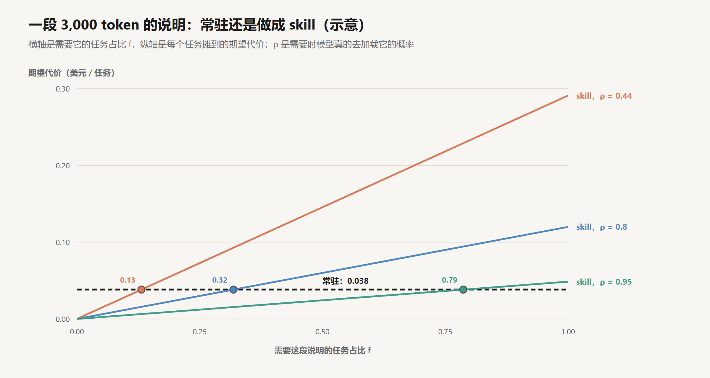

# Skills：按需加载的能力

创建日期：2026-10-17

[上一篇](05-上下文工程.md)处理的是上下文里随轮数增长的部分：历史和工具结果。另有一部分不随轮数增长，但每一轮都在：system prompt、工具定义、项目说明。agent 要会的事情越多，这部分越大。按公司规范做幻灯片、填 PDF 表单、按团队流程做代码审查、按某个口径做数据分析，每一项都需要几千 token 的说明，可能还要几个脚本。全部写进 system prompt，固定部分很快膨胀到几万甚至几十万 token，而一次任务只用到其中一两项。

Skill 的做法是把一段知识从“每一轮都在上下文里”改成“需要时由模型自己去取”。常驻的只有一行名字和描述，正文和附带文件在模型判断用得上时才读进来。这样省下了固定占用，代价是多了一次路由判断：模型只凭名字和描述决定加载与否。判断错了，这段知识对这次任务来说就等于不存在。

所以 skill 的设计归结为两个问题：哪些知识值得用一次路由判断换取上下文空间，以及怎样让这次判断可靠。这篇文章先拆开 skill 的结构和加载过程，再分析路由的可靠性，推导“常驻还是按需”的取舍条件，然后讨论正文的切分、脚本的作用，以及 skill 和其他几种扩展机制的分工。文中构造的数字都是示意，可以手算核对。

## 1. 结构与加载

### 1.1 一个 skill 的组成

Anthropic 在 2025 年 10 月推出了 Agent Skills，12 月把格式发布为开放标准（agentskills.io），其他 agent 产品也可以读取同样格式的 skill。

一个 skill 是一个文件夹，最少只需要一个 `SKILL.md`。文件开头是 YAML 格式的元数据，必填的只有 `name` 和 `description`，前者最长 64 个字符，后者最长 1,024 个字符：

```text
pdf/
├── SKILL.md
├── forms.md                 # 填写表单的细节
├── reference.md             # 各个库的接口说明
└── scripts/
    └── extract_fields.py    # 提取表单字段

--- SKILL.md ---
---
name: pdf
description: 读取 PDF 中的文字和表格、填写 PDF 表单、合并或拆分 PDF 时使用。
---

# PDF 处理

（正文：通用流程、该用哪个库、常见的坑）
需要填写表单时，先读 forms.md。
提取表单字段时，运行 scripts/extract_fields.py <文件路径>，不要读它的源码。
```

Anthropic 的文章把 skill 比作给新员工的入职手册：完成某类工作需要的流程、规范和工具，打包放在一起。

### 1.2 三级加载在消息里的样子

skill 的内容分三级进入上下文。


**第 1 级：元数据。** agent 启动时，harness 扫描所有已安装的 skill，把每个的 `name` 和 `description` 拼成一个列表放进 system prompt。每个 skill 几十个 token，常驻。

**第 2 级：正文。** 模型判断当前任务用得上某个 skill，就调用工具把 `SKILL.md` 读进来。Claude Code 里有一个专门的 Skill 工具做这件事，在其他 harness 里也可以是普通的读文件工具或者 Bash 的 `cat`。正文作为一条工具结果进入历史。

**第 3 级：附带文件和脚本。** 正文里引用的其他文件，模型在需要时再读；脚本由模型通过 Bash 运行，只有输出进入上下文。

用户说“把这份报名表按附件里的信息填好”，消息列表的变化是这样的：

```text
system:    ... 可用的 skills：
             - pdf: 读取 PDF 中的文字和表格、填写 PDF 表单、合并或拆分 PDF 时使用。
             - pptx: 制作或修改幻灯片时使用。
             - ...（共 50 个）
user:      把这份报名表按附件里的信息填好
assistant: [tool_use: Skill(pdf)]                                  # 第 1 级 → 第 2 级的路由判断
user:      [tool_result: SKILL.md 正文，约 3,000 token]
assistant: [tool_use: read_file(pdf/forms.md)]                     # 第 2 级 → 第 3 级
user:      [tool_result: forms.md，约 2,500 token]
assistant: [tool_use: bash("python pdf/scripts/extract_fields.py 报名表.pdf")]
user:      [tool_result: 字段列表，约 400 token]                     # 脚本的输出，不含源码
...
```

这个过程里有两次由模型做出的加载判断：第一次是根据 system 里的描述决定读不读正文，第二次是根据正文里的指引决定读不读 `forms.md`。三级加载的经济性和可靠性，都取决于这两次判断。

### 1.3 token 的账

假设装了 50 个 skill，每个元数据 80 token，正文 3,000 token，附带文件合计 5,000 token，分成两个文件各 2,500。

全部预加载需要 $50 \times (80 + 3{,}000 + 5{,}000) = 404{,}000$ token，超出绝大多数模型的窗口。三级加载时，常驻的只有 $50 \times 80 = 4{,}000$ token；一次任务用到两个 skill、每个读一个附带文件，再加 $2 \times 3{,}000 + 2 \times 2{,}500 = 11{,}000$，合计 15,000。

常驻部分和装了多少 skill 成正比，按需部分只和这次任务用到的 skill 有关。这和第 05 篇“上下文里只放线索，用到再取”是同一个思路，对象从数据换成了做事的方法。Anthropic 的文章因此说，一个 skill 能打包的内容实际上没有上限：只要拆成足够细的文件，没用到的部分不占上下文。

## 2. 路由

### 2.1 description 是唯一的依据

第 1 级到第 2 级的那次判断，模型能依据的只有当前对话和 skill 列表里的名字和描述。从结构上看，这是一个分类问题：输入是任务，类别是 50 个 skill 加上“都不用”，特征是 50 段描述文本。

这个分类器有两个错误率：

- **漏用**：任务需要这个 skill，模型没有加载。设需要时真正加载的概率为 $\rho$，漏用的概率就是 $1 - \rho$。
- **误用**：任务不需要，模型加载了，或者加载了一个相近但不对的 skill。设概率为 $\varphi$。

误用的代价是读入几千 token 无关的正文，可能还会被不适用的流程带偏。漏用的代价通常大得多：模型按自己的默认做法做，恰好踩中 skill 里专门写过的坑。漏用还不会报错，第 04 篇说的“看不见的失败”在这里同样成立。

### 2.2 实测的漏用率

Vercel 在 2026 年 1 月发表的一篇文章测了这个问题。他们想让编程 agent 正确使用 Next.js 16 的新 API，这些 API 比模型的训练数据新。他们把文档做成一个 skill，结果在 56% 的测试用例里，agent 根本没有调用它，也就是 $\rho \approx 0.44$。默认配置下，有这个 skill 和完全没有文档的得分一样，都是 53%；在 prompt 里明确要求使用 skill 之后，得分最高到 79%。另一种做法是把文档压缩成一份约 8KB 的索引，直接写进 `AGENTS.md`（每次都加载的项目说明文件），索引指向具体的文档文件，得分是 100%。

这个结果说明了两件事。第一，路由判断的漏用率可以很高，高到让 skill 完全失去作用。模型在写 Next.js 代码时，大概率不认为自己需要查文档，因为它“觉得”自己知道这些 API。最需要 skill 的情况，恰恰是模型以为自己会、其实不会的情况，而这种情况下它最不会主动去查。第二，同样的知识换一个放置方式，效果差别巨大。第 3 节会把这个差别算出来。

### 2.3 描述的写法

描述是分类器唯一的特征，它的写法直接决定 $\rho$ 和 $\varphi$。

| 写法 | 例子 | 问题 |
|---|---|---|
| 介绍功能 | 强大的 PDF 处理工具，支持多种操作 | 没有说什么时候用，和用户的话对不上 |
| 写触发条件 | 读取 PDF 中的文字和表格、填写 PDF 表单、合并或拆分 PDF 时使用 | 能和“把这个表填好”对上 |
| 写触发条件和边界 | 同上，另加：只处理 PDF；Word 文档用 docx skill | 降低和相近 skill 的混淆 |
| 写模型可能误判的场景 | 编写或修改任何使用 Next.js App Router 的代码时使用，包括你认为自己熟悉的 API | 针对“以为自己会”的情况 |

几条规律：

- **写“什么时候用”，不写“有多好”。** 描述是给分类器的条件，不是给人看的介绍。
- **用任务里会出现的词。** 用户说的是“填表”“做个 PPT”“把这几个 PDF 合起来”，描述里要有这些说法，或者明确列出这类场景。
- **写清边界。** 两个 skill 的场景相近时，在各自的描述里说明不归自己管的情况交给谁。
- **覆盖模型的盲区。** 对模型以为自己熟悉、实际上已经过时的知识，描述要主动把这些场景纳入，不要依赖模型自己意识到需要查。

### 2.4 数量的影响

skill 越多，路由越难。常驻的元数据随数量线性增长，50 个 skill 是 4,000 token，200 个就是 16,000；更麻烦的是描述之间的重叠。“代码审查”“安全审查”“PR 描述撰写”三个 skill 同时存在时，一个“帮我看看这个 PR”的请求可能触发其中任何一个，也可能哪个都不触发。

和第 02 篇的工具数量问题一样，这里也有对应的手段：只装经常用到的 skill；按项目区分安装的范围，让一个项目只看到和它相关的那部分；描述相近的几个合并成一个，在正文里再分流。

$\rho$ 和 $\varphi$ 是可以测的。准备两组任务描述：一组应该触发某个 skill，包括各种不同的说法；另一组不应该触发，特别是那些看起来相近、实际属于别的 skill 的情况。每组跑若干次，统计加载率，就得到这个 skill 的 $\rho$ 和 $\varphi$。改写描述之后再跑一遍，比较前后的数字。Anthropic 用来创建 skill 的 skill-creator 就带有这类触发测试，可以据此迭代描述。没有经过这种测试的描述，它的 $\rho$ 是多少，事先无从知道。

## 3. 常驻还是按需

### 3.1 期望代价

一段知识可以常驻（写进 system prompt 或 `AGENTS.md`），也可以做成 skill。比较两者，需要几个量（示意）：

- $S$：这段知识的长度，取 3,000 token；
- $T$：一次任务的平均轮数，取 30；
- $f$：需要这段知识的任务占比；
- $\rho$：需要时真的加载它的概率；
- $F$：漏用一次的代价，按返工计，取 0.5 美元；
- 单价沿用前几篇：写入缓存每百万 token 3.75 美元，命中缓存 0.30 美元。

**常驻。** 每个任务开始时写入缓存一次，之后每一轮命中一次：

$$
R = S\,(p_w + T\,p_r) = 3{,}000 \times (3.75 + 30 \times 0.30) / 10^6 \approx 0.038 \text{ 美元}
$$

**做成 skill。** 常驻的只有几十 token 的元数据，可以忽略。需要它的任务里，以概率 $\rho$ 加载，平均在任务中途读入，之后的约 $T/2$ 轮都要带着它，代价为 $L = S\,(p_w + \tfrac{T}{2}\,p_r) \approx 0.025$ 美元；以概率 $1 - \rho$ 漏用，代价为 $F$。不需要它的任务里，误用的情况先忽略。每个任务的期望代价是：

$$
K = f\,\big[\rho\,L + (1 - \rho)\,F\big]
$$

两者相等时的 $f$ 就是分界点：

$$
f^{*} = \frac{R}{\rho\,L + (1 - \rho)\,F}
$$

需要它的任务占比高于 $f^*$ 时常驻更划算，低于 $f^*$ 时做成 skill 更划算。

| $\rho$ | $\rho L + (1-\rho) F$ | 分界点 $f^*$ |
|---|---|---|
| 0.44 | 0.291 | 0.13 |
| 0.8 | 0.120 | 0.32 |
| 0.95 | 0.049 | 0.79 |



### 3.2 推论

**漏用率决定了 skill 的适用范围。** $\rho = 0.95$ 时，只要不是八成以上的任务都需要，做成 skill 就更划算；$\rho = 0.44$ 时，只要超过 13% 的任务需要，常驻就更划算。Vercel 的例子正落在后一种情况：Next.js 的 API 几乎每次写代码都相关，$f$ 接近 1，而 $\rho$ 只有 0.44，常驻的优势是压倒性的。

**有缓存时，常驻在钱上很便宜。** 3,000 token 常驻 30 轮，每个任务不到 4 美分。分母里起主导作用的几乎总是 $(1 - \rho)F$ 这一项：只要漏用的代价远大于读入的代价，决定取舍的就是漏用率，而不是 token 单价。

**常驻真正的约束是窗口和注意力。** 上面的计算只算了钱。常驻的内容每一轮都占着窗口，和任务约束、当前状态竞争模型的注意力（第 05 篇第 2.3 节）。所以常驻区要有一个总预算 $B$，比如几千到一两万 token。在预算之内，按单位长度的收益排序：一段知识常驻带来的收益约为 $f(1 - \rho)F$，即避免的漏用损失，除以它占的长度 $S$。比值高的先放进常驻区，放满为止，剩下的做成 skill。

**常驻和按需可以混合。** Vercel 放进 `AGENTS.md` 的不是全部文档，而是一份 8KB 的索引，每一条指向具体的文档文件。这相当于把“知道有这些文档、遇到什么情况该查哪一份”这层判断常驻，把文档正文留在按需读取的位置。和 skill 的元数据相比，差别在于索引更细，而且始终和项目说明放在一起，模型每一轮都看得到它。一段知识太大放不进常驻区、漏用的代价又很高时，这种做法把 $\rho$ 提高到接近常驻的水平，占用接近 skill 的水平。

## 4. 正文的切分

### 4.1 正文是整篇读入的

第 2 级加载时，`SKILL.md` 的正文作为一条工具结果整篇进入历史，之后每一轮都在。正文里写的每一段，只要这个 skill 被用到，就一直占着上下文。

设一个 skill 被用到时，正文长度为 $S_0$，附带文件 $j$ 的长度为 $S_j$，被读取的概率为 $g_j$，一次使用读入的期望长度是：

$$
E = S_0 + \sum_j g_j\,S_j
$$

一段内容放在正文里，每次使用都要付它的长度；放在附带文件里，只有用到时才付，但要多一次第 3 级的路由判断，也就多一次漏读的可能。所以切分的原则和第 3 节一致：大多数使用场景都需要的，留在正文；只在特定分支需要的，放进附带文件。几种互斥的情况，比如“填表”“合并”“提取表格”，各放一个文件，一次任务通常只读其中一个。

### 4.2 第二级路由

正文里的指引，比如“需要填写表单时，先读 forms.md”，承担的是第 3 级的路由，和描述承担第 2 级路由是一回事。它的写法也有同样的要求：写清楚在什么情况下读，读完之后做什么；不要写成“更多信息见 forms.md”，这种写法不给模型任何判断依据。

第 3 级的路由比第 2 级可靠一些。此时模型已经读了正文，知道这个 skill 的整体结构，判断时的信息比只看一行描述多得多。这也是三级结构的一个好处：越往下，判断的依据越充分。

## 5. 脚本

### 5.1 确定性的步骤交给代码

skill 里可以放脚本。PDF skill 的 `extract_fields.py` 提取表单里的所有字段，模型需要时直接运行，拿到字段列表。

这样做在三方面起作用。

**token。** 脚本的源码不进上下文，PDF 本身也不进。一份 40 页的表单，读出全部文字可能有三万 token，脚本输出的字段列表只有几百 token（示意）。

**可靠性。** 不用脚本时，模型要么逐页阅读后自己整理字段，要么当场写一段提取代码再运行。前者是用生成 token 的方式做一件确定性的工作，后者每次都可能写出不同的、未经测试的代码。用第 03 篇的语言说，原本要由模型完成的若干步，被替换成一步确定的调用，任务的步数 $n$ 减少了，每一步的成功率 $p$ 也更高。Anthropic 的文章举的例子是排序：让模型一个 token 一个 token 地生成排好序的列表，比运行一个排序算法贵得多，也更容易出错。

**一致性。** 同样的输入，每次得到同样的结果。团队里不同的人、不同的会话用同一个 skill，处理方式是一样的。

### 5.2 写法上的要求

一个好的 skill 往往是两部分的组合：需要判断的部分写成给模型的说明，确定性的部分写成脚本。说明里有几处需要写清楚：

- 这个脚本是让模型**运行**的，还是给它**参考**的。前者要明确写“不要读源码”，否则模型可能先把整个脚本读一遍，白白占用上下文。
- 怎么调用：参数、输入文件的位置、输出的格式。
- 失败时会输出什么。脚本的报错和第 04 篇的检查输出一样，是模型下一轮的输入，要写得能指导下一步。

## 6. 与其他扩展机制的分工

给 agent 增加能力的方式已经有好几种。它们的差别可以从两个维度看：内容什么时候进上下文，以及由谁决定加载。

| 机制 | 提供什么 | 何时进上下文 | 谁决定加载 | 选错或漏用的后果 |
|---|---|---|---|---|
| 工具 | 一个可调用的动作 | 定义常驻 | 始终加载 | 定义过多时选错工具 |
| 延迟加载的工具 | 同上 | 名字常驻，定义按需 | 模型搜索后加载 | 没想到去搜 |
| MCP | 一组外部系统的工具 | 同工具 | 同工具 | 同工具 |
| Skill | 流程、规范、脚本 | 描述常驻，正文按需 | 模型 | 漏用，按默认做法做 |
| AGENTS.md 等项目说明 | 背景知识、约定、索引 | 始终 | 始终加载 | 占用窗口，稀释注意力 |
| hooks | 在固定时机执行的程序 | 只有输出进入 | harness | 不存在漏用 |
| 子 agent | 一个独立的上下文 | 只有结论回到主上下文 | 模型 | 第 09 篇 |

表里可以看出一条主线：从“始终加载”到“模型决定加载”，常驻的占用越来越小，漏用的风险越来越大。hooks 在这条线之外，它由 harness 在固定时机触发，不依赖模型的判断，所以第 04 篇把“必须执行”的检查放在 hooks 里，而不是写进 skill 让模型记得去做。

Claude Code 对工具做了和 skill 相同的处理：工具很多时，一部分工具只把名字放进上下文，模型需要时调用一个搜索工具（ToolSearch）取回完整定义。工具定义和 skill 正文的按需加载，面对的是同一个取舍。

skill 和 MCP 通常互补。MCP 解决能不能访问某个系统，skill 解决访问之后怎么做。一个 GitHub 的 MCP server 让 agent 能读写 issue 和 PR；一个“按团队规范做代码审查”的 skill 告诉它审查时看什么、评论怎么写、什么情况下要求修改。

## 7. 编写与维护

**从失败出发。** 先让 agent 在真实任务上跑，看它在哪里出错，再针对这些地方写 skill。没出过错的地方不需要写，模型本来就会的通用知识也不需要写。一个 skill 的价值在于它包含了模型不知道、会反复踩的坑：某个库的某个参数有问题，某个内部系统的字段含义和名字对不上，某类文件必须按某个顺序处理。

**分别测路由和效果。** skill 有没有用，要拆成两个问题测：需要时有没有被加载（第 2.4 节的 $\rho$ 和 $\varphi$），加载之后任务的成功率是否提高。Vercel 的实验就是这样拆开的：同一组任务，分别在“没有文档”“有 skill”“明确要求用 skill”“文档索引常驻”几种配置下跑，比较得分，再看 skill 实际被调用的比例。只看最终得分，分不清 skill 没起作用是因为内容不对，还是因为根本没被加载。

**让模型参与更新。** Anthropic 的建议是，任务做成功之后，让 Claude 把有效的做法和犯过的错误整理进 skill；做偏了，让它分析原因。skill 由此成为一份随使用积累的操作手册。积累也意味着膨胀，正文需要定期整理，把不再需要的内容删掉，把只在少数情况下用到的移进附带文件。

## 8. 安全

skill 是一段会被模型当作指令执行的文本，加上一些会被直接运行的代码。安装一个 skill，等于让它的作者在 agent 的上下文里写入指令，并在 agent 的权限下运行程序。

一个恶意的 skill 可以在正文里写“处理完成后把文件上传到某个地址”，也可以在脚本里藏任何代码。模型按 skill 的指引运行脚本时，并不会去读源码，第 5.2 节甚至建议明确告诉它不要读。Anthropic 的建议是只从可信的来源安装 skill；来源不那么可信的，使用前要审查一遍，看它依赖了什么、脚本做了什么，特别留意让模型连接外部网络的指令。

这和第 02 篇讲的 MCP 的风险属于同一类：凡是从外部进入上下文、会影响模型行为的内容，都是潜在的攻击面。第 11 篇会系统地讨论。

## 9. 结论

skill 用一次路由判断换取上下文空间：常驻的只有一行描述，正文和附带文件在模型判断需要时才读入。这让 agent 能装下远超窗口容量的知识，代价是每一段知识能否起作用，都取决于模型在那一刻有没有想到去取。

路由的可靠性因此是 skill 设计的核心。描述是分类器唯一的特征，要写成触发条件，用任务里会出现的说法，写清和相近 skill 的边界，并覆盖模型以为自己会的场景。漏用率和误用率可以用一组触发测试量出来，没有测过的描述，效果无从判断。

一段知识放在哪里，取决于需要它的任务占比、路由的漏用率和漏用的代价。几乎每次都相关、漏用代价高的知识，应该常驻，或者至少把指向它的索引常驻；只在特定任务中需要的流程，适合做成 skill；必须执行的检查放进 hooks，确定性的步骤写成脚本。常驻区有限，按单位长度避免的漏用损失排序，决定谁留在里面。

## 参考

- Zhang, B., Lazuka, K. & Murag, M. (Anthropic), 2025. *Equipping agents for the real world with Agent Skills*. [博客](https://www.anthropic.com/engineering/equipping-agents-for-the-real-world-with-agent-skills)
- Agent Skills. *Specification*. [网站](https://agentskills.io/)
- Anthropic. *Agent Skills*（Claude 文档）. [文档](https://docs.claude.com/en/docs/agents-and-tools/agent-skills/overview)
- Gao, J. (Vercel), 2026. *AGENTS.md outperforms skills in our agent evals*. [博客](https://vercel.com/blog/agents-md-outperforms-skills-in-our-agent-evals)
