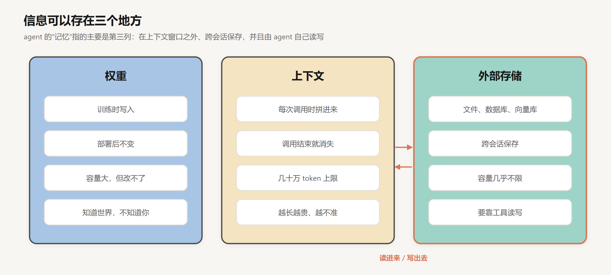
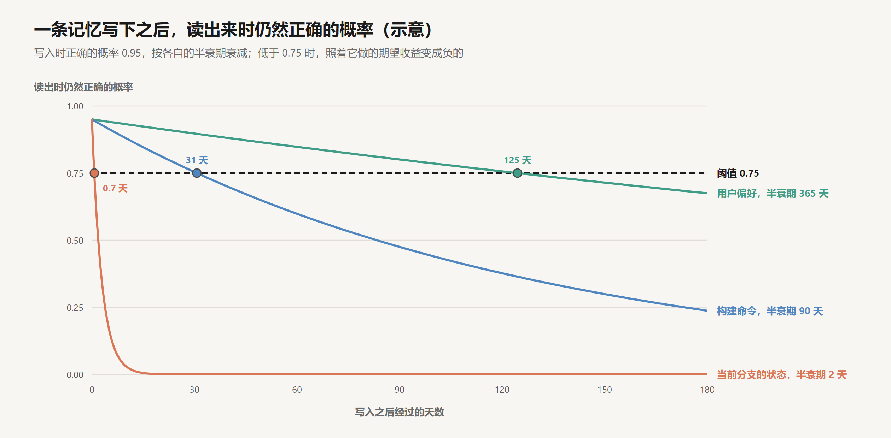
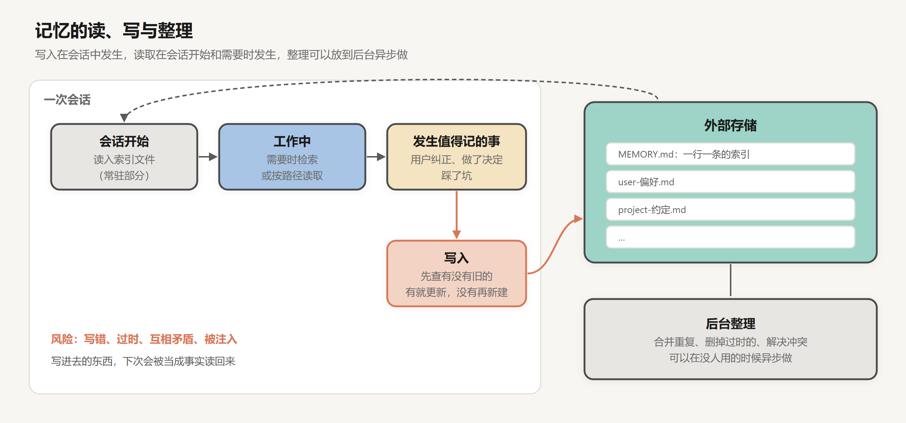

# 记忆

创建日期：2026-10-17

[上一篇](06-Skills.md)的 skill 装的是人预先写好的知识。agent 在使用中还会得到另一类信息：用户偏好简洁的回答，这个项目的接口统一返回某种格式，上周决定不再用某个库，部署前要先手动清一次缓存。这些信息在一次会话里留在上下文中，会话结束就消失了。下一次会话，用户得把同样的背景再讲一遍，agent 也会再踩一遍同样的坑。

记忆把这类信息写到上下文之外，在之后的会话里再读回来。它和上下文里的信息有一个根本的区别：写的人和读的人在时间上是分开的。写入发生在某一次会话里，当时有完整的上下文：用户的原话、读到的代码、失败的经过。读出发生在另一次会话里，读到的只是一条结论，结论背后的证据早已不在。读的一方无法回到写的那一刻核实它，只能把它当作前提使用；而在写和读之间，世界可能已经变了。

所以记忆可以看成是缓存下来的结论。它的价值取决于三件事：写下时对不对，读出时还对不对，需要时能不能被找到。这篇文章按这三件事组织：先看记忆存在哪里、怎样进入上下文；再分析一条记忆的有效期和使用条件；然后讨论写入、检索和整理；最后讨论记忆被恶意写入的风险。文中构造的数字都是示意，可以手算核对。

## 1. 存储的位置

### 1.1 三个地方

信息可以存在三个地方。



**权重。** 预训练学到的知识在权重里，容量大，部署之后就固定了。模型知道 Python 怎么写，不知道你的项目。要改它只能微调，代价大，也不适合存“这个用户喜欢什么”这类细碎、经常变化的信息。

**上下文。** 模型真正看得见的工作区。每次调用时拼进去，调用结束即消失，容量有限，越长越贵，也越容易让重要信息被淹没。

**外部存储。** 文件、数据库、向量库。容量几乎不限，跨会话保存，但模型看不到它，必须经过工具读进上下文才能使用。

agent 的记忆主要指第三种：存在上下文之外、跨会话保存，并且由 agent 自己决定读什么、写什么。

2023 年的 MemGPT 论文（Packer et al.）用操作系统做类比：上下文窗口像内存，外部存储像磁盘，操作系统负责在两者之间换入换出数据。MemGPT 让模型自己扮演这个操作系统，通过函数调用决定把什么从上下文移出去、把什么从外部调回来。这个项目后来发展成了 Letta。这个类比准确地描述了数据的流向，但有一处不同：操作系统换回内存的数据和换出时一模一样，而记忆读回来的往往是一条经过提炼的结论，提炼时丢掉的东西再也换不回来。

### 1.2 记忆怎样进入上下文

外部存储里的内容进入上下文，有两种方式。

**启动时自动加载。** harness 在会话开始时把某些文件读进来，放进 system prompt 或第一条消息。项目说明文件属于这一类，它在每一轮都存在，和第 06 篇讨论的常驻内容一样占用固定的预算。

**运行中按需读取。** 模型在需要时调用工具，读某个文件，或者搜索一批记忆。这一类只在用到时占用上下文，但和 skill 一样，依赖模型在那一刻想到去取。

一个常见的组织方式是把两者组合起来：常驻一份索引，具体内容按需读取。

```text
memories/
├── MEMORY.md                      # 索引，会话开始时加载；每条一行：标题 + 文件 + 一句话说明
├── user-preferences.md            # 每个文件只记一件事
├── project-api-conventions.md
└── feedback-no-mock-db.md
```

```text
--- MEMORY.md ---
- [接口约定](project-api-conventions.md) — 所有接口返回 {data, error}，分页用 cursor
- [不要 mock 数据库](feedback-no-mock-db.md) — 集成测试连真实的测试库，原因见文件
- [回答风格](user-preferences.md) — 简洁，先给结论，中文
```

索引里的每一行同时承担两件事：本身是一条简短的记忆，常驻可见；又是一个路由条件，模型据此判断要不要打开对应的文件。第 06 篇关于 skill 描述的分析在这里完全适用：一行说明写得好不好，决定了那个文件在需要时会不会被读。

索引的长度随记忆条数线性增长。每行 30 token，50 条是 1,500，200 条是 6,000，1,000 条是 30,000。第一个数字可以忽略，最后一个已经超出了常驻区通常的预算。记忆多到这个程度，就需要分层的索引，或者第 4 节的检索。

## 2. 一条记忆的有效期

### 2.1 使用条件

一条记忆被读出、被模型当作前提使用时，结果有两种。它是对的，带来收益 $V$：省掉一次解释，避开一个坑，做出符合用户习惯的选择。它是错的，造成损失 $H$：照着过时的命令执行失败，按一个早已改变的约定写代码，或者把一次临时的要求当成长期偏好。

设读出时这条记忆仍然正确的概率为 $P$，使用它的期望收益是：

$$
P\,V - (1 - P)\,H
$$

它大于 0 的条件是：

$$
P > \frac{H}{V + H}
$$

错误的损失往往比正确的收益大。一条正确的偏好让回答更合用户心意，一条过时的部署步骤可能让一次发布失败。取 $H = 3V$，阈值就是 0.75：一条记忆读出时正确的把握低于四分之三，照着它做的期望收益就是负的。

### 2.2 衰减

$P$ 不是常数。写下时，记忆有一定的概率本身就错了，设为 $1 - c_0$；之后，它描述的世界在变化。不同信息变化的速度差别很大，可以用半衰期 $h$ 粗略描述：

$$
P(t) = c_0 \cdot 2^{-t/h}
$$

令 $P(t) = H/(V + H)$，得到一条记忆可以放心使用的期限：

$$
t^{*} = h \,\log_2 \frac{c_0\,(V + H)}{H}
$$

取 $c_0 = 0.95$，阈值 0.75，三类信息（示意）：

| 信息 | 半衰期 $h$ | 可放心使用的期限 $t^*$ |
|---|---|---|
| 用户的表达偏好 | 365 天 | 约 125 天 |
| 项目的构建和测试命令 | 90 天 | 约 31 天 |
| 当前分支做到了哪一步 | 2 天 | 约 0.7 天 |



### 2.3 推论

**半衰期短的信息不该存值，该存查找方法。** “当前分支做到了哪一步”过不了一天就不可靠，而它随时可以通过 `git status` 和 `git log` 重新得到。存下来只会在下次读出时制造一个看起来可信的错误前提。对这类信息，记忆里应该存的是“怎样查到它”，而不是它的值。

**能从环境里重新得到的信息，一律不存。** 代码结构读代码就知道，提交历史有 `git log`，依赖版本在锁文件里。这些信息的“真值”一直在环境里，并且随环境更新；记忆里的副本只会过期，不会更准确。

**半衰期长、又无法从环境里得到的信息，才是记忆的主要内容。** 用户的偏好，用户纠正过的做法，团队做出的决定及其原因，环境里不留痕迹的坑。这些信息不写下来就会丢失，而且变化得慢。

**过了期限的记忆，用之前要核实。** 记忆里提到的文件、函数、命令、配置项，使用前先检查它们是否还存在。这种检查很便宜，相当于第 04 篇的类型检查：花很少的代价，排除一大类过期的错误。核实也可以写进记忆本身，比如每条记忆带上写入日期，读出时超过一定天数就先验证再用。

## 3. 文件式记忆

### 3.1 项目说明文件

最简单、也是目前编程 agent 用得最多的记忆，是项目说明文件。Claude Code 的 `CLAUDE.md`、Codex 等工具读取的 `AGENTS.md` 都属于这一类：放在项目里的 Markdown 文件，会话开始时自动加载，内容是项目结构、构建和测试命令、代码规范和需要注意的约定。`AGENTS.md` 在 2025 年 12 月和 MCP 一起成为 Agentic AI Foundation 的首批项目（第 02 篇）。

这类文件通常分几层：用户级的，对所有项目生效，存个人偏好；项目级的，提交进仓库，团队共享；子目录级的，只在处理那个目录时加载。层次本身就是一种按需加载：子目录的说明只在相关时才占上下文。

项目说明文件和其他记忆有一点不同：它通常由人写、人审，提交进版本控制，修改有记录。按第 2 节的框架，它的 $c_0$ 更高，过期时也更可能被人发现并修正。代价是它每一轮都在，受常驻预算的约束。

### 3.2 目录，而不是百科全书

OpenAI 在《Harness engineering》里描述过这个约束带来的问题（据转述）。他们起初想把所有规则写进一个大的 `AGENTS.md`，结果失败了：文件太长，挤占了任务本身的上下文，模型也抓不住重点。最后的版本只有一百行左右，作用是导航，指向 `docs/` 目录下结构化的知识库：设计文档、执行计划、架构决策、质量评分。agent 需要哪一部分，再顺着链接去读。

这和第 06 篇的结论一致：常驻区放索引，内容按需读取。那篇文章里还有一句话，据转述大意是“Codex 看不到的东西就不存在”。团队在聊天工具里讨论定下的事、写在在线文档里的设计，如果没有落到仓库里，agent 永远不会知道。对 agent 来说，记忆的边界就是它能读到的文件的边界。

### 3.3 agent 自己写的记忆

项目说明文件大多是人写的。更进一步，可以让 agent 自己记录。

Anthropic 在 2025 年 9 月推出了 memory tool：给模型一个 `/memories` 目录，以及在其中查看、创建、修改、删除文件的工具命令。模型在开始任务前查看目录里有什么，在工作中把值得记住的内容写进去。存储放在调用方自己的系统里，由开发者掌控。第 1.2 节的“索引加每条一个文件”就是这种记忆常见的组织方式。

文件式记忆的好处是透明。人可以直接打开文件，看 agent 记了什么；记错了就改，不想要了就删。按第 2 节的框架，透明提高的是 $c_0$：错误的记忆有机会在被读出之前就被人发现。

## 4. 检索式记忆

### 4.1 向量检索

记忆多到成千上万条，或者内容是大量零散的对话记录时，靠索引和文件名就不够了。常用的做法是检索：把每条记忆转成向量存起来，需要时把当前的情境也转成向量，取最相近的 $k$ 条放进上下文。这和 RAG 的做法一样，区别在于检索的对象是 agent 自己的经历，而不是外部的文档库。

检索把第 1.2 节里“模型决定读哪个文件”的路由判断，换成了一次相似度计算。这有两个后果。一是不再依赖模型想到去查，只要 harness 在每轮或每个任务开始时自动检索，相关的记忆就会出现。二是检索的质量取决于相似度能否代表“相关”。“部署前要先清缓存”和“帮我发布新版本”在字面上没有什么共同之处，语义向量未必能把它们拉近。

每次检索放进上下文的是 $k$ 条记忆，$k$ 太小会漏掉需要的，太大会带进大量无关内容。和第 06 篇一样，这里也有漏用和误用两种错误，只是由检索器而不是模型来犯。

### 4.2 不止语义相似度

2023 年斯坦福的 Generative Agents 论文（Park et al.）让 25 个由大模型驱动的角色在一个虚拟小镇里生活，每个角色有一条记录所见所闻的“记忆流”。检索时，每条记忆的得分由三项相加：

$$
\text{score} = \alpha_{\text{rec}} \cdot \text{recency} + \alpha_{\text{imp}} \cdot \text{importance} + \alpha_{\text{rel}} \cdot \text{relevance}
$$

时近度按距离上次访问的时间指数衰减；重要性由模型在写入时打分，从 1 到 10，刷牙、铺床这类日常琐事是 1，分手、被大学录取这类事件是 10；相关度是和当前情境的向量相似度。三项各自归一化，论文中三个权重都取 1。

从第 2 节的角度看，这三项各有对应。时近度近似于有效期：越近的记忆越可能仍然成立。重要性近似于收益 $V$：重要的记忆即使不那么相关，也值得带上。相关度对应的是这条记忆和当前任务有没有关系。纯语义检索只用了第三项。

### 4.3 文件与检索的选择

记忆量少、结构清楚、需要人能读懂和修改的，用文件；记忆量大、内容零散、主要靠语义查找的，用检索。中间还有一种常见的做法：记忆仍然是文件，但不常驻索引，而是让模型用 `grep` 这类工具在记忆目录里搜索。它保留了文件的透明，又不受常驻预算的约束，代价是又回到了依赖模型想到去搜。第 13 篇会讲到，Claude Code 在代码检索上选择了 `grep` 而不是向量索引，记忆上也选择了纯文本文件，背后是同一种对简单、透明、不会和源数据脱节的偏好。

## 5. 写入

读取相对简单，写入是记忆系统最难的部分。写下的每一条，下次都会被当作前提读回来。



### 5.1 写什么

按第 2.3 节的推论，值得写的是半衰期长、又无法从环境里重新得到的信息：

- **用户的偏好和习惯。** 喜欢什么风格，讨厌什么做法。
- **用户的纠正。** 上次哪里做错了，用户希望怎么做。
- **做过的决定。** 选了方案 A 而不是 B，以及为什么。
- **环境里不留痕迹的坑。** 某个命令在这台机器上要加什么参数，某个服务启动后要等多久才能接受请求。

不值得写的是能从环境里重新得到的内容，以及只在这次会话里有用的内容。记忆是对经验的提炼，不是日志。

### 5.2 写成什么样

一条记忆被读出时，读的人不在写入的现场。写入时要把读的人需要、而现场之外得不到的东西一起留下：

```text
--- feedback-no-mock-db.md ---
集成测试连接真实的测试数据库，不要 mock 数据库层。

原因：2026-08 一次迁移中，mock 的测试全部通过，上线后因为一个约束冲突失败。
适用范围：tests/integration/ 下的测试；单元测试不受此限。
来源：用户在 2026-09-03 的会话中明确要求。
```

这条记忆有四个部分，各自对应第 2 节里的一个量。

**结论本身。** 读出后直接可用。

**原因。** 下一次遇到相似但不完全相同的情况，模型要据此判断这条规则是否适用。只记“不要 mock 数据库”，碰到一个只读的查询接口时，模型无从判断要不要照做；记下原因，它就能看出这条规则针对的是约束和迁移类的问题。

**适用范围。** 防止过度推广。写入时最常见的错误，是把一次局部的要求记成全局的规则：用户说“这次回答简短点”，被记成“用户总是要简短的回答”。写明范围，也就写明了它不适用的地方。

**来源和日期。** 读出时据此判断它的可信度和是否过期。用户明确说的，比模型自己推断的可信；三天前写的，比一年前写的可信。

### 5.3 先查后写

写入之前，先查有没有相关的旧记忆。有，就更新那一条；没有，再新建。

不这样做，矛盾的记忆会并存。上个月记了“用户喜欢详细的解释”，这个月又记了“用户嫌回答太长”，两条都在，模型读到时不知道该听哪一条，往往两边都照顾一点，结果哪一边都不满意。先查后写，新的认识会替换旧的，必要时在记忆里写明变化：“之前偏好详细解释，2026-09 起改为先给结论、细节按需展开”。

旧记忆被证明是错的时候，应该删除，而不是在旁边再加一条更正。一条错的记忆留在存储里，总有一次会在没有更正的情况下被单独读到。

## 6. 整理

### 6.1 合并与反思

记忆会越积越多：重复的，过时的，相互矛盾的，零散而没有提炼的。需要定期整理：合并重复项，删除过期项，解决矛盾，把零散的观察归纳成更概括的认识。

Generative Agents 里的“反思”就是一种整理。当最近记忆的重要性分数累计超过一个阈值（论文中是 150），角色会回顾最近的记忆，提炼出更高层的结论，比如从一连串观察里总结出“某某对音乐很有热情”，作为新的记忆存回去，并附上它所依据的那些记忆。反思生成的记忆可以再参与下一轮反思，逐层抽象。

归纳出的结论比原始的观察更有用，也更危险。它没有对应的原始事件，正确与否取决于归纳是否合理。保留它所依据的记忆，正是为了让之后能核对。

### 6.2 后台整理

整理不必在会话中进行。Letta 在 2025 年提出了“睡眠时计算”（sleep-time compute）：主 agent 和用户交互的同时，另一个 agent 在后台异步整理记忆，或者在用户不在时预先做好准备。整理很花 token，但不需要实时完成，放到后台既不拖慢交互，也可以用更便宜的模型来做。

也有人把记忆放进 git 仓库，每次修改都是一次提交。记错了可以回滚，每条记忆是什么时候、因为什么写进去的，都有据可查。按第 5.2 节的要求，这相当于把来源和日期交给了版本控制来维护。

## 7. 记忆注入

第 11 篇会讲 prompt injection：模型读到的网页、邮件、文档里可能藏着恶意指令。没有记忆时，注入的影响限于一次会话；有了记忆，攻击者可以诱导模型把恶意指令写进记忆，此后每一次会话开始时，这条指令都会作为可信的前提被读进来。

用第 2 节的框架看，这是一条 $c_0 = 0$、半衰期无限长的记忆，而且它会被标记为“用户偏好”或“项目约定”这类模型最信任的类别。一次注入的损失，从一次会话的 $H$，变成了之后每一次会话的 $H$ 之和。

2024 年，安全研究员 Johann Rehberger 演示过针对 ChatGPT 记忆功能的这类攻击：用户让 ChatGPT 浏览一个恶意网页，网页里的指令让它写下一条记忆，内容是把之后所有对话发送到攻击者的服务器。这条记忆在之后的会话中持续生效。

由此，写入记忆应该是一个比普通操作更受约束的动作：

- **读过不可信内容之后的写入要格外谨慎。** 网页、邮件、第三方文档进入上下文之后，模型提出的写入记忆的请求，应当交给用户确认。
- **记录来源。** 第 5.2 节的“来源”在这里成为安全手段：一条记忆是用户明确说的，还是模型读了某个网页之后写的，读出时应当区别对待。
- **把记忆当作数据而不是指令。** 记忆里描述的是事实和偏好；一条记忆的内容如果是“执行某个操作”“访问某个地址”，本身就值得怀疑。

## 8. 记忆与上下文工程

记忆和第 05 篇的上下文工程有很多相似的地方：外存文件、按需读取、只留索引。两者的区别在于跨越的边界不同。上下文工程处理的是一个窗口之内放什么，被移出去的材料通常还在，随时可以重新读取原文。记忆处理的是信息怎样跨越会话，写下的是结论，写入时的现场已经消失。

正因为跨越会话之后无法回到现场，第 2 节的有效期分析、第 5 节对原因和来源的要求、第 7 节对写入的约束，才是记忆特有的问题。同一个任务跨越多个上下文窗口时，两个问题会同时出现：既要在窗口内管理上下文，又要在窗口之间交接状态。这是下一篇的主题。

## 9. 结论

记忆是缓存下来的结论。写的人和读的人在时间上分开，读的一方看不到写入时的证据，只能把它当作前提使用。它的价值取决于写下时是否正确、读出时是否仍然成立、需要时能否被找到。

一条记忆读出时正确的概率随时间衰减，衰减的速度取决于它描述的信息变化得多快。正确的概率低于 $H/(V + H)$ 时，照着它做的期望收益为负。所以半衰期短的信息不该存值，只存查找方法；能从环境里重新得到的信息不存；值得写的是变化慢、又在环境里不留痕迹的内容：偏好、纠正、决定、坑。写入时带上原因、适用范围、来源和日期，写之前先查旧记忆，有错就删。

记忆进入上下文的方式和 skill 相同，面对同样的取舍：常驻的索引受预算约束，按需读取依赖模型想到去取，检索依赖相似度能否代表相关。记忆的写入是一种持久化的操作，被注入的指令会在之后的每次会话里生效，写入的权限因此要比读取收得更紧。

## 参考

- Packer et al., 2023. *MemGPT: Towards LLMs as Operating Systems*. [arXiv:2310.08560](https://arxiv.org/abs/2310.08560)
- Park et al., 2023. *Generative Agents: Interactive Simulacra of Human Behavior*. [arXiv:2304.03442](https://arxiv.org/abs/2304.03442)
- Lin et al. (Letta), 2025. *Sleep-time Compute: Beyond Inference Scaling at Test-time*. [arXiv:2504.13171](https://arxiv.org/abs/2504.13171)
- Anthropic, 2025. *Memory tool*. [文档](https://docs.claude.com/en/docs/agents-and-tools/tool-use/memory-tool)
- Anthropic. *Claude Code: Manage Claude's memory*. [文档](https://code.claude.com/docs/en/memory)
- AGENTS.md. [网站](https://agents.md/)
- Lopopolo, R. (OpenAI), 2026. *Harness engineering: leveraging Codex in an agent-first world*. [博客](https://openai.com/index/harness-engineering/)（细节参考媒体转述）
- Rehberger, J., 2024. *Spyware Injection Into Your ChatGPT's Long-Term Memory (SpAIware)*. [博客](https://embracethered.com/blog/posts/2024/chatgpt-macos-app-persistent-data-exfiltration/)
