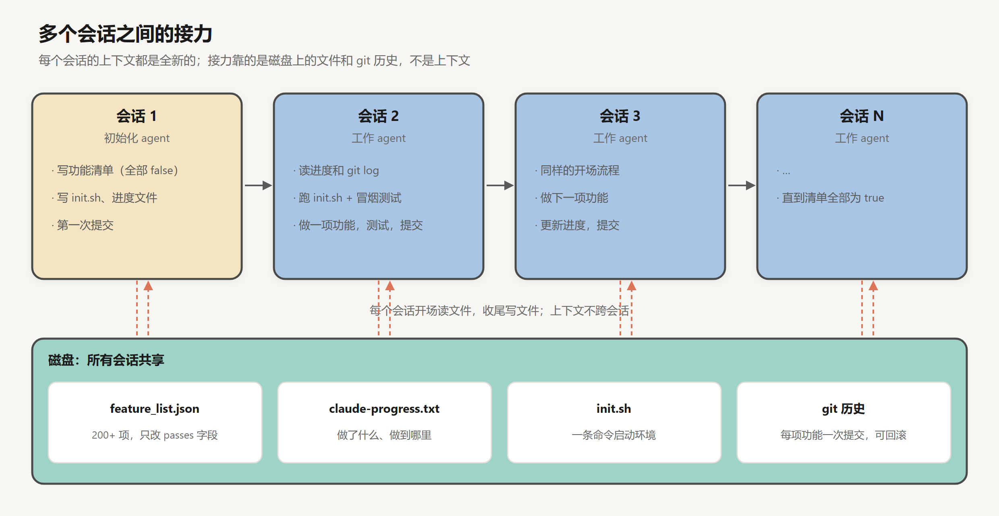
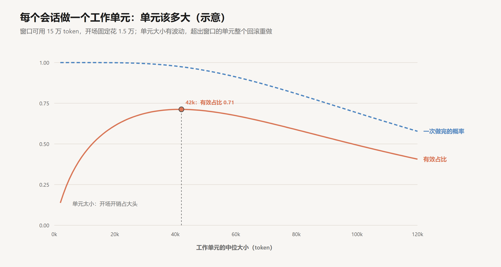
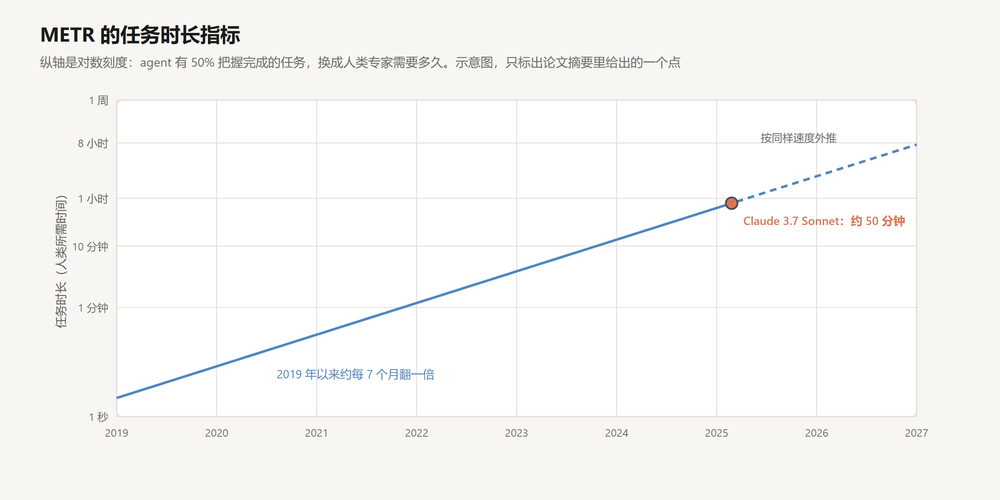

# 长时任务：跨越多个上下文窗口

创建日期：2026-10-17

第 05 篇的方法能让一个上下文窗口撑得更久，但有些任务注定一个窗口装不下：从零搭一个网站，迁移一个大型代码库，把几百页的需求文档实现出来。这类任务要做几个小时甚至几天，中间要读多少文件、跑多少次测试，事先无法估计。

这样的任务只能由一连串会话接力完成。每个新会话的上下文都是空的，它对任务的全部了解，来自开场时能读到的东西：磁盘上的文件、git 历史、运行起来的环境。所以长时任务的工程问题集中在交接上：把什么状态写到上下文之外，写成什么形式，才能让下一个会话以很小的代价重建出正确的工作状态；任务怎样切分，才能让每个会话结束时项目都停在一个干净、可回滚的位置；“全部完成”由什么来定义，才不会被某个会话的一眼印象所左右。

[上一篇](07-记忆.md)讨论的记忆也跨越会话，它存的是关于用户和项目的长期结论。这一篇的交接状态服务于同一个任务，寿命以小时和天计，读写都很频繁。这篇文章先分析为什么压缩不能代替交接，再讨论交接状态的组成、工作单元的大小、会话的开场和收尾，然后看一种极简的做法 Ralph 循环，最后看模型能独立工作的时长在怎样变化。文中构造的数字都是示意，可以手算核对。

## 1. 两种失败

### 1.1 一个实验

Anthropic 在 2025 年 11 月的《Effective harnesses for long-running agents》（Justin Young）里，记录了让 Claude 从零搭建一个 claude.ai 克隆网站的实验（第 04 篇讨论过它的验证部分）。最直接的做法是给一个高层需求，让 agent 一直跑，上下文满了就压缩，接着跑。这样做观察到两种典型的失败。

**一次做太多。** agent 试图一口气把整个应用写完，写到一半上下文耗尽。下一个会话接手时，面对的是一个写了一半、没有任何说明的功能，要花大量时间猜测前面发生了什么，再把应用恢复到能运行的状态。

**过早宣布完成。** 项目进行到后期，一个新会话的 agent 看了一眼，发现已经有很多功能做好了，就宣布整个任务完成。实际上还有很多功能没做。

### 1.2 两种失败的共同原因

两种失败都出在会话的边界上。第一种是边界落在了一个不一致的中间状态：功能写了一半，测试没跑，没有提交，没有说明。下一个会话读到的环境本身就是坏的。第二种是边界之后，新会话对“任务全貌”的认识只来自它看到的现有代码，而现有代码只能说明做了什么，不能说明还差什么。

第 04 篇说过，模型判断完成的依据只能是上下文里的证据。新会话的上下文里，如果没有一份“全部要做什么”的外部定义，它就只能拿“已经做了什么”去推断，这个推断天然偏向“差不多了”。

## 2. 压缩为什么不够

单个窗口里，第 05 篇的压缩能让任务继续。把压缩用到底，似乎也能撑过任意长的任务：每次窗口快满就压缩一次，接着跑。问题在于压缩是逐次叠加的。

每次压缩，模型把当前的上下文改写成一份摘要。设一条关键信息（一个约束、一个失败过的做法、一个未完成的子任务）在一次压缩中被保留下来的概率是 $\kappa$。第二次压缩时，模型改写的是第一次的摘要加上之后的新内容，这条信息要再被保留一次。经过 $m$ 次压缩，它仍然在的概率是 $\kappa^m$：

| $\kappa$ | 1 次 | 3 次 | 5 次 | 10 次 |
|---|---|---|---|---|
| 0.95 | 0.95 | 0.86 | 0.77 | 0.60 |
| 0.9 | 0.90 | 0.73 | 0.59 | 0.35 |

一个要跨越十几个窗口的任务，即使每次压缩只有 5% 的概率漏掉某条信息，到最后也有四成的概率把它丢了。更麻烦的是，丢失是无声的：摘要读起来依然通顺完整，看不出少了什么。

写在磁盘上的状态没有这个问题。一份功能清单不会在每个会话结束时被重新概括一遍，它只在某一项状态变化时被修改那一项，其余部分逐字保留。所以长时任务的状态不应该靠压缩在上下文里一代代传下去，而应该放在上下文之外，由每个会话按需读取、按项更新。压缩仍然有用，它负责一个会话之内的上下文；会话之间的交接，交给文件。

## 3. 交接状态

### 3.1 下一个会话需要知道什么

一个新会话开场时，需要回答几个问题，每个问题对应一种写在磁盘上的状态：

| 新会话需要知道 | 载体 | 写入方式 | 能否对照环境核实 |
|---|---|---|---|
| 全部要做什么，还差什么 | 功能清单 | 一次写定，之后只改状态字段 | 能：逐项跑测试步骤 |
| 之前的会话做了什么，留下了什么问题 | 进度文件 | 每个会话末尾追加一段 | 部分能：对照 git 历史 |
| 代码改了什么，为什么改 | git 历史 | 每完成一个单元提交一次 | 能：就是代码本身 |
| 怎样把环境跑起来 | 启动脚本 | 初始化时写，环境变化时更新 | 能：运行它 |
| 试过但失败的做法 | 进度文件或单独的笔记 | 失败时追加 | 不能，只能照记录 |

这张表里有两个规律。

**写入方式决定了状态会不会漂移。** 功能清单只允许改状态字段，进度文件只允许追加，git 历史本来就只追加。这些写法让状态不会在反复修改中被改写走样，这正是第 2 节压缩做不到的。

**能对照环境核实的状态更可靠。** 功能清单上标了 `passes: true` 的项，新会话可以按测试步骤重新验证；启动脚本可以直接运行。不能核实的只有“试过但失败的做法”这类记录，它对应第 05 篇所说的“无法重现的现场”，必须在发生时就写下来。

### 3.2 功能清单是完成的定义

Anthropic 那个实验的方案里，第一个会话是初始化 agent，它不写功能代码，只做准备：

- **写功能清单。** 把高层需求展开成详细的功能列表。claude.ai 克隆的清单有两百多项，比如“用户可以新建一个对话，输入问题，收到回答”。每一项有描述、测试步骤和一个 `passes` 字段，初始全部为 `false`。
- **写启动脚本 `init.sh`。** 一条命令把开发服务器跑起来。
- **建进度文件 `claude-progress.txt`。** 之后每个会话在这里记录做了什么。
- **做第一次 git 提交。**



功能清单解决的是第二种失败。“全部完成”不再由某个会话看一眼代码来判断，而是由清单定义：清单上还有 `false`，任务就没有完成。这是第 04 篇“完成的标准由外部证据决定”在长时任务上的形式。

清单用 JSON 而不是 Markdown，文章给出的理由是模型更不容易随手改写或覆盖 JSON 文件。后续的 agent 只允许修改 `passes` 字段，不允许删改条目，第 04 篇引用过那句措辞很重的指令：删除或修改测试是不可接受的。标准在第一个会话一次定下，之后的会话只能更新状态，不能改标准。

## 4. 工作单元

### 4.1 每个会话做一个单元

初始化之后的每个会话都是工作 agent，用的是同一个模型、同一套工具，区别只在初始的 prompt。工作 agent 每次只做清单上的一项功能：做完，用浏览器端到端测试，通过后把 `passes` 改为 `true`，写一条描述清楚的提交，更新进度文件。

这解决的是第一种失败。只要一项功能的工作量装得进一个窗口，会话结束时项目总停在一个一致的状态：要么这项功能做完、测试通过、已提交，要么还没开始。即使会话中途意外中断，回退到上一个提交就回到了一致的状态。

### 4.2 单元该多大

单元的大小有一个取舍。单元太小，每个会话开场的固定开销（读进度、读 git log、启动环境、跑基线测试）占了大头；单元太大，一部分单元会超出窗口，做到一半被截断，只能回滚重做。

可以用一个简单的模型估算（示意）。设窗口可用 15 万 token，开场固定花掉 1.5 万，剩下 $c = 13.5$ 万可以用来做单元。单元实际消耗的 token 数有波动，设它服从中位数为 $m$、对数标准差为 0.6 的对数正态分布。超出 $c$ 的单元整个回滚，消耗的 token 全部浪费。定义有效占比为“完成的单元消耗的 token”除以“全部消耗的 token（含开场）”：

$$
\eta(m) = \frac{\mathbb{E}\left[X \cdot \mathbf{1}(X \le c)\right]}{o + \mathbb{E}\left[\min(X, c)\right]}
$$

其中 $X$ 是单元的消耗，$o$ 是开场开销。

| 单元中位大小 | 一次做完的概率 | 有效占比 |
|---|---|---|
| 5k | 1.00 | 0.29 |
| 10k | 1.00 | 0.44 |
| 20k | 1.00 | 0.61 |
| 42k | 0.97 | 0.71 |
| 60k | 0.91 | 0.67 |
| 80k | 0.81 | 0.59 |
| 100k | 0.69 | 0.49 |



最优点在中位数约 4.2 万 token，这时一次做完的概率约 97%。对数正态分布的 97 分位数约是中位数的 $e^{1.88 \times 0.6} \approx 3.1$ 倍，即 13 万左右，正好接近可用的 13.5 万。

这个结果可以推广为一条规则：**让单元消耗的高分位数（而不是中位数）贴近窗口的可用容量。** 单元消耗的波动越大，中位数就要定得越小。经验上，同一类功能的消耗差别可以很大，一个看起来简单的功能可能因为一个难找的 bug 多出几倍的轮数，所以按“平均要多少”来切分，会让相当一部分单元超出窗口。

模型还说明了两件事。一是开场开销 $o$ 直接决定了小单元的效率，开场流程要尽量便宜：进度文件写得简洁，git log 只看最近几条，基线测试只跑冒烟用例。二是“超出窗口就整个回滚”是最坏的假设，如果单元内部还能再分出若干个可提交的小步骤，超出时只损失最后一步，曲线右侧会平缓得多。这和第 04 篇 git 检查点的作用一样：检查点越密，返工的上限越低。

## 5. 会话的开场与收尾

### 5.1 开场

每个工作 agent 开场时走一遍固定的流程：

```text
1. pwd                                    # 确认自己在哪个目录
2. 读 claude-progress.txt 和最近的 git log  # 之前发生了什么
3. 读功能清单，挑优先级最高的未完成项
4. 运行 init.sh 启动开发服务器
5. 跑一遍基本的端到端测试                    # 确认现有功能没坏
6. 开始做新功能
```

第 5 步容易被省略，它的作用可以用第 03 篇的模型说明。上一个会话可能留下一个没被发现的错误，也就是 $d$ 没有覆盖到的那部分。如果不先检查就开始做新功能，新旧问题会搅在一起，这个会话里的每一步都建立在一个错误的前提上，等到发现时已经很难分清问题出在哪一层。在会话的边界上跑一次基线测试，相当于在每个会话开始时把 $d$ 补一次：把上一棒漏掉的错误在交接时拦下来，让每个会话都从一个已知是好的状态开始。

开场流程固定下来还有一个好处：它可以写进每个会话都相同的初始 prompt，不依赖模型每次自己想到要做什么。

### 5.2 收尾

收尾是开场的镜像：开场读什么，收尾就要写什么。

- 功能清单：把这项的 `passes` 改为 `true`，只在测试真正通过之后。
- git：提交，提交信息写清楚做了什么、为什么这样做。
- 进度文件：追加一段，写做了哪一项、遇到了什么问题、有没有留下需要下一棒注意的事。

收尾的写入质量决定了下一个会话开场的成本。进度文件里一句“修了一些 bug”，下一棒要花几轮去 git diff 里找到底改了什么；写明“修复了导入时重复用户报 500 的问题，根因是唯一约束，见 import.py 的 skip_existing”，下一棒一轮就能接上。第 07 篇对记忆写法的要求，在这里同样适用。

## 6. Ralph 循环

### 6.1 一行循环

还有一种极简的做法。Geoffrey Huntley 在 2025 年 7 月介绍了他称为 Ralph 的方法（名字来自《辛普森一家》里的 Ralph Wiggum），核心只有一行：

```text
while :; do cat PROMPT.md | claude-code ; done
```

一个死循环，每次把同一份 prompt 交给编程 agent。agent 做完一轮就退出，循环立刻开始下一轮，每一轮都是全新的上下文。

状态全部在文件里：

- `PROMPT.md`：每一轮都相同的指令。
- `specs/`：需求规格，一个文件一个主题，开始前和 agent 一起写出来。
- `fix_plan.md`：按优先级排好的待办列表，agent 每轮从里面挑最重要的一项来做。
- `AGENT.md`：怎样构建和运行这个项目，agent 学到新东西时自己更新。

### 6.2 与前面方案的对应

Ralph 和 Anthropic 的方案在结构上是同一件事的两种实现。`specs/` 和 `fix_plan.md` 对应功能清单，是任务全貌的外部定义；每轮只做一件事，对应“每个会话一个工作单元”；全新上下文加上读文件开场，对应开场流程；测试、类型检查和静态分析作为反压（第 04 篇），对应每个单元结束前的验证。

差别在于 Ralph 把编排压到了最少：没有区分初始化 agent 和工作 agent，没有专门的进度文件格式，每轮的 prompt 完全相同。主上下文只负责调度，搜索代码、写文件这些耗上下文的工作交给子 agent（第 09 篇），所以每一轮的上下文用量很低。按第 4.2 节的模型，这是把单元做小、同时把开场开销也压低的做法。

LangChain 的 harness 文章把 Ralph 描述为一种 harness 模式：用一个 hook 拦截 agent 想要退出的动作，把原始 prompt 重新注入一个干净的上下文窗口，迫使它继续朝目标推进，状态通过文件系统在每一轮之间传递。这正是第 03 篇讲的 Stop hook 的一种用法。

### 6.3 失败模式

Huntley 坦白地列出了 Ralph 常见的问题：

- **占位实现。** 模型倾向于写一个最小的桩函数就交差。prompt 里要明确要求完整实现。
- **重复实现。** agent 用 `ripgrep` 搜索时，结果不总是可靠，它可能误以为某个功能还没实现，于是又写一遍。对策是在 prompt 里要求先搜索，不要假设不存在。
- **代码库被改坏。** 有时只能用 git 回退，重新开始循环。

第二种失败是交接问题的一个直接体现：每轮的上下文都是空的，“某个功能是否已经存在”只能靠当场搜索得出，搜索漏了，结论就错了。Huntley 还特别要求测试代码里写注释，说明这个测试为什么存在，因为后面的循环不会记得当初的理由。这和第 07 篇“写下原因”的要求是同一回事。

他对这个方法的评价是“在一个不确定的世界里，它确定地很糟糕”（deterministically bad in an undeterministic world）：它的失败方式是可预期的，可以通过调整 prompt 和反压一点点改进。他认为 Ralph 适合从零开始的新项目，能做到九成左右；用在已有的代码库上，他自己说绝对不会这样做。从交接的角度看，原因很清楚：新项目的全部状态都在 agent 自己写下的文件里，已有代码库里有大量没有写下来的约定和历史，每一轮全新的上下文都只能重新猜一遍。

## 7. 规划

长时任务里，功能清单或 `specs/` 定义了全貌，它们的质量决定了之后所有会话的方向。几种做法作用在这一步。

**先写规格。** 把模糊的需求变成具体的、可以逐项验证的条目。这一步通常需要人参与，因为只有人知道自己真正要什么。按第 04 篇的分析，规格是唯一能让“需求理解错误”被发现的外部证据，它写错了，后面每一项测试都会通过，做出来的却不是用户要的。

**先探索，再计划，再执行。** Claude Code 等编程 agent 提供计划模式：agent 只能读、不能改，先摸清相关代码，写出一份实施计划，人看过同意后再动手。这把理解问题和解决问题分开，让人在代价最低的时候介入。改一份计划只需要几句话，改一份已经实现了一半的代码要多得多。

**任务清单。** 一个会话之内，agent 可以维护一个 todo 列表，开始时列出步骤，每完成一步勾掉一项。第 05 篇说过，这份列表反复出现在上下文末尾，能帮模型保持方向。长时任务里，同样的东西被写到了磁盘上，成为功能清单和 `fix_plan.md`。

## 8. 模型能独立工作多久

### 8.1 任务时长

前面讨论的都是 harness 怎样帮 agent 撑过更长的任务。模型本身能独立处理多长的任务，也在快速增长。

METR 在 2025 年 3 月提出了一个衡量指标：任务时长（time horizon）。做法是收集一批软件和研究任务，先请人类专家完成，记录每个任务的耗时；再让 agent 来做，找出它有 50% 成功率的任务，对应的人类耗时有多长。这个耗时就是该 agent 的 50% 任务时长。



论文给出的结论是：当时的前沿模型，比如 Claude 3.7 Sonnet，50% 任务时长约为 50 分钟；2019 年以来，这个指标大约每 7 个月翻一倍，2024 年可能还在加速。

### 8.2 翻倍意味着什么

把第 03 篇的模型用在这里，可以看出这个指标在说什么。假设 agent 在任务的每一分钟里出现不可挽回错误的概率是常数 $\lambda$，一个需要人类 $L$ 分钟的任务，成功率约为 $e^{-\lambda L}$。50% 任务时长满足 $e^{-\lambda L_{50}} = 0.5$，即

$$
L_{50} = \frac{\ln 2}{\lambda}
$$

$L_{50} = 50$ 分钟，对应每分钟约 1.4% 的失败率。任务时长翻一倍，等价于这个失败率减半。“每 7 个月翻一倍”说的是：每 7 个月，单位时间里不可挽回的错误减少一半。这里的“不可挽回”，正是第 03 篇里没被看见、没被纠正的那部分错误，它既取决于模型，也取决于 harness 能把多少错误变得可见。

同一个模型下，对成功率的要求越高，能交给它的任务越短。在上面的简化模型里：

$$
L_{P} = L_{50} \cdot \frac{\ln P}{\ln 0.5}
$$

要求 80% 的成功率，任务时长约为 $50 \times 0.32 \approx 16$ 分钟；要求 90%，约为 7.6 分钟。实际使用中很少接受一半的失败率，所以对“agent 能做多长的任务”的估计，要按自己需要的成功率打折扣。这些任务也大多是边界清楚、可以自动评分的软件任务，真实工作要混乱得多。METR 自己也说明，外推的前提是这些结果能推广到真实的软件工作，而这本身还是一个开放问题。

### 8.3 对 harness 设计的含义

任务时长的增长直接改变第 4.2 节的取舍。模型能在一个窗口里可靠地完成更大的单元，单元就可以切得更大，会话数更少，交接的次数和开场的总开销都随之下降。今天需要拆成二十个会话的任务，一年后可能五个就够了；今天必须写进 prompt 的开场流程和约束，以后可能有一部分变得多余。

反过来，交接机制本身不会因此过时。只要任务的长度可以超过任何一个窗口，会话边界就存在，状态就必须写在上下文之外。模型能力变化的是单元的大小和交接的频率，不是交接的必要性。第 10 篇会讨论模型和 harness 之间的这种此消彼长。

## 9. 结论

长时任务由一连串会话接力完成，每个会话从空的上下文开始，只知道磁盘上写了什么。因此长时任务的设计就是交接的设计。

交接状态要放在上下文之外，并且按项更新，而不是靠压缩一代代概括下去：每次压缩都可能丢掉一点信息，十几次之后累积的损失相当可观，而且无声无息。全貌由一份外部的功能清单定义，后续会话只能改状态、不能改标准，这样“全部完成”才不会被某个会话的一眼印象左右。进度追加写入，代码按单元提交，环境由脚本一键启动，失败的尝试在发生时就记下来。

任务切成工作单元，每个会话做一个，做完验证、提交、记录，让每个会话都在一致的状态上结束。单元的大小应当让消耗的高分位数贴近窗口的可用容量，消耗波动越大，单元越要切小；开场流程要固定、要便宜，并且在开始新工作之前先验证基线，把上一棒漏掉的错误拦在交接处。

模型能独立完成的任务时长在快速增长，单元可以随之变大、交接可以变少。只要任务比窗口长，交接就仍然是必要的。

## 参考

- Young, J. (Anthropic), 2025. *Effective harnesses for long-running agents*. [博客](https://www.anthropic.com/engineering/effective-harnesses-for-long-running-agents)
- Huntley, G., 2025. *Ralph Wiggum as a "software engineer"*. [博客](https://ghuntley.com/ralph/)
- Trivedy, V. (LangChain), 2026. *The Anatomy of an Agent Harness*. [博客](https://www.langchain.com/blog/the-anatomy-of-an-agent-harness)
- Kwa, T. et al. (METR), 2025. *Measuring AI Ability to Complete Long Tasks*. [arXiv:2503.14499](https://arxiv.org/abs/2503.14499)
