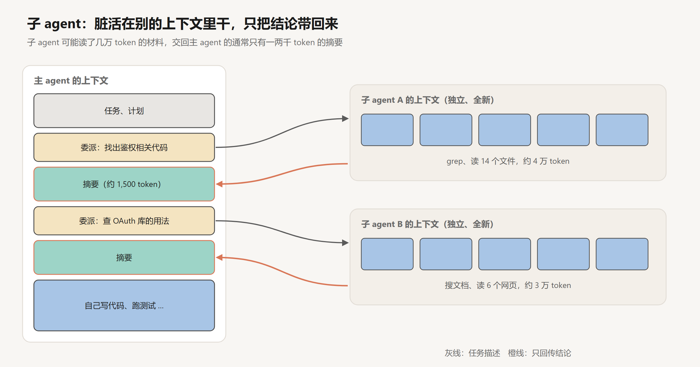
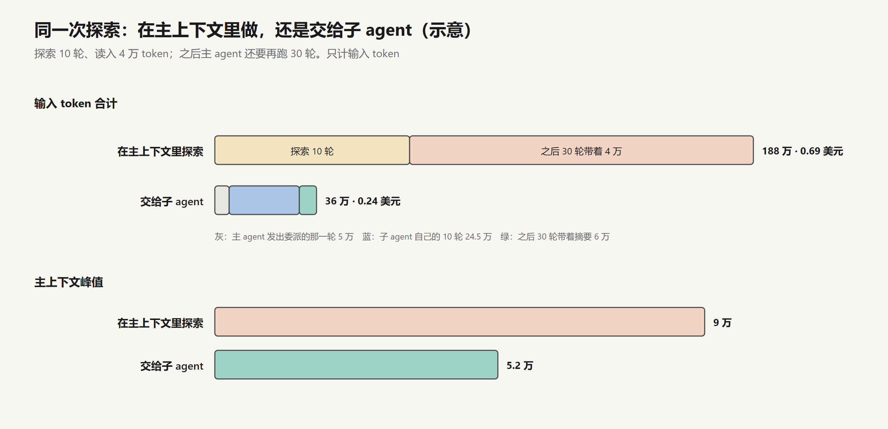
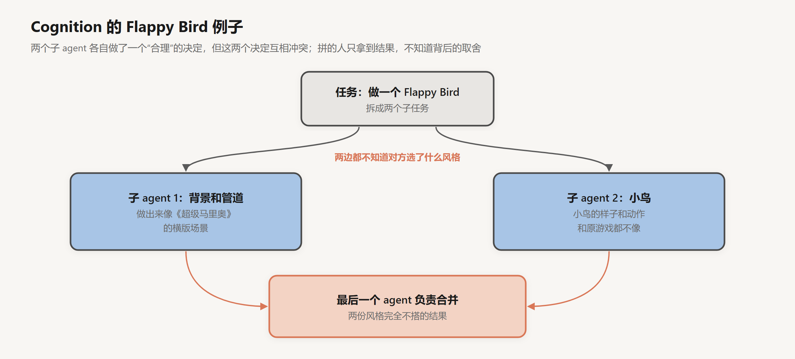

# 子 agent 与多 agent

创建日期：2026-10-17

[上一篇](08-长时任务.md)让多个上下文窗口按时间先后接力。这一篇讨论另一种组合：在同一个任务里，让多个上下文窗口分工。

把一部分工作交给另一个上下文，得到的是隔离：子任务的中间过程不进入主上下文，主上下文只收到结论；几个子任务可以各用一个完整的窗口，也可以同时进行。付出的是边界上的信息损失：子 agent 只知道委派消息里写了什么，主 agent 只知道摘要里写了什么，双方在过程中做出的、没有写下来的决定，都过不了这条边界。

所以拆不拆、怎么拆，取决于这两者的比较。中间过程很长、结论很短、子任务之间不需要彼此协调时，隔离的收益大，边界的损失小；子任务之间有大量隐含的共同决定时，边界的损失会抵消一切收益。这篇文章先从消息层面看子 agent 的调用，计算隔离省下了什么；再分析委派和回传这两条边界上的信息；然后看并行编排的收益和成本，以及隐含决定带来的冲突；最后给出拆分的判断条件。文中构造的数字都是示意，可以手算核对。

## 1. 子 agent 的调用

### 1.1 在消息里的样子

从主 agent 的角度看，调用子 agent 和调用一个工具没有区别：发出一个请求，拿回一个结果。区别在于这个“工具”的内部是一个完整的 agent 循环。

```text
主 agent 的消息列表：
  ...
  assistant: [tool_use: Task(description = "找出鉴权相关的代码：入口、中间件、token 校验在哪里，
                                           返回文件路径、函数名和调用关系，不要修改任何文件")]
  user:      [tool_result: "入口在 api/auth.py 的 login()；中间件 middleware/session.py 第 40–88 行……"]
  ...

子 agent 的消息列表（主 agent 看不到）：
  system:    子 agent 的 system prompt + 工具定义
  user:      找出鉴权相关的代码：入口、中间件……（就是上面那段 description）
  assistant: [tool_use: grep "auth"]
  user:      [tool_result: 60 行匹配]
  assistant: [tool_use: read_file api/auth.py]
  ...                                               # 十轮左右，读入约 4 万 token
  assistant: "入口在 api/auth.py 的 login()；中间件……"   # end_turn，这段文字成为主 agent 的 tool_result
```

子 agent 的上下文从零开始，内容只有它自己的 system prompt、工具定义和那段任务描述。它跑完自己的循环，最后一条回答被 harness 包成 `tool_result` 交回主 agent。子 agent 读过的四万 token 留在它自己的消息列表里，随它结束而被丢弃。



Anthropic 在上下文工程的文章里给过一个量级：子 agent 自己可能用掉几万甚至更多 token，交回去的通常是一份 1,000 到 2,000 token 的精简摘要。第 05 篇把它列为控制上下文的三种手段之一，和压缩、外存并列。

### 1.2 隔离省下了什么

用一个例子算一下（示意，只计输入 token）。主 agent 做到一半时上下文有 5 万 token，需要先探索代码库：10 轮，每轮读入约 4,000 token，共读入 4 万。探索结束后，主 agent 还要再跑 30 轮写代码、跑测试。

**在主上下文里探索。** 10 轮探索的输入从 5 万涨到 8.6 万，合计 68 万 token。之后的 30 轮，每一轮都带着这 4 万 token 的探索材料，又多出 $30 \times 40{,}000 = 120$ 万。总计 188 万，主上下文的峰值是 9 万。

**交给子 agent。** 主 agent 发出委派的那一轮输入 5 万。子 agent 从约 6,500 token（自己的 system、工具定义和委派消息）开始，10 轮合计 $10 \times 6{,}500 + 4{,}000 \times 45 = 24.5$ 万。之后的 30 轮，主上下文里只多了委派消息和摘要共约 2,000 token，合计 6 万。总计约 36 万，主上下文的峰值约 5.2 万。

按前几篇的单价，开启缓存时，前者约 0.69 美元，后者约 0.24 美元。



差别主要来自两处。一是探索阶段的基数：在主上下文里探索，每一轮都要带着已有的 5 万 token；子 agent 从 6,500 开始。二是探索之后的携带：4 万 token 的原始材料变成了 1,500 token 的结论，之后每一轮都少带 3.85 万。

一般地，设探索读入的材料为 $X$，摘要为 $s$，委派消息为 $d$，主 agent 之后还要跑 $T$ 轮，单看携带部分，子 agent 省下的输入约为

$$
(X - s - d) \cdot T
$$

$X$ 越大、结论越短、之后的轮数越多，子 agent 越划算。反过来，如果探索本身只读了几千 token，或者主 agent 马上就要结束，委派的开销（子 agent 重新加载 system 和工具定义、主 agent 多一轮等待）就可能超过收益。

钱只是一个方面。第 05 篇说过，过期的观察留在上下文里，会稀释模型对约束和当前状态的注意。子 agent 把四万 token 的原始材料挡在主上下文之外，主 agent 后面三十轮看到的都是提炼过的结论，这部分收益不在上面的账里。

## 2. 边界上的信息

### 2.1 委派消息是子 agent 的全部背景

子 agent 知道的，只有委派消息里写的内容。主 agent 上下文里的背景、和用户之前的讨论、已经排除掉的方向、用户的偏好，子 agent 一概不知。

Anthropic 在介绍多 agent 研究系统的文章里总结过，一条好的委派要说清楚四件事：

- **目标。** 要查清楚什么，查到什么程度算完成。
- **输出格式。** 结果按什么结构交回来。
- **可用的工具和信息源。** 该去哪里找，哪些来源可信。
- **边界。** 哪些不用管，哪些已经有人在查。

他们早期的版本里，主 agent 给子 agent 的指令很短，比如“研究一下半导体短缺”。几个子 agent 对任务的理解各不相同，有的重复了别人的工作，有的查错了方向。这些子 agent 并没有犯错，它们只是在信息不足时各自做了合理的猜测，而猜测不一致。

委派消息的写法和第 06 篇的 skill 描述、第 07 篇的记忆写法要求一样：写的人有完整的上下文，读的人没有，所以要把读的人需要、而自己处处默认的东西写出来。主 agent 往往意识不到哪些是默认的，因为对它来说，这些信息就在上下文里，一直看得见。

### 2.2 摘要是主 agent 的全部所得

反方向的边界同样有损失。子 agent 读过的四万 token，主 agent 只能看到摘要。摘要里没写的，对主 agent 来说就不存在。

这和第 05 篇的压缩是同一个问题，结论也一样：摘要要区分结论和证据，并且给出证据的位置。“鉴权逻辑在 middleware/session.py 第 40–88 行”比“鉴权逻辑在中间件里”有用得多：主 agent 后面需要细节时，可以直接去读那几十行，不必重新派一次子 agent。一份只有结论、没有出处的摘要，主 agent 无法核实，只能全盘接受。

摘要也要写明子 agent 没有做到的部分。“没有找到 token 刷新的逻辑，可能不在这个仓库里”是一条有用的信息；不写，主 agent 会默认它不存在，或者默认子 agent 查过了。

### 2.3 适合交出去的任务

两条边界的损失决定了什么样的任务适合交给子 agent：中间过程长、结论短、结论可以写清楚出处，并且做这件事不需要知道主 agent 的大量背景。

在代码库里定位代码，读文档查一个库的用法，调研一个问题的几种方案，都符合这些条件。它们的共同点是**读多写少**：子 agent 产出的是信息，不是对共享状态的修改。Claude Code 内置的 Explore 子 agent 就是这样设计的，它只有读取和搜索类的工具，不能编辑文件。

## 3. 并行编排

### 3.1 研究系统

更进一步，主 agent 可以同时派出多个子 agent 并行工作，再汇总结果。这是第 03 篇的编排者-执行者模式，只是每个执行者都是一个完整的 agent。

Anthropic 在 2025 年 6 月公开了 Claude 研究功能背后的设计。一个主 agent（Claude Opus 4）接到研究问题后制定计划，派出多个子 agent（Claude Sonnet 4）并行搜索问题的不同方面；子 agent 把发现交回主 agent，主 agent 判断是否还要继续查；最后由一个专门的 agent 给结论加上引用来源。在他们内部的研究类评估上，这个多 agent 系统比单独使用 Opus 4 的单 agent 高出 90.2%。

### 3.2 收益从哪里来

文章对收益来源的分析很直接。他们在 BrowseComp（考查 agent 能否在网上找到难找的信息）上做了分析，发现三个因素解释了 95% 的表现差异，其中 token 用量一个因素就解释了约 80%，另外两个是工具调用次数和模型的选择。文章的原话是：

> Multi-agent systems work mainly because they help spend enough tokens to solve the problem.

多 agent 系统之所以有效，主要是因为它能花足够多的 token 来解决问题。

从第 1.2 节的角度看，这句话有一个具体的含义。一个上下文窗口能容纳的材料有限，而且材料越多，每一轮的输入越大，注意力越分散。$k$ 个子 agent 各有一个完整的窗口，能处理的材料总量约是单个窗口的 $k$ 倍，每个窗口里却只有和自己那部分相关的内容；主 agent 收到的是 $k$ 份摘要，而不是 $k$ 份原始材料。

并行还带来速度。$k$ 个互相独立、各需时间 $t_i$ 的子任务，串行完成需要 $\sum t_i$，并行完成需要 $\max t_i$ 加上主 agent 规划和汇总的时间。五个各需六分钟的子任务，串行半小时，并行只要六分钟多一点。文章报告，对复杂的查询，子 agent 并行加上工具调用并行，让研究时间最多缩短了 90%。

### 3.3 成本与规模

代价是 token。文章给出的数字是：单 agent 的 token 用量大约是普通聊天的 4 倍，多 agent 系统大约是 15 倍。多 agent 因此只适合价值足够高的任务，一个简单的事实性问题用 15 倍的成本回答并不划算。

他们早期的系统还有一个规模问题：主 agent 不会估计任务的难度，一个简单的问题也派出 50 个子 agent，或者没完没了地搜索根本不存在的资料。解决办法是在 prompt 里写明规模的标准：

| 任务类型 | 子 agent 数量 | 每个的工具调用次数 |
|---|---|---|
| 简单的事实查找 | 1 个 | 3 到 10 次 |
| 直接的比较 | 2 到 4 个 | 各 10 到 15 次 |
| 复杂的研究 | 10 个以上 | 职责划分清楚 |

这相当于把第 03 篇的刹车和预算前移到了规划阶段：不是等到花超了再停，而是一开始就按任务的难度分配。

文章里还有一个细节：他们做了一个专门测试工具的 agent，让它反复使用一个有缺陷的工具，然后改写这个工具的描述。之后的 agent 用上改写后的描述，完成任务的时间减少了 40%。在多 agent 系统里，一份工具描述会被每个子 agent 读到，它的质量被放大了 $k$ 倍。

## 4. 隐含的决定

### 4.1 Cognition 的反对意见

几乎在同一时间，做编程 agent Devin 的 Cognition 发表了一篇文章，标题就是《Don't Build Multi-Agents》（Walden Yan，2025 年 6 月）。文章提出两条原则：

第一条，共享上下文，而且要共享完整的 agent 运行轨迹，不只是单条消息。

第二条，行动里带着隐含的决定，相互冲突的决定会带来糟糕的结果。

第二条是关键。agent 的每一个动作背后都有一些没有说出来的选择：用什么风格，假设了什么前提，优先考虑什么。在单个 agent 里，这些选择前后一致，因为后面的动作能看到前面的动作。拆成多个并行的子 agent，每个都在各自做选择，彼此看不见。

### 4.2 Flappy Bird

文章举的例子是让 agent 做一个 Flappy Bird 游戏，拆成两个子任务：一个做带绿色管道的滚动背景，一个做上下飞的小鸟。



第一个子 agent 做出来的背景像《超级马里奥》，第二个做出来的小鸟样子和动作都和原游戏不像。负责合并的 agent 拿到两份风格完全不搭的东西，只能硬拼。

把原始任务也一起传给子 agent，并不能解决这个问题。文章的解释是：真实的任务是多轮对话形成的，中间有用户的追加要求、工具调用的结果，这些都会影响对任务的理解。只传原始任务，子 agent 仍然不知道主 agent 在过程中已经做了哪些决定。这正是第 2.1 节说的，委派消息里只有写的人意识到要写的东西。

### 4.3 冲突的概率

可以粗略估计一下冲突发生的概率。设两个并行的子任务之间有 $m$ 个共同的隐含决定点：画风、坐标系、帧率、命名约定、错误处理方式、接口的参数顺序。在每个决定点上，两个子 agent 独立地做出相互一致的选择的概率是 $c$。两份产出完全兼容的概率是 $c^m$：

| $c$ | $m = 1$ | $m = 3$ | $m = 5$ | $m = 10$ |
|---|---|---|---|---|
| 0.9 | 0.90 | 0.73 | 0.59 | 0.35 |
| 0.8 | 0.80 | 0.51 | 0.33 | 0.11 |

调研类任务的 $m$ 接近 0：几个子 agent 分别查不同的方面，结论各自成立，拼在一起就行。代码类任务的 $m$ 很大：两段要互相调用的代码，接口、数据结构、错误约定都必须一致，任何一个不一致都要返工。

这个模型也说明了缓解冲突的办法。一是降低 $m$：按耦合最弱的地方切分，让子任务之间的接触面尽量小。二是把隐含的决定变成显式的：在委派之前由主 agent 先定下共同的决定，比如先写好接口定义和风格约定，再写进每一条委派消息，相当于把这些决定点上的 $c$ 提高到接近 1。三是不并行：让子任务按顺序进行，后一个能看到前一个的产出，冲突在发生时就能被看见和处理。

### 4.4 Cognition 推荐的做法

Cognition 推荐的默认架构是单线程、线性的 agent：一个 agent 从头做到尾，上下文始终连续。任务太长、上下文装不下时，用一个专门的模型把历史压缩成关键的细节、事件和决定（他们为此微调了一个小模型），而不是拆给多个 agent。

文章还专门评论了 Claude Code 的子 agent：它们不和主 agent 并行写代码，通常只负责回答一个定义清楚的问题，因为它们缺少主 agent 的上下文。作者认为这是一个有意保持简单的设计。

## 5. 拆分的条件

两篇文章看起来针锋相对，结论其实一致。Anthropic 的文章自己也写到（大意）：需要所有 agent 共享同一个上下文、或者 agent 之间有大量依赖的领域，目前不太适合多 agent 系统，比如大多数编程任务。

研究是广度优先的：要查的方面很多，各方面相对独立，结论可以分开写再汇总，$m$ 很小，读多写少。编程是一致性优先的：每一处修改都要和其他修改配合，$m$ 很大，产出是对共享代码库的修改。

把前面的分析合在一起，一个子任务适不适合交给另一个上下文，可以按四个条件判断：

| 条件 | 适合拆 | 不适合拆 |
|---|---|---|
| 中间过程与结论的长度比 | 读入几万，结论一两千 | 读得少，或者结论本身就很长 |
| 与其他子任务的共同决定 | 几乎没有，或可以事先定好 | 很多，而且在过程中才会出现 |
| 产出的形式 | 信息、结论 | 对共享状态的修改 |
| 任务的价值 | 值得多倍的 token | 简单任务 |

实际中最常见、也最稳妥的做法，是主 agent 负责所有的决定和所有的写操作，子 agent 只负责读和查，交回带出处的结论。这样拿到了上下文隔离的收益，又避开了隐含决定的冲突。确实需要并行写的场景，先由主 agent 定下接口和约定，再按耦合最弱的地方切分，并在合并后跑一遍完整的验证（第 04 篇）。

## 6. 多 agent 的工程问题

真要构建多 agent 系统，还会遇到单 agent 没有的工程问题。Anthropic 的文章提到了几个：

- **错误会累积。** agent 有状态，跑得很长，一个子 agent 出错可能让整个任务偏离。从头重跑代价太大，所以要能从检查点恢复，并且在出错时告诉 agent 哪个工具失败了，让它自己调整。这是第 03 篇错误回填和第 08 篇检查点在多 agent 上的延伸。
- **同步的瓶颈。** 主 agent 等所有子 agent 完成才继续，最慢的那个决定了整体速度，主 agent 在等待期间也无法调整方向。异步执行能解决这个问题，但结果的协调、状态的一致和错误的传播都更复杂。
- **部署更新。** 系统里随时有很多 agent 在运行，有的已经跑了很久。更新代码时不能直接替换，他们采用逐步切换流量的方式（rainbow deployment），让旧版本上正在运行的任务继续跑完。
- **调试困难。** 每次运行的路径都不同，出了问题很难复现。需要完整记录每个 agent 的决策过程和交互，在不记录对话内容的前提下监控决策的模式。

## 7. 结论

把工作交给另一个上下文，换来的是隔离：中间过程不进入主上下文，每个子任务有完整的窗口，互相独立的子任务可以并行。付出的是边界上的信息损失：子 agent 只知道委派消息，主 agent 只知道摘要，过程中隐含的决定过不了边界。

隔离的收益可以计算：探索读入的材料越多、结论越短、主 agent 之后要跑的轮数越多，交出去越划算。边界的损失可以控制：委派写清目标、格式、来源和边界，摘要区分结论和证据并给出出处，也写明没查到的部分。隐含决定的冲突随共同决定点的数量指数增长，只能靠减少共同决定、事先显式地定下它们，或者干脆不并行来避免。

由此，读多写少、结论能写清出处、彼此几乎不需要协调的子任务，适合交给子 agent，任务价值足够高时可以并行地交给多个；需要对共享状态做出相互配合的修改的子任务，留在一个连续的上下文里。最稳妥的分工是主 agent 掌握全部决定和写操作，子 agent 负责读和查。

## 参考

- Hadfield, J. et al. (Anthropic), 2025. *How we built our multi-agent research system*. [博客](https://www.anthropic.com/engineering/multi-agent-research-system)
- Yan, W. (Cognition), 2025. *Don't Build Multi-Agents*. [博客](https://cognition.com/blog/dont-build-multi-agents)
- Rajasekaran, P. et al. (Anthropic), 2025. *Effective context engineering for AI agents*. [博客](https://www.anthropic.com/engineering/effective-context-engineering-for-ai-agents)
- Anthropic. *Claude Code: Subagents*. [文档](https://code.claude.com/docs/en/sub-agents)
