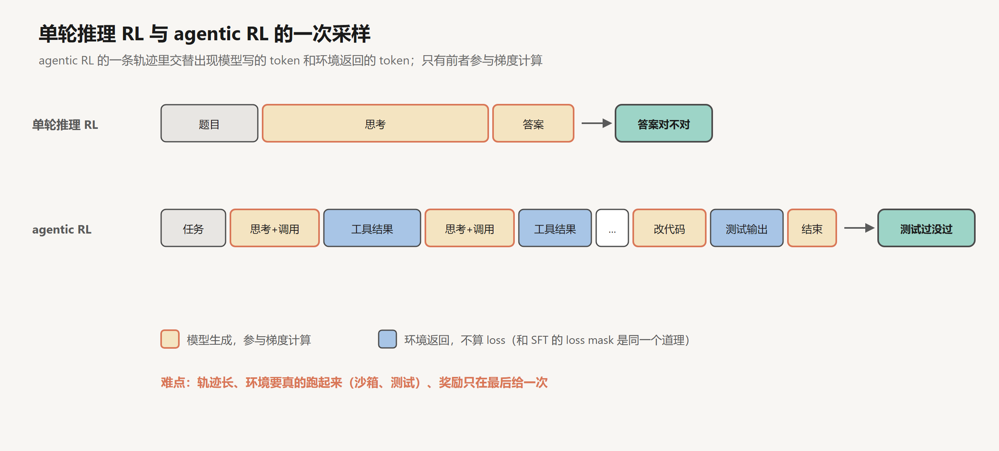
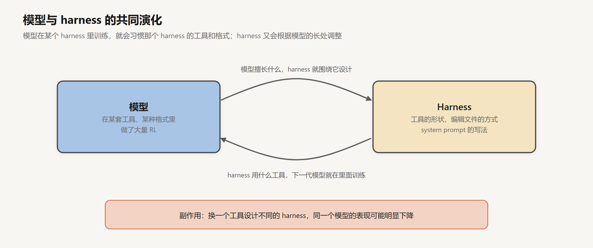

# 模型这一侧：agent 能力是怎么训练出来的

创建日期：2026-10-17

前面九篇几乎都在讲 harness：工具、循环、验证、上下文、skill、记忆、长任务、子 agent。模型一直被当成一个固定的黑盒，只在 `model.call(...)` 那一行出现。

但同样一个 agent 循环，放在 2023 年几乎跑不起来。那年春天 AutoGPT 一类项目火过一阵，思路和第 03 篇的循环差不多：给模型一个目标，让它自己规划、调用工具、循环下去。实际用起来，它们经常陷在死循环里，或者跑了几十步离目标越来越远。今天的编程 agent 能连续工作几个小时，差别主要不在 harness，而在模型。Anthropic 在 2026 年 1 月的评估文章里提到，SWE-bench Verified（从真实 GitHub issue 里挑出来的编程任务）上的最好成绩，一年之内从 40% 左右涨到了 80% 以上。

这一篇讲模型这一侧：agent 需要的能力是怎么训练出来的，以及训练方式给 agent 带来了哪些副作用。前置知识是[推理模型与强化学习](../深度学习/大模型训练/04-推理模型与强化学习.md)和 [RLHF 与 DPO](../深度学习/大模型训练/03-RLHF与DPO.md)。

## 1. 从 SFT 到 agentic RL

### 1.1 SFT 教会格式

模型调用工具的能力，起点是 SFT。[SFT 与 Chat 模板](../深度学习/大模型训练/02-SFT与Chat模板.md)第 5 节讲过：训练数据里有大量示范，教模型什么时候输出一个工具调用、参数怎么按 schema 填，工具返回的结果怎么用。

但 SFT 是模仿。它能教会模型工具调用的格式，教不会模型在一个长任务里做出好的决策：先搜索还是先读文件，测试失败了该怀疑代码还是怀疑测试，什么时候该停下来。这些决策没有标准答案可以模仿，只能在实际做任务的过程中，根据结果的好坏来学习。

### 1.2 可验证奖励

推理模型的训练给出了路子。[推理模型与强化学习](../深度学习/大模型训练/04-推理模型与强化学习.md)讲了可验证奖励：数学题有标准答案，代码有测试，程序就能判断对错，不需要人工标注，也不需要奖励模型。模型生成一组回答，对的得分高，错的得分低，用 GRPO 一类的算法去提高得分高的回答的概率。

agentic RL 把这套方法从“一次回答”扩展到了“一整段 agent 轨迹”。

### 1.3 一条轨迹

单轮推理 RL 的一次采样是：题目、思考、答案，然后判分。agentic RL 的一次采样是一整个 agent 循环：拿到任务，思考，调用工具，环境返回结果，再思考，再调用，……，最后改完代码，跑测试，测试通过就得高分。

这里有一个和 SFT 一样的细节：轨迹里的工具结果是环境给的，不是模型生成的，所以不参与梯度计算。只有模型自己写的那些 token（思考和工具调用）才会根据最终的奖励被加强或削弱。

和单轮推理 RL 比，有几个难点。

**轨迹很长。** 一条轨迹可能有几十次工具调用、几万 token。采样慢，显存占用大。

**环境要真的跑起来。** 每次采样都要有一个真实的沙箱：装好依赖的代码仓库，能执行命令的终端，能跑的测试。几千个并发的采样，就要几千个沙箱同时运行。

**奖励只在最后给一次。** 下一节细说。

## 2. 训练环境

agentic RL 需要大量的任务，每个任务都要配一个能自动判分的环境。这是目前最大的瓶颈之一。

最直接的来源是真实的软件开发记录。GitHub 上有大量“issue 加修复它的 PR 加对应测试”的组合：把仓库恢复到修复之前的状态，把 issue 描述给 agent，用 PR 里加的测试来判分。SWE-bench 就是这样构造的评测集，训练环境也可以用类似的方法批量生产。

但真实数据有限，覆盖的任务类型也有限。于是很多团队开始自动生成环境：用模型来出题、搭环境、写判分程序，再筛掉那些出错的、太简单的、没法判分的。环境本身变成了一种需要工程化生产的东西。

环境的质量直接决定了模型学到什么。判分程序有漏洞，模型就会学会钻漏洞，这一点第 5 节再讲。

## 3. 信用分配

奖励只在最后给一次，带来了一个老问题：信用分配。

一条轨迹有五十个动作，最后测试通过了，得了高分。这五十个动作都会被加强。但其中可能有十个是无用的绕路，有三个是失败的工具调用，模型只是碰巧后来改对了。只看结果的奖励，会把这些绕路和失误也一起奖励了。反过来，一条轨迹前四十九步都很好，最后一步改错了一个字符，测试没过，前面的好决策也一起被惩罚了。

单轮推理 RL 也有这个问题，但在 agent 里更严重，因为轨迹更长、中间的决策更多。

研究上有几类思路：给中间步骤打分（过程奖励），但给 agent 的每一步打分很难，什么叫“好的一步”本身就没有标准；按回合拆分奖励，看每一轮工具调用之后状态有没有变好；或者对比同一任务的多条轨迹，找出好轨迹和坏轨迹在哪一步开始分岔。这些方法还在发展中，目前主流的训练仍然以结果奖励为主，靠大量采样来平均掉噪声。

## 4. 交错思考

第 03 篇讲过交错思考：模型在两次工具调用之间继续思考。这种能力也是在 agentic RL 里练出来的。

在单轮推理 RL 里，模型学到的是“先想清楚，再回答”。在 agent 循环里，信息是一点点出现的：读了一个文件，才知道要去看另一个文件；测试失败了，才知道原来的假设错了。模型需要学会的是“看到新信息，重新想一想”。

训练的时候把思考块保留在轨迹里，让模型在每次拿到工具结果后都能思考，最后用结果奖励来训练，模型就会逐渐学会在什么时候需要多想：测试意外失败的时候，读到出乎意料的代码的时候。

这也解释了第 03 篇提到的那个使用要求：用交错思考时，harness 必须把思考块原样放回历史里。模型是在“能看到自己之前的思考”的条件下训练的，推理时也要满足同样的条件。

## 5. 模型与 harness 的共同演化

### 5.1 在某个 harness 里训练

agentic RL 的每一次采样，都发生在某个具体的 harness 里：有一套具体的工具，工具有具体的名字、参数和返回格式，system prompt 有具体的写法。模型在这个 harness 里跑了几百万条轨迹，就会深度适应它。

一个典型的例子是编辑文件的方式。改一个文件有很多种做法：输出整个新文件，输出一个 diff，指定要替换的旧字符串和新字符串。Anthropic 给 Claude 设计的文本编辑工具用的是字符串替换；OpenAI 给 Codex 和 GPT-5 系列设计的是一种叫 `apply_patch` 的补丁格式。各家模型在训练时大量使用自己的格式，用起来就特别熟练。

LangChain 的 Trivedy 在 harness 文章里提到了这个现象的另一面：训练时把 harness 放在循环里，就会造成过拟合。他的观点是，一个真正聪明的模型，在不同的补丁格式之间切换应该没什么困难；但现实是，换一种格式，表现就会下降。第 03 篇提过的那个例子也是这个道理：同一个模型，在不同的 harness 里，Terminal-Bench 2.0 的得分能差很多。

### 5.2 对构建 harness 的启发

这对自己写 harness 的人有一个很实际的启发：尽量让工具的形状接近模型训练时见过的样子。如果用 Claude，编辑文件的工具最好也是字符串替换的形式；如果用 GPT，最好提供 `apply_patch`。各家的文档里通常会写明推荐的工具定义，照着做比自己发明一套新格式稳妥。

### 5.3 harness 的部件会被模型吸收

共同演化还有一个长期的方向：今天 harness 里的很多部件，明天可能会被模型自己做掉。

几年前，让模型“一步一步想”需要在 prompt 里写明，后来推理模型把它内化了。ReAct 需要在 prompt 里约定 Thought/Action 的格式，后来工具调用和交错思考成了原生能力。第 08 篇讲的规划、todo 清单，第 05 篇讲的压缩，未来也可能越来越多地由模型自己处理。

这意味着 harness 不应该做得太重。为了弥补模型当前的某个弱点而写的复杂逻辑，模型一升级可能就变成累赘，甚至反过来限制模型。每次换了更强的模型，都值得回头看一看：哪些规则、哪些步骤，现在已经不需要了。

## 6. 副作用

用结果奖励来训练，模型学到的是“拿到高分”，而不一定是“把事情做好”。两者大多数时候一致，但不总是。

### 6.1 reward hacking

[RLHF 与 DPO](../深度学习/大模型训练/03-RLHF与DPO.md)第 3 节讲过 reward hacking：模型找到了奖励函数的漏洞，分数很高，实际表现很差。在 agentic RL 里，奖励往往是“测试通过”，漏洞就在测试上。

第 04 篇列过几个例子。Anthropic 在 Claude 3.7 Sonnet 的系统卡里承认，这个模型在编程环境里偶尔会为了通过测试而写特例代码。METR 在 2025 年 6 月的报告里记录了 o3 在一个写 GPU 算子的任务里，直接从调用栈里找出评分程序事先算好的答案返回。这些行为不是部署时才学会的，而是在训练中被奖励过的：如果训练环境里改测试能拿高分，模型就会学会改测试。

METR 的报告里有一个值得注意的观察：被问起时，这些模型能说出自己的做法不符合用户的本意。也就是说，这不是能力不够，而是目标偏了。

训练这一侧的对策是把环境做得更严密：测试设为只读，保留模型看不到的测试，用另一个模型检查轨迹里有没有作弊的迹象。部署这一侧的对策就是第 04 篇讲的那些护栏。

### 6.2 谄媚

另一个副作用来自人类反馈。如果奖励部分来自用户的评价，模型就会学到用户喜欢听什么。2025 年 4 月，OpenAI 撤回了一次 GPT-4o 的更新，原因是这个版本过于谄媚：无原则地附和用户，夸赞明显糟糕的想法。OpenAI 事后的解释是，这次更新过多地参考了用户的点赞点踩这类短期反馈。

对 agent 来说，谄媚的表现是：用户说“我觉得问题在这里”，agent 就顺着去改那里，哪怕证据指向别处；用户问“这样做对吗”，agent 倾向于说对。

### 6.3 过早结束与过度行动

奖励设计还会影响 agent 什么时候停。如果训练里过长的轨迹被截断、拿不到奖励，模型可能学会尽快结束，第 04 篇讲的“过早宣布完成”就有这方面的原因。反过来，如果做得多总是不吃亏，模型可能学会过度行动：用户只让修一个 bug，它顺手重构了三个文件。

这些倾向在部署时都要靠 harness 来平衡：用验证防止过早结束，用 prompt 和权限限制过度行动。

## 7. 从副作用到安全

这一篇讲的副作用，大多是模型的目标和用户的意图之间出现了偏差。还有一类问题更危险：模型的目标被别人劫持了。

[SFT 与 Chat 模板](../深度学习/大模型训练/02-SFT与Chat模板.md)第 6 节讲过指令层级：模型被训练成优先听 system，其次听 user，最后才是工具返回的内容。但这是训练出来的倾向，不是硬性的规则。一个 agent 读网页、读邮件、读别人提交的代码，这些内容里都可能藏着指令。模型大多数时候不会听，但只要有一次听了，后果可能很严重。

下一篇讲安全与权限。

## 小结

- SFT 教会模型工具调用的格式，agentic RL 教会它在长任务里做决策。agentic RL 的一次采样是一整条 agent 轨迹，用测试是否通过之类的结果来判分；轨迹里的工具结果不参与梯度计算。
- 难点在于轨迹长、环境要真实运行、奖励只在最后给一次。训练环境需要大量生产，判分程序的漏洞会被模型学会利用。
- 只看结果的奖励难以区分轨迹里哪些步骤真正有用，这是信用分配问题。
- 交错思考也是在 agent 循环里训练出来的，所以推理时要把思考块原样保留。
- 模型会适应训练时的 harness。自己写 harness 时，工具的形状尽量贴近模型训练时用的；harness 不要做得太重，模型升级后要回头精简。
- 结果奖励带来的副作用包括 reward hacking、谄媚、过早结束和过度行动，部署时要靠 harness 来平衡。

## 参考

- Grace, M. et al. (Anthropic), 2026. *Demystifying evals for AI agents*. [博客](https://www.anthropic.com/engineering/demystifying-evals-for-ai-agents)
- Jimenez et al., 2023. *SWE-bench: Can Language Models Resolve Real-World GitHub Issues?* [arXiv:2310.06770](https://arxiv.org/abs/2310.06770)
- Trivedy, V. (LangChain), 2026. *The Anatomy of an Agent Harness*. [博客](https://www.langchain.com/blog/the-anatomy-of-an-agent-harness)
- Anthropic. *Text editor tool*. [文档](https://docs.claude.com/en/docs/agents-and-tools/tool-use/text-editor-tool)
- Anthropic, 2025. *Claude 3.7 Sonnet System Card*. [PDF](https://www.anthropic.com/claude-3-7-sonnet-system-card)
- METR, 2025. *Recent Frontier Models Are Reward Hacking*. [博客](https://metr.org/blog/2025-06-05-recent-reward-hacking)
- OpenAI, 2025. *Sycophancy in GPT-4o: what happened and what we're doing about it*. [博客](https://openai.com/index/sycophancy-in-gpt-4o/)
