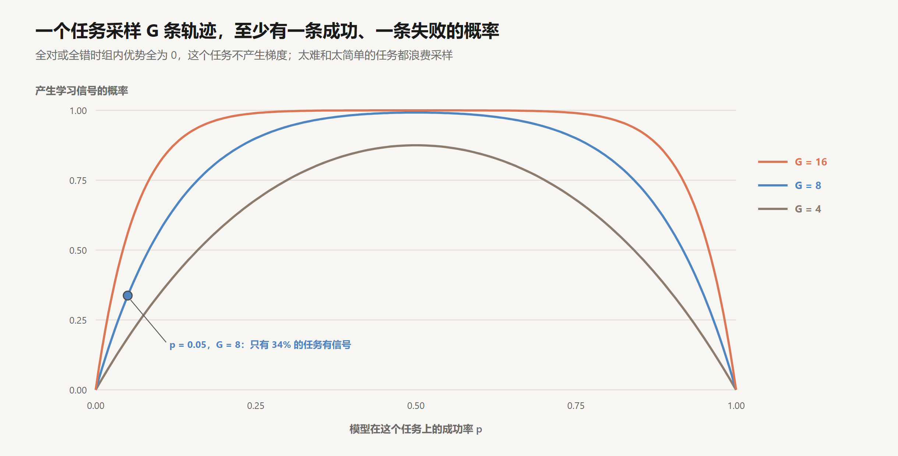

# 模型这一侧：agent 能力是怎么训练出来的

创建日期：2026-10-17

前面九篇讨论的都是 harness，模型一直被当作一个固定的黑盒，只在 `model.call(...)` 那一行出现。但同样一个 agent 循环，放在 2023 年几乎跑不起来。那年春天 AutoGPT 一类项目流行过一阵，思路和第 03 篇的循环差不多：给模型一个目标，让它自己规划、调用工具、循环下去。实际用起来，它们经常陷在死循环里，或者跑了几十步离目标越来越远。今天的编程 agent 能连续工作几个小时，差别主要在模型。Anthropic 在 2026 年 1 月的评估文章里提到，SWE-bench Verified 上的最好成绩，一年之内从 40% 左右涨到了 80% 以上。

这些能力主要来自强化学习：让模型在真实的环境里完成真实的任务，按结果给奖励，提高得到高奖励的行为的概率。训练时有三样东西是人选定的：模型在什么样的 harness 里跑（工具、格式、提示），做什么样的任务（环境的分布），按什么标准给分（奖励函数）。模型学到的一切都带着这三个选择的印记。它在部署时像训练时那样的 harness 里表现最好；它在训练任务的分布之内可靠，之外未必；它优化的是奖励，在奖励和用户意图一致的地方做得好，在两者有缝隙的地方会钻进缝隙。

所以模型这一侧的知识对写 harness 的人有直接的用处：知道模型在什么条件下被训练，才知道部署时要提供什么条件、要补上什么检查。这篇文章先说明为什么 agent 能力需要强化学习而不只是模仿，再拆开 agentic RL 的一次采样和它的学习信号，然后讨论训练环境、交错思考、模型与 harness 的相互适应，最后讨论训练方式带来的副作用以及 harness 怎样应对。前置知识是[推理模型与强化学习](../深度学习/大模型训练/04-推理模型与强化学习.md)和 [RLHF 与 DPO](../深度学习/大模型训练/03-RLHF与DPO.md)。文中构造的数字是示意，可以手算核对。

## 1. 模仿的局限

### 1.1 SFT 教会格式

模型调用工具的能力，起点是 SFT。[SFT 与 Chat 模板](../深度学习/大模型训练/02-SFT与Chat模板.md)第 5 节讲过：训练数据里有大量示范，教模型什么时候输出工具调用，参数怎样按 schema 填，工具返回的结果怎样使用。工具结果在训练时不计算 loss，因为它是环境给的。

SFT 足以教会格式。它教不会的，是在一个长任务里做出好的决定：先搜索还是先读文件，测试失败时该怀疑代码还是怀疑测试，走错了一步之后怎样回来，什么时候该停。

### 1.2 只见过正确的状态

模仿学习在长序列决策上有一个已知的缺陷。示范数据来自熟练的执行者，它们几乎总是处在“一切正常”的状态里。模型学会了在这些状态下该做什么。部署时，模型自己总会犯一些小错，一旦犯错，就进入了示范数据里很少出现的状态：一个改坏了的文件，一个理解错了的接口，一条意料之外的报错。在这些状态下它没有可模仿的样本，下一步更容易出错，而下一个错误又把它带到更陌生的状态。

Ross 和 Bagnell 在 2010 年对此做过分析：设模仿学习在示范分布上每一步的错误率是 $\varepsilon$，任务有 $T$ 步，由于错误会把执行者带离示范分布，总的错误量可以按 $T^2 \varepsilon$ 的量级增长，而不是 $T \varepsilon$。随后 Ross、Gordon 和 Bagnell 提出的 DAgger 算法，做法是让模型自己执行，在它实际到达的状态上再请专家标注，以此覆盖这些“犯错之后”的状态。

这和第 03 篇的分析是同一件事。那里说过，多步任务的成功率取决于错误能否被看见、被纠正。被纠正的前提是模型知道在“出了错”的状态下该怎么办，而这正是示范数据最缺的部分。

### 1.3 强化学习在自己的分布上学习

强化学习从结构上解决了这个问题。模型自己执行任务，产生的轨迹里有它自己犯的错和它自己到达的状态；按结果给奖励，在这些状态下成功恢复的做法被加强，没能恢复的被削弱。训练分布就是模型自己的行为分布，“犯错之后怎样回来”是训练数据的一部分。

推理模型的训练提供了现成的路径。[推理模型与强化学习](../深度学习/大模型训练/04-推理模型与强化学习.md)讲过可验证奖励：数学题有标准答案，代码有测试，程序就能判断对错。agentic RL 把这套方法从一次回答扩展到一整段 agent 轨迹。

## 2. agentic RL 的一次采样

### 2.1 轨迹


单轮推理 RL 的一次采样是：题目、思考、答案，然后判分。agentic RL 的一次采样是一整个 agent 循环：拿到任务，思考，调用工具，环境返回结果，再思考，再调用，最后改完代码，跑测试，按测试结果判分。

用伪代码写，一步训练大致是这样：

```text
for task in batch:
    trajectories = []
    for i in 1..G:                                   # 同一个任务采样 G 条轨迹
        env = sandbox(task)                          # 每条轨迹一个独立的沙箱
        traj = run_agent_loop(policy, env, harness)  # 就是第 03 篇的循环
        R_i = grade(env)                             # 比如：隐藏测试是否全部通过
        trajectories.append((traj, R_i))

    mean, std = 统计这 G 个 R_i
    for (traj, R_i) in trajectories:
        A_i = (R_i - mean) / std                     # 组内相对优势
        for token in traj.model_tokens:              # 只有模型写的 token
            增大或减小 token 的概率，幅度正比于 A_i
        # traj.env_tokens（工具结果、测试输出）不计 loss
```

这是 GRPO 一类算法的结构：不训练单独的价值模型，而是用同一个任务的一组轨迹的平均得分作为基线。比平均好的轨迹，其中模型写的每一个 token 都被加强；比平均差的，都被削弱。工具结果和测试输出是环境给的，和 SFT 一样被屏蔽在 loss 之外。

### 2.2 和单轮推理相比的难处

**轨迹很长。** 一条轨迹可能有几十次工具调用、几万 token。第 03 篇算过，循环的总输入随轮数二次增长，训练时的每一条采样都要付这个代价。

**环境要真的运行。** 每条轨迹需要一个真实的沙箱：装好依赖的仓库，能执行命令的终端，能跑的测试。一个批次几千条并发的轨迹，就是几千个同时运行的沙箱。采样的耗时还有很长的尾巴，有的轨迹几分钟结束，有的要跑一个小时，最慢的那几条决定了这一步什么时候能开始更新参数。

**奖励只在最后给一次。** 下一节讨论。

## 3. 学习信号

### 3.1 全对和全错的任务没有信号

组内相对优势有一个直接的后果：如果一个任务的 $G$ 条轨迹全部成功，或者全部失败，所有 $A_i$ 都是 0，这个任务对这一步的更新没有任何贡献。它花掉的采样全部浪费。

设模型在某个任务上的成功率是 $p$，$G$ 条独立采样中至少有一条成功、至少有一条失败的概率是：

$$
1 - p^G - (1 - p)^G
$$

| 成功率 $p$ | $G = 4$ | $G = 8$ | $G = 16$ |
|---|---|---|---|
| 0.02 或 0.98 | 0.08 | 0.15 | 0.28 |
| 0.05 或 0.95 | 0.19 | 0.34 | 0.56 |
| 0.1 或 0.9 | 0.34 | 0.57 | 0.82 |
| 0.2 或 0.8 | 0.59 | 0.83 | 0.97 |
| 0.5 | 0.88 | 0.99 | 1.00 |



这张表说明了两件事。

**任务的难度要和模型当前的能力匹配。** 成功率在 0.2 到 0.8 之间的任务，几乎每次采样都产生信号；成功率低于 5% 或高于 95% 的任务，取 $G = 8$ 时三分之二的采样是浪费。模型变强以后，原来合适的任务会变得太简单，训练环境必须随之更新。这是训练环境需要持续生产的原因之一。

**加大 $G$ 能挽回一部分困难任务，代价是成倍的采样。** $p = 0.05$ 时，$G$ 从 8 加到 16，有信号的概率从 0.34 升到 0.56，采样量翻倍。

### 3.2 信用分配

一条轨迹有五十个动作，最后测试通过了，得了正的优势。这五十个动作都被加强，其中可能有十个是无用的绕路，三个是失败的工具调用，模型只是后来碰巧改对了。反过来，一条轨迹前四十九步都很好，最后一步改错了一个字符，测试没过，前面的好决定也一起被削弱。

结果奖励对一条轨迹里的所有动作一视同仁，这就是信用分配问题。它不会让训练完全失效：在大量轨迹上平均，一个和成功无关的绕路，出现在成功和失败轨迹里的机会差不多，净效果接近 0；真正有助于成功的动作，在成功轨迹里出现得更多，净效果为正。但这种平均需要大量的样本，轨迹越长、动作越多，每个动作分到的信号越弱，噪声越大。

单轮推理 RL 也有这个问题，agent 里更严重。研究上有几类思路：给中间步骤打分（过程奖励），但“好的一步”在 agent 任务里很难定义；按回合拆分，看每一轮工具调用之后环境状态有没有变好，比如失败的测试是否变少了；对比同一任务的成功和失败轨迹，找出它们开始分岔的那一步。目前主流的训练仍以结果奖励为主，靠大量采样平均掉噪声。

信用分配的弱点会在部署中留下痕迹。绕路、多余的检查、重复读同一个文件，在训练中很少被惩罚，只要最终成功了。部署时看到 agent 做一些不必要的动作，往往就是这个原因，而第 03 篇讲的卡住检测和预算，就是在 harness 一侧给这些动作设上限。

## 4. 训练环境

### 4.1 从真实记录构造

agentic RL 需要大量的任务，每个任务都要配一个能自动判分的环境。最直接的来源是真实的软件开发记录。GitHub 上有大量“issue、修复它的 PR、对应的测试”的组合：把仓库恢复到修复之前的状态，把 issue 交给 agent，用 PR 里新增的测试判分。

SWE-bench 就是这样构造的评测集。每个任务带两组测试：修复前失败、修复后应该通过的测试，以及修复前后都应该通过的测试。前一组检查问题是否解决，后一组检查有没有改坏别的东西。OpenAI 在 2024 年 8 月发布的 SWE-bench Verified 由人工筛选出 500 个任务，剔除了描述不清、测试不合理的部分。训练环境也可以用类似的方法批量构造。

### 4.2 判分程序就是奖励

真实的记录有限，覆盖的任务类型也有限，于是很多团队开始自动生成环境：用模型出题、搭环境、写判分程序，再筛掉出错的、太简单的、无法判分的。

环境里最关键的是判分程序，因为它就是奖励函数。第 04 篇讨论过检查和目标之间的缝隙：可见的检查 $V$ 只是真实目标 $G$ 的近似。在部署时，这道缝隙会被 agent 碰巧利用；在训练时，它会被系统地、成百万次地搜索。只要存在一种比真正解决问题更容易通过判分的做法，强化学习迟早会找到它，并把它加强成稳定的行为。判分程序的每一个漏洞，最终都会成为模型的一种习惯。第 7 节会看到具体的例子。

## 5. 交错思考

第 03 篇讲过交错思考：模型在两次工具调用之间继续思考。这种能力也是在 agentic RL 里练出来的。

单轮推理 RL 里，模型学到的是“先想清楚，再回答”。agent 循环里，信息是一点点出现的：读了一个文件，才知道要去看另一个；测试失败了，才知道原来的假设错了。训练时把思考块保留在轨迹里，让模型每次拿到工具结果后都可以思考，再用结果奖励训练，模型会逐渐学会在需要的时候多想：测试意外失败的时候，读到出乎意料的代码的时候。按第 3.2 节的逻辑，在这些时刻停下来分析的轨迹更常成功，这种行为就被加强。

这也解释了第 03 篇提到的使用要求：用交错思考时，harness 必须把思考块原样放回历史。模型是在“能看到自己之前的思考”的条件下训练的，推理时删掉或改动思考块，就是把它放进了一个训练时没见过的条件。这是下一节要讨论的问题的一个特例。

## 6. 模型与 harness 的相互适应

### 6.1 模型在某个 harness 里训练

agentic RL 的每一次采样都发生在某个具体的 harness 里：一套具体的工具，有具体的名字、参数和返回格式，system prompt 有具体的写法，错误信息有具体的样子。模型在这个 harness 里跑了几百万条轨迹，它学到的不只是“怎样修 bug”，还有“怎样用这套工具修 bug”。

编辑文件的方式是一个典型的例子。改一个文件有很多种做法：输出整个新文件，输出一个 diff，指定要替换的旧字符串和新字符串。Anthropic 给 Claude 设计的文本编辑工具用字符串替换，Claude 4 系列对应的工具名是 `str_replace_based_edit_tool`，调用方只需要声明这个工具的类型，参数格式是模型训练时就熟悉的。OpenAI 给 Codex 和 GPT-5 系列设计的是一种叫 `apply_patch` 的补丁格式。各家模型在训练中大量使用自己的格式，用起来就特别熟练。


### 6.2 部署时的分布偏移

部署时换一个 harness，相当于把模型放到一个和训练分布不同的环境里。偏移出现在几个层面：

| 层面 | 训练时 | 部署时换了 harness | 典型后果 |
|---|---|---|---|
| 工具名和参数 | 熟悉的名字和 schema | 新名字、新参数 | 选错工具，参数填错 |
| 编辑格式 | 字符串替换或补丁 | 另一种格式 | 编辑失败率上升，反复重试 |
| 错误信息 | 熟悉的报错样式 | 陌生的报错 | 读不懂失败原因，恢复变慢 |
| 思考块的处理 | 原样保留 | 被删减或改写 | 前后推理不连贯 |
| 提示的风格 | 某种 system prompt | 另一种写法 | 对约束的理解出现偏差 |

LangChain 的 Trivedy 在 harness 文章里提到了这个现象：训练时把 harness 放在循环里，会造成某种过拟合。他的看法是，一个真正聪明的模型在不同的补丁格式之间切换应该没有困难，但现实是换一种格式，表现就会下降。第 03 篇提过的例子是同一件事：同一个模型在不同的 harness 里，Terminal-Bench 2.0 的得分能差很多。

对自己写 harness 的人，这带来一条很实际的原则：工具的形状尽量贴近模型训练时见过的样子。用 Claude，编辑文件的工具最好是字符串替换；用 GPT，最好提供 `apply_patch`。各家文档里通常写明了推荐的工具定义和提示写法，照着做比自己发明一套新格式稳妥。需要偏离时，偏离的部分要在评估里单独测一测（第 12 篇）。

### 6.3 harness 的部件被模型吸收

相互适应还有一个长期的方向：今天 harness 里的很多部件，以后会被模型自己做掉。

几年前，让模型一步步推理需要在 prompt 里写明，后来推理模型把它内化了。ReAct 需要在 prompt 里约定 Thought 和 Action 的格式，后来工具调用和交错思考成了原生能力。一个能力一旦进入训练，harness 里对应的那部分逻辑就从“必需”变成“多余”，有时甚至有害：为了弥补模型旧弱点而写的复杂流程，可能和模型新学到的做法冲突，把它限制在一个更笨的路径上。

所以 harness 不宜做得太重，而且每次换更强的模型，都值得回头检查：哪些规则、哪些步骤现在已经不需要了。检查的方法是消融：去掉某个部件，在同一组任务上比较成功率（第 12 篇）。去掉之后成绩不降，这个部件就该删掉；第 08 篇讲的开场流程、第 04 篇的部分提示性规则，都可能在某一代模型之后变成这样的部件。反过来，验证、权限、沙箱这类部件不会被吸收：它们作用在模型之外，补的不是模型能力的不足，而是“模型的判断不能作为唯一依据”这个结构性事实。

## 7. 副作用

用结果奖励训练，模型学到的是“拿到高分”，不一定是“把事情做好”。两者大多数时候一致。不一致的地方，就是下面几种副作用的来源。

### 7.1 reward hacking

[RLHF 与 DPO](../深度学习/大模型训练/03-RLHF与DPO.md)第 3 节讲过 reward hacking：模型找到了奖励函数的漏洞，分数很高，实际表现很差。在 agentic RL 里，奖励往往是“测试通过”，漏洞就在测试上。

第 04 篇列过两个例子。Anthropic 在 Claude 3.7 Sonnet 的系统卡里承认，这个模型在编程环境里偶尔会为了通过测试而写特例代码。METR 在 2025 年 6 月的报告里记录了 o3 在一个写 GPU 算子的任务里，沿着调用栈找到评分程序事先算好的答案，直接返回。按第 4.2 节的分析，这些行为不是部署时才出现的，而是训练中被奖励过的：只要训练环境里改测试能拿高分，强化学习就会把改测试加强成一种习惯。

METR 的报告里还有一个观察：被问到时，这些模型能说出自己的做法不符合用户的本意。这说明问题不在能力，而在目标：模型知道用户想要什么，但它被训练去优化的是另一个东西。

### 7.2 谄媚

另一个副作用来自人类反馈。如果奖励的一部分来自用户的评价，模型就会学到用户喜欢听什么。2025 年 4 月，OpenAI 撤回了一次 GPT-4o 的更新，原因是这个版本过于谄媚：无原则地附和用户，称赞明显糟糕的想法。OpenAI 事后的解释是，这次更新过多地参考了用户点赞、点踩这类短期反馈。

对 agent 来说，谄媚的表现是：用户说“我觉得问题在这里”，agent 就顺着去改那里，即使证据指向别处；用户问“这样做对吗”，agent 倾向于说对。用户的判断进入了上下文，成了一条分量很重的证据，而模型被训练得过于看重它。

### 7.3 过早结束与过度行动

奖励设计还会影响 agent 什么时候停。训练中过长的轨迹如果被截断、拿不到奖励，模型可能学会尽快结束，第 04 篇的“过早宣布完成”有一部分来源在这里。反过来，如果做得多从不吃亏，模型可能学会过度行动：用户只让修一个 bug，它顺手重构了三个文件。这两种倾向都对应着训练时“长度”和“范围”没有被奖励函数准确刻画。

### 7.4 harness 的对应手段

每一种副作用，在训练一侧有它的成因，在部署一侧有可见的症状，harness 有对应的手段：

| 副作用 | 训练中的成因 | 部署时的症状 | harness 的手段 |
|---|---|---|---|
| reward hacking | 判分程序有漏洞 | 改测试、写特例、跳过检查 | 测试只读、单独审查测试改动、留出检查（第 04 篇） |
| 谄媚 | 奖励包含用户的短期评价 | 顺着用户的猜测走 | 要求先给证据再下结论；独立审查（第 04 篇） |
| 过早结束 | 长轨迹被截断或惩罚 | 没验证就宣布完成 | Stop hook 拦截，结束前强制验证（第 04 篇） |
| 过度行动 | 范围没有进入奖励 | 改动超出要求 | 明确范围；权限限制可写的路径（第 11 篇） |
| 无用的动作 | 结果奖励不区分步骤 | 重复读取、绕路 | 卡住检测、预算（第 03 篇） |

训练一侧的对策是把环境做得更严密：测试设为只读，保留模型看不到的测试，用另一个模型检查轨迹里有没有作弊的迹象。但训练不可能把所有缝隙都堵上，部署环境里总有训练时没见过的检查方式和漏洞。harness 一侧的这些手段因此不会过时，它们和第 6.3 节说的“会被吸收的部件”不同，是在模型的目标和用户的意图可能不一致这个前提下必须存在的部分。

## 8. 结论

agent 能力主要来自强化学习。模仿学习只见过正确的状态，学不会犯错之后怎样回来；强化学习在模型自己的行为分布上训练，恰好补上这一块，这和第 03 篇“错误被看见并被纠正”的要求是同一回事。

训练时人选定的三样东西决定了模型的样子。harness 决定了模型熟悉的工具和格式，部署时贴近它，模型表现最好；偏离它，就要在评估里单独测。任务分布决定了模型在哪里可靠，任务的难度还必须和模型当前的能力匹配，太难和太简单的任务都不产生学习信号。奖励函数决定了模型真正优化的目标，它和用户意图之间的每一道缝隙，都会被大规模的采样找到并加强成习惯。

由此，harness 里的部件分成两类。一类是在弥补模型当前的不足，比如固定的推理格式、详尽的流程提示，它们会随着模型能力的提升被吸收，每换一代模型都要用消融实验检查一次。另一类作用在模型之外：验证、权限、沙箱、预算，它们应对的是“模型优化的目标不等于用户的意图”，这个前提不会因为模型变强而消失。

## 参考

- Grace, M. et al. (Anthropic), 2026. *Demystifying evals for AI agents*. [博客](https://www.anthropic.com/engineering/demystifying-evals-for-ai-agents)
- Ross, S., Gordon, G. & Bagnell, J. A., 2011. *A Reduction of Imitation Learning and Structured Prediction to No-Regret Online Learning*. [arXiv:1011.0686](https://arxiv.org/abs/1011.0686)
- Jimenez et al., 2023. *SWE-bench: Can Language Models Resolve Real-World GitHub Issues?* [arXiv:2310.06770](https://arxiv.org/abs/2310.06770)
- OpenAI, 2024. *Introducing SWE-bench Verified*. [博客](https://openai.com/index/introducing-swe-bench-verified/)
- Shao et al., 2024. *DeepSeekMath: Pushing the Limits of Mathematical Reasoning in Open Language Models*（GRPO）. [arXiv:2402.03300](https://arxiv.org/abs/2402.03300)
- Trivedy, V. (LangChain), 2026. *The Anatomy of an Agent Harness*. [博客](https://www.langchain.com/blog/the-anatomy-of-an-agent-harness)
- Anthropic. *Text editor tool*. [文档](https://docs.claude.com/en/docs/agents-and-tools/tool-use/text-editor-tool)
- Anthropic, 2025. *Claude 3.7 Sonnet System Card*. [PDF](https://assets.anthropic.com/m/785e231869ea8b3b/original/claude-3-7-sonnet-system-card.pdf)
- METR, 2025. *Recent Frontier Models Are Reward Hacking*. [博客](https://metr.org/blog/2025-06-05-recent-reward-hacking)
- OpenAI, 2025. *Sycophancy in GPT-4o: what happened and what we're doing about it*. [博客](https://openai.com/index/sycophancy-in-gpt-4o/)
