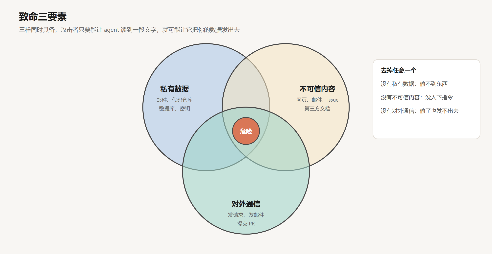
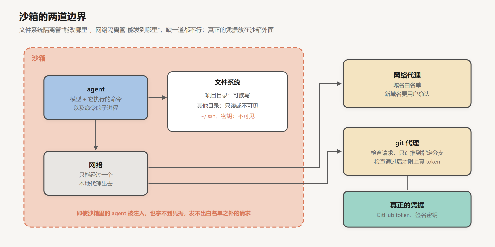

# 安全与权限

创建日期：2026-10-17

到这一篇为止，agent 已经能执行命令、读写文件、访问网络、调用各种外部服务，还能记住事情、分派子任务、连续工作几个小时。它能做的事情越多，出问题时的破坏也越大。

[上一篇](10-模型这一侧.md)讲了训练带来的副作用：模型的目标和用户的意图出现偏差。这一篇讲另外两类风险：agent 自己犯错，以及 agent 被别人利用。

## 1. 三类风险

**误操作。** agent 没有恶意，只是判断错了。想清理临时文件，结果删错了目录；想重置测试数据库，结果连上的是生产库；想修一个 bug，顺手 `git push --force` 覆盖了别人的提交。模型对自己的操作往往很有信心，而命令执行了就收不回来。

**被注入。** agent 读到的内容里藏着指令，它照着做了。这叫 prompt injection（提示注入）。网页、邮件、GitHub issue、PDF、代码注释、MCP server 返回的结果、上一篇讲的记忆文件，任何进入上下文的文字都可能是载体。

**数据外泄。** 注入的最终目的往往是偷数据：让 agent 读取你的私有信息，再通过某种方式发给攻击者。

后两类风险是 agent 特有的。传统软件的安全边界是代码，而 agent 的行为由上下文决定，任何能往上下文里塞文字的人，都在某种程度上能影响它的行为。

## 2. prompt injection 为什么防不住

### 2.1 指令和数据混在一起

传统软件里，代码和数据是分开的。SQL 注入之所以能被根治，是因为有参数化查询：用户的输入被明确标记为数据，数据库永远不会把它当成命令执行。

大模型没有这样的分隔。system prompt、用户的话、网页的内容，最后全部拼成一个 token 序列，模型看到的就是一段文字。Simon Willison 的说法是：

> LLMs are unable to reliably distinguish the importance of instructions based on where they came from.

大模型无法可靠地根据指令的来源来区分它们的重要性。

模型最大的本事就是遵循自然语言里的指令。这个本事对用户的指令有效，对攻击者藏在网页里的指令同样有效。

### 2.2 指令层级是倾向，不是规则

[SFT 与 Chat 模板](../深度学习/大模型训练/02-SFT与Chat模板.md)第 6 节讲过指令层级：训练模型优先听 system，其次听 user，最后才是工具返回的内容。这确实大幅提高了模型对注入的抵抗力。

但它是训练出来的统计倾向，不是硬性的规则。模型在绝大多数情况下会忽略网页里的“请忽略之前的指令”，可攻击者可以换一千种说法、试一万次，只要成功一次就够了。

Willison 对那些号称能拦截 95% 攻击的防护产品的评价是：在 Web 应用安全领域，95% 是一个不及格的分数。防御方需要每次都成功，攻击方只需要成功一次。

所以 agent 的安全设计有一个基本前提：假设模型会被注入。不指望模型自己守住底线，而是在模型之外设置限制，让它即使被注入了，也做不成坏事。

## 3. 致命三要素

### 3.1 三样东西

Willison 在 2025 年 6 月总结了一个判断框架，他称之为“致命三要素”（the lethal trifecta）：

- **能接触私有数据**：读你的邮件、代码仓库、数据库、密钥。这往往正是使用工具的目的。
- **会接触不可信内容**：任何攻击者能控制的文字可能进入上下文的渠道，比如网页、邮件、别人提交的 issue、文档、图片。
- **能对外通信**：任何能把信息发出去的途径，比如发 HTTP 请求、发邮件、提交 PR，甚至在回答里渲染一张图片（图片的 URL 可以带上被偷的数据）。

三样同时具备，攻击者只要能让 agent 读到一段文字，就有可能让它读取你的私有数据并发送出去。

### 3.2 真实的例子

这不是理论上的风险。Willison 的文章里列了一长串曾经受影响的产品，包括 Microsoft 365 Copilot、GitHub 官方的 MCP server、GitLab Duo、ChatGPT、Google Bard、Amazon Q、Slack、Anthropic 的 Claude iOS 应用等。大多数在被报告后很快修复了，修复方式通常是堵住对外通信的那条路：比如不再自动渲染外部图片。

GitHub MCP 的那个案例很典型：一个 agent 有权限访问用户的私有仓库，它去处理一个公开仓库里的 issue，issue 里藏着指令，让它去读私有仓库的内容，然后在公开仓库里提交一个 PR 把内容写进去。三要素全都来自同一个 MCP server。

### 3.3 组合的问题

厂商可以修自己产品里的漏洞，但修不了用户自己组合出来的漏洞。

第 02 篇讲过 MCP 的好处是可以自由组合：接一个读邮件的 server，再接一个浏览网页的 server，再接一个发 Slack 消息的 server。每一个单独看都没问题，组合起来就凑齐了三要素。Willison 对普通用户的建议很直接：唯一可靠的办法是不要让一个 agent 同时具备这三样能力。去掉任何一个，攻击链就断了。

## 4. 防线

### 4.1 权限审批

最直观的防线是让人来批准：agent 每次要执行命令、修改文件、访问网络之前，弹出一个确认框，用户点同意才执行。

问题在于审批疲劳。Anthropic 在 2025 年 10 月讲 Claude Code 沙箱的文章里描述了这个现象：确认框弹得太多，用户就不再仔细看了，习惯性地点同意。到了这一步，审批就只剩下形式，起不到防护作用，反而让人误以为是安全的。

所以审批要用在刀刃上。安全的操作（读项目里的文件、运行测试）可以自动放行，只有真正有风险的操作（删除文件、推送代码、访问新的域名）才需要确认。怎么划分，本身就是一个需要权衡的设计。

### 4.2 沙箱

比审批更根本的办法是沙箱：限制 agent 能碰到的范围，在这个范围里让它自由行动。

Anthropic 那篇文章强调，有效的沙箱需要两道边界，缺一不可：

- **文件系统隔离**：agent 只能读写指定的目录（通常是项目目录），碰不到 `~/.ssh` 这类敏感位置，也改不了系统文件。
- **网络隔离**：agent 只能连接允许的服务器。所有网络请求都经过一个沙箱外的代理，代理按白名单放行，遇到新的域名时请用户确认。

为什么两道都要？只有文件隔离，被注入的 agent 虽然改不了系统文件，但可以把它能读到的项目代码发到任何地方。只有网络隔离，被注入的 agent 可以修改系统里的配置，比如改掉 shell 的启动脚本，让下一次在沙箱外执行命令时被利用。

这两道边界是用操作系统的机制实现的（Linux 上用 bubblewrap，macOS 上用 seatbelt），不仅约束 agent 直接的操作，也约束它执行的命令启动的所有子进程。约束在操作系统层面生效，模型无论被说服成什么样，都绕不过去。

效果也很明显：在 Anthropic 内部使用中，开启沙箱后需要用户确认的次数减少了 84%。安全性和自主性在这里不矛盾：边界清楚了，边界之内就可以放手让 agent 干活，审批反而可以少很多。

### 4.3 凭据不进沙箱

Claude Code 的网页版在云端的沙箱里运行，这里有一个关键的设计：真正的凭据（GitHub token、签名密钥）根本不放进沙箱。

agent 要推送代码时，请求先发给沙箱外的一个 git 代理。代理用一个权限受限的临时凭据验证请求来自这个沙箱，再检查请求本身，比如是不是只推送到了指定的分支，检查通过了，才附上真正的 GitHub token 转发出去。这样，即使沙箱里的 agent 被完全攻破，攻击者也拿不到真正的凭据，能做的事情也被限定在代理允许的范围内。

### 4.4 最小权限

这些做法背后是一个老原则：最小权限。agent 只拿完成当前任务所必需的权限，多一点都不给。

- 只读的任务，就只给读的工具。
- 只需要访问一个仓库，token 的权限就只覆盖那一个仓库。
- 需要访问生产数据的任务，用只读账号，或者让 agent 生成操作方案，由人来执行。
- 读过不可信内容之后，收紧 agent 的能力。

最后一条来自 2025 年一篇关于 agent 安全设计模式的论文（Beurer-Kellner et al.），其中的一个原则是：一旦 agent 读入了不可信的输入，就必须把它限制到“这个输入不可能触发任何有后果的操作”的程度。Google DeepMind 的 CaMeL 走得更远：让一个能接触不可信数据的模型和一个负责决策的模型分开，前者只能产出数据，不能产出指令，从架构上把指令和数据分开。

### 4.5 hooks

第 04 篇讲的 hooks 在这里也有用：在 agent 执行命令前，用一段确定性的程序检查这条命令。命中黑名单的命令（`rm -rf /`、强制推送到主分支）直接拦截，不管模型给出了什么理由。

## 5. 第三方组件

agent 的能力很多来自第三方：MCP server、skill、插件。每一个都是潜在的攻击面。

MCP server 是一段运行在你机器上（或者能访问你数据）的第三方代码。它的工具描述会进入模型的上下文，可以在里面藏指令；它的返回结果也会进入上下文，同样可以藏指令。一个今天还正常的 server，明天更新一个版本就可能变得有问题。

skill 也一样。第 06 篇讲过，skill 的正文是给模型看的指令，附带的脚本会被直接执行。Anthropic 的建议是只从可信的来源安装，不太可信的要先审查。

对待这些组件，应该像对待任何第三方依赖一样：看来源，看代码，锁定版本，只给它需要的权限。

## 6. 安全是 harness 的责任

回顾这一篇，几乎所有的防线都在模型之外：沙箱、代理、权限、hooks、审批。模型这一侧能做的，是通过训练提高对注入的抵抗力，这很有用，但不能作为唯一的防线。

这和第 04 篇讲的验证是同一个思路：重要的约束，不要依赖模型的自觉，要用程序强制执行。

到这里，harness 的各个部件都讲完了。但还有一个问题没有回答：改了一版 prompt、换了一个工具、调整了沙箱的规则之后，agent 是变好了还是变差了？下一篇讲评估。

## 小结

- agent 的风险有三类：误操作、被注入、数据外泄。后两类是 agent 特有的，因为它的行为由上下文决定。
- 大模型无法可靠地区分指令的来源，指令层级只是训练出来的倾向。安全设计要假设模型会被注入。
- 致命三要素：私有数据、不可信内容、对外通信。三者同时具备就有外泄风险，去掉任何一个，攻击链就断了。
- 审批太多会导致审批疲劳。沙箱要同时有文件系统和网络两道边界，由操作系统强制执行；真正的凭据放在沙箱外面，由代理检查后再附加。
- 最小权限：只给必需的权限，读过不可信内容后收紧能力。MCP server 和 skill 要像第三方依赖一样审查。

## 参考

- Willison, S., 2025. *The lethal trifecta for AI agents: private data, untrusted content, and external communication*. [博客](https://simonwillison.net/2025/Jun/16/the-lethal-trifecta/)
- Dworken, D. & Weller-Davies, O. (Anthropic), 2025. *Beyond permission prompts: making Claude Code more secure and autonomous*. [博客](https://www.anthropic.com/engineering/claude-code-sandboxing)
- Beurer-Kellner, L. et al., 2025. *Design Patterns for Securing LLM Agents against Prompt Injections*. [arXiv:2506.08837](https://arxiv.org/abs/2506.08837)
- Debenedetti, E. et al., 2025. *Defeating Prompt Injections by Design*（CaMeL）. [arXiv:2503.18813](https://arxiv.org/abs/2503.18813)
- Wallace et al., 2024. *The Instruction Hierarchy: Training LLMs to Prioritize Privileged Instructions*. [arXiv:2404.13208](https://arxiv.org/abs/2404.13208)
