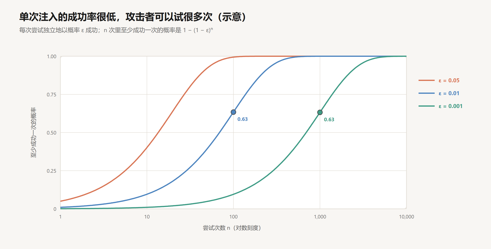
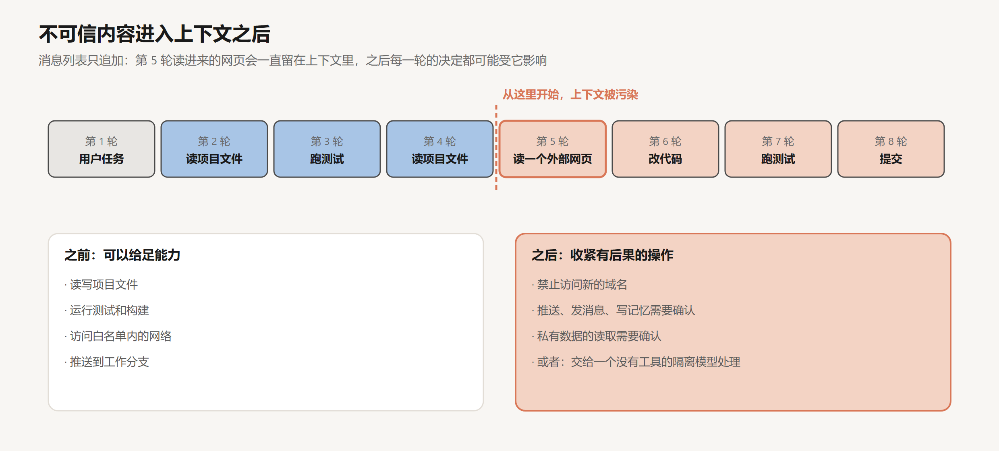

# 安全与权限

创建日期：2026-10-17

到这一篇为止，agent 已经能执行命令、读写文件、访问网络、调用外部服务，还能写记忆、派子 agent、连续工作几个小时。[上一篇](10-模型这一侧.md)讨论的是模型的目标和用户意图之间的偏差。这一篇讨论另外两类风险：agent 自己判断失误，以及 agent 被别人利用。

两类风险有一个共同的根源。agent 的行为由上下文决定，而上下文里的内容来自很多地方：用户、项目文件、工具结果、网页、邮件、第三方的 MCP server。任何能往上下文里写入文字的人，都在一定程度上影响着 agent 接下来做什么。模型可以被训练得更不容易受影响，但它的抵抗力是概率性的，而攻击者可以反复尝试。所以模型本身不能充当安全边界。

安全设计因此要换一个出发点：不去保证模型永远做出正确的判断，而是限定它做出任何判断之后，能造成的后果有多大。这种限定必须在模型之外、由确定性的机制执行：操作系统的隔离，网络代理的白名单，凭据的存放位置，工具的权限范围。这篇文章先说明为什么注入无法在模型层面根治，再用信息流的方式分析外泄需要的条件，然后逐层讨论各种防线限定的是什么，最后讨论误操作和第三方组件。文中构造的数字是示意，可以手算核对。

## 1. 三类风险

**误操作。** agent 没有恶意，只是判断错了。想清理临时文件，删错了目录；想重置测试数据库，连上的是生产库；想修一个 bug，顺手 `git push --force` 覆盖了别人的提交。模型对自己的操作往往很有把握，而命令一旦执行就收不回来。

**被注入。** agent 读到的内容里藏着指令，它照着做了。这叫 prompt injection（提示注入）。网页、邮件、GitHub issue、PDF、代码注释、MCP server 返回的结果、第 07 篇讲的记忆文件，任何进入上下文的文字都可能是载体。

**数据外泄。** 注入的目的往往是窃取数据：让 agent 读取用户的私有信息，再通过某种渠道发给攻击者。

后两类是 agent 特有的。传统软件的行为由代码决定，攻击者要改变它的行为，就得找到代码里的漏洞；agent 的行为由上下文决定，攻击者只需要让它读到一段文字。

## 2. 注入为什么无法在模型层面根治

### 2.1 指令和数据在同一个通道里

传统软件里，代码和数据是分开的。SQL 注入能被根治，是因为有参数化查询：用户的输入被明确标记为数据，数据库在任何情况下都不会把它当作命令执行。分隔发生在协议层面，和输入的内容无关。

大模型没有这样的分隔。第 01 篇讲过，system prompt、用户的话、工具结果，最后都被渲染成同一个 token 序列，角色只是序列里的一些特殊标记。模型对“这段话该不该听”的判断，完全来自它对内容和位置的理解。Simon Willison 的说法是：

> LLMs are unable to reliably distinguish the importance of instructions based on where they came from.

大模型无法可靠地根据指令的来源来区分它们的重要性。

模型最核心的能力是遵循自然语言里的指令。这个能力对用户的指令有效，对攻击者藏在网页里的指令同样有效。

### 2.2 指令层级是倾向

[SFT 与 Chat 模板](../深度学习/大模型训练/02-SFT与Chat模板.md)第 6 节讲过指令层级：训练模型优先遵循 system，其次是 user，最后才是工具返回的内容。OpenAI 2024 年的论文（Wallace et al.）表明，这种训练能显著提高模型对注入的抵抗力。

但它是训练出来的统计倾向，不是协议层面的规则。模型在绝大多数情况下会忽略网页里的“请忽略之前的指令”，攻击者却可以换各种说法，反复尝试。设一次注入尝试成功的概率是 $\varepsilon$，各次尝试相互独立，$n$ 次尝试里至少成功一次的概率是：

$$
1 - (1 - \varepsilon)^n
$$

| 单次成功率 $\varepsilon$ | $n = 10$ | $n = 100$ | $n = 1{,}000$ | $n = 10{,}000$ |
|---|---|---|---|---|
| 0.05 | 0.40 | 0.99 | 1.00 | 1.00 |
| 0.01 | 0.10 | 0.63 | 1.00 | 1.00 |
| 0.001 | 0.01 | 0.10 | 0.63 | 1.00 |

单次成功率从 1% 降到 0.1%，攻击者需要的尝试次数多了十倍，但结局并没有改变。对一个每天读几百个网页、几十封邮件的 agent 来说，每一个外部文档都是一次尝试的机会，攻击者甚至不需要知道这个 agent 存在，只需要把文字放在它可能读到的地方。

Willison 对那些号称能拦截 95% 攻击的防护产品的评价是：在 Web 应用安全领域，95% 是一个不及格的分数。防守方每次都要成功，攻击方只需要成功一次。

### 2.3 前提

由此得出 agent 安全设计的基本前提：假设模型会被注入。提高模型的抵抗力仍然有价值，它降低了 $\varepsilon$，让攻击的成本更高；但防线不能建立在“模型不会被说服”之上，而要建立在“即使被说服了，也做不成”之上。

## 3. 外泄需要的条件

### 3.1 致命三要素

Willison 在 2025 年 6 月总结了一个判断框架，称为“致命三要素”（the lethal trifecta）：

- **能接触私有数据**：读用户的邮件、代码仓库、数据库、密钥。这往往正是使用工具的目的。
- **会接触不可信内容**：任何攻击者能控制的文字可能进入上下文的渠道，比如网页、邮件、别人提交的 issue、文档、图片。
- **能对外通信**：任何能把信息发出去的途径，比如发 HTTP 请求、发邮件、提交 PR，甚至在回答里渲染一张图片，图片的 URL 可以带上被窃取的数据。

三者同时具备，攻击者只要能让 agent 读到一段文字，就可能让它读取私有数据并发送出去。

### 3.2 作为信息流

把三要素看成一条信息流的路径，会更清楚它为什么成立，以及怎样切断。

外泄需要三段：不可信内容进入上下文，成为“指令”；模型按指令调用工具，读取私有数据，私有数据进入上下文；模型按指令调用一个能对外发送的工具，把上下文里的私有数据作为参数发出去。三段都经过同一个上下文，模型是它们的连接点。

这条路径上，任何一段断开，外泄就不能完成。没有不可信内容，就没有人下达指令；没有私有数据，就偷不到东西；没有对外通信，偷到了也发不出去。Willison 对普通用户的建议因此很直接：不要让一个 agent 同时具备这三样能力。

### 3.3 例子

这不是理论上的风险。Willison 的文章列了一长串曾经受影响的产品，包括 Microsoft 365 Copilot、GitHub 官方的 MCP server、GitLab Duo、ChatGPT、Google Bard、Amazon Q、Slack、Anthropic 的 Claude iOS 应用等。大多数在被报告后很快修复，修复方式通常是切断对外通信的那一段，比如不再自动渲染外部图片。

GitHub MCP 的案例很典型。一个 agent 有权限访问用户的私有仓库，它被要求处理一个公开仓库里的 issue。issue 里藏着指令，让它去读私有仓库的内容，然后在公开仓库里提交一个 PR，把内容写进去。读 issue 是不可信内容，读私有仓库是私有数据，在公开仓库提交 PR 是对外通信，三段全部由同一个 MCP server 提供。

### 3.4 组合与污染

厂商可以修自己产品里的路径，修不了用户自己组合出来的路径。第 02 篇讲过，MCP 的好处是可以自由组合：接一个读邮件的 server，再接一个浏览网页的 server，再接一个发消息的 server。每一个单独看都没有问题，组合起来就凑齐了三段。

三要素还要放在时间上看。第 03 篇说过，消息列表只追加。不可信内容一旦进入上下文，就会一直留在那里，之后每一轮模型做决定时都能看到它。所以“这个 agent 有没有接触不可信内容”，不是某一次工具调用的属性，而是从那一刻起整个会话的属性。

这给出了一个可以执行的规则：会话开始时可以给足能力；一旦读入了不可信的内容，之后有后果的操作就要收紧，比如禁止访问新的域名，推送、发消息、写记忆需要确认。2025 年一篇关于 agent 安全设计模式的论文（Beurer-Kellner et al.）把它表述为：一旦 agent 读入了不可信的输入，就必须把它限制到“这个输入不可能触发任何有后果的操作”的程度。

## 4. 防线

### 4.1 防线的两种性质

各种防线可以按一个问题分类：它的效果依赖模型的判断，还是不依赖。

| 防线 | 由什么执行 | 绕过它需要 |
|---|---|---|
| system prompt 里的规则 | 模型 | 说服模型 |
| 指令层级训练 | 模型 | 说服模型，难度更高 |
| 权限审批 | 人 | 让人在疲劳中点同意 |
| hooks 拦截 | 确定性程序 | 找到规则没覆盖到的写法 |
| 沙箱的文件和网络隔离 | 操作系统 | 操作系统的漏洞 |
| 凭据放在沙箱之外 | 架构 | 攻破沙箱之外的代理 |

依赖模型的防线，绕过的概率就是第 2.2 节的 $1 - (1 - \varepsilon)^n$，随尝试次数趋近于 1。不依赖模型的防线，绕过的概率和攻击者说了什么无关：沙箱不允许访问的域名，模型被说服成什么样都访问不了。所以防线要尽量往表格的下方放，上方的几层用来降低出事的频率，下方的几层用来限定出事的后果。

### 4.2 权限审批

最直观的防线是让人来批准：agent 每次要执行命令、修改文件、访问网络之前，弹出确认，用户同意才执行。

问题在于审批疲劳。Anthropic 在 2025 年 10 月介绍 Claude Code 沙箱的文章里描述了这个现象：确认弹得太多，用户就不再仔细看，习惯性地点同意。可以把审批的实际效果写成每一次有风险的操作被拦下的概率：它等于这个操作触发了确认的概率，乘以用户在确认时真的认真看了的概率。确认越频繁，后一项越低。把所有操作都设为需要确认，前一项是 1，后一项可能趋近于 0；乘积未必比只对少数高风险操作确认来得高。

所以审批要集中在真正有风险的操作上。Claude Code 提供了几种权限模式来调节这件事：`default` 下每个工具第一次使用时要确认；`acceptEdits` 自动接受文件编辑；`plan` 只能读和规划，不能修改；`dontAsk` 不再弹出确认，只执行事先允许过的操作，其余一律拒绝；`bypassPermissions` 跳过确认，只适合在隔离的环境里使用。在这之上还可以写精细的允许、拒绝和询问规则，比如允许 `Bash(npm run test:*)`，拒绝读取 `.env` 文件。规则的作用是把“确认”这个稀缺的注意力，留给规则之外的、真正需要人判断的操作。

### 4.3 沙箱

比审批更根本的是沙箱：划定 agent 能碰到的范围，在范围之内让它自由行动，范围之外由操作系统拦截。

Anthropic 的那篇文章强调，有效的沙箱需要两道边界，缺一不可：

- **文件系统隔离**：agent 只能读写指定的目录，通常是项目目录；碰不到 `~/.ssh` 这类敏感位置，也改不了系统文件。
- **网络隔离**：agent 只能连接允许的服务器。所有网络请求都经过沙箱外的一个代理，代理按白名单放行，遇到新的域名时请用户确认。

两道都需要，原因可以用第 3.2 节的信息流说明。只有文件隔离，被注入的 agent 改不了系统文件，但可以把它能读到的项目代码发到任何地方，外泄的最后一段没有被切断。只有网络隔离，被注入的 agent 可以修改沙箱外也会用到的配置，比如改掉 shell 的启动脚本或 git hooks，在下一次有人在沙箱外执行命令时被利用，相当于把攻击带出了沙箱。

这两道边界由操作系统的机制实现，Linux 上用 bubblewrap，macOS 上用 seatbelt。它们不只约束 agent 直接的操作，也约束它执行的命令所启动的全部子进程。一个看起来无害的 `npm install` 会运行依赖包里的安装脚本，这些脚本同样被关在沙箱里。

文章报告，在 Anthropic 内部使用中，开启沙箱后需要用户确认的次数减少了 84%。这正是第 4.2 节那个乘积的另一面：边界由操作系统守住以后，边界之内的操作不再需要人逐一确认，确认的次数降下来，每一次确认被认真看待的概率就上去了。安全性和自主性在这里是同一个方向。

### 4.4 凭据不进沙箱

Claude Code 的网页版在云端的沙箱里运行，有一个关键的设计：真正的凭据，比如 GitHub token 和签名密钥，根本不放进沙箱。

agent 要推送代码时，请求先发给沙箱外的一个 git 代理。代理用一个权限受限的临时凭据确认请求来自这个沙箱，再检查请求本身，比如是否只推送到了指定的分支。检查通过后，代理才附上真正的 token 转发出去。即使沙箱里的 agent 被完全控制，攻击者也拿不到真正的凭据，能做的事情被限定在代理允许的范围之内。

这是第 4.1 节表格最下面一层：它不依赖模型，也不依赖沙箱本身不被攻破，只依赖沙箱之外的那个代理。

### 4.5 hooks

第 04 篇讲的 hooks 在这里也有用。`PreToolUse` 在工具执行前运行一段确定性的程序，检查这次调用。命中规则的调用，比如递归删除根目录、强制推送到主分支、读取凭据文件，以退出码 2 拒绝，不管模型给出了什么理由。

hooks 的局限在于它检查的是调用的形式。同一个操作有很多种写法，`rm -rf` 可以换成一段 Python，一个被禁止的域名可以通过重定向访问。所以 hooks 适合拦截明确、常见的危险操作，作为沙箱之上的补充，不能代替沙箱。

## 5. 架构层面的分离

### 5.1 设计模式

前面的防线都是给一个通用的 agent 加限制。另一类做法从架构上改变 agent 的结构，让不可信内容在结构上就无法触发有后果的操作。Beurer-Kellner 等人 2025 年的论文总结了几种设计模式：

| 模式 | 做法 | 限定了什么 |
|---|---|---|
| 动作选择器 | 模型只能从一组预定义的动作里选一个，看不到动作的结果 | 不可信内容无法反过来影响下一步 |
| 先计划后执行 | 在接触不可信内容之前定好完整的动作序列 | 不可信内容能影响参数，不能增加动作 |
| map-reduce | 每份不可信文档由一个隔离的调用单独处理，只输出受约束的结果 | 一份文档的注入影响不到其他文档和主流程 |
| 双模型 | 有工具权限的模型从不直接看不可信内容，只通过符号引用操作它 | 指令和数据在架构上分开 |
| 先写代码后执行 | 模型先写出一段处理程序，再由程序处理不可信数据 | 数据不再经过模型的判断 |
| 上下文最小化 | 把用户的原始请求等不再需要的内容从上下文里移除 | 减少可被利用的内容 |

这些模式的共同点是牺牲一部分灵活性，换取结构上的保证。先计划后执行的 agent 无法根据网页内容决定再去访问另一个网页；动作选择器无法处理计划外的情况。它们适合动作空间清楚、对安全要求高的场景，比如客服、邮件处理、对接内部系统的助手。

### 5.2 CaMeL

Google DeepMind 2025 年提出的 CaMeL 是双模型思路的一个完整实现。一个“特权模型”只看用户的请求，把它翻译成一段程序；程序里需要处理不可信数据的地方，交给一个“隔离模型”，它能读不可信内容，但没有任何工具，只能返回数据。程序由一个解释器执行，解释器给每个值标记来源，并按策略检查数据流：比如来自不可信邮件的地址，不能作为发送私有文件的收件人。

从第 3.2 节的角度看，这是在信息流的层面切断路径：不可信内容可以进入系统，但它只能作为数据流动，永远到不了决定“调用哪个工具”的位置。代价是系统更复杂，能表达的任务受限于特权模型事先写出的程序。

## 6. 误操作

注入之外，agent 自己的失误同样需要边界。误操作的后果取决于两个属性：操作能不能撤销，影响范围有多大。

| | 影响限于本地工作区 | 影响共享的状态或外部系统 |
|---|---|---|
| 可撤销 | 编辑项目文件、本地提交 | 推送到个人分支、创建草稿 |
| 不可撤销 | 删除未提交的文件 | 强制推送、删库、发出邮件、部署生产 |

左上角可以放手让 agent 做，git 让它们随时可以回退（第 04 篇）。右下角无论 agent 多可靠都应该经过人，或者由 agent 生成操作方案、人来执行。中间两格按场景决定：删除未提交的文件可以通过定期提交变成可撤销的；推送到个人分支虽然影响共享状态，但很容易撤回。

这和防注入的思路是一致的：不判断 agent 这一次做得对不对，而是根据“做错了的后果”来决定给不给它权限。最小权限原则在这里的具体形式是：只读的任务只给读的工具；只需要一个仓库，token 的权限只覆盖那一个仓库；需要访问生产数据，用只读账号。

## 7. 第三方组件

agent 的能力很多来自第三方：MCP server、skill、插件。每一个都是潜在的攻击面，而且位置特殊：它们提供的内容会直接进入上下文，它们的代码在 agent 的权限下运行。

MCP server 是一段运行在用户机器上、或者能访问用户数据的第三方代码。它的工具说明进入上下文，可以在里面藏指令；它的返回结果进入上下文，同样可以藏指令。一个今天正常的 server，明天更新一个版本就可能变得有问题，用户批准过的工具定义可以在之后被悄悄修改。skill 也一样，第 06 篇说过，它的正文是给模型的指令，附带的脚本会被直接执行，而模型通常不读脚本的源码。

对待这些组件，要像对待任何第三方依赖一样：看来源，审查代码，锁定版本，只给它需要的权限。按第 3 节的分析，还要看它在三要素里提供了哪几段：一个同时提供读取私有数据和对外发送的 server，单独接入就已经接近危险的组合。

## 8. 结论

agent 的行为由上下文决定，上下文里有攻击者能写入的内容，而模型无法可靠地区分指令的来源。提高模型的抵抗力能降低单次攻击的成功率，但攻击者可以反复尝试，任何不为零的成功率都会在足够多的尝试中兑现。所以模型不能充当安全边界，安全设计要假设模型会被注入，转而限定它被注入之后能造成的后果。

外泄需要一条完整的信息流：不可信内容进入上下文，私有数据被读入，再经对外通信发出。三段中切断任何一段，路径就不成立。由于消息列表只追加，不可信内容一旦进入，整个会话之后的部分都处在它的影响之下，有后果的操作应当随之收紧。

防线按是否依赖模型的判断分为两类。依赖模型的防线降低出事的频率，不依赖模型的防线限定出事的后果：沙箱同时隔离文件系统和网络，凭据放在沙箱之外由代理检查后附加，权限按操作的可撤销性和影响范围分配。审批是稀缺的注意力，只应留给真正需要人判断的操作。对动作空间清楚、安全要求高的场景，可以从架构上把指令和数据分开，以灵活性换取结构上的保证。

## 参考

- Willison, S., 2025. *The lethal trifecta for AI agents: private data, untrusted content, and external communication*. [博客](https://simonwillison.net/2025/Jun/16/the-lethal-trifecta/)
- Dworken, D. & Weller-Davies, O. (Anthropic), 2025. *Beyond permission prompts: making Claude Code more secure and autonomous*. [博客](https://www.anthropic.com/engineering/claude-code-sandboxing)
- Anthropic. *Claude Code: Identity and Access Management / Permission modes*. [文档](https://code.claude.com/docs/en/iam)
- Beurer-Kellner, L. et al., 2025. *Design Patterns for Securing LLM Agents against Prompt Injections*. [arXiv:2506.08837](https://arxiv.org/abs/2506.08837)
- Debenedetti, E. et al., 2025. *Defeating Prompt Injections by Design*（CaMeL）. [arXiv:2503.18813](https://arxiv.org/abs/2503.18813)
- Wallace et al., 2024. *The Instruction Hierarchy: Training LLMs to Prioritize Privileged Instructions*. [arXiv:2404.13208](https://arxiv.org/abs/2404.13208)
