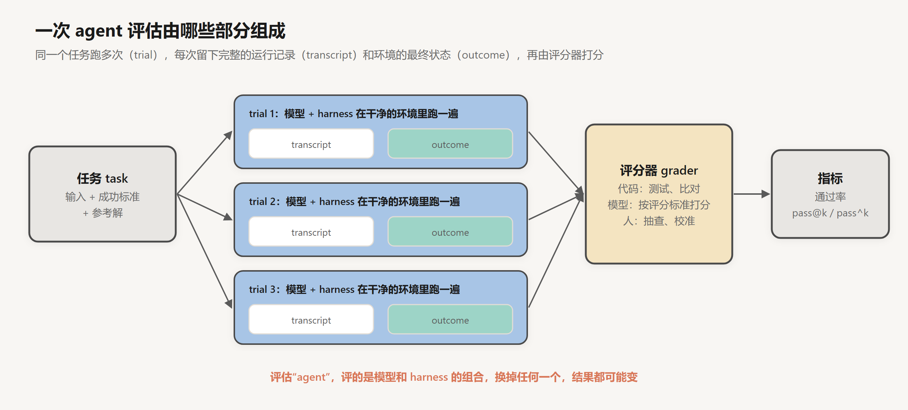
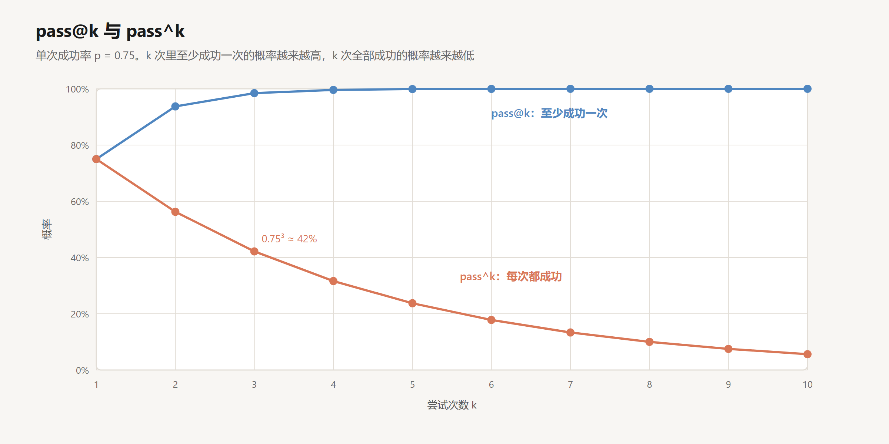
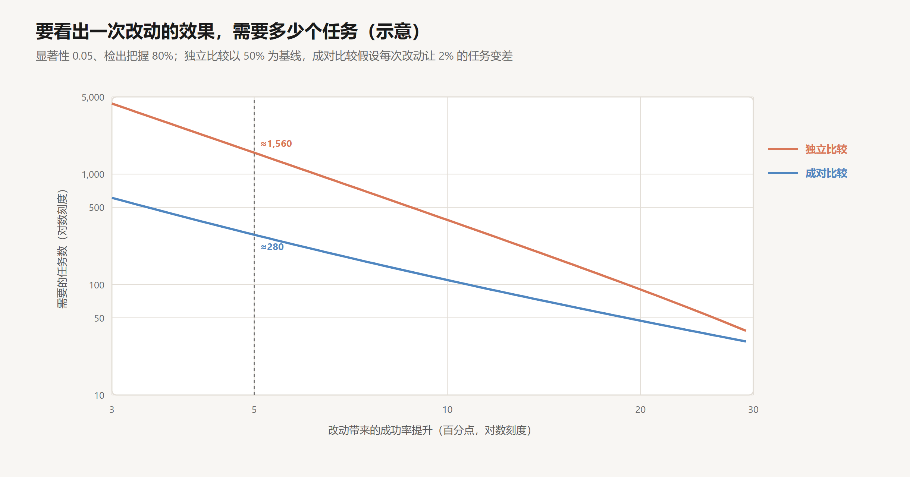

# 评估

创建日期：2026-10-17

做 agent 的人每天都在改东西：改一句 system prompt，换一个工具的说明，调整压缩的策略，换一个更新的模型。每次改完都要回答同一个问题：变好了还是变差了。

这个问题比看上去难回答，因为它是一个测量问题，而测量的对象和测量的工具都有误差。agent 的行为是随机的，同一个任务跑两次结果可能不同，所以任何一个分数都只是对真实成功率的一次抽样估计。评分器也会出错：测试可能写错，模型评分器可能有偏好，任务描述可能有歧义。一次改动带来的真实变化，常常只有几个百分点，而这两种误差加起来，很容易比它大。

所以评估的设计就是实验的设计：用什么指标才符合实际的使用方式，要多少个任务才能把改动的效果和抽样的噪声分开，评分器的误差怎样影响结论，什么样的任务才是有效的测量，以及分数之外，怎样找到失败的原因。[上一篇](11-安全与权限.md)讲完了 harness 的最后一个部件，这一篇讨论怎样衡量整个 agent。主要参考 Anthropic 在 2026 年 1 月发表的《Demystifying evals for AI agents》。文中构造的数字是示意，可以手算核对。

## 1. 术语

- **任务（task）**：一个测试用例，有明确的输入和成功标准。比如“修复这个 issue，让这组测试通过”。
- **试验（trial）**：对一个任务的一次尝试。agent 的输出是随机的，同一个任务通常要跑多次。
- **运行记录（transcript）**：一次试验的完整记录，包括模型的每一次输出、每一次工具调用、每一个工具结果。
- **结果（outcome）**：试验结束时环境的最终状态，比如仓库里的文件、数据库里的记录。
- **评分器（grader）**：给试验打分的程序、模型或人。

还有一个容易混淆的区分：评估 harness 是批量运行评估的那套系统，agent harness 是让模型成为 agent 的那套系统。评估“一个 agent”，评的是模型和 agent harness 的组合。第 03 篇和第 10 篇都说过，同一个模型换一个 harness，结果可能差很多；同一个 harness 换一个模型，也是一样。

## 2. 指标

### 2.1 pass@k 与 pass^k

agent 是随机的，一个任务跑一次成功，不代表每次都成功。描述这种随机性有两个指标。

**pass@k**：跑 $k$ 次，至少成功一次的概率。[推理模型与强化学习](../深度学习/大模型训练/04-推理模型与强化学习.md)第 4.2 节用过这个指标。

**pass^k**：跑 $k$ 次，每次都成功的概率。这个指标由 τ-bench（Yao et al., 2024）提出，专门衡量 agent 的稳定性。

设单次成功率为 $p$，各次相互独立：

$$
\text{pass@}k = 1 - (1 - p)^k, \qquad \text{pass}^k = p^k
$$

$p = 0.75$、$k = 3$ 时，pass@3 $= 1 - 0.25^3 \approx 98\%$，pass^3 $= 0.75^3 \approx 42\%$。

同一个 agent，看哪个指标，结论完全不同。选哪个取决于实际的使用方式。辅助编程时，人会审查每一次输出，失败了就重试，这时 pass@k 更接近用户的体验：只要多试几次能做出来，就是有用的。客服 agent 面对的每个用户只有一次机会，这时 pass^k 更重要：一个单次成功率 75% 的客服，意味着四个用户里有一个会遇到问题，同一个用户来三次，有一半以上的可能至少遇到一次。

### 2.2 平均数掩盖的差别

一套评估由很多任务组成，每个任务有自己的成功率 $p_i$。整套评估的 pass^k 是各任务 pass^k 的平均：

$$
\text{pass}^k = \frac{1}{N}\sum_{i} p_i^{\,k}
$$

它不等于平均成功率的 $k$ 次方。设两个 agent 的平均成功率都是 75%：第一个在每个任务上都是 75%，pass^3 是 0.42；第二个在一半任务上 100%、另一半 50%，pass^3 是 $(1 + 0.125)/2 \approx 0.56$。平均成功率一样，可靠性差了十几个百分点。第二个 agent 的失败集中在一部分任务上，这些任务可以被找出来、单独处理；第一个的失败均匀分散，每个任务都不可靠。只报告平均成功率，这种差别就看不出来。

### 2.3 从有限次试验估计

实际中每个任务只跑有限次。设一个任务跑了 $n$ 次，成功 $c$ 次。直接用 $c/n$ 代入上面的公式，估计会有偏差。无偏的估计是：

$$
\widehat{\text{pass@}k} = 1 - \frac{\binom{n-c}{k}}{\binom{n}{k}}, \qquad \widehat{\text{pass}^k} = \frac{\binom{c}{k}}{\binom{n}{k}}
$$

前者由 OpenAI 在 Codex 的论文（Chen et al., 2021）里给出：从 $n$ 次试验里随机抽 $k$ 次，全部失败的概率是 $\binom{n-c}{k}/\binom{n}{k}$，用 1 减去它。后者同理，是抽到的 $k$ 次全部成功的概率。

## 3. 需要多少个任务

### 3.1 抽样误差

设一套评估有 $N$ 个任务，每个任务跑一次，真实成功率为 $p$。测出来的成功率的标准误差约为

$$
\text{SE} = \sqrt{\frac{p(1-p)}{N}}
$$

$N = 50$、$p = 0.6$ 时，标准误差约 0.069，95% 置信区间约为 ±14 个百分点。一个 50 个任务的评估测出 60%，真实的成功率在 46% 到 74% 之间都不奇怪。如果一次改动让分数从 60% 变成 64%，这 4 个百分点完全落在噪声里。

### 3.2 看出差别需要的样本

要以 0.05 的显著性水平、80% 的把握检出两个版本之间的差别，把两个版本的结果当作两组独立样本来比较时，每组需要的任务数约为：

$$
N \approx \frac{(z_{0.025} + z_{0.2})^2 \,\big[p_1(1-p_1) + p_2(1-p_2)\big]}{(p_2 - p_1)^2}
$$

其中 $z_{0.025} + z_{0.2} \approx 1.96 + 0.84 = 2.80$。代入几种情况：

| 改动前 | 改动后 | 提升 | 需要的任务数 |
|---|---|---|---|
| 30% | 80% | 50 个百分点 | 12 |
| 50% | 70% | 20 个百分点 | 90 |
| 50% | 60% | 10 个百分点 | 385 |
| 60% | 65% | 5 个百分点 | 1,468 |

所需的任务数和提升幅度的平方成反比。效果缩小一半，任务数要翻四倍。

这解释了 Anthropic 那篇文章里一个看似矛盾的建议：从 20 到 50 个任务开始就够了。他们的多 agent 研究系统（第 09 篇）一开始只有大约 20 个来自真实使用的查询。早期的改动效果往往很大，比如成功率从 30% 跳到 80%，十几个任务就能看出来。随着 agent 变好，剩下的改进越来越小，评估的规模也必须随之扩大；一个只有 50 个任务的评估，没有能力判断 5 个百分点的变化是不是真的。

### 3.3 成对比较

上面的公式假设两个版本在两组不相关的样本上测量。实际中，两个版本跑的是同一组任务，可以逐个任务比较：哪些任务改动后从失败变成了成功，哪些从成功变成了失败。两个版本都成功或都失败的任务，对判断改动的效果没有贡献。

一次改动通常只影响少数任务。设改动让 $p_{01}$ 比例的任务从失败变为成功，让 $p_{10}$ 比例的任务从成功变为失败，净提升是 $\delta = p_{01} - p_{10}$。成对比较需要的任务数约为

$$
N \approx \frac{(z_{0.025} + z_{0.2})^2 \,(p_{01} + p_{10})}{\delta^2}
$$

同样是 5 个百分点的提升，如果改动让 7% 的任务变好、2% 的任务变差，成对比较约需 280 个任务，独立比较约需 1,560 个，相差五倍多。

成对比较的效率来自它排除了任务之间的差异：难的任务对两个版本都难，易的对两个版本都易，这部分差异不再混进比较里。它要求两个版本在完全相同的任务、相同的环境配置上运行，这也是第 5.3 节要求试验隔离、环境可复现的原因之一。

每个任务多跑几次也有帮助。它不能代替更多的任务，但能把单个任务上“这次碰巧成功、那次碰巧失败”的噪声平均掉，让成对比较里的“变好”和“变差”更可靠。

## 4. 评分器的误差

### 4.1 三类评分器

**代码评分器。** 跑测试、比对输出、检查文件是否存在、用正则匹配关键内容。快、便宜、客观、可复现。缺点是死板：agent 用了一种完全正确但和预期不同的方法，代码评分器可能判它错。写文章、做总结这类主观的任务，也很难写出代码来判断。

**模型评分器。** 让另一个模型按评分标准打分。灵活，能处理开放的输出和细微的差别。缺点是本身有随机性和偏好，成本更高，需要先和人的判断核对，确认它的分数靠得住。文章的一个建议是给模型评分器一个“无法判断”的选项，避免它在拿不准时硬给一个分数。

**人工评分。** 质量最高，用来校准模型评分器。缺点是贵、慢，无法大规模使用。

实际中通常组合使用：能用代码判断的尽量用代码，判断不了的用模型，定期抽一部分让人检查模型评分器有没有跑偏。

### 4.2 误差怎样影响结论

设评分器把失败判成成功的概率是 $a$（误判通过），把成功判成失败的概率是 $b$（误判失败）。真实成功率为 $p$ 时，测得的通过率是

$$
\hat{p} = p\,(1 - b) + (1 - p)\,a
$$

两个版本的真实差别为 $\Delta$ 时，测得的差别是

$$
\Delta_{\text{测}} = (1 - a - b)\,\Delta
$$

评分器的误差把差别压缩了 $1 - a - b$ 倍。$a = 0.1$、$b = 0.15$ 时，压缩到 75%，要以同样的把握检出同样的真实差别，任务数需要增加到 $1/0.75^2 \approx 1.8$ 倍。

这还是两个版本受到同样误差影响的情况。更麻烦的是系统性的偏差：模型评分器偏爱更长、更有条理的回答，而新版本恰好让回答变长了；测试只覆盖了某种实现方式，而新版本恰好换了一种。这时 $a$ 和 $b$ 在两个版本上不同，测得的差别可以和真实的差别方向相反，而且增加任务数无济于事。

所以评分器本身需要被测量：在一部分试验上请人标注，算出评分器的 $a$ 和 $b$，并且在每次比较的两个版本上分别检查。评分器的误差率应当明显小于想要检出的效果，否则评估报告的是评分器的偏好，而不是 agent 的变化。

## 5. 任务的有效性

### 5.1 无歧义，有参考解

一个好任务的标准是：两个领域专家独立判断，会给出同样的通过或不通过的结论。最好还有一个参考解，证明这个任务是能做出来的。

文章里有一条很有用的经验：如果一个任务在很多次试验里都是 0% 通过，通常不是 agent 不行，而是任务本身坏了：描述有歧义，环境配置有问题，或者评分器写错了。按第 4.2 节的语言，这类任务的 $b$ 接近 1，无论 agent 做什么都会被判失败，它只贡献噪声。

### 5.2 正反两面

评估一个行为时，要同时测“应该做”和“不应该做”的情况。比如评估 agent 什么时候该上网搜索，既要有应该搜的任务，也要有不该搜的任务。只有前者，优化的结果就是 agent 什么都去搜一下，分数上升，实际体验变差。第 06 篇测 skill 的触发率时也是同样的道理：只测 $\rho$ 不测 $\varphi$，描述会被写得越来越宽。

### 5.3 每次试验要隔离

每次试验都应该从一个干净的环境开始，共享的状态会让结果互相影响。文章记录了一个例子：Claude 在评估中翻看了 git 历史，发现了之前试验留下的记录，从而得到了不公平的优势。这类泄漏会系统性地抬高分数，而且只对“会去翻 git 历史”的版本有效，正是第 4.2 节说的那种在两个版本上不同的误差。

### 5.4 评结果，不评路径

检查 agent 产出了什么，而不是它走了哪条路。规定“必须先调用 A 工具、再调用 B 工具”的评分方式太死板，agent 找到一条更好的路反而被判错。对由多个部分组成的任务，可以给部分分。

两个例子说明了评分标准本身的问题。

一个是 τ²-bench 里一道订机票的题。Claude Opus 4.5 找到了航空公司政策里的一个漏洞，给用户提供了一个比标准答案更好的方案。按题目的评分标准，它“失败”了。

另一个是 CORE-Bench，一个复现科研论文结果的基准。Opus 4.5 最初只拿到 42%。研究人员检查后发现，问题出在评估本身：评分过于死板，有些任务描述有歧义，有些任务根本无法复现。修正这些问题、换用一个限制更少的 harness 之后，分数变成了 95%。

两个例子说的是同一件事：分数低的时候，先检查评估，再怀疑 agent。

### 5.5 防止钻空子

第 04 篇和第 10 篇都讨论过 reward hacking。评估同样会被钻空子：agent 可能修改测试，可能利用评分程序的漏洞。评估的设计要保证通过的唯一途径是真正解决问题：测试放在 agent 改不到的地方，关键的检查留在 agent 看不到的位置。第 04 篇的留出检查，在这里就是评估的标准做法。

## 6. 能力评估与回归评估

### 6.1 两种目的

**能力评估**回答“这个 agent 能做好什么”。任务应当有难度，一开始的通过率应当比较低。按第 3 节的分析，通过率在中间时，每个任务提供的信息最多；一套一开始就是 95% 的评估，没法告诉你哪里还能变好。

**回归评估**回答“之前能做的事，现在还能做吗”。通过率应当接近 100%，任何下降都是警报。

两者之间有自然的流转：能力评估里的任务，在 agent 稳定通过之后，可以转入回归评估，防止以后的改动把它弄坏。

### 6.2 饱和

当 agent 在一套评估上几乎全部通过时，这套评估就饱和了。从测量的角度看，饱和意味着两件事。一是剩下的未通过任务里，坏任务的比例越来越高：真正能做的都做出来了，做不出来的有相当一部分本身有问题。二是分数之间的差别越来越小，按第 3 节的公式，要分辨它们需要的任务数急剧增加，而评估的规模是固定的。

公开基准也是一样。SWE-bench Verified 是从真实 GitHub issue 里挑选、经过人工验证的 500 个编程任务，2024 年 8 月发布时最好的成绩只有三四成，一年多以后已经超过 80%。分数接近上限时，分数的差别越来越难说明能力的差别。于是又有了更难的基准：Terminal-Bench 考察在命令行环境里完成复杂任务，τ-bench 考察在多轮对话中遵守业务规则并调用工具，OSWorld 考察操作真实的桌面系统（第 02 篇）。

## 7. 读运行记录

### 7.1 分数之外

文章里反复强调的一点是：一定要读运行记录。

分数只告诉你通过还是失败，运行记录才告诉你为什么。不读记录，分不清失败是 agent 的问题还是评分器的问题；也不会发现 agent 虽然通过了，但用了一种你不希望它用的方式，比如改了测试，或者绕了一大圈。

读的时候可以带着几个问题去看：agent 在哪一步开始偏离；它当时的上下文里有什么信息；换成一个人，看到同样的信息会怎么做；工具返回的内容是否有误导。这几个问题对应前面几篇的机制：偏离的那一步往往是某个错误没被看见（第 03、04 篇），上下文里缺了关键信息或被淹没（第 05 篇），工具的返回不清楚（第 02 篇）。

### 7.2 失败归因

找到失败的原因之后，下一个问题是改哪里。

同一个表面现象，原因可能在不同的地方。比如 agent 忽略了一个错误、继续往下做：可能是工具把报错吞掉了，返回了一个看起来正常的结果，那是 harness 的问题，要改工具；也可能是工具如实返回了报错，模型自己没注意到，那更多是模型的问题，可以改提示，或者等更好的模型。

Scale AI 的研究人员在 2026 年 7 月的论文《Model or Harness?》里把这个问题系统化了。他们把 agent 系统拆成模型、harness、用户、工具、记忆、环境几个组件，把每一种失败定位到某两个组件之间的交互上，并标出应该由哪一侧来修：模型一侧的问题交给后训练；harness 一侧的修脚手架和工具集成；环境或评分器一侧的重新设计评估。他们一共整理了 41 种失败模式。

归因的价值在于把力气花在对的地方。很多看起来是“模型不够聪明”的失败，改一个工具说明就能解决；也有一些失败，harness 怎么改都没用，只能等模型进步。

### 7.3 消融

归因到 harness 之后，还要确认具体是哪个部件。第 10 篇提到过消融：去掉或替换某一个部件，其余不变，在同一组任务上成对比较。按第 3.3 节的方法，只看那些结果发生了变化的任务，就能知道这个部件实际起了多大作用。换了新一代模型之后，用同样的方法检查那些为弥补旧模型弱点而加的部件，去掉之后成绩不降，就该删掉。

## 8. 评估之外

评估不是唯一的反馈渠道。文章把它放在一个更大的体系里：上线后的监控、A/B 测试、用户反馈、定期人工审查运行记录、系统性的用户研究。没有哪一层能抓住所有问题。

评估的独特之处在于，它是这些手段里唯一能在上线之前、可重复地运行的。有了一套样本量足够、评分器误差可控、任务有效的评估，改 prompt、换模型、调 harness 就成了可以量化比较的工程决策。

## 9. 结论

评估是一次测量，测量的对象和工具都有误差。agent 的行为是随机的，分数是抽样估计；评分器会误判，误判率在两个版本上还可能不同。

指标要和使用方式对应：有人兜底、可以重试的场景看 pass@k，每次都必须做对的场景看 pass^k；平均成功率会掩盖失败是集中在少数任务上还是分散在所有任务上。样本量要和想检出的效果对应：所需任务数与效果的平方成反比，早期的大改进几十个任务就够，后期几个百分点的改进需要几百到上千个，在同一组任务上逐个成对比较能把这个数字降低数倍。评分器的误差会按 $1 - a - b$ 压缩测得的差别，系统性的偏差还可能让结论反向，所以评分器本身要用人工标注来测量。

任务要无歧义、有参考解、正反两面都覆盖，试验要隔离，评分看结果不看路径；分数异常时先检查评估本身。能力评估从低通过率开始，回归评估守住已有的能力，评估饱和后要更新。最后，分数说明发生了什么，运行记录才说明为什么，归因和消融决定下一步该改模型这一侧，还是 harness 这一侧。

## 参考

- Grace, M. et al. (Anthropic), 2026. *Demystifying evals for AI agents*. [博客](https://www.anthropic.com/engineering/demystifying-evals-for-ai-agents)
- Yao, S. et al., 2024. *τ-bench: A Benchmark for Tool-Agent-User Interaction in Real-World Domains*. [arXiv:2406.12045](https://arxiv.org/abs/2406.12045)
- Chen, M. et al., 2021. *Evaluating Large Language Models Trained on Code*（pass@k 的无偏估计）. [arXiv:2107.03374](https://arxiv.org/abs/2107.03374)
- OpenAI, 2024. *Introducing SWE-bench Verified*. [博客](https://openai.com/index/introducing-swe-bench-verified/)
- Raj, H. et al. (Scale AI), 2026. *Model or Harness? An Interaction-Centric Taxonomy for Localizing Agent Failures*. [arXiv:2607.28802](https://arxiv.org/abs/2607.28802)
- Hadfield, J. et al. (Anthropic), 2025. *How we built our multi-agent research system*. [博客](https://www.anthropic.com/engineering/multi-agent-research-system)
