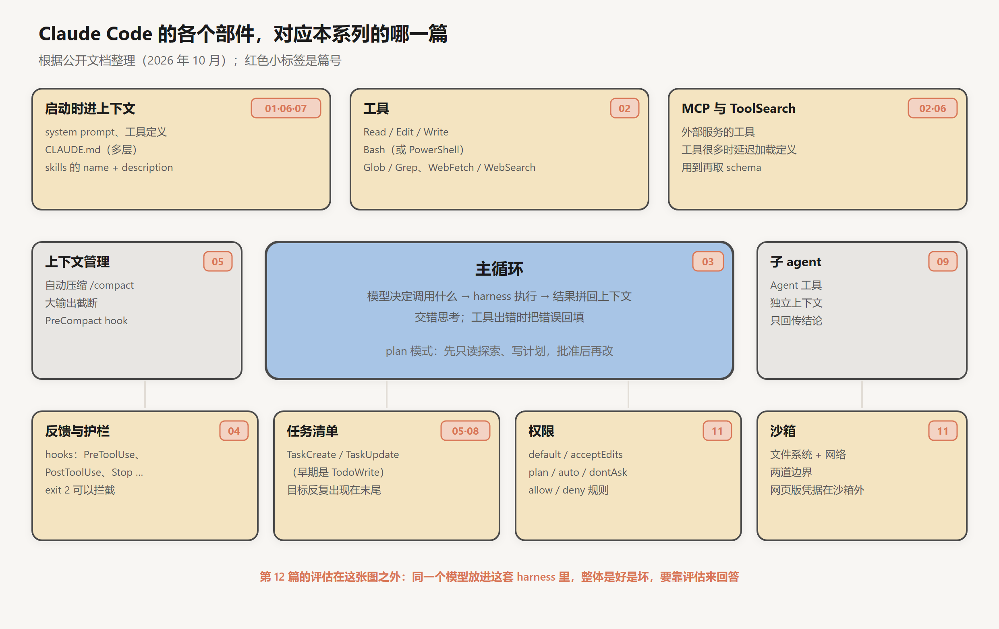
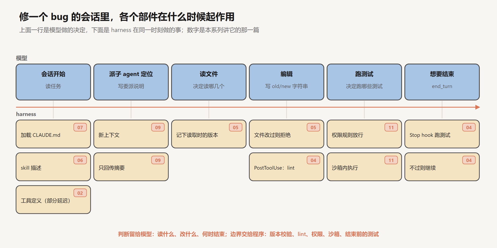

# 拆解一个真实的 harness：Claude Code

创建日期：2026-10-17

前面十二篇各自从一个约束出发，推出 harness 的一个部件：上下文是有限的预算，总输入随轮数二次增长；错误要被看见才能被纠正；按需加载的知识依赖一次可能出错的路由判断；跨越会话的状态必须写在上下文之外；模型会被注入，安全边界不能交给它；模型在某种 harness 里训练，部署时贴近那个形状效果最好。每一篇讨论的时候，部件是孤立的。

这一篇拿一个真实的产品，看这些部件放在一起的样子。选 Claude Code，一是因为它是目前使用最广的编程 agent 之一，二是因为它的公开文档写得很细，很多设计可以直接对上前面的分析。读下来会发现，它的设计可以概括为一条分工：需要判断的事情交给模型，划定边界的事情交给程序，两者之间的一切尽量用模型能直接读写的纯文本来承载。下面先沿着一次真实的会话，看每个部件在哪个时刻起作用、对应哪条约束；再把各部件按约束归类；最后讨论几个关键的设计取舍，以及在什么条件下另一种选择会更好。

这里只使用公开文档和 Anthropic 发表的文章，不涉及内部实现。Claude Code 更新很快，下文以 2026 年 10 月的文档为准，具体的工具名和配置项以后可能会变。

## 1. 总览

把第 03 篇那张 harness 地图里的方框换成 Claude Code 里具体的东西，大致是这张图。中间是主循环，就是第 03 篇那十几行伪代码；上面是启动时进入上下文的内容和工具；两边是上下文管理和子 agent；下面是护栏、任务清单、权限和沙箱。

## 2. 一次会话

### 2.1 时间线

用第 03 篇的例子：用户说“注册接口在邮箱带大写字母时报错，修一下”。下面沿着这次会话，看模型在每一步做什么决定，harness 在同一时刻做什么。

**会话开始。** 第一次调用模型之前，harness 组装好请求的固定部分：system prompt；工具定义，其中 MCP 等外部工具较多时只放名字，完整定义延迟加载；各层的 `CLAUDE.md`；所有 skill 的名字和描述。这一步决定了第 05 篇所说的固定部分有多大，也决定了第 06 篇的路由判断能依据哪些描述。

**定位代码。** 模型可以自己 `grep`，也可以调用 `Agent` 工具派一个子 agent 去找。Claude Code 内置的 Explore 子 agent 只有读和搜索类的工具。它在新的上下文里读完相关文件，只交回“入口在哪、校验函数在哪、调用关系是什么”。主上下文里只多了委派说明和摘要，正是第 09 篇计算过的那种隔离。

**读文件。** `Read` 把文件内容放进上下文。harness 同时记下这个文件被读取时的状态。

**编辑。** 模型调用 `Edit`，给出一段原文和要替换成的新文字，原文必须在文件中唯一出现。如果文件在上次读取之后被修改过，编辑会被拒绝，要求先重新读取，这是第 05 篇讲的“过期的观察”在工具层面的兜底。编辑成功后，如果配置了 `PostToolUse` hook，lint 和类型检查会立即运行，失败信息交回模型，这是第 04 篇“便宜的检查每一步都跑”。

**跑测试。** 模型调用 `Bash` 执行测试命令。权限规则里如果允许了这条命令，就不需要用户确认；沙箱开启时，命令和它启动的所有子进程都只能访问项目目录和白名单内的网络。这是第 11 篇的两道边界。

**想要结束。** 模型不再调用工具，准备交回结果。如果配置了 `Stop` hook，它会在这时运行一遍相关测试；测试失败就以退出码 2 阻止结束，失败信息交回模型，循环继续。这是第 03 篇和第 04 篇说的“结束本身是一次可能出错的判断，结束之前必须验证一次”。

会话结束后，消息列表保存在本地。之后可以用 `--continue` 或 `--resume` 读回来接着做，模型分不出中间停过，这是第 03 篇“状态全在消息列表里”的直接应用。

### 2.2 一条分工

沿着时间线看，模型做的决定都是需要判断的：读哪几个文件，派不派子 agent、怎么写委派，改哪几行，跑哪些测试，什么时候结束。harness 做的事都是确定的：文件版本对不上就拒绝，lint 失败就报告，沙箱外的路径一律访问不到，测试不过就不让结束。

这条分工不是偶然的。第 03 篇算过，多步任务的成功率对“失败能否被看见”极其敏感，而这一项主要由 harness 决定；第 11 篇说明，依赖模型判断的防线在反复尝试下终会失守，不依赖模型的防线才能限定后果。所以凡是能写成确定规则的检查和边界，都应该从模型的判断里拿出来，交给程序。

## 3. 部件与约束

把 Claude Code 的部件按它们应对的约束归类：

| 约束 | 推出它的篇 | Claude Code 的部件 |
|---|---|---|
| 模型只知道上下文里有的东西 | 01、07 | 多层 `CLAUDE.md`，子目录的说明按需加载 |
| 工具定义占固定预算 | 02、06 | 工具定义延迟加载（ToolSearch） |
| 编辑格式要贴近训练时的形状 | 10 | `Edit` 用字符串替换 |
| 状态全在消息列表里 | 03 | 会话可保存、恢复 |
| 结束是一次可能出错的判断 | 03、04 | `Stop` hook |
| 便宜的检查每步都跑 | 04 | `PostToolUse` hook |
| 上下文只追加、会过期 | 05 | 编辑前校验文件版本；自动压缩，`PreCompact` hook |
| 目标会被大量观察淹没 | 05、08 | 任务清单（`Task` 工具，早期是 `TodoWrite`） |
| 知识要按需加载，路由会出错 | 06 | skill 三级加载，`Skill` 工具 |
| 先理解再动手 | 08 | plan 模式 |
| 读多写少的子任务适合隔离 | 09 | `Agent` 工具，自定义子 agent |
| 模型会被注入，审批会疲劳 | 11 | 权限模式和规则，沙箱，凭据放在沙箱外 |

下面挑几个部件，看它们在 Claude Code 里的具体形式。

### 3.1 分层的说明与配置

`CLAUDE.md` 可以有好几层：组织统一下发的，用户自己的（放在 `~/.claude/` 下，对所有项目生效），项目的（提交进仓库，团队共享），以及只在本地生效、不提交的。子目录里也可以放 `CLAUDE.md`，agent 处理那个目录里的文件时才加载。这对应第 07 篇“目录而不是百科全书”：根目录的说明保持简短，细节分散到相关的位置，按需进入上下文。

配置文件也分层，从高到低是：组织的托管配置，命令行参数，项目本地配置（`.claude/settings.local.json`），项目共享配置（`.claude/settings.json`），用户配置（`~/.claude/settings.json`）。高层覆盖低层。组织可以统一锁定安全策略，团队共享项目约定，个人保留自己的偏好。从第 11 篇的角度看，分层的意义在于让安全边界由最上层的人来定，不会被下层的配置放宽。

### 3.2 工具集

内置工具大致分几类：读写文件的 `Read`、`Edit`、`Write`；执行命令的 `Bash`（Windows 上还有 `PowerShell`）；搜索的 `Glob` 和 `Grep`；网络的 `WebFetch` 和 `WebSearch`；编排类的 `Agent`、`Skill`、一组 `Task` 工具，以及进出计划模式的 `EnterPlanMode` 和 `ExitPlanMode`。

整个工具集以 Bash 为核心，再加少数专用工具。第 02 篇讲过两者的分工：Bash 什么都能做，但每次调用的含义要从命令字符串里解析，权限只能在操作系统层面控制；专用工具的参数结构固定，更省 token，权限也更容易精细控制。所以 `Read` 不需要确认，`Bash` 需要；文档也写明，`Bash` 里 `ls`、`cat` 这类只读命令会自动放行。

`Edit` 的字符串替换格式，是第 10 篇所说“模型与 harness 相互适应”的例子：Claude 在训练中大量使用这种编辑方式，Claude Code 也就采用它。给 Claude 写自己的 harness，照着这个形状设计编辑工具会比较稳。

### 3.3 hooks

hooks 覆盖了 agent 生命周期里的许多时机，常用的有：`SessionStart`（会话开始，注入动态的背景信息），`UserPromptSubmit`（用户提交消息之后、模型处理之前），`PreToolUse`（工具执行前，可以放行、拒绝或转为询问用户），`PostToolUse`（工具执行后），`Stop`（模型准备结束时），`PreCompact`（压缩之前）。

hook 是一段普通的脚本。以退出码 2 退出，或者输出一段带拒绝决定的 JSON，就能拦下对应的动作，并把理由交回模型。第 04 篇的“每次编辑后自动检查”“测试不过不准结束”，第 07 篇的“压缩前先把状态写进文件”，都可以用 hooks 实现。

文档里有一句提醒：不要把 hooks 当作硬性的安全边界。原因在第 11 篇讲过：hook 检查的是调用的形式，同一个危险操作有很多种写法。hooks 适合守住流程和质量，安全边界由权限和沙箱负责。

### 3.4 权限与沙箱

Claude Code 有几种权限模式，在便利和监督之间做不同的取舍：

| 模式 | 不用询问就能做的事 | 适合 |
|---|---|---|
| `default` | 读 | 每一步都要自己审查的工作 |
| `acceptEdits` | 读、编辑文件、常见的文件系统命令 | 边改边看 |
| `plan` | 只读探索 | 动手之前先想清楚 |
| `auto` | 全部，但有后台的安全检查 | 长任务，减少审批疲劳 |
| `dontAsk` | 只有预先批准的工具，其他一律拒绝 | 锁定的 CI 和脚本 |
| `bypassPermissions` | 全部 | 只在隔离的容器或虚拟机里用 |

`auto` 模式用另一个模型（文档里叫分类器）代替人审查 agent 的动作，只拦下它判断有风险的。按第 11 篇第 4.2 节的分析，它想解决的是审批的乘积里“人是否认真看”那一项：把大量常规的确认交给分类器，人的注意力留给少数真正有风险的操作。分类器本身也依赖模型的判断，所以它属于降低出事频率的那一类防线，后果仍然要靠沙箱来限定。

沙箱同时隔离文件系统和网络，Linux 上用 bubblewrap，macOS 上用 seatbelt，约束 agent 和它启动的所有子进程；网络请求经过沙箱外的代理，按域名白名单放行。网页版的 Claude Code 在云端沙箱里运行，真正的 git 凭据放在沙箱外的代理里，检查请求之后才附加。Anthropic 内部的数据是，开启沙箱后需要用户确认的次数减少了 84%。

## 4. 设计取舍

### 4.1 用 grep，不建索引

Claude Code 一个很有代表性的选择，是不给代码库建向量索引，而是让 agent 用 `grep`、`glob` 这类工具现场搜索。Anthropic 的上下文工程文章把它描述为一种混合策略：`CLAUDE.md` 预先加载，具体的代码按需搜索。Claude Code 的开发者在公开访谈里也提到过，他们试过基于向量检索的方案，最后发现让 agent 自己搜索效果更好。

用第 07 篇的框架看，索引是代码的一份缓存副本。代码一直在变，索引和源文件之间总有一段时间不一致，读出的结果可能是过期的；`grep` 每次读的都是当前的源文件，没有有效期的问题。代码里最常见的查询是函数名、变量名、报错信息，精确匹配比语义相似度更准。不维护索引，也就少了一套需要同步、需要保护的系统。代价是 agent 要多花几轮去找，按第 03 篇的成本分析，每多一轮都是一次完整的输入；但随着模型越来越擅长搜索，这个代价在变小。

这个取舍有它的适用条件。代码库大到 `grep` 一次要跑很久，或者查询主要是“和这段逻辑相似的代码在哪里”这类语义问题，或者要检索的是文档、工单这类非代码的材料，索引的优势就会显现。对一个中等规模、变化频繁、查询以标识符为主的代码库，现场搜索更合适。

### 4.2 纯文本承载状态

记忆写在 Markdown 文件里，配置是 JSON，skill 和子 agent 的定义是带元数据的 Markdown，任务清单和进度可以是普通文件，会话历史保存在本地。

按第 07 篇的分析，纯文本最大的好处是透明：人能直接打开、阅读、修改、删除，错误的内容有机会在被读出之前被发现，相当于提高了写入时正确的概率。第 08 篇的交接也依赖这一点：下一个会话读得懂上一个会话写下的东西，人也读得懂。代价是结构化程度低，查询能力弱，内容多了以后要靠索引文件和 `grep` 来找。

### 4.3 判断交给模型，边界交给程序

怎么搜、搜到什么程度、怎么改、什么时候停，由模型决定。能碰哪些文件、能连哪些服务器、什么样的编辑会被拒绝、结束前必须通过什么检查，由操作系统、代理、工具的校验、hooks 和权限规则决定。这是第 2.2 节那条分工在整个产品上的体现，也是第 04 篇和第 11 篇反复得出的结论：重要的约束不依赖模型的自觉。

### 4.4 harness 保持薄

Claude Code 没有为某一类任务写死复杂的流程。具体领域的做法交给 skill、`CLAUDE.md` 和用户自己的配置，harness 本身只提供通用的机制：循环、工具、加载、hooks、权限、沙箱。

第 10 篇讨论过，harness 的部件分两类。一类在弥补模型当前的不足，会随着模型变强被吸收，写得越重，模型升级后越可能变成累赘；另一类作用在模型之外，比如验证、权限、沙箱，不会被吸收。保持 harness 薄，指的是前一类尽量少，并且放在 skill、`CLAUDE.md` 这类容易修改和删除的地方；后一类则做在 harness 里，由程序保证。

## 5. 回顾

最后把整个系列串一遍。

一次 API 调用里，模型读进一段 token，写出一段 token，不记得任何事，也不能做任何事（第 01 篇）。给它工具，它能写出对动作的描述，由程序替它执行（第 02 篇）。把工具调用放进循环，让模型决定下一步和何时结束，就有了 agent，它的状态全在一个只追加的消息列表里，总输入随轮数二次增长，错误会沿着轮次传下去（第 03 篇）。

错误要被看见才能被纠正，所以要给它反馈，并且由程序在固定的时机执行（第 04 篇）。上下文是有限的预算，要决定什么常驻、什么外存、什么压缩（第 05 篇）；能力可以按需加载，代价是一次路由判断（第 06 篇）；值得长期记住的结论写到上下文之外，带上原因、范围和日期（第 07 篇）；比窗口更长的任务由一连串会话接力，交接靠磁盘上按项更新的状态（第 08 篇）；读多写少的子任务可以交给独立的上下文，需要协调的修改留在一个上下文里（第 09 篇）。

这些都是 harness 的部件。另一边，模型的 agent 能力是在某种 harness 里用强化学习练出来的，也带着训练时奖励函数的缝隙（第 10 篇）。agent 能做的事越多，越要假设它会犯错、会被注入，用不依赖模型判断的机制限定后果（第 11 篇）。所有这些改动是好是坏，要靠一次设计得当的测量来回答（第 12 篇）。

模型进步得很快，harness 的很多具体做法会过时。今天要写进 prompt 的规则，以后可能不需要；今天要拆成十个会话的任务，以后可能一个就够。几个结论大概不会变：上下文是有限的预算，模型需要外部的证据才知道自己对不对，安全的边界不能交给模型自己守，改了任何东西都要量一量。

## 6. 结论

Claude Code 的设计可以看作对前面各篇约束的一组具体回答。上下文预算的约束，对应分层的说明、延迟加载的工具定义、三级加载的 skill、隔离的子 agent 和自动压缩；错误要被看见的约束，对应编辑前的版本校验、编辑后的 hook、结束前的 hook；安全的约束，对应权限模式、沙箱和放在沙箱外的凭据；训练形状的约束，对应字符串替换的编辑工具。

这些回答遵循一条分工：需要判断的交给模型，能写成规则的检查和边界交给程序，两者之间的状态尽量用纯文本承载。几个关键的取舍，现场搜索而不建索引，纯文本而不用数据库，薄的 harness 而不写死流程，都有各自的适用条件：代码库规模适中、变化频繁、查询以标识符为主时，现场搜索优于索引；需要人能审查和修改时，纯文本优于结构化存储；模型能力还在快速提升时，弥补模型不足的部件越少越好，而限定后果的部件始终要由程序来保证。

## 参考

- Anthropic. *Claude Code Docs*：[工具](https://code.claude.com/docs/en/tools-reference)、[Hooks](https://code.claude.com/docs/en/hooks)、[权限模式](https://code.claude.com/docs/en/permission-modes)、[配置](https://code.claude.com/docs/en/settings)、[记忆](https://code.claude.com/docs/en/memory)、[子 agent](https://code.claude.com/docs/en/sub-agents)、[Skills](https://code.claude.com/docs/en/skills)、[MCP](https://code.claude.com/docs/en/mcp)
- Rajasekaran, P. et al. (Anthropic), 2025. *Effective context engineering for AI agents*. [博客](https://www.anthropic.com/engineering/effective-context-engineering-for-ai-agents)
- Dworken, D. & Weller-Davies, O. (Anthropic), 2025. *Beyond permission prompts: making Claude Code more secure and autonomous*. [博客](https://www.anthropic.com/engineering/claude-code-sandboxing)
