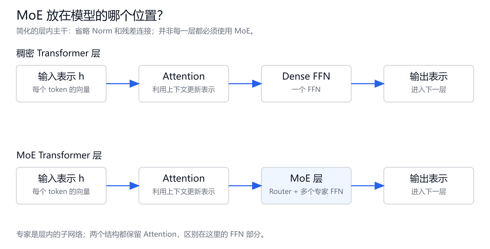
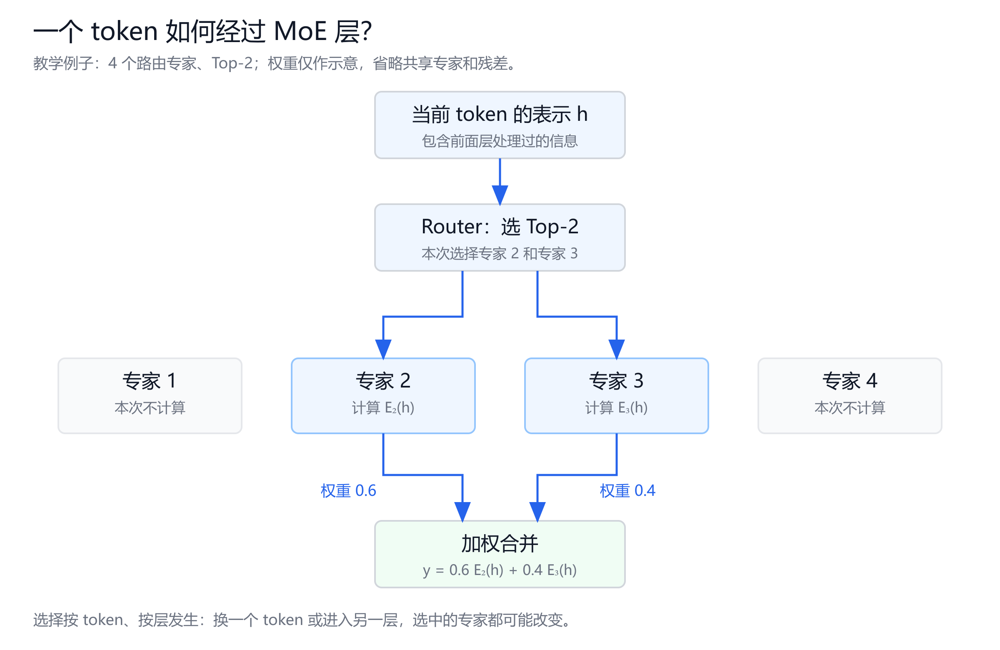
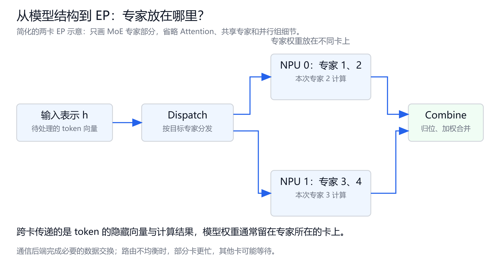

# 大模型推理与昇腾部署学习笔记

创建日期：2026-10-09
学习方向：LLM 推理原理、vLLM、昇腾 910B3、GLM / DeepSeek MoE 部署。

先把模型怎么运行弄明白，再看配置怎么影响速度、显存和稳定性。学到新内容就补到对应章节；跑过的命令、遇到的报错和测试结果单独留记录。

这份笔记根据目前的学习复盘整理。涉及版本的内容按 2026-10-09 查到的官方文档补充，尚未在实际服务器上验证。

## 1. LLM 怎么生成回答

### 1.1 Token 和 Tokenizer

模型处理的输入是 token ID。Tokenizer 负责把文字转成 token ID，也负责把生成的 ID 转回文字。

一个 token 可能对应一个字、一个词、词的一部分或标点。中文字符数和 token 数不能直接画等号，不同模型的 tokenizer 也可能不同。

Token 数会影响输入长度、生成长度、KV Cache 占用和推理耗时。聊天模板里的角色标记等内容同样可能占用 token。

### 1.2 自回归生成

以常规生成流程为例，模型根据输入和已经生成的内容，预测下一个 token 的概率，再按采样规则选出一个 token。把它接到当前序列后，继续预测下一个。

```text
输入 prompt → 预测 token 1
prompt + token 1 → 预测 token 2
prompt + token 1 + token 2 → 预测 token 3
……直到停止条件满足
```

这里描述的是逻辑上的生成顺序。实际计算会复用缓存，不会每生成一个 token 都把整个历史从头算一遍。

### 1.3 Prefill 和 Decode

| 阶段 | 做什么 | 主要特点 |
|---|---|---|
| Prefill | 处理输入 prompt，建立其 KV Cache，得到预测第一个输出 token 所需的结果 | 输入 token 已知，可以并行处理多个位置 |
| Decode | 利用历史 KV Cache，逐步生成后续 token | 同一个请求的后续 token 依赖前面生成的内容 |

Prefill 是输入处理阶段。“首 token”是用户看到的输出结果，两者不能直接当成同一个概念。

也不必把 Prefill 理解成一次必须处理完全部 prompt。Chunked Prefill 会把长输入分成几块调度，具体机制后面再学。

### 1.4 KV Cache

在注意力计算中，各层会生成 Key 和 Value。推理时把历史 token 的 K、V 保存下来，后续生成直接读取，避免重复计算这些历史 K、V。

缓存保存的是注意力所需的中间结果，不是模型权重，也不是整段回答。

KV Cache 节省计算，但要占用设备显存。请求越多、上下文越长，通常需要的缓存空间越大。具体占用还与模型层数、注意力结构和缓存精度有关。

先记住：权重能放下，只说明模型有机会加载成功；能同时接多少请求，还要看 KV Cache 和运行时需要多少空间。

### 1.5 几个常见指标

| 指标 | 含义 | 读数时要确认什么 |
|---|---|---|
| TTFT | 从发出请求到收到第一个输出 token 的时间 | 从客户端还是服务端计时，是否包含网络和排队 |
| TPOT | 输出阶段平均每个 token 的耗时 | 统计口径，是否排除首 token |
| 吞吐 | 单位时间处理的 token 数 | 输入、输出还是合计 token，测试并发是多少 |
| QPS | 每秒处理的请求数 | 是接收请求数还是完成请求数，输入输出长度是否一致 |
| 上下文窗口 | 模型能够处理的序列长度范围 | 服务设置的长度上限可能低于模型标称值 |

TTFT 会受排队、输入处理等环节影响。TPOT 更接近开始输出后的生成速度。吞吐高，不代表单个请求一定响应快。

### 1.6 显存容量、显存带宽和计算能力

权重放得下，说明容量可能满足加载需求；推理速度还要看数据读写和计算。

| 资源 | 含义 | 常见单位 | 主要限制 |
|---|---|---|---|
| 显存容量 | 设备能存多少数据 | GB / GiB | 权重、缓存等是否放得下 |
| 显存带宽 | 设备显存与计算单元之间，每秒能传多少数据 | GB/s、TB/s | 权重和缓存能多快送到计算单元 |
| 计算能力 | 每秒能完成多少运算 | FLOPS、TFLOPS；整数运算常用 TOPS | 矩阵等运算能多快完成 |
| 卡间通信能力 | 设备之间传递数据的能力 | 带宽与延迟 | TP、EP 的数据交换和同步 |

带宽与容量不是一回事。80 GB 描述存储容量，800 GB/s 描述每秒传输量；这里的数字只用来说明单位，没有对应实际 910B3 规格。

权重驻留设备显存后，计算单元仍然需要读取它们。显存中的数据不是自动全部放进芯片高速缓存里。这里讨论显存到计算单元的访问，不是每轮都从硬盘加载模型。

### 1.7 为什么 Prefill 常更容易受计算能力限制

假设输入有 1000 个 token，它们在 Prefill 开始前都已知。模型可以同时处理多个位置，对同一层的权重做较大的矩阵运算。同一批读取的权重能用于更多 token，计算相对数据搬运的比例更高。

因果注意力仍然限制每个位置只能看允许的历史位置，但这些位置的输入已知，所以不需要等前一个位置生成完后再处理下一个。

因此，较长 prompt 的 Prefill 通常更容易充分使用计算单元，受计算能力限制。短输入、长上下文 Attention、稀疏专家和不同实现可能表现不同，不能把“Prefill 一定是计算瓶颈”作为固定结论。

参考：[Sarathi-Serve 对 Prefill / Decode 的分析](https://www.usenix.org/conference/osdi24/presentation/agrawal)。

### 1.8 为什么小 batch Decode 常受显存带宽限制

常规自回归 Decode 中，同一个请求每轮只处理一个新位置。每一步仍要读取参与计算的权重，并访问所需历史 KV，才能预测下一个 token。

权重读取量相对计算量可能很大。如果数据供应跟不上，计算单元就会等待。增加算术计算能力不一定能明显提速，因为瓶颈在数据搬运。

可以用两项粗略估算帮助理解：

```text
计算时间 ≈ 运算量 / 有效计算速度
读写时间 ≈ 读写字节数 / 有效显存带宽
```

对一个可重叠计算与搬运的算子，两者中较大的项往往主导耗时。这不是整个请求的精确公式：各层依赖、启动开销、同步、通信等还要另外考虑。

小 batch Decode 往往更容易遇到带宽瓶颈。提高 batch 后，同一份权重可以服务更多请求的 token，改善复用，瓶颈也可能转向计算或其他环节。但各请求的 KV Cache 通常仍有独立读写需求，不能把组批理解成所有读写都共用。

参考：[Transformer 推理的计算与带宽分析](https://jax-ml.github.io/scaling-book/inference/)。

### 1.9 KV Cache 为什么不能让后续 token 免费生成

KV Cache 避免重复计算历史 token 的 K、V。新 token 仍要经过模型各层，生成自己的表示，并使用历史缓存做 Attention。

对于常见全注意力，历史长度增加时，需要访问的 KV 通常也增加。长上下文不仅占更多缓存空间，还可能提高每步 Attention 的读写和计算开销。滑动窗口、稀疏注意力、MLA 等结构要另看实现。

PagedAttention 改善缓存分配和访问方式，不能把所有历史 Attention 计算消掉。

参考：[PagedAttention 论文中的推理背景](https://arxiv.org/html/2309.06180v1#S2)。

### 1.10 MoE 和多卡带来的额外瓶颈

MoE 把 token 分给不同专家。同一轮有很多 token，不代表每个专家都能分到足够大的 batch。部分专家收到的 token 很少，其计算可能不容易充分利用设备；热点专家收到很多 token，又可能拖慢整个阶段。

EP 还要分发隐藏向量并汇合结果。多卡部署中的通信带宽、通信延迟和同步等待都可能影响速度。TP 也有自身的数据交换需求。

判断瓶颈时，必须区分设备内的显存带宽与设备之间的通信能力。“memory-bound”不表示显存容量已经用满；低计算利用率也不直接证明模型不需要更多算力。

观察现象只能确定检查方向：

| 现象 | 可以优先检查什么 |
|---|---|
| OOM | 各类显存占用、缓存容量、分配问题 |
| 首 token 慢 | 排队、Prefill、输入长度、前缀缓存命中 |
| 输出 token 间隔长 | Decode 计算与读写、混入的 Prefill、通信等待 |
| 增加并发后总吞吐提高 | 是否改善了组批与权重复用；同时看单请求延迟 |
| 卡间负载差异明显 | 专家路由、每卡任务、通信与同步 |

具体结论需要压测和 profiling，不能只看一个 NPU 利用率数字。

参考：[DeepSeek-V3 技术报告的部署讨论](https://arxiv.org/html/2412.19437v2)。

### 1.11 KV Cache 的基本估算公式

先限定范围：普通全注意力的 MHA / GQA / MQA，逐层缓存 K、V，各层参数相同；不计前缀共享、分页尾部空位、量化额外元数据和多卡复制。MLA、混合注意力等结构需要按实际缓存布局另算。

每一层、每个已缓存 token，要保存：

```text
K：KV 头数 × 每头维度 个数
V：KV 头数 × 每头维度 个数
```

每个头可以先理解成注意力中的一个向量通道。KV 头数可能与 Query 头数不同，不能看到模型有 32 个注意力头就直接代入 32。

因此，一个 token 跨所有层的缓存字节数是：

```text
每 token KV 字节数 = 2 × 层数 × KV 头数 × 每头维度 × 每个缓存元素的字节数
```

开头的 2 表示 K、V 两份；最后的字节数由 KV Cache 的 dtype 决定，例如 BF16 / FP16 通常是 2 字节。

若 N 个请求都缓存了 S 个 token：

```text
KV 总字节数 ≈ N × S × 2 × L × Hkv × D × b
```

| 符号 | 含义 |
|---|---|
| N | 有缓存驻留的独立序列数量 |
| S | 每条序列已缓存的 token 数 |
| L | 缓存 K、V 的层数 |
| Hkv | 每层 KV 头数 |
| D | 每个 KV 头的维度；此处假设 K、V 维度相同 |
| b | 每个缓存元素占用的字节数 |

缓存长度包含已经进入模型处理的输入和生成 token。估预算时可用输入长度加计划输出长度；精确到某一步时，刚采样出的 token 可能尚未写入 KV，需看执行位置。

参考：[Hugging Face：缓存的张量结构](https://huggingface.co/docs/transformers/cache_explanation)、[Transformer 推理：KV 内存估算](https://jax-ml.github.io/scaling-book/inference/)。

### 1.12 算一个具体例子

以下参数都是教学假设，不对应特定 GLM 或 DeepSeek 型号：

- 32 层。
- 每层 8 个 KV 头。
- 每个 KV 头的维度为 128。
- KV Cache 使用 BF16，每个元素 2 字节。

先算一个 token：

```text
2 × 32 × 8 × 128 × 2 = 131072 字节 = 128 KiB
```

这里按二进制单位换算：1024 字节 = 1 KiB，1024 MiB = 1 GiB。

| 缓存长度 | 序列数量 | 有效 KV 数据占用 |
|---|---:|---:|
| 4096 token | 1 | 512 MiB |
| 8192 token | 1 | 1 GiB |
| 4096 token | 8 | 4 GiB |
| 8192 token | 8 | 8 GiB |

在这些假设下，长度翻倍，KV 数据量翻倍；独立序列数量翻倍，KV 数据量也翻倍。模型权重不会因此跟着翻倍。

若各请求长度不同，把每条序列的长度相加即可：

```text
KV 总字节数 ≈ 每 token KV 字节数 × (S₁ + S₂ + … + Sₙ)
```

这里的 N 不是 QPS，也不一定等于全部 HTTP 请求数。等待队列中尚未建立 KV 的请求，不按完整 KV 长度计入；前缀缓存、生成分支等可能另外占用或共享缓存块。

### 1.13 为什么不能直接用注意力头数

MHA 的 Query 头与 KV 头数量通常相同。GQA 让多个 Query 头共享一组 K、V，KV 头数更少；MQA 则共享一组 K、V。

假设 Query 头数为 32，而 KV 头数为 8，估缓存要代入 8。其他条件相同，和 32 个 KV 头相比，基础缓存数据量是四分之一。

后面读取模型配置时，重点找：

```text
num_hidden_layers
num_attention_heads
num_key_value_heads
head_dim（若配置显式提供）
```

常见标准结构中，head_dim 可以由 hidden_size / num_attention_heads 推导，但不能除以 num_key_value_heads，也不能把这个推导套到所有模型。真实字段和布局以模型代码为准。

DeepSeek 的一些模型使用 MLA 压缩缓存，不能直接套用普通逐头 K、V 的公式。MoE 是专家层的结构，MHA / GQA / MLA 是注意力相关结构，必须分别确认。

### 1.14 从缓存数据量到实际显存预算

上面的结果是有效缓存数据量，不是进程占用，也不是启动时已分配的缓存池大小。

PagedAttention 按块分配，最后一个块可能没有填满。在简单独立序列的估算中，可以把 S 按 block size 向上取整，再计算对应块容量。缓存池可能提前建立，所以设备显示的已分配显存不会总随请求数量逐条增长。

完整预算还包含：

```text
权重 + KV Cache / 缓存池 + 中间张量 + 算子工作空间 + 通信与其他运行时开销
```

权重量化不自动改变 KV Cache 精度；W4A8 也不直接表示 KV 使用 8 位。KV 量化、滑动窗口、MLA、前缀共享和多卡分片都需要按实际配置另算。

多卡缓存有分片或复制等不同布局，也不能一概把公式结果除以卡数。

服务的 max-model-len 描述长度上限，不能直接当成每条请求当前占用的实际长度。请求输入短、实际输出短，按需占用的块也可以更少；设定更高长度上限，并不等于每条请求都立刻用满那个长度。

参考：[Hugging Face 缓存策略与窗口限制](https://huggingface.co/docs/transformers/kv_cache)、[vLLM 缓存分块原理](https://vllm.ai/blog/2023-06-20-vllm)。

## 2. vLLM 解决什么问题

### 2.1 Batch：为什么把请求放在一起算

Batch 是把多个请求组织到一轮计算中。Batch size 表示批次大小，在讨论按请求组批时，通常指这一批有多少条请求。一次调度处理多少 token 是另一个维度。

例如，同一轮让 A、B、C 三个请求各自向前生成一个 token。三个请求用同一套模型权重，但各自有独立的上下文和 KV Cache，内容不会混在一起。

组批能让模型权重的读取成本由多个请求分摊，也能把计算组织成更适合设备执行的形式。尤其是单请求 Decode，每一步只处理一个新位置，常常不能充分利用设备。

代价是需要更多 KV Cache 和中间数据。为了凑 batch 而等待新请求，也会增加已有请求的延迟。

参考：[PagedAttention 论文，§2.3 Batching Techniques](https://arxiv.org/html/2309.06180v1#S2.SS3)。

### 2.2 静态 batch：一批请求从开始跑到结束

这里的静态 batch 指请求级的固定组批：先选一组请求，运行期间不加入新请求，等这一批完成后再运行下一批。

“静态”主要说的是批次成员固定，不代表所有实现的 batch size 永远不变。

假设 A、B、C 一起进入，只看 Decode 轮次，先忽略 Prefill 耗时：

| 请求 | 需要的 Decode 轮次 |
|---|---|
| A | 2 轮 |
| B | 5 轮 |
| C | 8 轮 |

```text
第 1～2 轮：A、B、C 都在生成
第 3～5 轮：A 已结束，B、C 继续
第 6～8 轮：A、B 已结束，C 继续
第 9 轮起：才允许下一批请求进入
```

如果 D 在第 3 轮前就已经到达，它仍不能填补 A 留出的处理机会，只能等 C 结束。

批次后半段能一起计算的请求越来越少，设备利用率可能下降。短请求是否立即返回给用户，是另一件事：即使 A 的结果已经返回，固定批次仍可能无法接入 D。

部分朴素实现会继续维护已经结束的序列槽位，用 mask 等方式处理；其他实现可能减少无效计算。共同的问题是运行中的批次不接收新请求，不能把所有实现都理解成一直对结束的请求做完整计算。

静态 batch 适合请求已准备好、对在线等待时间不敏感的部分场景。在线聊天里请求不断到达、长度差异大，这个限制就更明显。

参考：[Orca：请求级调度与迭代级调度](https://www.usenix.org/conference/osdi22/presentation/yu)。

### 2.3 Padding：长度不同为什么可能浪费计算

不同请求的输入可能分别有 3、5、8 个 token。朴素的矩形张量组批，可以把短输入补到同样长度：

```text
A：a a a _ _ _ _ _
B：b b b b b _ _ _
C：c c c c c c c c
```

`_` 是 padding，占位并配合 mask 使用。有效输入有 16 个 token，矩形张量却有 24 个位置，额外位置可能增加计算和内存开销。

这个例子只说明朴素组批的开销。实际推理可以采用变长计算、打包等方式，不能据此认定所有 batch 都必须做这么多 padding。

请求长度不一致会影响计算组织；KV Cache 长度不一致还会影响显存分配。这两件事相关，但不能混为同一种浪费。

参考：[PagedAttention 论文，§2.3](https://arxiv.org/html/2309.06180v1#S2.SS3)。

### 2.4 显存里到底放了什么

推理时，设备显存主要放模型权重、KV Cache、中间张量，以及算子工作空间、通信缓冲等运行时资源。

同一个模型实例组批处理多个请求，不会因为多了一个请求就复制整套模型权重。更容易随并发和长度增长的是 KV Cache 等请求相关数据。

一个请求的缓存大致经历这样的过程：

```text
Prefill：为输入 prompt 建立 KV Cache
Decode：处理新的 token，继续增加缓存
结束：缓存可以释放；若用于前缀复用，则可能保留可复用块
```

输出什么时候结束，事先通常不知道。缓存不断增长，请求又在不同时间退出，使显存管理比加载固定大小的权重复杂。

### 2.5 三种显存浪费：预留、内部碎片、外部碎片

先看一种传统设计：为了让单个请求的 KV Cache 连续存放，按最大可能长度提前分配一整段空间。下面的数字只用于说明分配方式。

**提前预留：现在还没用，未来可能会用。**

假设输入有 200 个 token，输出上限是 800 个 token。若一开始就分配 1000 个 token 的 KV 空间，其中 800 个位置还没被填上。

这些位置属于当前请求，其他请求不能直接使用。它们将来可能被填满，所以不能把所有预留空间都叫作最终碎片；但在尚未使用时，它们确实压缩了服务其他请求的空间。

**内部碎片：已经分配给请求，但最终没有用完。**

假设上面的请求只生成了 100 个 token 就结束。实际只需保存 300 个 token 的 KV，而分配了 1000 个位置。剩余 700 个位置在这次请求里始终没有用上。

内部碎片发生在分配区域内部。“分配给请求的空间”大于“请求实际使用的空间”。请求结束后整段区域可以回收，不代表这 700 个空位会永久丢失。

**外部碎片：空闲空间有，但分散在不同区域之间。**

用一个简化的连续区域分配器举例：

```text
[空闲 2 GB][占用][空闲 2 GB][占用][空闲 2 GB]
```

总空闲有 6 GB。如果新分配要求一个连续的 4 GB 区域，就无法直接满足，因为最大的空闲区域只有 2 GB。

这里说的是该分配器可分配的连续区域。现代设备内存管理还有地址映射等机制，真实 OOM 不能只凭这张示意图判断。

| 类型 | 空间在哪里 | 为什么暂时或最终用不上 |
|---|---|---|
| 提前预留 | 已分配给请求的区域内 | 给未来 token 留了位置，当前尚未使用 |
| 内部碎片 | 已分配给请求的区域内 | 请求实际需求比所分配的区域小 |
| 外部碎片 | 已分配区域之间 | 空闲区域分散，满足不了当前连续分配要求 |

所以，“显存不足”既可能是数据确实太多，也可能与分配方式有关。还要区分权重、KV Cache、工作空间分别占了多少，不能看到 OOM 就直接归因于碎片。

参考：[PagedAttention 论文，§3 Memory Management in Existing Systems](https://arxiv.org/html/2309.06180v1#S3)。上述容量是教学示例，不是设备测试数据。

### 2.6 PagedAttention：把 KV Cache 按块管理

PagedAttention 借鉴分页的思路，把 KV Cache 分成固定大小的块。请求按需要取得块，不再要求整段缓存连续存放。

为了方便画图，假设一个块能保存 4 个 token 的 KV。这个数字只是示意，不是部署建议。

10 个 token 需要 3 个块：

```text
逻辑块 0：[1  2  3  4]
逻辑块 1：[5  6  7  8]
逻辑块 2：[9 10  空 空]
```

这三个逻辑块在缓存池里可以映射到不同位置：

| 逻辑块 | 缓存池中的物理块 |
|---|---|
| 0 | 7 |
| 1 | 2 |
| 2 | 11 |

Block table 保存这种映射。Attention 根据映射找到历史 K、V，仍然按正确的 token 位置计算。

当第 11、12 个 token 的 KV 写入时，可以填入最后一个块；需要保存第 13 个位置时，再取得一个新块。请求结束后，不再被引用的块可以交给其他请求使用。

分页描述的是存储位置，注意力所需的历史内容仍然要读取。它不会因为缓存分块，就只看最后一个块。

参考：[vLLM Paged Attention 设计说明](https://docs.vllm.ai/en/latest/design/paged_attention/)。

在这种基础分配方式下，请求只需在末尾块留少量空位。同样大小的空闲块可以组合给请求使用，避免了“必须找到足够大的连续区域”的限制。KV Cache 的显存利用率提高后，才有空间容纳更多请求。

实际服务常常先建立缓存池，再从池里分配块。按需分配主要指请求按需占用池内的块，不是每生成一个 token 都调用一次设备内存分配接口。

分页改善的是 KV Cache 的分配方式。权重放不下、缓存池耗尽、工作空间过大，依然可能导致 OOM。

参考：[vLLM 的 PagedAttention 原理介绍](https://vllm.ai/blog/2023-06-20-vllm)。

### 2.7 连续批处理：每轮重新安排请求

连续批处理把调度粒度缩小到推理迭代。完成的请求退出，等待中的请求在条件满足时进入下一轮。

仍用 A 需要 2 轮、B 需要 5 轮、C 需要 8 轮的例子，假设 D 已经完成必要的输入处理，可以进入 Decode：

```text
第 1 轮：A、B、C
第 2 轮：A、B、C；A 结束
第 3 轮：B、C、D
第 4 轮：B、C、D
第 5 轮：B、C、D；B 结束
第 6 轮：C、D，还可按条件接入其他请求
```

D 不必等 C 完成。这让请求处理机会更容易被利用，新请求的排队时间也可能缩短。

真实的新请求先要经过 Prefill，不能一到达就直接生成后续 token。调度器还要检查 KV 空间、运行请求数、每轮 token 预算等条件；不能把示意图理解成每轮一定补满一个固定 batch。

参考：[Orca 的迭代级调度](https://www.usenix.org/conference/osdi22/presentation/yu)。

“动态 batch”这个词有时指先等待一小段时间，把新到达的请求凑成一批；但这一批开始后仍可能固定不变。判断是否是连续批处理，要看运行中的请求集合能否在迭代之间更新，不能只看名字里有没有“动态”。

### 2.8 Prefill 和 Decode 怎么影响调度

长 prompt 的输入处理可能占用较长的一轮计算时间。如果新请求的整段 Prefill 插入已有 Decode 工作，正在输出的请求可能出现较长的 token 间隔。

Chunked Prefill 把长输入分成较小的块，再与其他计算一起安排。它帮助调度器在输入处理和持续输出之间分配资源；块大小和 token 预算会影响 TTFT、TPOT 与吞吐，仍然有取舍。

这是与连续批处理相关的补充概念，具体调度策略和昇腾上的效果尚待实操。

参考：[vLLM 调优说明：Chunked Prefill](https://docs.vllm.ai/en/latest/configuration/optimization/)。

### 2.9 KV Cache、PagedAttention、连续批处理怎样配合

| 机制 | 主要解决的问题 | 不能直接解决什么 |
|---|---|---|
| KV Cache | 避免重复计算历史 token 的 K、V | 缓存空间如何分配、请求什么时候进入计算 |
| PagedAttention | 按块存放和访问 KV，减少分配浪费 | 模型权重太大、所有计算和通信瓶颈 |
| 连续批处理 | 已有请求结束后，及时调度新的请求 | 显存容量不足、单个请求所有阶段的延迟 |

连续批处理让更多请求有机会一起运行，分页缓存让这些请求更容易在显存里放得下。缓存空间和计算调度需要配合。

同一请求内部用 KV Cache 复用历史 K、V，是基础缓存机制；多个生成分支共享相同前缀的 KV 块，则是共享机制。在符合条件时，分页的块映射可以支持这种共享，避免重复存储相同前缀。

共享也有边界：同一个词出现在不同位置或不同上下文里，KV 不一定相同。Prefix Cache 的具体命中条件后面单独学。

参考：[vLLM 的 KV 块共享说明](https://vllm.ai/blog/2023-06-20-vllm)。

## 3. 量化

### 3.1 W 和 A 分别是什么

W 表示权重，A 表示激活，也就是计算过程中产生的中间数据。

| 写法 | 基本含义 |
|---|---|
| W8A8 | 权重用 8 位表示，激活用 8 位表示 |
| W4A8 | 权重用 4 位表示，激活用 8 位表示 |

位数只是其中一部分信息。还要看数值类型、量化粒度、缩放参数，以及模型里哪些层实际参与量化。8 位也不能直接等同于 FP8。

### 3.2 量化的收益和代价

降低权重精度通常能减少权重占用。有没有速度收益，还取决于硬件是否有合适的计算能力、框架是否调用对应算子，以及当前负载的瓶颈。

量化可能影响模型输出质量，损失大小需要测试。不能预先假定一定只有少量损失。

权重量化也不等于 KV Cache 量化。总显存还包括缓存、中间张量和运行时开销。

### 3.3 910B3 和 FP8：把三个问题分开

原复盘记的是“910B3 不支持 FP8”。后面选型时需要拆开核实：

- 硬件是否原生支持 FP8 计算。
- 当前 vLLM-Ascend 是否能加载某种 FP8 checkpoint。
- 加载后实际用什么精度计算、占多少显存。

查到的新版文档提供了部分块量化 FP8 权重的加载路径：950 系列之外的昇腾设备会在加载时转到模型 dtype，并使用 BF16 矩阵乘。文档提示，权重内存需按约两倍 FP8 存储量规划。

因此，能加载 FP8 文件不代表能在 910B3 上原生执行 FP8。实际环境的版本和模型格式仍要核对。

参考：[vLLM-Ascend 量化指南](https://docs.vllm.ai/projects/ascend/en/latest/user_guide/feature_guide/quantization.html)。

## 4. 多卡并行：TP、EP、DP

### 4.1 TP：张量并行

TP 把层内的权重张量和计算分到多张卡上。同一份请求由多张卡协同处理，计算过程中需要卡间通信。

例如，一层矩阵很大，可以按相应维度切成几份，各卡计算自己的部分，再通过通信完成后续计算。

TP 常用于稠密模型，也能用于 MoE 模型中的 Attention 等部分。它不是稠密模型专属。

卡数增加会分摊权重和计算，但通信也会增加。TP 数值越大，不保证推理越快。

### 4.2 EP：专家并行

MoE 层有多个专家。路由器为 token 选择专家，token 送到对应专家计算，结果再汇合。

EP 把专家分布到不同卡上。基础理解是每张卡保存一部分专家，token 根据路由结果跨卡流动。

“每个专家完整放在一张卡”适合帮助理解基础 EP，但不能当成所有实现的固定规则。专家是否进一步切分、是否有冗余专家，要看具体框架和配置。

MoE 每个 token 通常只激活部分专家，减少的是参与计算的参数量；完整专家权重仍需要有存放位置，不能只按激活参数量估算权重显存。

### 4.3 专家热点

如果大量 token 被分到少数专家，它们所在的卡就会更忙，其他卡可能等待。

所以检查 MoE 性能时，除了看总体 NPU 利用率，还要看不同卡的负载和专家接收到的 token 分布。如何统计、如何调节，放到后续实操。

参考：[vLLM-Ascend 专家负载均衡](https://docs.vllm.ai/projects/ascend/en/latest/user_guide/feature_guide/expert_parallelism_load_balancer.html)。

### 4.4 DP：先区分服务副本和框架内部配置

服务层最容易理解的方式是部署多个完整模型实例，由网关把不同请求分给它们。每个实例可以只用一张卡，也可以内部用多卡 TP / EP。

例如，两台服务器各自部署一个能独立响应请求的模型实例，就是两套服务副本。完整模型的权重可以分布在一台机器的多张卡上，不要求每张卡都保存完整模型。

但在 vLLM 的 MoE 部署中，`--data-parallel-size` 不一定意味着每个 DP rank 都保存全部专家。开启 EP 后，专家可以跨 TP × DP 的进程组分布；Attention 部分则按 TP、DP 配置运行。

看配置时必须问清楚：这里说的“副本”，是独立服务实例，还是框架里的某个 rank？

### 4.5 vLLM 中的 EP 参数

当前官方文档用 `--enable-expert-parallel` 开启 EP，EP 规模由 TP 和 DP 配置共同决定：

```text
EP_SIZE = TP_SIZE × DP_SIZE
```

原复盘中的 `--expert-parallel-size` 不先作为通用参数记下来。部署时查所用版本的文档和 `vllm serve --help`。

参考：[vLLM 专家并行部署说明](https://docs.vllm.ai/en/latest/serving/expert_parallel_deployment/)。

### 4.6 三种并行放在一起看

| 方式 | 分什么 | 主要用途 | 主要成本 |
|---|---|---|---|
| TP | 层内张量和计算 | 分摊单个实例的权重、计算 | 卡间通信 |
| EP | MoE 专家及其计算任务 | 分摊专家权重、计算 | token 路由通信、负载不均衡 |
| 服务副本 | 请求 | 提高整体服务能力 | 每套实例都要占用模型资源 |

单机内的多卡协作和网关外的多实例分流，是两个层面，可以一起使用。

### 4.7 MoE 放在模型的哪个位置



常见 Transformer 层有 Attention 和 FFN 两部分。Attention 利用上下文更新 token 的表示；FFN 对各位置的表示做矩阵运算和非线性变换。

常见 MoE 架构把部分层的单个 FFN 换成多个专家 FFN，加上选择专家的 Router。Attention 仍然存在。图里省略了 Norm 和残差连接，只看这两部分的关系。

一个专家通常是某一层内的子网络，不是一套完整聊天模型，也不会单独生成一份完整回答。不同 MoE 层通常各有自己的专家和路由器。

参考：[Hugging Face 的 MoE 结构说明](https://huggingface.co/blog/moe)。

### 4.8 一个 token 怎样选专家



图中假设有 4 个路由专家，每个 token 选择 2 个。这里只用教学配置，不代表 GLM 或 DeepSeek 的具体专家数量。

进入这一层时，token 已经有隐藏向量 h。Router 根据这个向量计算专家分数，再按规则选择 Top-K。Top-2 就是选出两个专家，不是生成两个 token。

专家 2 和专家 3 都接收 h，分别输出向量 E₂(h)、E₃(h)。假设这次的合并权重是 0.6 和 0.4：

```text
y = 0.6 × E₂(h) + 0.4 × E₃(h)
```

这是向量的加权合并，不是对两份文字回答投票。实际模型的评分、选择、权重归一化和缩放规则可能不同。

Router 的参数在训练中学到。不能把专家固定理解成“专家 1 负责数学，专家 2 负责写作”。同一个 token 换了上下文或到了另一层，隐藏向量不同，选中的专家也可能不同。

参考：[Transformers 专家后端的计算说明](https://huggingface.co/docs/transformers/v5.9.0/experts_interface)、[DeepSeek-V3 路由与 MoE 的官方实现](https://github.com/deepseek-ai/DeepSeek-V3/blob/main/inference/model.py)。

### 4.9 路由专家与共享专家

上一张 Top-2 图只画了路由专家。一些 MoE 模型还有共享专家分支，当前 token 会同时经过共享专家与被选中的路由专家。

以 DeepSeekMoE 这类设计为例：

```text
                  → 共享专家 → 共享分支结果 ──┐
当前表示 h ───────┤                         ├→ 相加 → 输出
                  → Router → Top-K 专家 → 加权结果 ─┘
```

同一个 h 分别进入两条分支。共享专家参与每个 token 的计算；路由专家只计算这次选中的部分。最后把分支结果相加。残差连接没有画在这里，实际实现还要看模型结构。

共享专家的设计目标之一是学习通用部分，减少各路由专家重复学习相同内容。但不能把这理解成共享专家只学语法、路由专家只学专业知识，具体分工由训练决定。

“共享”也不是把所有设备拼成一个公共专家服务。它描述模型中的计算分支，权重是复制还是切分到多卡，要另看部署配置。

| 概念 | 所在位置 | 是否按 Router 的 Top-K 选择 |
|---|---|---|
| Attention 等公共部分 | 模型的其他计算部分 | 不属于路由专家的 Top-K 选择 |
| 共享专家 | MoE 内的一条专家分支 | 这类设计中每 token 都参与 |
| 路由专家 | MoE 内的候选专家集合 | 每 token 选择其中部分专家 |

共享专家不是所有 MoE 模型都有的配置，也不能把所有 GLM 或 DeepSeek 版本都视为同一种结构。

参考：[DeepSeekMoE 论文](https://arxiv.org/abs/2401.06066)、[DeepSeek-V3 MoE 官方实现](https://github.com/deepseek-ai/DeepSeek-V3/blob/main/inference/model.py)。

### 4.10 总参数量、激活参数量和显存

总参数量统计模型里全部参数。每 token 激活参数量统计处理这个 token 时参与计算的参数，包含公共计算部分、共享专家和选中的路由专家等，不仅是路由专家参数。

用一个假设模型做算术示例，忽略额外路由等小项：

| 部分 | 参数量 | 当前 token 使用多少 |
|---|---|---|
| Attention 等公共部分 | 2B | 2B |
| 共享专家分支 | 1B | 1B |
| 4 个路由专家，各 1B | 4B | Top-2 使用 2B |

B 表示十亿。总参数量是 2B + 1B + 4B = 7B，每 token 激活参数量是 2B + 1B + 2B = 5B。

这个模型存有 7B 参数，但处理当前 token 时只有上述 5B 参数参与计算。下一次选中的路由专家可能变化，因此没有选中的专家仍需要有存放位置。

假设所有权重都用 BF16，每个参数 2 字节，单看权重数据：

```text
7 × 10^9 个参数 × 2 字节 = 14 × 10^9 字节 ≈ 14 GB
```

这里用十进制 GB，约为 13.0 GiB。不能按 5B 激活参数量把完整权重估成 10 GB。

14 GB 只是这个假设模型的原始权重数据，不是服务的总显存。还要给 KV Cache、中间张量、工作空间、通信缓冲和其他运行时资源留空间。多卡上的权重还可能有公共部分复制，不能保证每卡开销正好等于总量除以卡数。

常规部署会加载并分布完整专家权重；特殊的卸载方案另算。MoE 节省每 token 的部分计算，但实际速度还受专家 batch 大小、路由、通信和显存带宽影响，不能把参数比例直接当成速度比例。

参考：[DeepSeek-V3 技术报告的架构与部署讨论](https://arxiv.org/html/2412.19437v2)。上面的参数量和容量均为教学示例。


### 4.11 从专家路由到 EP



模型结构决定有哪些专家、token 怎么选择它们。EP 决定专家权重如何放到不同设备上。MoE 模型也可以把所有专家放在一张能容纳它们的卡上，MoE 与 EP 不是同一个概念。

图中 NPU 0 放专家 1、2，NPU 1 放专家 3、4。如果 token 选中专家 2、3，它的隐藏向量需要送到相应专家所在的进程；专家计算后，结果再归位并合并。

Dispatch 表示按专家分发数据；Combine 表示把结果汇合到原 token 对应的位置并加权。实际通常会把很多 token 按目标专家组织后一起通信、一起计算，不是每个 token 都发一个独立网络包。

常规 EP 中，专家权重留在设备上，通信主要交换输入向量、结果以及必要的路由信息。哪些数据需要跨卡，取决于专家和 token 所在位置。

若多个 token 都选中专家 2，它所在的卡可能成为热点。例如四个 token 的选择分别是 {2,3}、{2,4}、{2,3}、{1,2}，专家 2 收到 4 个 token，而专家 1 和 4 各收到 1 个。这个例子说明负载不均衡怎么产生，真实负载还与每卡其他专家及任务有关。

参考：[vLLM 的专家并行部署说明](https://docs.vllm.ai/en/latest/serving/expert_parallel_deployment/)。

## 5. 昇腾软件栈

### 5.1 CANN

CANN 是昇腾的异构计算软件平台，包含运行时、算子和开发工具等能力，上面连接框架，下面连接硬件。

对照 CUDA 生态可以帮助理解它的位置，但“CANN = 底层驱动 + 算子库”过于简单。安装部署时还要分别确认驱动、固件、CANN 的版本及配套关系。

参考：[昇腾 CANN 介绍](https://www.hiascend.com/cann)、[CANN 文档概览](https://www.hiascend.com/doc_center/source/zh/CANNCommunityEdition/82RC1alpha002/index/index.html)。

### 5.2 HCCL

HCCL 是昇腾的集合通信库，支持多卡之间的集合通信。TP 的结果交换、EP 的 token 分发和汇合会涉及通信后端，具体路径取决于实现。

多卡运行失败时，要区分算子计算失败和通信失败。检查版本、卡间连接和通信配置，是后面排障需要补的内容。

参考：[Ascend HCCL 官方仓库说明](https://gitee.com/ascend/cann-hccl/blob/master/README.md)。

### 5.3 vLLM-Ascend 和容器

vLLM-Ascend 把 vLLM 的推理能力接到昇腾设备上。实际部署要匹配框架、插件、CANN、驱动和模型支持情况，不能只看其中一个版本。

容器方便固定用户态依赖，但宿主机仍要提供设备和驱动。设备映射、目录挂载、共享内存和网络配置，留到实操时记录。

目前还没有确认实际服务器的完整版本组合。

## 6. 集团业务里的部署位置

根据目前描述，业务流程是：

```text
运维人员 → 堡垒机 → 服务器部署和维护

业务请求 → 网关 → 模型实例 A / 模型实例 B
模型实例部署完成 → 集团平台注册服务
```

堡垒机用于运维访问。平台登记服务信息。网关接收业务请求并选择后端实例。模型实例负责实际推理和实例内部的调度。

目前讨论的部署思路是：

- 每台服务器有 8 张 910B3，在单机内运行一个多卡模型实例。
- 单机内选择合适的 EP、TP 等配置。
- 两台服务器各自运行完整服务实例，网关分流。

这还是架构描述。具体模型能否在单机放下、并行配置怎么选，要结合模型版本、量化方案、每卡显存和请求长度验证。

## 7. 后续待学

这里保留问题，学过并核实后再写结论。

### 7.1 启动参数和部署

- `--tensor-parallel-size`、`--data-parallel-size`、`--enable-expert-parallel` 分别控制哪些层和进程。
- `--max-model-len` 如何限制输入加输出长度，与缓存空间有什么关系。
- 并发上限、每轮 token 预算、显存使用比例如何影响调度。
- 量化权重的格式与启动参数如何匹配。
- HF 权重什么时候能直接加载，什么时候需要量化或转换。不能默认所有模型都必须转换成统一的“昇腾格式”。
- MindIE Turbo 的具体组件、支持范围和启用条件，先确认名称及版本。

### 7.2 故障排查

- 启动时 OOM 和请求运行时 OOM 分别怎么看。
- HCCL 初始化失败、通信超时怎么定位。
- 专家热点怎么观察，框架有哪些负载均衡能力。
- 服务超时时，怎么区分网关排队、实例排队和模型计算慢。

### 7.3 服务和监控

- OpenAI 兼容接口的请求、流式响应和参数。
- QPS、TTFT、TPOT、吞吐、显存、NPU 利用率、专家负载怎么采集。
- 平均值与 P95 / P99 分别能说明什么。
- 网关和模型实例各自如何排队。
- 限流、熔断、重试和健康检查怎么配合。
- 多实例的设备、端口、目录和容器资源如何隔离。

### 7.4 进阶内容

- Prefix Cache：什么前缀能复用，收益和限制是什么。
- 长上下文的缓存和调度优化。
- SGLang、MindIE、vLLM-Ascend 的适用场景。
- MoE 专家负载均衡的具体机制。

## 8. 学习和实践记录

原理补到前面对应章节。实践记录留在这里，保留当时的版本和条件，方便以后回头比较。

### 2026-10-09：整理已有知识

整理了 Token、Prefill / Decode、KV Cache、PagedAttention、连续批处理、量化、TP / EP / DP，以及集团内的部署位置。

本次修正了 Prefill 与首 token 的关系、PagedAttention 与 KV Cache 的区别，以及服务副本与 MoE 内部 DP 的区别。FP8 和 EP 参数补了官方文档说明，实际机器上的支持情况仍待验证。

### 2026-10-09 补充：组批与显存管理

第二章补充了 batch 的计算方式、静态 batch 的等待问题、padding、显存组成、提前预留与内外部碎片，并用示例说明 KV 块映射和连续批处理。Chunked Prefill 与缓存共享作为相关补充，具体实现和部署效果仍待学习与验证。

### 2026-10-09 补充：MoE 结构与路由

增加三张结构图，以及 FFN 专家、Top-K 路由、加权合并、共享专家、总参数量与激活参数量的解释，并把路由流程和多卡 EP 连接起来。图中专家数量、权重和设备布局均为教学示例。SVG 已通过结构和几何检查，导出的 PNG 已检查文字与连线。

### 新记录模板

```text
日期 / 主题：

这次弄清楚了什么：

运行环境：
模型名称和版本、设备及显存、驱动 / 固件、CANN、vLLM / vLLM-Ascend。

操作或启动命令：

观察结果：
输入输出长度、并发、TTFT、TPOT、吞吐、显存；有报错就保留关键日志。

结论和适用条件：

还没弄清楚的问题：

参考资料：
```
