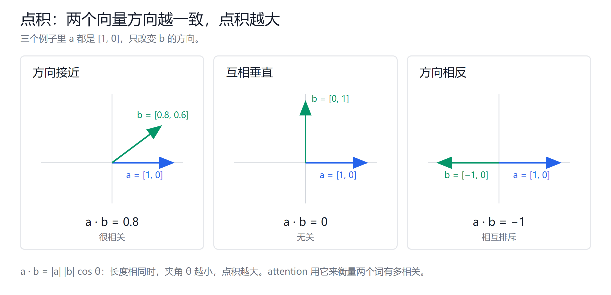
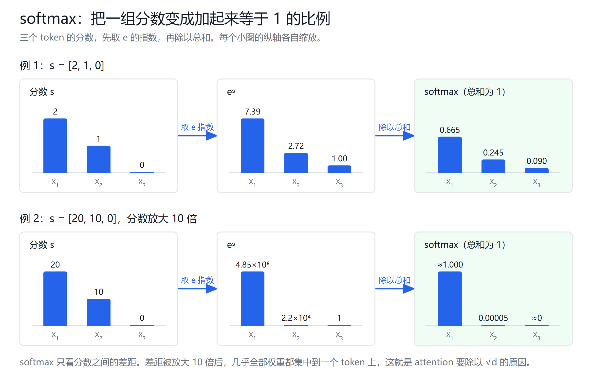
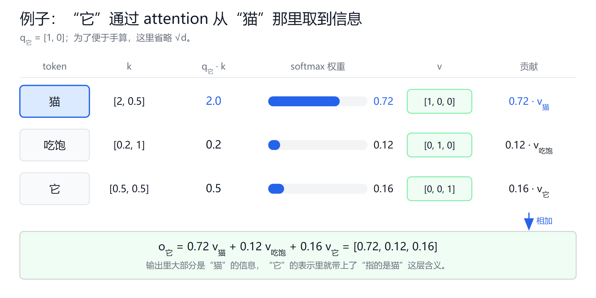

# Attention 与 QKV 入门

创建日期：2026-10-13

这篇从零讲 attention 是什么、Q、K、V 各自做什么，以及它们为什么要这样算。只需要知道"向量是一串数字"就能读懂，用到的数学在第 2 节先讲。

## 1. 从一个问题开始

看两句话：

- "苹果发布了新手机。"
- "我吃了一个苹果。"

同一个"苹果"，前一句指公司，后一句指水果。区分它们的不是"苹果"这两个字，而是旁边的"发布""手机""吃"。

再看一句：

- "猫吃饱了，它睡着了。"

"它"本身没有具体意思，要看前文才知道指的是"猫"。

这说明：**一个词的含义，要结合上下文里的其他词才能确定。** 模型读一句话时，必须让每个词去参考其他词，并更新自己的含义。

attention（注意力机制）就是用来做这件事的。对句子里的每个词，它要回答三个问题：

1. 该参考哪些词？
2. 每个词参考多少？
3. 从那些词里拿走什么信息？

后面会看到，Q、K、V 分别对应这三个问题。

## 2. 预备知识

### 2.1 token 和词向量

模型不直接处理文字，而是先把文字切成一个个小单位，叫 **token**。一个 token 可能是一个字、一个词，或者词的一部分。这篇为了好理解，把每个词当成一个 token。

每个 token 会被转换成一串数字，叫**词向量**（embedding）。比如：

$$
x_{\text{猫}} = [0.8,\ 0.1,\ -0.3,\ \dots]
$$

真实模型里，一个词向量有几千个数字。每个数字没有固定的人工含义，但整体上，意思相近的词，向量也相近。这些数字是模型训练出来的。

后文的 $x_i$，指的都是第 $i$ 个 token 的向量。

### 2.2 点积：衡量两个向量有多"像"

两个向量的**点积**，是把对应位置的数字相乘再加起来：

$$
a \cdot b = a_1 b_1 + a_2 b_2 + \dots + a_d b_d
$$

它有一个很重要的几何含义：

$$
a \cdot b = \|a\|\,\|b\|\cos\theta
$$

$\theta$ 是两个向量的夹角。所以：

| 例子 | 两个向量的关系 | 点积 | 含义 |
|---|---|---|---|
| $[1, 0] \cdot [0.8, 0.6]$ | 方向接近 | 0.8 | 很相关 |
| $[1, 0] \cdot [0, 1]$ | 互相垂直 | 0 | 无关 |
| $[1, 0] \cdot [-1, 0]$ | 方向相反 | −1 | 相互排斥 |

记住一句话：**点积越大，两个向量越"对得上"。** attention 用点积来衡量"两个词之间有多相关"。

### 2.3 矩阵乘法：一次算很多个点积

矩阵乘法本质上就是批量做点积。如果把每个 token 的向量当成矩阵的一行，那么：

$$
A B^\top \text{ 的第 } i \text{ 行第 } j \text{ 列} = A \text{ 的第 } i \text{ 行} \cdot B \text{ 的第 } j \text{ 行}
$$

$B^\top$ 是 $B$ 的转置，即行列互换。这样，一次矩阵乘法就能算出"每个 token 和每个 token"的点积，GPU 很擅长做这种运算。

另外，向量乘一个矩阵，结果还是一个向量。可以把它理解成"换一个角度重新表示"：

$$
q = x\, W
$$

$W$ 是一个参数矩阵，由训练学出来。同一个 $x$ 乘不同的 $W$，会得到侧重点不同的向量。

### 2.4 softmax：把一组分数变成比例

softmax 把任意一组数，转换成一组加起来等于 1 的正数：

$$
\mathrm{softmax}(s)_j = \frac{e^{s_j}}{\sum_k e^{s_k}}
$$

例子：

$$
s = [2,\ 1,\ 0] \quad\Rightarrow\quad e^{s} = [7.39,\ 2.72,\ 1.00],\ \text{总和 } 11.11
$$

$$
\mathrm{softmax}(s) = [0.665,\ 0.245,\ 0.090]
$$

它的特点是：

- 结果都大于 0，加起来等于 1，可以当成"分配比例"。
- 原来大的更大，原来小的更小。分数 2 和 1 只差 1，比例却差了将近 3 倍。

图里第二行把分数放大了 10 倍。差距一拉大，几乎全部比例都集中到第一个，其余接近 0。第 7.1 节会用到这个现象。

## 3. 最朴素的做法，以及它的问题

有了点积和 softmax，可以先试一个最简单的方案：

1. 用词向量直接做点积，衡量相关度：$s_{ij} = x_i \cdot x_j$。
2. 对分数做 softmax，得到权重 $a_{ij}$。
3. 按权重把各个词向量加起来：$o_i = \sum_j a_{ij}\, x_j$。

这个方案能用，但有三个问题：

1. **每个词主要关注自己。** 一个向量和自己的夹角是 0，点积通常最大，所以"它"最相关的词往往就是"它"自己，学不到指代关系。
2. **相关性被迫对称。** $x_i \cdot x_j = x_j \cdot x_i$，"它"关注"猫"有多强，"猫"关注"它"就有多强。但实际上，"它"需要去找"猫"，"猫"并不需要去找"它"。
3. **"凭什么被关注"和"能提供什么"混在一起。** 同一个 $x_j$，既用来打分，又用来被取走。一个词因为"是名词"被找到，但它要提供的应该是"具体是什么东西"，这是两种不同的信息。

解决办法：**给每个词准备三个不同的向量，分别负责这三件事。** 这就是 Q、K、V。

## 4. 引入 Q、K、V

### 4.1 三个角色

每个 token 的向量 $x_i$，分别乘三个参数矩阵，得到三个新向量：

$$
q_i = x_i W_Q,\qquad k_i = x_i W_K,\qquad v_i = x_i W_V
$$

| 向量 | 全称 | 负责的事 | 对应第 1 节的问题 |
|---|---|---|---|
| $q_i$ | Query，查询 | 我想找什么样的信息 | 该参考哪些词（发起方） |
| $k_j$ | Key，键 | 我是什么，可以被怎样找到 | 该参考哪些词（被匹配方） |
| $v_j$ | Value，值 | 如果有人关注我，我提供什么内容 | 拿走什么信息 |

至于"每个词参考多少"，由 $q_i \cdot k_j$ 经过 softmax 得到的权重决定。

### 4.2 类比：图书馆找书

- **Q**：你脑子里的需求，比如"我要一本讲猫的书"。
- **K**：每本书书脊上的标签，比如"动物 / 猫科"。
- **V**：书里的正文内容。

你拿需求去和每本书的标签比对（$q \cdot k$），越对得上的书越值得看（softmax 权重），最后按这个比例把各本书的内容读进来（加权求和 $v$）。

标签和正文是两样东西：靠标签找到书，读的是正文。这就是 K 和 V 要分开的原因。

### 4.3 这样就解决了第 3 节的问题

1. **不再总是关注自己**：$q_i$ 和 $k_i$ 由不同的矩阵得到，方向不一定接近，自己和自己的分数不一定最高。
2. **相关性可以不对称**：$q_{\text{它}} \cdot k_{\text{猫}}$ 和 $q_{\text{猫}} \cdot k_{\text{它}}$ 是两个不同的数。
3. **找和给分开了**：用 $k$ 打分，用 $v$ 提供内容，两者可以学成不同的东西。

$W_Q$、$W_K$、$W_V$ 不是人设计的，是模型在训练中自己学出来的。训练的目标是让模型更准确地预测下一个词，为此它会逐渐学会"什么样的词该去找什么样的词"。

## 5. 手算一个完整例子

句子"猫吃饱了，它睡着了"。我们看"它"这个 token 怎么更新自己。为了好算，只取三个 token：猫、吃饱、它。向量都用虚构的小维度，并且这一步先省略 $\sqrt{d}$，第 7 节再讲。

### 第一步：投影，得到 q、k、v

假设乘完矩阵后得到：

| token | q | k | v |
|---|---|---|---|
| 猫 | （本例用不到） | $[2,\ 0.5]$ | $[1,\ 0,\ 0]$ |
| 吃饱 | （本例用不到） | $[0.2,\ 1]$ | $[0,\ 1,\ 0]$ |
| 它 | $[1,\ 0]$ | $[0.5,\ 0.5]$ | $[0,\ 0,\ 1]$ |

可以这样理解这些数字：

- $q_{\text{它}} = [1, 0]$：第一维代表"在找名词或动物"。
- $k_{\text{猫}}$ 第一维很大：表示"我是动物名词"。
- $k_{\text{吃饱}}$ 第二维大：表示"我是动作"。
- $v$ 写成三个不同方向，方便看出最后混入了谁的信息：$v_{\text{猫}}$ 代表"猫"的信息，依此类推。

真实模型里，这些维度没有这么清楚的含义，这里只是为了演示。

### 第二步：打分，$q_{\text{它}}$ 和每个 $k$ 做点积

$$
q_{\text{它}} \cdot k_{\text{猫}} = 1 \times 2 + 0 \times 0.5 = 2.0
$$

$$
q_{\text{它}} \cdot k_{\text{吃饱}} = 1 \times 0.2 + 0 \times 1 = 0.2
$$

$$
q_{\text{它}} \cdot k_{\text{它}} = 1 \times 0.5 + 0 \times 0.5 = 0.5
$$

### 第三步：softmax，得到权重

$$
e^{2.0} = 7.39,\quad e^{0.2} = 1.22,\quad e^{0.5} = 1.65,\quad \text{总和} = 10.26
$$

$$
a = [0.72,\ 0.12,\ 0.16]
$$

"它"把 72% 的注意力给了"猫"。

### 第四步：加权求和，得到输出

$$
o_{\text{它}} = 0.72\, v_{\text{猫}} + 0.12\, v_{\text{吃饱}} + 0.16\, v_{\text{它}} = [0.72,\ 0.12,\ 0.16]
$$

输出里大部分是"猫"的信息。经过这一层，"它"的表示里就带上了"指的是猫"这层含义。

### 为什么"权重乘 v"就能表示输出

$o_i = \sum_j a_{ij} v_j$ 是一个**加权平均**。权重加起来等于 1，所以结果是各个 $v$ 按比例的混合：

- 关注度高的 token，它的内容在输出里占比大。
- 关注度接近 0 的 token，几乎不贡献任何内容。

于是 $o_i$ 就是"第 $i$ 个 token 从上下文里收集到的信息"。

## 6. 写成矩阵形式

第 5 节只算了一个 token。实际中，所有 token 是同时算的。把每个 token 的向量当成一行，堆成矩阵 $X$：

$$
Q = XW_Q,\qquad K = XW_K,\qquad V = XW_V
$$

$$
\mathrm{Attention}(Q, K, V) = \mathrm{softmax}\!\left(\frac{QK^\top}{\sqrt{d}}\right)V
$$

和第 5 节一一对应：

| 公式部分 | 对应步骤 | 结果形状（$S$ 个 token） |
|---|---|---|
| $XW_Q,\ XW_K,\ XW_V$ | 第一步：投影 | 各为 $[S,\ d]$ |
| $QK^\top$ | 第二步：所有 token 两两打分 | $[S,\ S]$ |
| $\mathrm{softmax}(\cdot)$ | 第三步：每一行变成权重 | $[S,\ S]$ |
| $\times V$ | 第四步：每一行按权重汇总 $v$ | $[S,\ d]$ |

$QK^\top$ 的第 $i$ 行第 $j$ 列，就是 $q_i \cdot k_j$。softmax 按行做，所以每一行的权重各自加起来等于 1。

这正是 2.3 节说的"矩阵乘法 = 批量点积"：一个公式，所有 token 同时完成了第 5 节的四步。

## 7. 两个细节

### 7.1 为什么要除以 $\sqrt{d}$

$d$ 是 q、k 向量的维度。点积是 $d$ 项相加，维度越大，结果的数值通常越大。如果 q、k 的每一项都是均值为 0、方差为 1 的随机数，点积的方差就是 $d$，典型大小约为 $\sqrt{d}$。比如 $d = 128$ 时，大约是 11。

分数一大，softmax 就会变得很极端：

$$
\mathrm{softmax}([2,\ 1,\ 0]) = [0.665,\ 0.245,\ 0.090]
$$

$$
\mathrm{softmax}([20,\ 10,\ 0]) \approx [0.99995,\ 0.00005,\ 0.00000]
$$

第二种情况就是 2.4 节图中的第二行：几乎所有注意力都给了一个 token，其他 token 的权重接近 0。这时训练很难调整这些权重，因为梯度几乎消失了。

除以 $\sqrt{d}$，把分数拉回到正常的大小，softmax 才能保持"有主有次"的分配。

### 7.2 因果 mask：不许看未来

GPT 这类生成模型是一个字一个字往后写的。生成第 $i$ 个词时，后面的词还不存在，所以计算时也必须只让第 $i$ 个 token 看到自己和前面的 token。

做法是在 softmax 之前，把"未来位置"的分数加上 $-\infty$。由于 $e^{-\infty} = 0$，这些位置的权重就严格为 0。

$$
\mathrm{Attention}(Q, K, V) = \mathrm{softmax}\!\left(\frac{QK^\top}{\sqrt{d}} + M\right)V
$$

$M$ 是 mask 矩阵：自己和前面的位置为 0（分数不变），后面的位置为 $-\infty$（被屏蔽）。

## 8. attention 在模型中的位置

attention 不是整个模型，而是模型里反复出现的一个部件。了解它所处的位置，才不会误以为"o 就是最终答案"。

- **多头**：一组 $W_Q, W_K, W_V$ 只能学到一种"找"的方式。模型会同时用很多组（比如 32 组），各自关注不同的关系，比如指代、搭配、相邻位置，最后把结果拼起来。
- **残差连接**：输出 $o_i$ 不会替换原来的 $x_i$，而是加回去：新表示 ≈ $x_i + o_i W_O$。词保留了原有的含义，再补充上下文信息。
- **前馈网络**：attention 之后，每个 token 还会单独经过一个小网络（FFN），做进一步加工。
- **层层堆叠**：attention + FFN 组成一层，模型叠几十层。前面的层学到的多是语法、搭配，后面的层能处理更抽象的关系。

## 9. 常见误区

| 误区 | 实际情况 |
|---|---|
| Q、K、V 是三份不同的输入 | 它们来自同一个 $x$，只是乘了不同的矩阵 |
| V 负责加权汇总 | 汇总是 attention 这一步做的，V 是被汇总的内容 |
| 注意力权重越大，说明模型"理解"了 | 权重只表示信息从哪里取，不等于模型的推理过程 |
| 每个维度都有明确的人类含义 | 第 5 节为了演示才这样设定，真实模型里的维度通常很难解释 |
| attention 的输出就是最终结果 | 它只是一层中的一步，后面还有残差、FFN 和更多层 |

## 10. 小结

| 步骤 | 运算 | 回答的问题 |
|---|---|---|
| 投影 | $q = xW_Q,\ k = xW_K,\ v = xW_V$ | 每个词以什么身份参与 |
| 打分 | $q_i \cdot k_j / \sqrt{d}$ | 第 $j$ 个词和我有多相关？ |
| 归一化 | softmax | 我的注意力怎么分配？ |
| 汇总 | $\sum_j a_{ij}\, v_j$ | 按这个比例，我能从上下文拿到什么？ |

一句话：**Q 和 K 决定"看谁、看多少"，V 决定"看了拿到什么"。**
