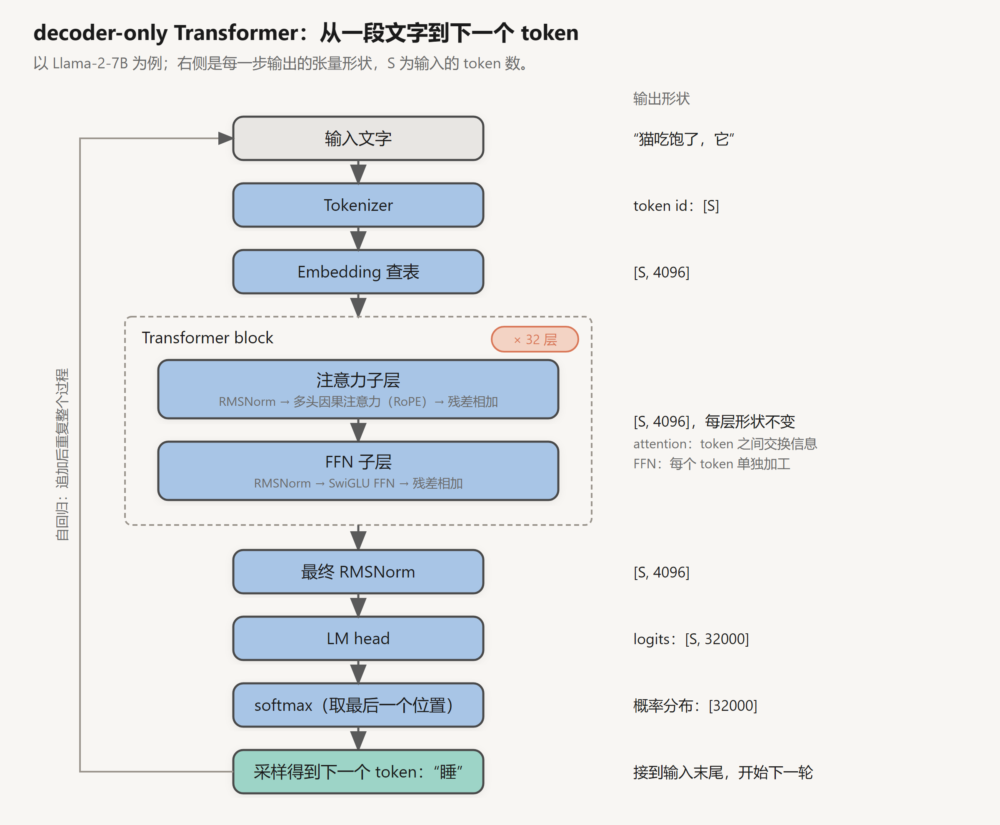
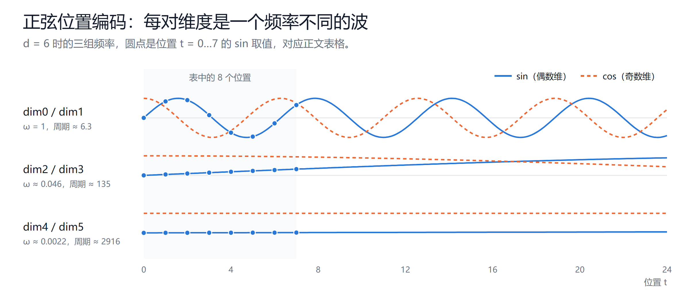
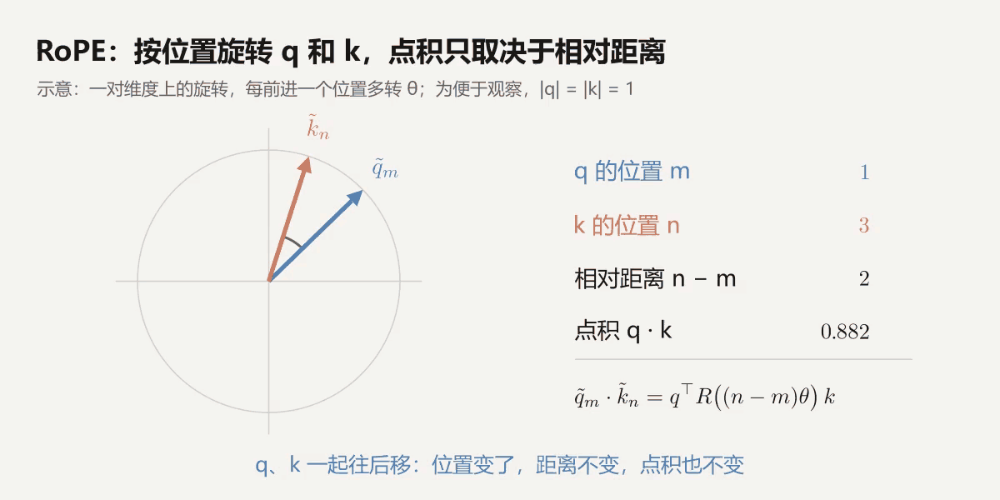
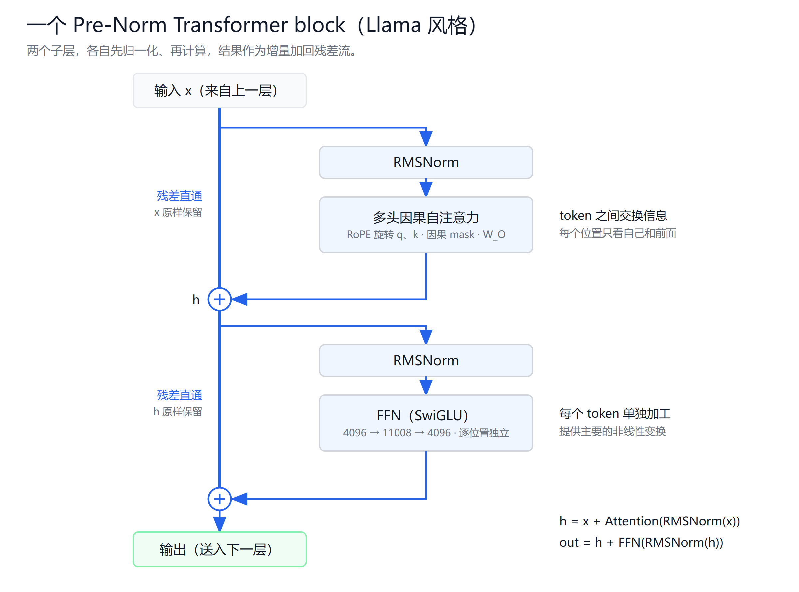
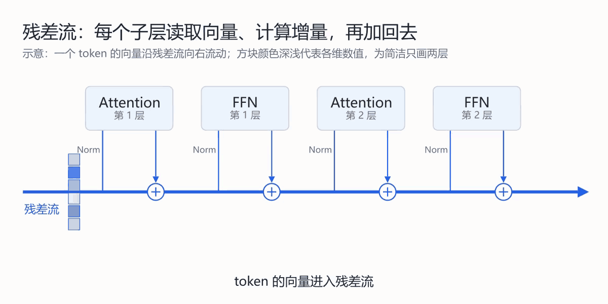
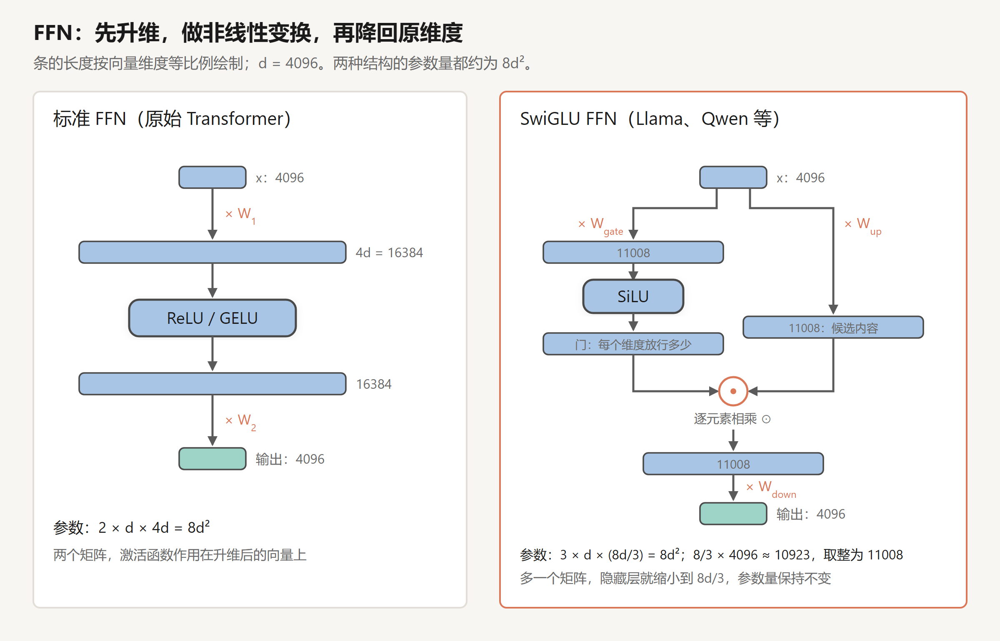
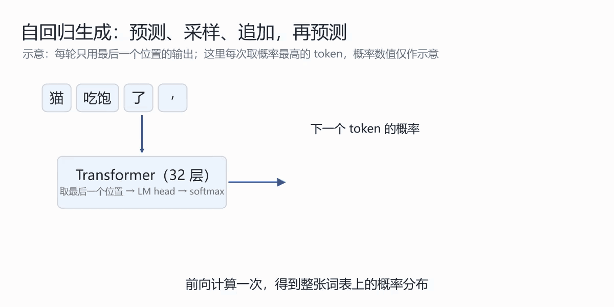
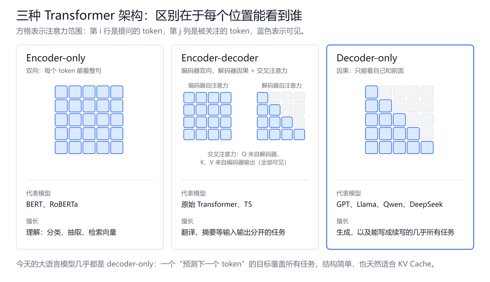
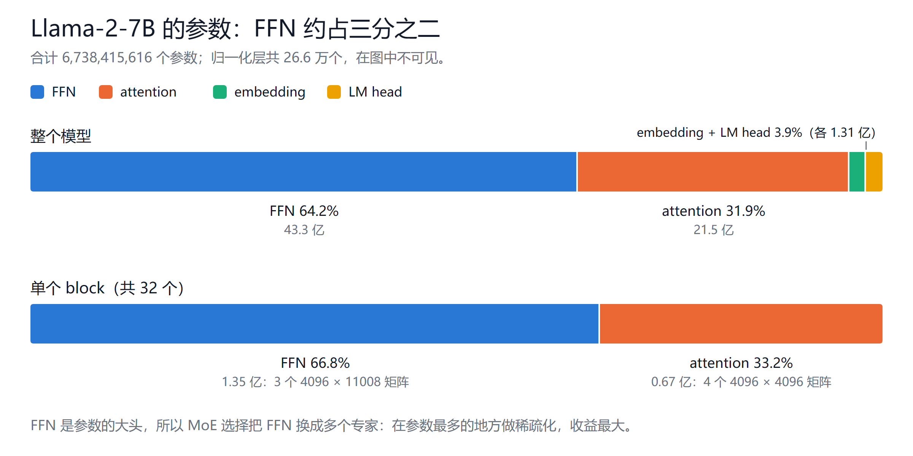
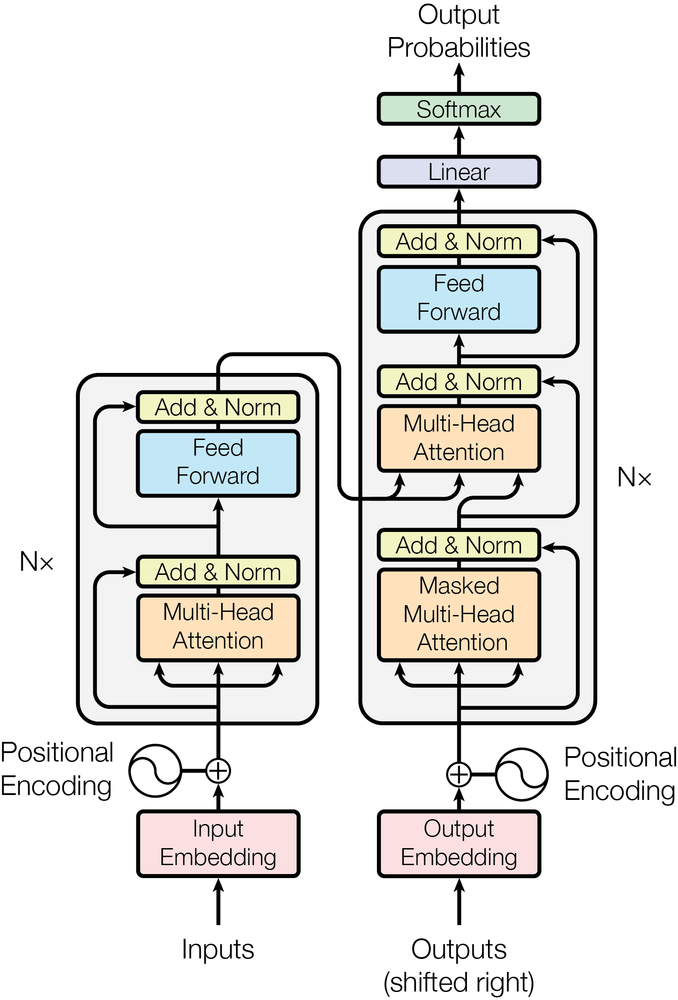

# Transformer 结构详解：从一段文字到下一个 token

创建日期：2026-10-13

2017 年，论文 *Attention Is All You Need* 提出了 Transformer。今天的大语言模型，无论是 GPT、Llama、Qwen 还是 DeepSeek，骨架都是它的一个变体：decoder-only Transformer。

这篇沿着一次前向传播的数据流往下走：一段文字怎么变成 token，token 怎么变成向量，向量怎么一层层被加工，最后怎么变成"下一个 token 的概率"。每到一个部件，都讲清楚它在做什么、为什么要这样设计。

全文以 Llama-2-7B 作为具体例子，所有维度和参数量都按它的真实配置计算。attention 内部的 QKV 计算假设你已经了解，这里只在用到时简要回顾。

## 1. 为什么是 Transformer

在 Transformer 之前，处理序列的主流模型是 RNN（循环神经网络）及其变体 LSTM。RNN 的做法是按顺序一个词一个词地读，把读过的内容压缩进一个隐藏状态，再带着这个状态去读下一个词。

这个设计有两个根本问题：

- **远距离信息容易丢失。** 第 1 个词的信息要经过几十、上百次状态更新才能传到第 100 个词，途中不断被覆盖和稀释。
- **无法并行。** 第 $t$ 步必须等第 $t-1$ 步算完。训练时 GPU 的大量算力只能闲着，模型很难做大。

Transformer 用 attention 替换了循环结构：

- **任意两个位置之间都是一步直达。** 第 100 个词可以直接"看"第 1 个词，信息路径长度从 $O(n)$ 变成 $O(1)$。
- **所有位置可以同时计算。** 训练时一整句话一次性送进去，一次矩阵乘法就算出所有位置之间的关系，正好发挥 GPU 的长处。

代价是计算量：每个位置都要和其他所有位置算一次分数，序列长度为 $S$ 时，这部分开销是 $O(S^2)$。长上下文贵，根源就在这里。

可以并行训练、能够堆得很深很宽，这两点让 Transformer 成为了"规模化"的最佳载体。后来大模型的发展，基本就是在这个骨架上不断加大参数和数据。

## 2. 全局视角：一次前向传播

先看全貌。一个 decoder-only 模型从输入文字到输出下一个 token，要经过下面几步：

以 Llama-2-7B、输入 $S$ 个 token 为例，每一步的张量形状如下：

| 步骤 | 做什么 | 输出形状 |
|---|---|---|
| Tokenizer | 文字切分成 token，查表得到 token id | $[S]$ |
| Embedding | 每个 id 查表得到一个向量 | $[S,\ 4096]$ |
| 32 层 Transformer block | 逐层加工，形状保持不变 | $[S,\ 4096]$ |
| 最终归一化 | 对最后一层的输出做 RMSNorm | $[S,\ 4096]$ |
| LM head | 投影到词表大小，得到 logits | $[S,\ 32000]$ |
| softmax（取最后一行） | 变成下一个 token 的概率分布 | $[32000]$ |

有两点值得先记住：

1. **中间所有层的形状都是 $[S,\ d_{\text{model}}]$。** 每个 token 始终对应一个 4096 维的向量，层与层之间传递的就是这个向量。后面会看到，这个不变的维度是理解残差结构的关键。
2. **推理时只用最后一个位置的输出。** 最后一行向量负责预测下一个 token；前面各行在训练时有用，因为训练时每个位置都要预测它的下一个 token（第 8 节）。

接下来按顺序逐个拆开。

## 3. 输入：从文字到向量

### 3.1 Tokenizer：切分文字

模型不直接处理字符，而是处理 token。tokenizer 负责把文字切成 token，并把每个 token 映射成一个整数 id。

主流做法是 BPE（Byte Pair Encoding）及其变体。思路是从单个字节或字符出发，统计语料中最常一起出现的相邻片段，把它们合并成新的 token，反复合并，直到词表达到预设大小。结果是：

- 高频的词或词组会成为一个完整的 token，比如英文的 "the"、"ing"。
- 低频的词会被拆成几个片段。
- 任何文字都能被表示出来，最坏情况下退化成一个个字节。

词表大小是一个重要的设计选择。Llama 2 的词表是 32000，对中文覆盖较少，一个汉字常常要拆成多个 token；Qwen2 的词表约 15 万，中文效率高得多。同样一段中文，在不同模型里的 token 数可能差好几倍，这会直接影响上下文能装下多少内容，以及推理成本。

### 3.2 Embedding：查表得到向量

每个 token id 要变成一个向量，才能参与后续计算。做法很简单：模型里有一张表，叫 embedding 矩阵，形状是 $[V,\ d_{\text{model}}]$，第 $i$ 行就是 id 为 $i$ 的 token 的向量。

$$
E \in \mathbb{R}^{V \times d_{\text{model}}},\qquad x_t = E[\text{id}_t]
$$

Llama-2-7B 中 $V = 32000$、$d_{\text{model}} = 4096$，这张表有 1.31 亿个参数。

查表在数学上等价于"one-hot 向量乘矩阵"：把 id 写成一个只有第 $i$ 位为 1 的长向量，乘以 $E$，正好取出第 $i$ 行。所以 embedding 本质上是一个没有激活函数的线性层，表里的数值和其他参数一样，通过训练学出来。

训练后，意思相近、用法相近的 token，向量也会相近。但这时的向量只代表 token 本身，还不包含任何上下文，同一个"苹果"在任何句子里拿到的都是同一个向量。区分"苹果公司"和"吃苹果"，是后面各层的工作。

## 4. 位置信息：让模型知道词的顺序

### 4.1 attention 本身不认识顺序

attention 的计算只依赖 token 两两之间的点积，不包含任何位置信息。如果把输入的 token 打乱顺序，每个 token 算出来的输出完全不变，只是跟着一起换了位置。用数学的说法，self-attention 是**置换等变**的。

这意味着，如果不额外提供位置信息，"猫追狗"和"狗追猫"对模型来说是同一袋词，无法区分谁追谁。

（严格说，生成模型使用的因果 mask 让每个位置能看到的 token 数量不同，这会间接带来一点位置信息，但非常弱，不能替代显式的位置编码。）

### 4.2 绝对位置编码

最早的做法是给每个位置一个向量，直接加到 token 的 embedding 上：

$$
x_t \leftarrow x_t + p_t
$$

原始 Transformer 用的是固定的正弦函数：

$$
p_{t,\,2i} = \sin\!\left(\frac{t}{10000^{2i/d}}\right),\qquad
p_{t,\,2i+1} = \cos\!\left(\frac{t}{10000^{2i/d}}\right)
$$

第 $2i$ 维和第 $2i+1$ 维共用一个角频率 $\omega_i = 10000^{-2i/d}$，一个取 sin，一个取 cos。$i$ 从 0 增大到 $d/2-1$，$\omega_i$ 从 1 降到约 $1/10000$，对应的周期从 $2\pi \approx 6.3$ 个位置拉长到约 6.3 万个位置。

**一个小例子。** 取 $d = 6$，只有三组频率：

| 维度对 | $\omega_i$ | 周期（位置数） |
|---|---|---|
| dim0 / dim1 | $1$ | ≈ 6.3 |
| dim2 / dim3 | $10000^{-1/3} \approx 0.046$ | ≈ 135 |
| dim4 / dim5 | $10000^{-2/3} \approx 0.0022$ | ≈ 2916 |

前 8 个位置的编码是：

| 位置 t | dim0 sin | dim1 cos | dim2 sin | dim3 cos | dim4 sin | dim5 cos |
|---|---|---|---|---|---|---|
| 0 | 0.000 | 1.000 | 0.000 | 1.000 | 0.000 | 1.000 |
| 1 | 0.841 | 0.540 | 0.046 | 0.999 | 0.002 | 1.000 |
| 2 | 0.909 | −0.416 | 0.093 | 0.996 | 0.004 | 1.000 |
| 3 | 0.141 | −0.990 | 0.139 | 0.990 | 0.006 | 1.000 |
| 4 | −0.757 | −0.654 | 0.185 | 0.983 | 0.009 | 1.000 |
| 5 | −0.959 | 0.284 | 0.230 | 0.973 | 0.011 | 1.000 |
| 6 | −0.279 | 0.960 | 0.275 | 0.961 | 0.013 | 1.000 |
| 7 | 0.657 | 0.754 | 0.319 | 0.948 | 0.015 | 1.000 |

比如 $t = 1$ 时，dim0 $= \sin 1 = 0.841$，dim2 $= \sin(0.046) \approx 0.046$，dim4 $= \sin(0.0022) \approx 0.002$。

这张表能看出几件事：

- **dim0/dim1 转得快**，8 个位置里已经正负来回一圈多，相邻位置的值差别很大，适合区分近处的 token。但它每 6.3 个位置就重复一次，单靠它不太容易分开 $t=0$ 和 $t=6$：两者在 (dim0, dim1) 上分别是 (0.000, 1.000) 和 (−0.279, 0.960)，差别已经不大。
- **dim2/dim3 转得慢**，在这 8 个位置里近似线性增长，正好补上 dim0 的歧义：$t=0$ 和 $t=6$ 在 dim2 上是 0.000 和 0.275，差得很开。
- **dim4/dim5 几乎不动**，dim5 一直显示 1.000。它在短序列里没什么用，要到几百上千个位置的尺度上才能拉开差距。

这就是钟表的秒针、分针、时针：每根针单独看都会循环，几根速度不同的针合在一起，才能唯一地标出一个时刻。真实模型 $d$ 是 512 或更大，频率从快到慢排得更密，道理相同。

**为什么 sin 和 cos 要成对。** 对同一个频率 $\omega$，位置 $t+k$ 的那一对值，可以由位置 $t$ 的值乘一个只依赖 $k$ 的旋转矩阵得到：

$$
\begin{bmatrix} \sin\omega(t+k) \\ \cos\omega(t+k) \end{bmatrix}
=
\begin{bmatrix} \cos\omega k & \sin\omega k \\ -\sin\omega k & \cos\omega k \end{bmatrix}
\begin{bmatrix} \sin\omega t \\ \cos\omega t \end{bmatrix}
$$

也就是说，"往后挪 $k$ 个位置"对编码来说是一个固定的线性变换，和 $t$ 本身无关。原论文选这种形式，就是希望模型能借助这个性质学到相对位置。不过位置向量是加在 embedding 上的，再经过 $W_Q$、$W_K$ 投影，这个性质在 attention 打分里并不能被干净地利用。下一节的 RoPE 把同一个旋转直接作用在 q、k 上，才真正让打分只依赖相对位置。

另外有两点容易忽略：

- 位置向量是**加**到 embedding 上，不是拼接，所以不增加维度。原论文还把 embedding 先乘了 $\sqrt{d_{\text{model}}}$，避免数值在 $[-1, 1]$ 的位置编码盖过词本身的信息。
- 正弦编码不需要训练，任意位置 $t$ 都能直接算出来。但模型在训练中没见过的长位置组合，实际效果依然不好，所以"公式能算"不等于"能外推"。

BERT、GPT-2 用的则是可学习的位置向量：直接准备一张 $[\text{最大长度},\ d]$ 的表，和 embedding 一样训练出来。

绝对位置编码有一个明显的问题：**它编码的是"第几个"，而语言里更重要的往往是"相隔多远"。** "猫"和"追"在句首还是句中，它们的关系应该一样。另外，可学习的位置表有固定长度，超过训练长度的位置根本没有对应的向量。

### 4.3 RoPE：用旋转编码相对位置

今天的主流模型（Llama、Qwen、DeepSeek 等）基本都用 RoPE（Rotary Position Embedding，旋转位置编码）。它不再把位置向量加到输入上，而是在 attention 里，**按位置旋转 q 和 k**。

先看二维的情况。把 q 看成平面上的一个向量，位置为 $m$ 的 token，把它的 q 旋转 $m\theta$ 角度；位置为 $n$ 的 token，把它的 k 旋转 $n\theta$：

$$
\tilde{q}_m = R(m\theta)\, q_m,\qquad \tilde{k}_n = R(n\theta)\, k_n,\qquad
R(\alpha) = \begin{bmatrix} \cos\alpha & -\sin\alpha \\ \sin\alpha & \cos\alpha \end{bmatrix}
$$

旋转矩阵有一个性质：$R(a)^\top R(b) = R(b - a)$。于是两者的点积为：

$$
\tilde{q}_m \cdot \tilde{k}_n = q_m^\top R(m\theta)^\top R(n\theta)\, k_n = q_m^\top R\big((n - m)\theta\big)\, k_n
$$

**结果只和位置差 $n - m$ 有关。** 两个 token 无论出现在句子的什么地方，只要相隔距离相同，旋转带来的影响就相同。绝对位置在点积中被自然地消掉了，只剩相对位置。

高维的情况，就是把 $d$ 维向量两两分组，看成 $d/2$ 个二维平面，每个平面用不同的旋转速度：

$$
\theta_i = \text{base}^{-2i/d},\qquad i = 0, 1, \dots, \tfrac{d}{2} - 1
$$

base 通常取 10000（Llama 2 即是如此）。和正弦编码的思路一样，前面的维度转得快，用来区分近距离；后面的维度转得慢，用来感知远距离。

关于 RoPE，还有几个实现上的细节：

- **只旋转 q 和 k，不旋转 v。** 位置信息只需要影响"看谁"（打分），不需要影响"拿什么"（内容）。
- **每一层都要做。** 旋转发生在每层 attention 内部，而不是只在输入时加一次。
- **推理时缓存的 K 是旋转之后的。** 生成过程中，每个 token 的位置是确定的，旋转后的 k 可以直接存进 KV Cache。

### 4.4 长上下文外推

模型在训练时只见过一定长度以内的位置差。超过这个长度，某些维度会转到训练时从未出现过的角度，效果会明显下降。

常见的扩展方法，大多是在 RoPE 的旋转速度上做文章：调大 base、按比例压缩位置（Position Interpolation），或者对不同频率的维度区别对待（NTK-aware、YaRN 等），再配合少量长文本继续训练。这些方法让模型可以从 4K 扩展到 32K、128K 甚至更长。

## 5. Transformer Block：一层里有什么

### 5.1 整体结构

Llama 系列的一个 block 如下：

它由两个子层组成，每个子层前面有一个归一化，后面有一条残差连接：

$$
h = x + \mathrm{Attention}\big(\mathrm{Norm}(x)\big)
$$

$$
\text{out} = h + \mathrm{FFN}\big(\mathrm{Norm}(h)\big)
$$

两个子层分工明确：

- **attention 负责 token 之间交换信息。** 每个 token 从上下文的其他 token 那里收集相关内容。
- **FFN 负责每个 token 自己加工信息。** 对每个位置单独做非线性变换，不同位置之间互不影响。

一句话概括：attention 是"开会讨论"，FFN 是"各自消化"。下面逐个展开。

### 5.2 多头因果自注意力

attention 的核心计算是：

$$
\mathrm{Attention}(Q, K, V) = \mathrm{softmax}\!\left(\frac{QK^\top}{\sqrt{d_{\text{head}}}} + M\right)V
$$

在一个 block 里，它的完整过程是：

1. 输入 $[S,\ 4096]$ 分别乘 $W_Q$、$W_K$、$W_V$，得到 Q、K、V。
2. 按头切分：$4096 = 32 \times 128$，形状变成 $[32,\ S,\ 128]$。
3. 对 q、k 施加 RoPE 旋转。
4. 每个头独立计算 attention，加上因果 mask $M$，保证每个位置只能看到自己和前面的位置。
5. 32 个头的输出拼接回 $[S,\ 4096]$，再乘输出矩阵 $W_O$。

多头的意义在于：一组 $W_Q$、$W_K$ 只能学到一种"找"的方式，32 个头可以同时关注不同的关系，比如有的头关注前一个词，有的头处理指代，有的头连接相隔很远的相关内容。

$W_O$ 的作用是把各个头的结果重新混合。拼接只是把 32 段 128 维的结果首尾相连，$W_O$ 让这些信息真正融合到一起，再写回 4096 维的空间。

Llama-2-7B 中，四个矩阵都是 $[4096,\ 4096]$，attention 部分每层共 $4 \times 4096^2 \approx 6711$ 万个参数。更新的模型普遍采用 GQA（多个 Q 头共用一组 K、V），$W_K$、$W_V$ 会小一些。

### 5.3 残差连接与残差流

每个子层的输出不是直接作为下一步的输入，而是**加回到它的输入上**：

$$
x \leftarrow x + f(x)
$$

这个设计看起来简单，作用却是根本性的。

**第一，它让深层网络能够训练。** 求梯度时，$x + f(x)$ 对 $x$ 的导数是 $1 + f'(x)$。那个 1 意味着，即使 $f$ 的梯度很小，梯度也能沿着"直通"的路径从最后一层原样传回第一层，不会在几十层之后衰减到零。没有残差，几十层的网络基本训练不动。

**第二，它改变了理解网络的方式。** 把每个 token 对应的那个 4096 维向量，想象成一条从下往上贯穿所有层的数据流，称为**残差流**（residual stream）。每个子层做的事都一样：

1. 从残差流里**读取**当前的向量（先归一化）；
2. 计算出一个**增量** $f(x)$；
3. 把增量**加回**残差流。

按这个视角，各层并不是一道道"替换"数据的工序，而是在一块共享的工作区上不断**追加**信息：某个 attention 头把"这个'它'指的是猫"写进去，某个 FFN 把"猫是一种动物"写进去。后面的层可以读到前面所有层写入的内容。

这也解释了为什么所有层的维度必须一致：大家都在同一个 4096 维空间里读写。

### 5.4 归一化：LayerNorm 与 RMSNorm

残差不断累加，向量的数值大小会在层与层之间漂移。如果某一层的输入数值特别大或特别小，它的输出和梯度也会跟着失控。归一化的作用，是在每个子层读取残差流之前，把向量的尺度调整到稳定的范围。

**LayerNorm** 对单个 token 的向量，在它自己的 $d$ 个维度上做标准化：

$$
\mathrm{LayerNorm}(x) = \frac{x - \mu}{\sqrt{\sigma^2 + \epsilon}} \odot \gamma + \beta
$$

其中 $\mu$、$\sigma^2$ 是这个向量 $d$ 个分量的均值和方差，$\gamma$、$\beta$ 是可学习的缩放和平移参数，$\epsilon$ 是防止除零的小常数。注意它是在**每个 token 内部**做的，和 batch 里其他样本、序列里其他 token 都无关。

**RMSNorm** 是 Llama 等模型使用的简化版本，去掉了减均值和平移项，只按均方根缩放：

$$
\mathrm{RMSNorm}(x) = \frac{x}{\sqrt{\frac{1}{d}\sum_{i=1}^{d} x_i^2 + \epsilon}} \odot \gamma
$$

实验表明效果与 LayerNorm 相当，但计算更少，参数也少了一半。

**归一化放在哪里，同样重要。**

- **Post-Norm**（原始 Transformer）：$x \leftarrow \mathrm{Norm}\big(x + f(x)\big)$，先加残差再归一化。
- **Pre-Norm**（今天的主流）：$x \leftarrow x + f\big(\mathrm{Norm}(x)\big)$，只对子层的输入做归一化，残差流本身不动。

两者的区别在于残差那条"直通"路径。Post-Norm 每层都要对残差流做一次归一化，梯度在直通路径上也要经过归一化，层数一深，训练就不稳定，需要精细的学习率预热。Pre-Norm 让残差流从头到尾保持畅通，深层模型更容易训练。代价是残差流的数值会随层数增长，所以 Pre-Norm 模型在最后一层之后要再做一次归一化（第 2 节流程图里的"最终归一化"）。残差流变大还会让深层的相对贡献变小，这个问题和几种修正办法见 [优化器与训练技巧](../神经网络基础/03-优化器与训练技巧.md) 的 6.4 节。

### 5.5 FFN：前馈网络

#### 标准结构

FFN（Feed-Forward Network，前馈网络，有时也叫 MLP）是一个两层的全连接网络，先升维，过激活函数，再降回原来的维度：

$$
\mathrm{FFN}(x) = \sigma(x W_1)\, W_2
$$

原始 Transformer 中，$W_1$ 把 $d$ 维升到 $4d$ 维，$W_2$ 再从 $4d$ 降回 $d$。$\sigma$ 是激活函数，最早用 ReLU，后来常用 GELU，几种激活函数的对比见 [线性层与激活函数](../神经网络基础/01-线性层与激活函数.md)。

它有一个关键特点：**逐位置独立**。同一个 FFN 被分别应用到序列的每个 token 上，token 之间没有任何交互。所以说 attention 负责"交流"，FFN 负责"思考"。

#### 为什么需要它

只有 attention 是不够的。attention 的输出是 $v$ 的加权平均，本质上是对已有信息的线性组合，softmax 只决定权重，不对内容本身做非线性加工。FFN 提供了模型绝大部分的非线性变换能力：升维让向量在更大的空间里展开，激活函数做非线性筛选，再把结果压回原空间。

从参数量看，FFN 也是模型的主体。下文第 10 节会算到，Llama-2-7B 中 FFN 占全部参数的 64%。

#### 一种理解：键值记忆

有研究提出，FFN 可以看成一种"键值记忆"（Geva 等，2021）：

- $W_1$ 的每一列像一个"键"，和输入做点积，检测输入里是否出现了某种模式；
- 激活函数决定哪些键被触发；
- $W_2$ 的每一行像一个"值"，被触发的键会把对应的值按激活强度加权，写回残差流。

按这个理解，模型学到的大量事实性知识，比如"巴黎是法国的首都"，很可能就存储在 FFN 的参数里。这是一种有实验支持的解释视角，并不是全部的真相，但对建立直觉很有帮助。

#### SwiGLU：今天的主流写法

Llama、Qwen、DeepSeek 等模型使用的是 SwiGLU 形式的 FFN（Shazeer，2020），用三个矩阵代替两个：

$$
\mathrm{FFN}_{\text{SwiGLU}}(x) = \Big(\mathrm{SiLU}(x W_{\text{gate}}) \odot (x W_{\text{up}})\Big)\, W_{\text{down}}
$$

其中 $\mathrm{SiLU}(z) = z \cdot \mathrm{sigmoid}(z)$，$\odot$ 是逐元素相乘。

可以这样理解：$W_{\text{up}}$ 负责升维，得到候选内容；$W_{\text{gate}}$ 经过 SiLU 得到一组"门"，逐元素决定每个维度放行多少；$W_{\text{down}}$ 再降回原维度。这种门控结构在同等参数量下效果更好，已经成为事实上的标准。

多了一个矩阵，隐藏层就要相应缩小，以保持参数量不变。标准 FFN 有 $2 \times d \times 4d = 8d^2$ 个参数；SwiGLU 有三个矩阵，令 $3 \times d \times h = 8d^2$，得到 $h = \frac{8}{3}d$。Llama-2-7B 中 $\frac{8}{3} \times 4096 \approx 10923$，向上取整到 256 的倍数，就是配置文件里的 11008。

#### MoE：把一个 FFN 换成多个专家

DeepSeek-V3、Qwen3 的 MoE 版本等模型，把每层的 FFN 换成了多个并列的"专家"（每个专家本身就是一个 FFN），再由一个路由器为每个 token 选出少数几个专家来计算。这样总参数可以做得很大，而每个 token 实际参与计算的参数只占一小部分。它改变的只是 FFN 这一个子层，block 的其他部分不变。

### 5.6 一层的完整计算

把以上内容合起来，Llama 的一个 block 是：

记 $a = \mathrm{RMSNorm}(x)$，$b = \mathrm{RMSNorm}(h)$：

$$
h = x + \mathrm{MHA}\Big(\mathrm{RoPE}(a W_Q),\ \mathrm{RoPE}(a W_K),\ a W_V\Big)\, W_O
$$

$$
\text{out} = h + \Big(\mathrm{SiLU}(b\, W_{\text{gate}}) \odot (b\, W_{\text{up}})\Big)\, W_{\text{down}}
$$

Llama-2-7B 每层的参数：

| 部件 | 矩阵 | 形状 | 参数量 |
|---|---|---|---|
| attention | $W_Q, W_K, W_V, W_O$ | 各 $[4096,\ 4096]$ | 67,108,864 |
| FFN | $W_{\text{gate}}, W_{\text{up}}$ | 各 $[4096,\ 11008]$ | 90,177,536 |
| FFN | $W_{\text{down}}$ | $[11008,\ 4096]$ | 45,088,768 |
| 归一化 | 两个 $\gamma$ | 各 $[4096]$ | 8,192 |
| **合计** | | | **202,383,360** |

Llama 的线性层都不带偏置项（bias），这也是现代大模型的普遍做法。

## 6. 层层堆叠

一个 block 的输入和输出形状相同，所以可以直接一层接一层地叠起来。Llama-2-7B 叠了 32 层，70B 的版本叠了 80 层。

层数和宽度（$d_{\text{model}}$）是模型规模的两个主要维度。更深的网络可以做更多步的组合推理：前一层的 attention 把相关信息聚到一个 token 上，后一层就可以基于聚好的信息再做下一步关联。

各层学到了什么，没有严格的分工，但对 BERT 等模型的探测研究发现了一个大致的倾向：较低的层更多编码词性、句法这类局部、表层的信息，较高的层更多处理语义、指代和与任务相关的抽象信息。结合残差流的视角，可以理解为：信息在残差流里逐层累积，越往上，每个 token 的向量包含的上下文信息越丰富、越抽象。

## 7. 输出：从向量到下一个 token

### 7.1 LM head 与 logits

经过 32 层和最终归一化后，取最后一个位置的 4096 维向量 $h_S$，乘一个 $[4096,\ 32000]$ 的矩阵，就得到词表中每个 token 的分数，称为 logits：

$$
z = h_S\, W_{\text{head}},\qquad z \in \mathbb{R}^{32000}
$$

再做一次 softmax，就是下一个 token 的概率分布：

$$
p(x_{S+1} = i \mid x_1, \dots, x_S) = \frac{e^{z_i}}{\sum_j e^{z_j}}
$$

LM head 的形状正好是 embedding 矩阵的转置。有些模型（如 GPT-2）让两者共用同一份参数，称为权重共享（weight tying）；Llama 2 没有共享，两者各有 1.31 亿个参数。

### 7.2 采样：从概率分布中选一个 token

拿到概率分布后，选哪个 token 由解码策略决定：

| 策略 | 做法 | 特点 |
|---|---|---|
| 贪心（greedy） | 每次都选概率最高的 | 稳定，但容易重复、单调 |
| 温度（temperature） | 先把 logits 除以 $T$ 再 softmax | $T < 1$ 分布更尖锐、更保守；$T > 1$ 更平坦、更多样 |
| Top-k | 只在概率最高的 $k$ 个里采样 | 截掉长尾的离谱选项 |
| Top-p（nucleus） | 只在累计概率达到 $p$ 的最小集合里采样 | 候选数量随分布形状自动调整 |

温度的作用和 attention 里除以 $\sqrt{d}$ 是同一个道理：缩放 softmax 的输入，就改变了分布的"尖锐程度"。

### 7.3 自回归循环

选出一个 token 后，把它接到输入末尾，再做一次前向传播，预测再下一个，如此循环，直到生成结束符或达到长度上限：

每一轮只需要最后一个位置的输出，而前面所有 token 在每一层算出的 K、V 都不会变（因果 mask 保证了这一点）。所以实际推理时，这些 K、V 会被缓存下来，新一轮只计算新 token 本身。这就是 KV Cache。

## 8. 训练：模型怎么学会这一切

上面所有的参数，包括 embedding、每层的 $W_Q, W_K, W_V, W_O$、FFN 的三个矩阵、归一化的 $\gamma$、LM head，都是通过同一个目标训练出来的：**预测下一个 token**。

给定一段文本 $x_1, \dots, x_S$，模型在每个位置 $t$ 都输出一个对 $x_{t+1}$ 的预测分布。损失函数是交叉熵，也就是正确 token 概率的负对数，再对所有位置取平均（交叉熵和反向传播的细节见 [损失函数与反向传播](../神经网络基础/02-损失函数与反向传播.md)）：

$$
\mathcal{L} = -\frac{1}{S-1} \sum_{t=1}^{S-1} \log p_\theta(x_{t+1} \mid x_1, \dots, x_t)
$$

这里正是因果 mask 发挥作用的地方。一段长度为 $S$ 的文本一次性送进模型，因为每个位置只能看到它前面的内容，所以一次前向传播就同时得到了 $S - 1$ 个"根据前文预测下一个词"的训练样本，并且没有任何一个位置能偷看答案。这种并行训练方式是 Transformer 能用海量数据训练的重要原因。

在大量文本上做这种训练，称为**预训练**。预训练得到的模型擅长续写，但还不擅长按指令回答问题。之后通常还要做**指令微调**（用"指令-回答"数据继续训练）和**偏好对齐**（如 RLHF、DPO），让模型的回答更符合人的期望。这些后续阶段改变的是参数的数值，模型结构本身不变。

## 9. 三种架构

原始 Transformer 是为机器翻译设计的，有编码器和解码器两部分。后来的模型保留了其中一部分或全部，形成了三种架构：

| 架构 | 注意力范围 | 代表模型 | 擅长 |
|---|---|---|---|
| Encoder-only | 双向：每个 token 能看整句 | BERT、RoBERTa | 理解类任务：分类、抽取、检索向量 |
| Encoder-decoder | 编码器双向；解码器因果，并通过交叉注意力读取编码器输出 | 原始 Transformer、T5、BART | 输入输出明确分开的任务：翻译、摘要 |
| Decoder-only | 因果：只能看自己和前面 | GPT 系列、Llama、Qwen、DeepSeek | 生成，以及几乎所有可以写成"续写"的任务 |

encoder-decoder 里的**交叉注意力**（cross-attention）值得一提：它的 Q 来自解码器，K 和 V 来自编码器的输出。解码器每生成一个词，都会去"查询"整段原文，这正好符合翻译的需要。完整的结构、计算过程和预训练目标见 [Encoder-Decoder 与交叉注意力](04-Encoder-Decoder与交叉注意力.md)。

今天的大语言模型几乎都是 decoder-only，原因大致有几点：

- **目标统一。** 预训练、指令遵循、多轮对话、代码生成，都可以写成"根据前文生成后文"，一个训练目标覆盖所有任务。
- **结构简单。** 只有一种 block，没有交叉注意力，扩展到上千亿参数时工程上更容易。
- **训练效率高。** 每个位置都在提供训练信号，数据利用充分。
- **推理友好。** 因果结构让 KV Cache 天然成立，生成时每一步的计算量很小。

## 10. 参数都在哪里

把 Llama-2-7B 的参数按部件汇总：

| 部件 | 参数量 | 占比 |
|---|---|---|
| FFN（32 层） | 4,328,521,728 | 64.2% |
| attention（32 层） | 2,147,483,648 | 31.9% |
| embedding | 131,072,000 | 1.9% |
| LM head | 131,072,000 | 1.9% |
| 归一化（65 个） | 266,240 | < 0.01% |
| **合计** | **6,738,415,616** | 100% |

合计 67.4 亿，与官方公布的 6.74B 一致。从这张表可以得出几个结论：

- **FFN 是参数的大头**，几乎占三分之二。这也是 MoE 选择替换 FFN 的原因：在参数最多的地方做稀疏化，收益最大。
- **embedding 和 LM head 占比很小**，但随词表增大而增长。词表 15 万、$d = 4096$ 时，这两部分各有约 6 亿参数。
- **归一化的参数可以忽略**，它的价值在于训练稳定性，而不在于参数量。

参数量也决定了计算量。一次前向传播中，每个参数大约参与一次乘法和一次加法，所以每处理一个 token，大约需要 $2N$ 次浮点运算。Llama-2-7B 约为每 token 135 亿次。训练还要反向传播，大约是 $6N$。attention 中 $QK^\top$ 和乘 $V$ 那部分的计算不在参数里，它随序列长度增长，在长上下文时会变得显著。

## 11. 从原始 Transformer 到今天的大模型

从 2017 年到现在，骨架没有变，细节几乎都换了一遍：

| 部件 | 原始 Transformer（2017） | 今天的主流（以 Llama 为例） | 改动的原因 |
|---|---|---|---|
| 整体架构 | Encoder-decoder | Decoder-only | 统一的生成目标，易于扩展 |
| 位置编码 | 正弦绝对位置，加在输入上 | RoPE，在每层旋转 q、k | 编码相对位置，更易外推 |
| 归一化 | LayerNorm，Post-Norm | RMSNorm，Pre-Norm | 深层训练更稳定，计算更省 |
| FFN | ReLU，$d \to 4d \to d$ | SwiGLU，$d \to \frac{8}{3}d \to d$ | 同等参数下效果更好 |
| 注意力头 | MHA | GQA | 缩小 KV Cache，降低推理成本 |
| 偏置项 | 有 | 无 | 简化，对效果几乎没有影响 |
| FFN 的形态 | 稠密 | 部分模型改为 MoE | 用稀疏计算换更大的总参数 |
| 规模 | base 版约 6500 万参数，6+6 层，$d = 512$ | 70 亿到数千亿参数，32～100 多层 | 规模定律：更大的模型和数据带来更强的能力 |

几乎每一项改动，都是为了两个目标之一：让模型能稳定地训练得更大，或者让推理更便宜。

对照一下 2017 年论文里的原图：

*图源：Attention Is All You Need（Vaswani et al., 2017）Figure 1。*

今天的 decoder-only 模型大致相当于只留下右边那一列，再去掉中间连向编码器的那个注意力子层。表里的几处改动在图上也能找到：Add & Norm 放在子层后面（Post-Norm），位置编码在最底下和 embedding 相加一次（正弦绝对位置）。

## 总结

一个 decoder-only Transformer 做的事情可以概括为：

1. tokenizer 把文字切成 token，embedding 把每个 token 变成一个向量；
2. 这个向量进入残差流，经过几十个 block，每个 block 里 attention 负责从上下文收集信息，FFN 负责对每个 token 单独加工，结果都以增量的形式加回残差流；
3. RoPE 在每层的 attention 里注入相对位置信息，RMSNorm 在每个子层之前稳定数值；
4. 最后一个位置的向量经过 LM head 和 softmax，变成下一个 token 的概率分布；
5. 采样一个 token，接到末尾，重复这个过程。

所有参数都来自同一个训练目标：在海量文本上预测下一个 token。

## 参考

- Vaswani et al., 2017. *Attention Is All You Need*. [arXiv:1706.03762](https://arxiv.org/abs/1706.03762)
- Su et al., 2021. *RoFormer: Enhanced Transformer with Rotary Position Embedding*. [arXiv:2104.09864](https://arxiv.org/abs/2104.09864)
- Zhang & Sennrich, 2019. *Root Mean Square Layer Normalization*. [arXiv:1910.07467](https://arxiv.org/abs/1910.07467)
- Xiong et al., 2020. *On Layer Normalization in the Transformer Architecture*. [arXiv:2002.04745](https://arxiv.org/abs/2002.04745)
- Shazeer, 2020. *GLU Variants Improve Transformer*. [arXiv:2002.05202](https://arxiv.org/abs/2002.05202)
- Geva et al., 2021. *Transformer Feed-Forward Layers Are Key-Value Memories*. [arXiv:2012.14913](https://arxiv.org/abs/2012.14913)
- Elhage et al., 2021. *A Mathematical Framework for Transformer Circuits*. [transformer-circuits.pub](https://transformer-circuits.pub/2021/framework/index.html)
- Ainslie et al., 2023. *GQA: Training Generalized Multi-Query Transformer Models from Multi-Head Checkpoints*. [arXiv:2305.13245](https://arxiv.org/abs/2305.13245)
- Touvron et al., 2023. *Llama 2: Open Foundation and Fine-Tuned Chat Models*. [arXiv:2307.09288](https://arxiv.org/abs/2307.09288)
