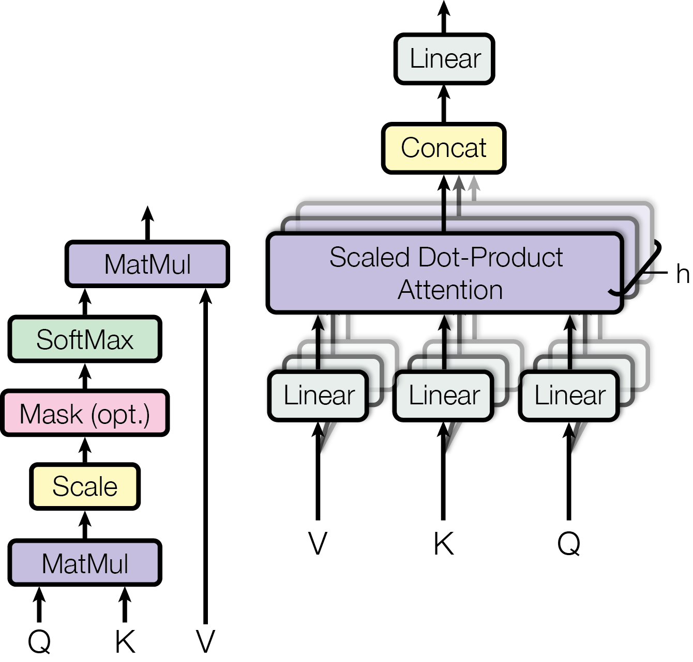
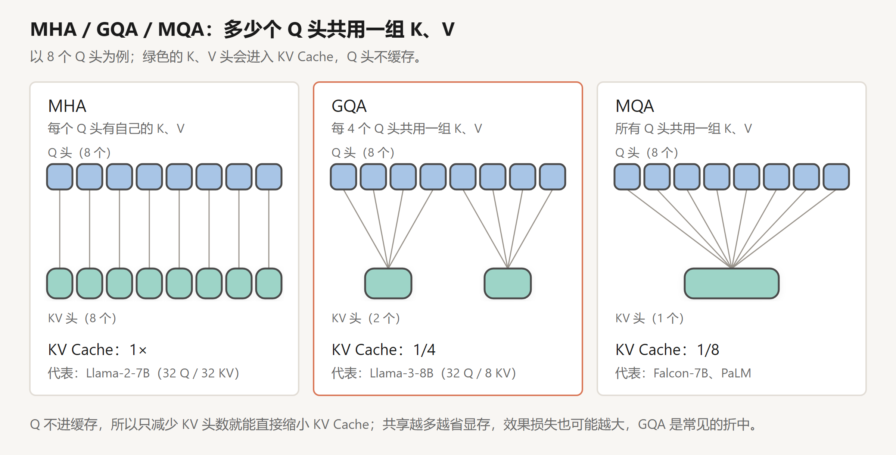
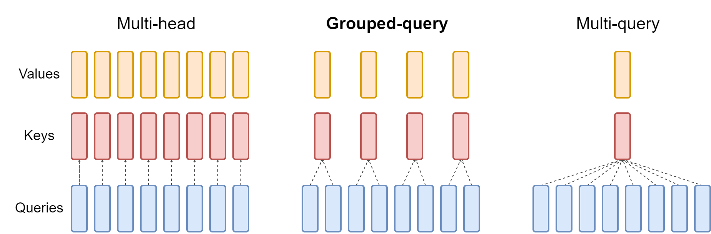
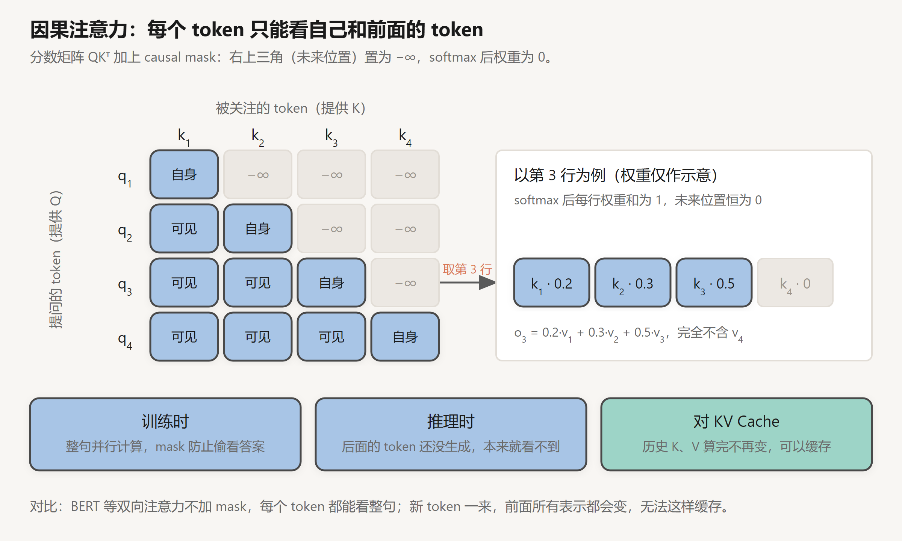
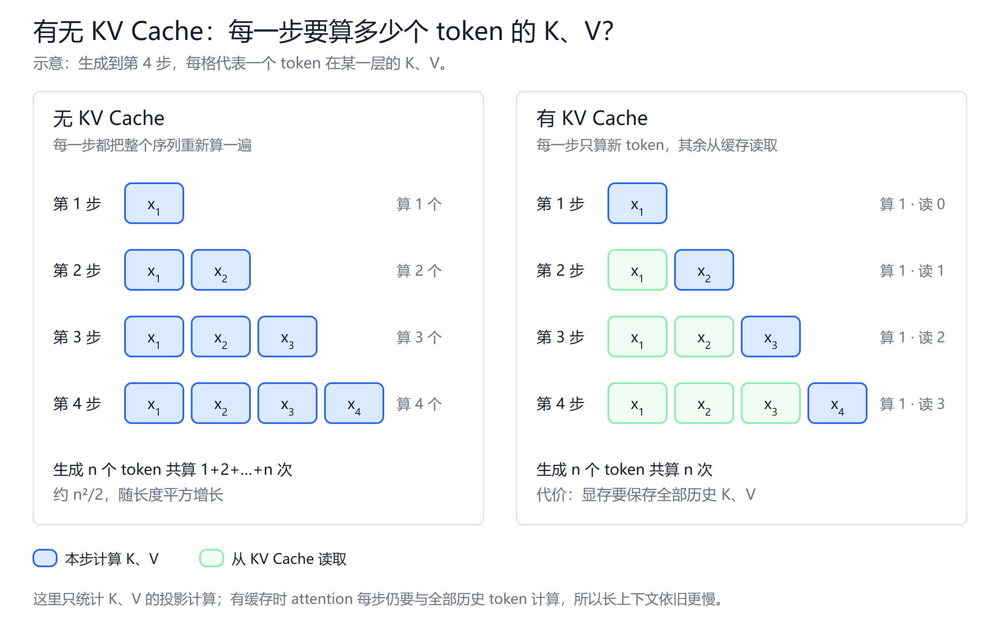
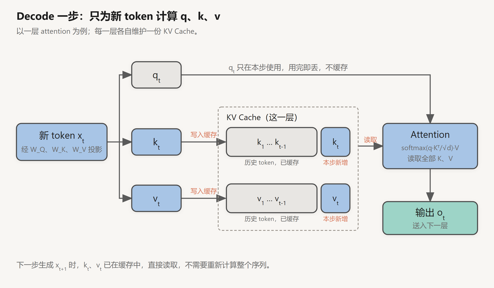

# KV Cache 与 Attention QKV 的关系

创建日期：2026-10-13

结论：KV Cache 缓存的就是 attention 里的 K 和 V。自回归生成时，模型把每一层、每个历史 token 的 K、V 存下来，后面的 token 直接复用，不再重新计算。Q 不需要缓存。

## 1. 从 QKV 开始

### 1.1 attention 要解决什么问题

一个词的含义取决于上下文。"苹果发布了新手机"和"我吃了一个苹果"里的"苹果"，意思完全不同。模型要理解它，就得参考句子里的其他词。

attention 做的就是这件事：让每个 token 从其他 token 那里收集相关信息，用来更新自己的表示。问题在于，该从谁那里收集、收集多少、收集什么，Q、K、V 就是为了回答这三个问题。

### 1.2 Q、K、V 的直观理解

可以类比搜索引擎：

- **Q（Query，查询）**：你输入的搜索词，表示"我想找什么"。
- **K（Key，键）**：每篇文档的标题和标签，用来和搜索词匹配，表示"我能被怎样找到"。
- **V（Value，值）**：文档正文，匹配上之后真正取走的内容。

搜索时，先用搜索词和每个标题比对打分，再按分数高低，把各篇正文按比例汇总起来。attention 也是这个流程。

不同的是，在 attention 里**每个 token 同时扮演三种角色**。同一个输入向量 $x_i$，乘三个不同的权重矩阵，得到 $q_i$、$k_i$、$v_i$：

$$
q_i = x_i W_Q,\qquad k_i = x_i W_K,\qquad v_i = x_i W_V
$$

为什么要分成三个，而不直接用 $x_i$ 本身？因为"我想找什么""我能被怎样找到""我能提供什么内容"是三件不同的事。用三个独立的矩阵，模型可以分别学习这三种特征。$W_Q$、$W_K$、$W_V$ 都是训练出来的参数。

| 向量 | 作用 | 使用方式 |
|---|---|---|
| Q，Query | 当前 token 的查询，与可见 token（含自身）的 K 做点积，得到关注程度 | 只在本步用一次 |
| K，Key | 每个 token 的"索引"，供 Q 匹配 | 被之后所有 token 的 Q 匹配 |
| V，Value | 每个 token 携带的内容，按关注程度被加权求和，作为输出 | 被之后所有 token 加权读取 |

注意：加权汇总是 attention 这一步做的，V 是被汇总的内容；权重来自 $Q K^\top$ 经 softmax 的结果。

### 1.3 计算的四个步骤

以第 $i$ 个 token 为例：

1. **投影**：由 $x_i$ 算出 $q_i$、$k_i$、$v_i$。
2. **打分**：$q_i$ 和每个可见 token 的 $k_j$ 做点积，得到相关度分数 $s_{ij} = \dfrac{q_i \cdot k_j}{\sqrt{d}}$。
3. **归一化**：对这一行分数做 softmax，得到权重 $a_{ij}$。所有权重都在 0～1 之间，加起来等于 1。
4. **加权求和**：$o_i = \sum_j a_{ij}\, v_j$，结果就是第 $i$ 个 token 这一层的输出。

把所有 token 放在一起，写成矩阵形式：

$$
Q = XW_Q,\qquad K = XW_K,\qquad V = XW_V
$$

$$
\mathrm{Attn}(Q, K, V) = \mathrm{softmax}\!\left(\frac{QK^\top}{\sqrt{d}} + M_{\text{causal}}\right)V
$$

**为什么要除以 $\sqrt{d}$**：$d$ 是向量维度。维度越大，点积的数值越大，softmax 会被推向"一个接近 1、其余接近 0"的极端，梯度变得很小，训练困难。除以 $\sqrt{d}$ 可以把分数的尺度拉回正常范围。

$M_{\text{causal}}$ 是因果 mask，保证第 $i$ 个 token 只能看到自己和前面的 token，第 3 节展开。

### 1.4 张量形状

把形状写出来，后面的缓存公式会更容易理解。先看单头的情况，设序列长度为 $S$，隐藏维度为 $d_{\text{model}}$：

| 张量 | 形状 | 说明 |
|---|---|---|
| $X$ | $[S,\ d_{\text{model}}]$ | 每个 token 一行 |
| $W_Q$、$W_K$、$W_V$ | $[d_{\text{model}},\ d_{\text{model}}]$ | 模型参数 |
| $Q$、$K$、$V$ | $[S,\ d_{\text{model}}]$ | 每个 token 一组 q、k、v |
| $QK^\top$ | $[S,\ S]$ | 两两 token 之间的分数 |
| 输出 | $[S,\ d_{\text{model}}]$ | 每个 token 一个新表示 |

$QK^\top$ 是 $S \times S$ 的矩阵，序列越长，这一项越大。这也是长上下文计算开销大的原因之一。

一句话记：K 决定"该不该看我"，V 决定"看了能拿到什么"。K、V 属于历史 token，后续每个 token 都要用，所以缓存；Q 只属于当前 token，用完即丢。

## 2. 多头注意力与 MHA / GQA / MQA

### 2.1 为什么要多个头

一组 $W_Q$、$W_K$ 只能学到一种匹配方式。但一句话里的关系有很多种：主谓关系、指代关系、相邻位置等等。多头注意力就是同时做多组 attention，每个头各自关注一种关系。

### 2.2 怎么切分

多头并不增加总维度，而是把 $d_{\text{model}}$ 切成 $H$ 份：

$$
d_{\text{model}} = H \times d_{\text{head}}
$$

以 Llama-2-7B 为例：$d_{\text{model}} = 4096$，$H = 32$，所以 $d_{\text{head}} = 128$。

计算过程：

1. $Q$、$K$、$V$ 的形状从 $[S,\ d_{\text{model}}]$ 变成 $[H,\ S,\ d_{\text{head}}]$，相当于切成 $H$ 组。
2. 每个头用自己的那一组，独立做一次 1.3 节的 attention。
3. $H$ 个头的输出拼接回 $[S,\ d_{\text{model}}]$，再乘一个输出矩阵 $W_O$，进行融合。

*图源：Attention Is All You Need（Vaswani et al., 2017）Figure 2。*

左边是单个头内部的计算，从下往上就是 1.3 节的四步：$QK^\top$（MatMul）、除以 $\sqrt{d_{\text{head}}}$（Scale）、可选的 mask、softmax，最后乘 $V$。Mask 那一步标着 opt.，第 3 节的因果注意力就是在这里加的。右边是多头：V、K、Q 各过一个 Linear 投影，叠起来的阴影表示有 $h$ 份，各自做一次左边的计算，再 Concat 拼接，最后一个 Linear 就是 $W_O$。论文里每个头画成一个独立的投影，和上面“先投影再切成 $H$ 份”是同一件事，实现上通常用一个大矩阵一次算完再切。

第 5 节公式里的"每头维度 $D$"，指的就是这里的 $d_{\text{head}}$。

### 2.3 MHA、GQA、MQA

既然 K、V 要缓存，那么 KV 头越多，缓存越大。于是出现了让多个 Q 头共用一组 K、V 的做法：

GQA 论文里的原图：

*图源：GQA: Training Generalized Multi-Query Transformer Models from Multi-Head Checkpoints（Ainslie et al., 2023）Figure 2。*

三种方式的 Query 都是 8 个头。左边 MHA 每个 Query 有自己的 Key 和 Value；右边 MQA 所有 Query 共用一组；中间 GQA 每 2 个 Query 共用一组，一共 4 组 K、V。

| 方式 | Q 头数 | KV 头数 | KV Cache 相对大小 | 代表模型 |
|---|---|---|---|---|
| MHA（Multi-Head） | $H$ | $H$ | 1× | Llama-2-7B（32 / 32） |
| GQA（Grouped-Query） | $H$ | $H/g$，每 $g$ 个 Q 头一组 | $1/g$ | Llama-3-8B（32 / 8，$g = 4$） |
| MQA（Multi-Query） | $H$ | 1 | $1/H$ | Falcon-7B、PaLM |

**为什么共享 K、V，而不共享 Q**：Q 不进缓存，减少 Q 头数省不了显存；K、V 要缓存，共享它们就能直接缩小 KV Cache。代价是表达能力下降：MQA 的效果损失比较明显，GQA 是折中，目前主流模型大多采用 GQA。

所以估算缓存时，要代入 **KV 头数**，不能直接用注意力头数。

### 2.4 KV Cache 的张量形状

有了多头，就可以写出 KV Cache 的完整形状。每一层存一份 K 和一份 V：

| 张量 | 形状 |
|---|---|
| 每层 K 缓存 | $[B,\ H_{kv},\ S,\ d_{\text{head}}]$ |
| 每层 V 缓存 | $[B,\ H_{kv},\ S,\ d_{\text{head}}]$ |
| 整体 | $[L,\ 2,\ B,\ H_{kv},\ S,\ d_{\text{head}}]$ |

其中 $B$ 是 batch 大小，$L$ 是层数。把这些维度乘起来，再乘上每个元素的字节数，就是第 5 节的大小公式。实际框架的内存布局可能不同，比如 vLLM 按块（block）分页存放，但总的数据量不变。

## 3. 因果注意力

因果注意力的意思是：**每个 token 只能看到自己和它前面的 token，看不到后面的。**"因果"指时间上的先后：前面的内容可以影响后面，后面的内容不能反过来影响前面。

### 3.1 怎么实现：mask 矩阵

$QK^\top$ 是一个分数矩阵，第 $i$ 行第 $j$ 列表示"第 $i$ 个 token 对第 $j$ 个 token 的关注程度"。因果注意力把右上三角（$j > i$，即未来位置）全部加上 $-\infty$。以 4 个 token 为例：

$$
M_{\text{causal}} =
\begin{bmatrix}
0 & -\infty & -\infty & -\infty \\
0 & 0 & -\infty & -\infty \\
0 & 0 & 0 & -\infty \\
0 & 0 & 0 & 0
\end{bmatrix}
$$

第 $i$ 行对应第 $i$ 个 token 的 $q_i$，第 $j$ 列对应 $k_j$。值为 0 的位置分数不变（可见），值为 $-\infty$ 的位置被屏蔽。

softmax 之后 $e^{-\infty} = 0$，未来位置的权重严格为 0，相当于完全没看到。每一行剩下的权重之和仍为 1。

### 3.2 为什么需要它

GPT、Llama、Qwen 这类模型的训练任务是"根据前文预测下一个 token"。

- **训练时**：为了效率，整句话一次性送入，所有位置并行计算。没有 mask 的话，预测第 3 个词时模型能直接看到第 3 个词本身，等于抄答案，学不到东西。
- **推理时**：后面的 token 还没生成，本来就看不到。
- 加上 mask，训练和推理时每个位置能看到的范围完全一致。

### 3.3 和 KV Cache 的关系

KV Cache 之所以成立，依赖的就是因果注意力：

- $x_2$ 只看 $x_1$、$x_2$，所以它在每一层的表示，以及由此得到的 $k_2$、$v_2$，只取决于 $x_1$、$x_2$。
- 之后再生成 $x_3, x_4, x_5, \dots$ 都不会回头改变 $x_2$ 的计算结果。
- 所以 $k_2$、$v_2$ 算一次就定下来了，可以放心缓存。

如果是双向注意力，每来一个新 token，前面所有 token 的表示都会变，缓存就失效了。

### 3.4 对比：双向注意力

| | 因果注意力 | 双向注意力 |
|---|---|---|
| 能看到 | 自己和前面的 token | 整句所有 token |
| 典型模型 | GPT、Llama、Qwen、DeepSeek（decoder-only） | BERT（encoder） |
| 擅长 | 逐字生成文本 | 理解、分类、抽取 |
| 能用 KV Cache | 能 | 不适用（一次看完整句，也不逐字生成） |

一句话记：因果注意力就是不许看未来。正因为看不到未来，历史 token 的 K、V 才不会被后来者改变，才能缓存。

## 4. 为什么只缓存 K、V

生成第 $t$ 个 token 时，当前层的输出为：

$$
o_t = \mathrm{softmax}\!\left(\frac{q_t\,[k_1, k_2, \dots, k_t]^\top}{\sqrt{d}}\right)[v_1, v_2, \dots, v_t]
$$

从这个式子可以看出三点：

1. **只用到当前的 $q_t$**。历史的 $q_1, \dots, q_{t-1}$ 以后不会再用，所以 Q 不存。
2. **要用到全部历史的 $k_i$、$v_i$**。每个新 token 都要和所有前面的 token 做一次 attention。
3. **历史的 K、V 不会变**。有 causal mask，第 $i$ 个 token 的表示只依赖它前面的 token，后来的 token 不会改变它，算一次就能一直用。

没有 KV Cache 时，每一步都要把整个序列重新过一遍模型，整个生成过程的投影计算量约为 $O(t^2)$。有 KV Cache 时，每一步只为新 token 算一组 $q_t$、$k_t$、$v_t$，把 $k_t$、$v_t$ 追加到缓存，再用 $q_t$ 和整个缓存做 attention。

Decode 单步（一层 attention）的读写过程：

推理因此分为两个阶段：

| 阶段 | 做什么 | 瓶颈 |
|---|---|---|
| Prefill | 一次并行处理整段 prompt，产生全部 K/V 并写入缓存 | 计算（compute-bound） |
| Decode | 每步生成 1 个 token，读取全部 KV Cache | 显存带宽（memory-bound） |

补充：使用 RoPE 的模型，缓存的是已经加上旋转位置编码的 K，V 不加位置编码。

## 5. 大小计算与部署影响

KV Cache 的大小可以直接算，式子里的 2 代表 K 和 V 各存一份：

$$
\text{KV 字节数} = 2 \times L \times H_{kv} \times D \times S \times N \times b
$$

| 符号 | 含义 |
|---|---|
| $L$ | 层数 |
| $H_{kv}$ | 每层 KV 头数 |
| $D$ | 每头维度 $d_{\text{head}}$ |
| $S$ | 缓存长度（输入 + 已生成的 token 数） |
| $N$ | 同时在跑的序列数 |
| $b$ | 每个元素的字节数，FP16 / BF16 为 2 |

以 FP16（每元素 2 字节）为例：

| 模型 | 层数 | KV 头数 | head_dim | 每 token | 4K 上下文单条 | 4K × 32 并发 |
|---|---|---|---|---|---|---|
| Llama-2-7B（MHA） | 32 | 32 | 128 | 512 KB | 2 GB | 64 GB |
| Llama-3-8B（GQA） | 32 | 8 | 128 | 128 KB | 512 MB | 16 GB |

以 Llama-2-7B 为例，每个 token 占 $2 \times 32 \times 32 \times 128 \times 2 = 524288$ 字节，即 512 KB。它的权重只有约 13 GB，32 路 4K 并发的 KV Cache 已经是权重的五倍。

它影响部署的三个方面：

- **并发与上下文长度**：显存减去权重，剩下的主要留给 KV Cache，它决定能同时跑多少请求、上下文能开多长。
- **Decode 速度**：每生成一个 token，都要从 HBM 把整个 KV Cache 读一遍，速度受显存带宽限制。
- **成本**：单卡能服务的并发越高，单 token 成本越低。

## 6. 主流优化方法

主流优化都是在缩小公式里的某一项，或者改进 KV 的存放方式。

| 方向 | 方法 | 改的是哪一项 |
|---|---|---|
| 减少 KV 头数 | MQA / GQA | 多个 Q 头共用一组 K/V，$H_{kv}$ 变小 |
| 低秩压缩 | MLA（DeepSeek-V2/V3） | K/V 压成低维 latent 向量缓存，用时还原或吸收进矩阵乘 |
| 降低精度 | KV 量化（INT8 / FP8 / INT4） | 每元素字节数 $b$ 变小 |
| 缩短保留长度 | 滑动窗口、StreamingLLM、H2O 等 token 淘汰 | $S$ 变小 |
| 显存管理 | PagedAttention（vLLM）、Prefix Caching | 大小不变，减少碎片，相同前缀共享 KV |
| 分层存储 | KV offload 到 CPU / SSD，PD 分离时跨节点传 KV | 用容量换带宽 |

昇腾上的 MindIE、vLLM-Ascend 同样采用分页式 KV 管理，原理与 PagedAttention 一致。

## 总结

Q 只在当前这一步用到；K、V 会被后续所有 token 反复读取，而且算出来以后不会再变，所以缓存 K、V。代价是显存占用随层数 × KV 头数 × 序列长度 × 并发数线性增长，因此它成为限制并发、上下文长度和吞吐的主要瓶颈。
