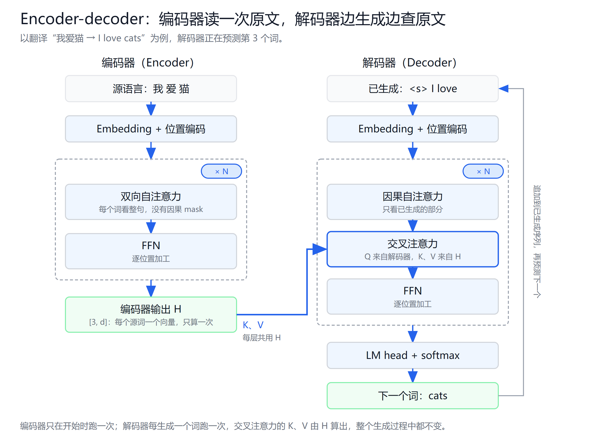

# Encoder-Decoder 与交叉注意力

创建日期：2026-10-14

原始 Transformer 是为机器翻译设计的，由编码器和解码器两部分组成。今天的大语言模型几乎都只保留了解码器，但 encoder-decoder 结构并没有消失：语音识别的 Whisper、文生图的 Stable Diffusion、T5 系列，都离不开它，尤其离不开连接两部分的**交叉注意力**。

这篇讲编码器和解码器各自做什么，交叉注意力怎么计算，训练和推理时数据怎么流动，以及 BERT、T5 这些模型的预训练目标。最后和 decoder-only 做个对比。前置知识是 [Attention 与 QKV 入门](01-Attention与QKV入门.md) 和 [Transformer 结构详解](02-Transformer结构详解.md)。

## 1. 为什么要分成两部分

以翻译为例，把"我爱猫"翻译成"I love cats"。这个任务有一个特点：**输入和输出是两段不同的序列，地位也不同**。

- 输入（原文）一开始就完整给出，可以反复看，前后文都能参考。理解"爱"的意思，看一眼后面的"猫"也没问题。
- 输出（译文）要一个词一个词地生成，生成第 3 个词时，第 4 个词还不存在。

encoder-decoder 结构正是按这个分工设计的：

- **编码器**负责读懂原文。它用**双向**自注意力，每个词都能看到整句，最后为每个源词输出一个包含全句上下文的向量。
- **解码器**负责生成译文。它用**因果**自注意力看自己已经生成的部分，再用**交叉注意力**去原文里查找需要的信息。

## 2. 整体结构



### 2.1 编码器

编码器的每一层和 decoder-only 模型的 block 几乎一样，唯一的区别是**没有因果 mask**：

$$
\begin{aligned}
h &= x + \mathrm{SelfAttn}_{\text{双向}}\big(\mathrm{Norm}(x)\big) \\
x' &= h + \mathrm{FFN}\big(\mathrm{Norm}(h)\big)
\end{aligned}
$$

（这里按 Pre-Norm 写，原始 Transformer 用的是 Post-Norm，结构相同。）

叠 $N$ 层后，得到编码器输出 $H \in \mathbb{R}^{S \times d}$，$S$ 是原文的 token 数。这一组向量就是编码器对原文的全部"理解"，解码器之后只通过它来获取原文信息。

### 2.2 解码器

解码器的每一层有**三个**子层，比编码器多一个：

$$
\begin{aligned}
a &= y + \mathrm{SelfAttn}_{\text{因果}}\big(\mathrm{Norm}(y)\big) \\
b &= a + \mathrm{CrossAttn}\big(\mathrm{Norm}(a),\ H\big) \\
y' &= b + \mathrm{FFN}\big(\mathrm{Norm}(b)\big)
\end{aligned}
$$

1. **因果自注意力**：译文内部的信息交换，只能看已生成的部分。
2. **交叉注意力**：从原文 $H$ 里读取信息。
3. **FFN**：逐位置加工。

三个子层都套在残差连接里。最后一层的输出经过 LM head 和 softmax，得到下一个词的概率分布，这部分和 decoder-only 完全一样。

注意解码器的**每一层**都有交叉注意力，读的都是**同一个** $H$，也就是编码器最后一层的输出。不是第 $l$ 层解码器读第 $l$ 层编码器。

原始 Transformer 的编码器和解码器各 6 层，$d = 512$。

## 3. 交叉注意力

### 3.1 Q 从哪来，K、V 从哪来

交叉注意力的计算公式和自注意力完全一样，区别只在于 Q、K、V 的来源：

$$
Q = Y W_Q,\qquad K = H W_K,\qquad V = H W_V
$$

$$
\mathrm{CrossAttn} = \mathrm{softmax}\!\left(\frac{Q K^\top}{\sqrt{d_k}}\right) V
$$

- **Q 来自解码器**（$Y$ 是解码器当前层的隐藏状态）：表示"我现在要生成下一个词，需要原文里的什么信息"。
- **K、V 来自编码器输出 $H$**：K 是原文每个词的"索引"，V 是原文每个词的"内容"。

用 QKV 入门那篇的图书馆类比：自注意力是在自己的书架上查书，交叉注意力是拿着自己的问题，去另一个图书馆（原文）里查书。

形状上，解码器有 $T$ 个位置，原文有 $S$ 个位置，分数矩阵 $QK^\top$ 是 $[T,\ S]$：每个译文位置对每个原文位置打一个分。它不需要是方阵，$T$ 和 $S$ 可以不相等。

**交叉注意力不需要因果 mask。** 原文是完整给出的，生成任何一个译文词时，都可以看原文的任何位置。只有在一个 batch 里原文长度不同、有 padding 时，才需要 padding mask 把填充位置挡掉。

### 3.2 手算一个例子

解码器已经生成了"I love"，现在要预测下一个词。设原文三个词的 key 和 value 是（为了好算，取很小的维度）：

| 原文词 | $k$ | $v$ |
|---|---|---|
| 我 | $(2,\ 0,\ 0)$ | $(1,\ 0)$ |
| 爱 | $(0,\ 2,\ 0)$ | $(0,\ 1)$ |
| 猫 | $(0,\ 0,\ 2)$ | $(1,\ 1)$ |

解码器当前位置的 query 是 $q = (0.2,\ 0.5,\ 1.5)$。这个 q 由"I love"的上下文算出：主语和动词都已经翻译了，接下来需要宾语。

**打分**，点积再除以 $\sqrt{3} \approx 1.732$：

$$
\text{我}:\ \frac{0.4}{1.732} = 0.231,\qquad \text{爱}:\ \frac{1.0}{1.732} = 0.577,\qquad \text{猫}:\ \frac{3.0}{1.732} = 1.732
$$

**softmax**：

$$
e^{0.231} = 1.260,\quad e^{0.577} = 1.781,\quad e^{1.732} = 5.652,\qquad \text{总和} = 8.693
$$

$$
\text{权重} = (0.145,\ 0.205,\ 0.650)
$$

**加权求和**：

$$
0.145 \times (1, 0) + 0.205 \times (0, 1) + 0.650 \times (1, 1) = (0.795,\ 0.855)
$$

65% 的注意力落在"猫"上，输出的向量主要携带了"猫"的信息，加回解码器的残差流后，后续的 FFN 和 LM head 就能据此输出"cats"。

### 3.3 对齐

在翻译任务里，交叉注意力的权重矩阵常常呈现出**对齐**关系：生成每个译文词时，注意力集中在对应的原文词上。把 $[T,\ S]$ 的权重画成热力图，往往能看到一条大致的对角线，语序不同的地方会出现偏折。

attention 机制最早就是在这里被提出的（Bahdanau 等，2014）。当时的翻译模型是 RNN 编码器加 RNN 解码器，编码器要把整句原文压缩成一个固定长度的向量，长句子信息丢失严重。Bahdanau 让解码器每一步都能回头看编码器的所有隐藏状态，按相关程度加权，这就是交叉注意力的前身。Transformer 后来把这个思路推广到了模型内部的所有位置之间，就成了自注意力。

## 4. 训练与推理

### 4.1 训练：teacher forcing

训练时，原文和完整的译文都是已知的。解码器的输入是**右移一位**的译文：

| 位置 | 1 | 2 | 3 | 4 |
|---|---|---|---|---|
| 解码器输入 | `<s>` | I | love | cats |
| 预测目标 | I | love | cats | `</s>` |

每个位置的输入是正确的前文，目标是下一个词。因果 mask 保证每个位置看不到自己之后的词，所以和 decoder-only 一样，一次前向传播就能同时得到所有位置的损失。这种"每一步都喂正确前文"的训练方式叫 **teacher forcing**。

损失只算在译文上，原文只是条件，不需要预测。

### 4.2 推理：编码器只跑一次

生成时：

1. 把原文送进编码器，跑一次，得到 $H$。
2. 解码器从 `<s>` 开始，每一步生成一个词，接到已生成序列的末尾，再生成下一个。

编码器在整个生成过程中**只运行一次**。原文不变，$H$ 就不变。

### 4.3 两种 KV Cache

解码器的两种注意力，缓存的方式不一样：

| | 因果自注意力 | 交叉注意力 |
|---|---|---|
| K、V 来自 | 已生成的译文 | 编码器输出 $H$ |
| 缓存大小 | 每生成一个词增加一行 | 固定为原文长度 $S$ |
| 何时计算 | 每一步算新 token 的那一行 | 生成开始前算一次，之后不变 |

交叉注意力的 K、V 是 $H W_K$ 和 $H W_V$，只依赖原文，所以在生成第一个词之前，就可以为每一层一次性算好，之后每一步直接用。自注意力的缓存和 decoder-only 模型一样，见 [KV Cache 与 Attention QKV 的关系](03-KV-Cache与Attention-QKV.md)。

## 5. 预训练目标

encoder-decoder 和 encoder-only 模型的预训练，都不是简单的"预测下一个词"。

### 5.1 BERT：掩码语言模型

BERT 是 encoder-only 模型，只有编码器，没有解码器。它的预训练目标是**掩码语言模型**（MLM）：随机选中 15% 的 token，让模型根据上下文把它们预测出来。被选中的 token 中：

- 80% 替换成特殊符号 `[MASK]`；
- 10% 替换成随机的 token；
- 10% 保持不变。

例如"我 爱 [MASK]"，模型要根据左右两边的上下文预测出"猫"。

只替换成 `[MASK]` 会有一个问题：微调和使用时输入里从来没有 `[MASK]`，训练和使用的分布不一致。随机替换和保持不变的那 20%，让模型不能只盯着 `[MASK]` 位置，每个位置都要认真建模。

MLM 让编码器学会双向地理解上下文，非常适合分类、抽取、语义检索这类理解任务。代价是：每次只在 15% 的位置上有训练信号，数据利用率比"预测下一个词"低；而且 BERT 没有解码器，不能直接生成文本。

### 5.2 T5：span corruption

T5 把所有任务都统一成"文本到文本"：翻译、摘要、分类、问答，输入和输出都是一段文字。分类任务就让模型直接输出类别名称。

它的预训练目标是 **span corruption**：随机挑出原文里的几段连续片段（平均长度 3 个 token，总共约占 15%），每段换成一个哨兵符号，编码器读入被挖空的文本，解码器依次输出被挖掉的片段：

```
原文：    Thank you for inviting me to your party last week.
编码器输入：Thank you <X> me to your party <Y> week.
解码器输出：<X> for inviting <Y> last <Z>
```

解码器只需要生成被挖掉的部分，目标序列很短，训练效率比重建整句高。

### 5.3 BART

BART 也是 encoder-decoder，预训练目标是**去噪**：对原文施加各种破坏（遮盖片段、删除 token、打乱句子顺序等），编码器读入破坏后的文本，解码器重建**完整的**原文。它在摘要等生成任务上表现很好。

## 6. 和 decoder-only 的比较

### 6.1 decoder-only 也能做翻译

decoder-only 模型做翻译，只需要把原文放在前面当提示：

```
把下面的中文翻译成英文：我爱猫
I love cats
```

原文和译文拼成一条序列，用同一个因果注意力处理。区别在于：

| | encoder-decoder | decoder-only |
|---|---|---|
| 原文内部的注意力 | 双向，每个词看整句 | 因果，每个词只看前面 |
| 原文和译文的参数 | 两套，编码器和解码器分开 | 一套，共用所有参数 |
| 生成时读原文的方式 | 交叉注意力读 $H$ | 自注意力直接看前面的原文 token |
| 训练目标 | 只预测译文 | 通常整条序列都预测 |

两者之间还有一种折中，叫 **prefix LM**：结构上是一个 decoder-only 模型，但前缀（原文）部分的 token 之间用双向注意力，后面的生成部分用因果注意力。

### 6.2 为什么 decoder-only 成了主流

[Transformer 结构详解](02-Transformer结构详解.md) 第 9 节列过几个原因：目标统一、结构简单、训练效率高、推理友好。从 encoder-decoder 的角度可以补充两点：

- **"输入"和"输出"的划分在通用场景里不自然。** 多轮对话里，上一轮的输出就是下一轮的输入；工具调用、代码生成、长推理中，模型生成的内容随时又会成为需要理解的上下文。decoder-only 不区分两者，处理起来最简单。
- **规模扩大后，双向编码的优势变小了。** 在同等计算量下，足够大的 decoder-only 模型配合大规模预训练和指令微调，在大多数任务上都能达到甚至超过 encoder-decoder 模型。

但在输入很长、输出很短，或者输入和输出明显属于两种模态的场景里，encoder-decoder 仍然有优势。

## 7. 今天还在用的地方

- **语音识别：Whisper。** 编码器读入 30 秒音频的梅尔频谱，解码器生成文字。输入是音频、输出是文本，天然就是两部分。
- **文生图：Stable Diffusion。** 文本先经过 CLIP 的文本编码器得到一组向量，去噪网络（U-Net）里的交叉注意力层，Q 来自图像的潜变量特征，K、V 来自文本向量。图像的每个区域都去文本里查"我这里该画什么"。扩散模型本身的原理见 [从流形假说到深度学习](../生成模型与数据几何/从流形假说到深度学习.md)。
- **多模态大模型。** 一种做法是在语言模型里插入交叉注意力层，让文本去读取图像编码器的输出（Flamingo、Llama 3.2 Vision）；另一种做法是把图像特征投影成"图像 token"，直接拼在文本前面，交给 decoder-only 模型处理（LLaVA 等）。后者今天更常见，本质上是把交叉注意力换成了自注意力。
- **翻译与 T5 系列。** 专用的翻译模型（如 NLLB）和 Flan-T5 等仍然是 encoder-decoder 结构，在算力有限、任务明确的场景里很实用。
- **文本向量与检索。** BERT 类的 encoder-only 模型仍然是语义检索、重排序的主力，RAG 系统里的向量模型大多是这一类。

## 小结

- encoder-decoder 按"读懂输入"和"生成输出"分工：编码器用双向注意力处理完整的输入，解码器用因果注意力生成输出。
- 解码器每层有三个子层：因果自注意力、交叉注意力、FFN。交叉注意力的 Q 来自解码器，K、V 来自编码器的最终输出，每一层读的是同一个 $H$。
- 交叉注意力不需要因果 mask，分数矩阵是 $[T,\ S]$，在翻译中通常表现为对齐关系。
- 推理时编码器只跑一次；交叉注意力的 K、V 在生成开始前算好，整个生成过程中不变。
- BERT 用掩码语言模型训练编码器，T5 用 span corruption、BART 用去噪训练整个 encoder-decoder。
- 今天的大语言模型以 decoder-only 为主，但交叉注意力在语音识别、文生图、部分多模态模型里仍然是核心部件。

## 参考

- Bahdanau, Cho & Bengio, 2014. *Neural Machine Translation by Jointly Learning to Align and Translate*. [arXiv:1409.0473](https://arxiv.org/abs/1409.0473)
- Vaswani et al., 2017. *Attention Is All You Need*. [arXiv:1706.03762](https://arxiv.org/abs/1706.03762)
- Devlin et al., 2018. *BERT: Pre-training of Deep Bidirectional Transformers for Language Understanding*. [arXiv:1810.04805](https://arxiv.org/abs/1810.04805)
- Raffel et al., 2019. *Exploring the Limits of Transfer Learning with a Unified Text-to-Text Transformer*（T5）. [arXiv:1910.10683](https://arxiv.org/abs/1910.10683)
- Lewis et al., 2019. *BART: Denoising Sequence-to-Sequence Pre-training*. [arXiv:1910.13461](https://arxiv.org/abs/1910.13461)
- Radford et al., 2022. *Robust Speech Recognition via Large-Scale Weak Supervision*（Whisper）. [arXiv:2212.04356](https://arxiv.org/abs/2212.04356)
- Rombach et al., 2021. *High-Resolution Image Synthesis with Latent Diffusion Models*. [arXiv:2112.10752](https://arxiv.org/abs/2112.10752)
- Alayrac et al., 2022. *Flamingo: a Visual Language Model for Few-Shot Learning*. [arXiv:2204.14198](https://arxiv.org/abs/2204.14198)
- Liu et al., 2023. *Visual Instruction Tuning*（LLaVA）. [arXiv:2304.08485](https://arxiv.org/abs/2304.08485)
