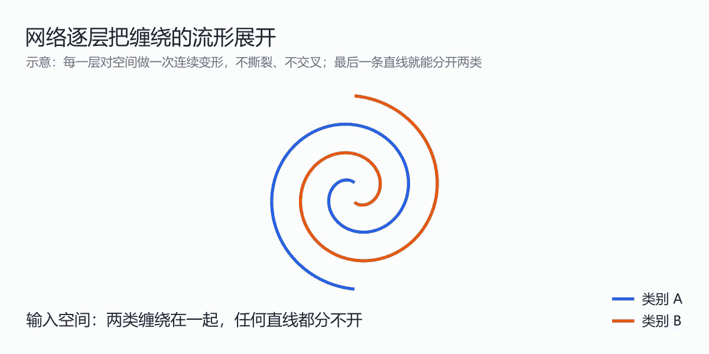
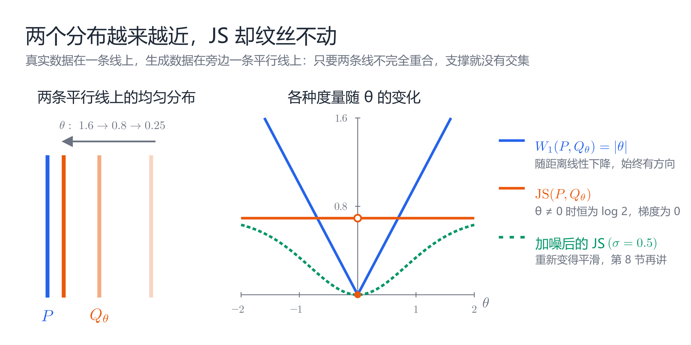
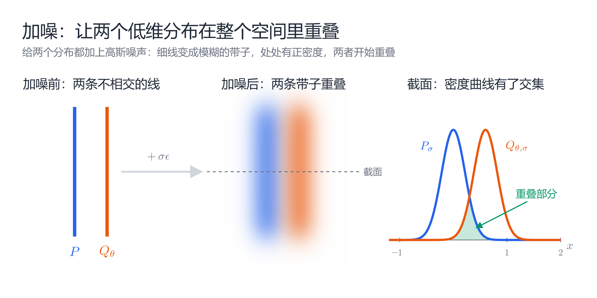

# 从流形假说到深度学习：数据的几何结构如何影响学习与生成

一张 $1024\times1024$ 的彩色图片，需要超过三百万个数值来表示。但这是否意味着，图片具有三百万个独立的自由度？

如果每个像素都可以随意变化，绝大多数结果只会是噪声。真实图片中的像素存在大量约束：物体移动时，轮廓会一起移动；光照改变时，相关区域的亮度会协调变化。

这意味着，理解机器学习不能只看输入有多少维，还要看数据在这些维度中如何分布。

流形假说提供了一个起点。沿着它继续追问，我们会先遇到一个老问题：高维空间明明有维度灾难，深度学习为什么还能学会？再往后，是分层空间、分布之间的距离、梯度消失，以及扩散模型和 Flow Matching 如何构造训练任务。

## 1. 坐标很多，自由度可能很少

先看一个简单例子：半径固定的圆。

圆上的点需要两个坐标 $(x,y)$，但它们满足：

$$
x^2+y^2=R^2
$$

两个坐标不能独立变化。只要确定角度 $\theta$，位置就确定了：

$$
(x,y)=(R\cos\theta,R\sin\theta)
$$

因此，圆所在的环境是二维的，圆本身却只有一个自由度。

这就是两个概念的区别：

- **环境维数 $D$**：表示数据使用的坐标数量。
- **内在维数 $d$**：描述数据局部变化所需的独立坐标数量。

球面也是如此。它位于三维空间，但沿球面移动，局部只需要两个坐标。

流形将这种直觉推广到了更一般的空间：每个点附近都可以建立欧氏空间式的局部坐标，整体则可以弯曲。“局部像平面”说的是坐标结构，并不意味着曲率为零。

## 2. 流形假说：数据集中在低维结构附近

流形假说认为，许多自然产生的高维数据，其概率质量主要集中在低维流形上或附近。

用符号表示：

$$
\mathcal M\subset\mathbb R^D,
\qquad
\dim(\mathcal M)=d\ll D
$$

在局部，我们可以用一个理想化模型理解：

$$
x=g(z)+\varepsilon
$$

其中，$x$ 是高维观测，$z$ 是低维变量，$g$ 将低维变量映射为观测数据，$\varepsilon$ 表示噪声或近似误差。

例如，同一个物体的图片可能随姿态、位置、光照而变化。这些因素共同影响大量像素，因此像素数量可以远大于独立变化因素的数量。

不过，**存在低维结构，不等于已经证明存在一个处处光滑、维数固定的流形**。研究在常用图像数据集上估计出了较低的内在维数，为低维结构提供了经验支持，但结论仍受数据集与估计方法限制。[Pope 等，2021](https://arxiv.org/abs/2104.08894)

## 3. 维度灾难与内在维数：高维数据为什么仍然可学

先看维度灾难有多严重。

假设要在单位立方体 $[0,1]^D$ 中每隔 $0.1$ 放一个样本，保证任何位置附近都有数据可参考，需要的点数是：

$$
10^D
$$

$D=2$ 时是 100 个；$D=100$ 时就已经远超可观测宇宙中的原子数（约 $10^{80}$）。而一张图片的 $D$ 有几百万。

换成学习问题也一样。如果只假设目标函数足够光滑，不借助别的结构，误差随样本数 $n$ 下降得非常慢。以 Lipschitz 函数的回归为例，最优均方误差大致按下式下降：

$$
n^{-2/(2+D)}
$$

$D$ 越大，指数越接近 0，多收集数据几乎没有帮助。

流形假说改变了这个算式里的 $D$。如果数据集中在 $d$ 维流形附近，一些方法的误差率会自动适应内在维数，变为大致按 $n^{-2/(2+d)}$ 下降。例如，k 近邻回归的收敛速度取决于数据的局部内在维数，而不是环境维数。[Kpotufe，2011](https://arxiv.org/abs/1110.4300)

神经网络上也有对应的经验证据。Pope 等用可控内在维数的合成图片做实验，发现学习所需的样本量主要随内在维数增长；只增加环境维数（例如把图片放大），影响则小得多。[Pope 等，2021](https://arxiv.org/abs/2104.08894)

一个直观例子能说明“像素空间”和“数据流形”的差别。把两张人脸照片的像素直接取平均，得到的是一张重影，而不是一张“介于两人之间的脸”。像素空间里的直线中点离开了数据流形。好的自编码器则会在潜空间中插值，再解码回图片，结果沿着流形移动，看起来仍像一张真实的脸。

这也引出了深度网络的一种几何理解：**逐层变换，把弯曲、缠绕的数据流形展开。**

例如，两条互相缠绕的螺旋线无法用一条直线分开。网络的每一层都对空间做一次连续变形，经过若干层后，两类数据可能被拉开，最后一层只需一个线性分类器。[Olah，2014](https://colah.github.io/posts/2014-03-NN-Manifolds-Topology/)

这种变化可以被测量。Ansuini 等估计了训练好的网络中各层表示的内在维数，发现它远小于该层的神经元数量，并且在最后几层逐步下降；最后一层的内在维数越低，测试准确率往往越高。未训练的网络、用随机标签训练的网络都没有这种规律。[Ansuini 等，2019](https://arxiv.org/abs/1905.12784)

需要注意，流形假说只是“深度学习为什么能泛化”的一部分解释。卷积等架构带来的归纳偏置、优化算法的隐式偏好等因素同样重要。

到这里，我们关心的是**在流形上学一个函数**，比如判断一张图是不是猫。生成模型要做的事更难：学出流形本身，以及流形上的概率分布。在此之前，先看看“单个流形”这个模型够不够用。

## 4. 从流形并集到分层空间

单个固定维数的流形是一种整齐的模型。现实数据可能更复杂：不同区域拥有不同数量的变化因素，也可能出现分支、边界和交汇。

一种扩展是允许多个流形：

$$
\mathcal S=\bigcup_k\mathcal M_k,
\qquad
\dim(\mathcal M_k)=d_k
$$

不同部分可以具有不同内在维数。有研究在常用图像数据集上发现了支持这种“流形并集”描述的证据。[Brown 等，2023](https://arxiv.org/abs/2207.02862)

如果这些部分还会连接，就需要进一步考虑**分层空间**。

想象一条“Y”形线：

- 每条开放分支，局部都像普通的一维曲线。
- 交汇点附近有三个分支，无法像普通直线一样建立局部坐标。
- 可以将交汇点单独视为零维层，将分支视为一维层。

各层可以是规则的流形，整体却允许奇异点。严格的分层还需要层与层满足相容条件，并非任意拼接。

这种视角使我们不必坚持“所有数据处处具有相同自由度”。相关研究还提出了 CW 复形等结构，用于描述更复杂的图像数据几何。[Wang 与 Wang，2024](https://proceedings.mlr.press/v235/wang24bs.html)

但认识结构之后，一个更实际的问题出现了：

**神经网络如何学到这样的分布？**

## 5. 可以表示，不等于可以训练

生成模型的一种常见写法是：

$$
z\sim P_z,
\qquad
x=G_\theta(z)
$$

我们从一个简单分布采样，再通过神经网络 $G_\theta$ 生成数据。它诱导出的分布记为 $P_\theta$，目标是让它接近真实分布 $P_{\mathrm{data}}$。

这涉及三个不同层次：

| 层次 | 要回答的问题 |
|---|---|
| 表示能力 | 模型是否能够表达目标分布？ |
| 训练目标 | 损失是否能够反映分布改善？ |
| 优化过程 | 参数更新是否能够有效降低损失？ |

增加模型容量，主要影响第一层。它不会自动解决后面两层。

低维结构也不是万能钥匙。即使只是第 3 节那种“在流形上学函数”的任务，也可能很难：几何结构可能复杂，目标函数也可能沿流形快速变化。理论研究表明，对神经网络的函数学习而言，仅有低维流形及有界曲率，仍不足以保证高效学习。[Kiani 等，2024](https://arxiv.org/abs/2406.01461) 这个结论针对的是函数学习而非生成模型，但它提醒我们，“数据是低维的”和“模型能高效学会”之间还隔着一段距离。

因此，下一步必须研究：**我们使用什么损失来比较分布？**

## 6. 两个分布越来越近，损失却可能不变

考虑两条平行线上的均匀分布：

$$
Z\sim U[0,1]
$$

$$
P=\operatorname{Law}(0,Z),
\qquad
Q_\theta=\operatorname{Law}(\theta,Z)
$$

这里 $\operatorname{Law}$ 表示随机变量的概率分布。真实数据在 $x=0$ 上，生成数据在 $x=\theta$ 上。

当 $\theta$ 从 10 变成 0.001，两条线显然越来越近。但只要 $\theta\neq0$，它们的支撑仍不重叠。支撑可以直观理解为分布可能产生样本的位置集合。

这时，不同分布度量给出了不同答案：

| 度量 | $\theta\neq0$ 时 |
|---|---:|
| $\mathrm{KL}(P\Vert Q_\theta)$ | $+\infty$ |
| $\mathrm{KL}(Q_\theta\Vert P)$ | $+\infty$ |
| $\mathrm{JS}(P,Q_\theta)$ | $\log2$ |
| $W_1(P,Q_\theta)$ | $\lvert\theta\rvert$ |

当 $\theta=0$ 时，它们都为零；表中使用自然对数。[WGAN 原论文](https://proceedings.mlr.press/v70/arjovsky17a/arjovsky17a.pdf)

原因在于，KL 和 JS 对支撑是否重叠非常敏感。Wasserstein 距离则考虑搬运概率质量的几何成本，因此能反映两条线相隔多远。

对于上述 JS 目标：

$$
\frac{\partial}{\partial\theta}
\mathrm{JS}(P,Q_\theta)=0,
\qquad \theta\neq0
$$

优化器得不到“往哪边移动更好”的信息。

图中的绿色虚线是第 8 节会讲到的“加噪后的 JS”：它随 $\theta$ 平滑变化，重新提供了方向信息。

这就是“梯度为零”说法的具体含义。它不是流形上的所有梯度都为零；KL 为无穷，也不能直接理解成梯度为零。实际 GAN 的训练信号还取决于判别器、生成器损失和正则化。[Arjovsky 与 Bottou，2017](https://leon.bottou.org/publications/pdf/iclr-2017.pdf)

注意这个例子与流形假说的联系：真实数据和生成数据都集中在各自的低维集合上，在高维空间中，两个低维集合恰好重叠的机会很小。所以支撑不重叠不是刻意构造的极端情况，而是低维结构带来的常态。

## 7. 第一条解决路线：改变分布比较方式

Wasserstein 距离的一种定义是：

$$
W_1(P,Q)
=
\inf_{\pi\in\Pi(P,Q)}
\mathbb E_{(x,y)\sim\pi}\|x-y\|
$$

其中，$\Pi(P,Q)$ 是所有边缘分布分别为 $P,Q$ 的联合分布。

直观上，我们寻找一种搬运方案，把 $P$ 的概率质量搬到 $Q$，并让总成本尽可能小。

在平行线例子中：

$$
W_1(P,Q_\theta)=|\theta|
$$

于是，分布靠近会使距离下降。

直接求解最优搬运方案很难。WGAN 用的是它的对偶形式（Kantorovich–Rubinstein 对偶）：

$$
W_1(P,Q)=\sup_{\|f\|_L\le1}
\mathbb E_{x\sim P}[f(x)]-\mathbb E_{x\sim Q}[f(x)]
$$

其中 $\|f\|_L\le1$ 表示 $f$ 是 1-Lipschitz 函数，即输出随输入变化的幅度不超过输入本身的变化。WGAN 中的 critic 网络就是在寻找这个 $f$：让它在真实数据上打分高、在生成数据上打分低，两者之差就是距离的估计，再用它为生成器提供反馈。

它改变了比较分布的方式，但 critic 的估计质量与 Lipschitz 约束的实现方式（权重裁剪、梯度惩罚等）仍然影响训练。[WGAN 原论文](https://proceedings.mlr.press/v70/arjovsky17a/arjovsky17a.pdf)

另一条路线则更进一步：**先把目标分布处理成更容易学习的形式。**

## 8. 第二条解决路线：加噪，再学习去噪方向

回到第 6 节的问题：KL 和 JS 失效，是因为两个分布的支撑不重叠。最直接的修补办法是给两边都加上高斯噪声。高斯分布在整个空间都有正密度，加噪后，两条平行线变成两团“模糊的带子”，它们处处重叠，KL 和 JS 重新能反映两者的距离。Arjovsky 与 Bottou 在分析 GAN 训练问题时，就提出过这种加噪思路。[Arjovsky 与 Bottou，2017](https://leon.bottou.org/publications/pdf/iclr-2017.pdf)

加噪还解决了另一个问题。如果一个分布严格集中在 $d<D$ 维的流形上，流形在 $\mathbb R^D$ 中的体积为零，这个分布就没有相对于整个 $\mathbb R^D$ 体积的普通密度。

因此，环境空间中的 score：

$$
s(x)=\nabla_x\log p(x)
$$

可能没有通常意义下的定义。这是“未定义”的问题，区别于前面的“梯度为零”。流形上的内在密度与内在梯度则需要另行定义。

一种处理方式是加入高斯噪声：

$$
x_\sigma=x_0+\sigma\epsilon,
\qquad
\epsilon\sim\mathcal N(0,I)
$$

对 $\sigma>0$，分布被平滑到环境空间中，可以学习其 score：

$$
s_\sigma(x)=\nabla_x\log p_\sigma(x)
$$

更重要的是，我们能自行构造训练样本。采样真实数据 $x_0$ 和噪声 $\epsilon$，得到 $x_\sigma$。给定 $x_0$ 时，$x_\sigma$ 服从均值为 $x_0$、方差为 $\sigma^2$ 的高斯分布，它的 score 可以直接写出来：

$$
\nabla_{x_\sigma}\log p(x_\sigma\mid x_0)
=-\frac{x_\sigma-x_0}{\sigma^2}
=-\frac{\epsilon}{\sigma}
$$

直观上，它指向“从加噪点回到原始数据点”的方向。我们不知道真实分布的 score，却知道这个条件 score，于是用它作为监督信号：

$$
\mathcal L(\theta)
=
\mathbb E\left[
\left\|
s_\theta(x_\sigma,\sigma)
+\frac{\epsilon}{\sigma}
\right\|^2
\right]
$$

在适当条件下，这种条件回归的最优解对应加噪分布的 score。这一方法称为去噪 score matching。[Vincent，2011](https://doi.org/10.1162/NECO_a_00142) 实际训练通常还会使用多个噪声尺度与权重。[Song 与 Ermon，2019](https://arxiv.org/abs/1907.05600)

关键在于：**通过已知的加噪过程，为未知分布构造可计算的监督信号。**

## 9. 扩散模型：把生成拆成多个可学习的阶段

扩散模型将加噪组织成逐步过程：从清晰数据走向近似纯噪声，再学习逆向生成。

以 DDPM 的常见参数化为例：

$$
x_t=
\sqrt{\bar\alpha_t}\,x_0
+
\sqrt{1-\bar\alpha_t}\,\epsilon
$$

其中，$\bar\alpha_t$ 控制数据保留程度：$t$ 越大，$\bar\alpha_t$ 越小，$x_t$ 越接近纯噪声。也就是说，**在 DDPM 中，$t=0$ 是数据，$t$ 增大走向噪声**。网络输入 $x_t,t$，预测噪声 $\epsilon$，常见的简化损失为：

$$
\mathcal L_{\mathrm{simple}}
=
\mathbb E_{x_0,t,\epsilon}
\left[
\|\epsilon-\epsilon_\theta(x_t,t)\|^2
\right]
$$

一个训练步骤只需采样数据、时间和噪声，构造输入，再反向传播。无需先生成一张完整图片才能训练。

生成时则不同：从噪声开始，反复使用模型执行逆向更新。[Ho 等，2020](https://arxiv.org/abs/2006.11239)

预测噪声与上一节的 score 学习其实是同一件事。对比上一节的条件 score $-\epsilon/\sigma$，这里噪声的尺度是 $\sqrt{1-\bar\alpha_t}$，因此最优的噪声预测与加噪分布的 score 相差一个缩放：

$$
\epsilon_\theta(x_t,t)\approx-\sqrt{1-\bar\alpha_t}\;\nabla_{x_t}\log p_t(x_t)
$$

但不能把单次噪声预测理解成总能精确找回原始图片；平方误差回归学到的是给定 $x_t$ 时噪声的条件平均。

连续时间的 score 模型进一步通过逆向随机微分方程，描述如何从噪声分布回到数据分布。[Song 等，2021](https://arxiv.org/abs/2011.13456)

## 10. Flow Matching：学习沿概率路径移动的速度

扩散让我们开始研究“一系列中间分布”。Flow Matching 则允许选择更一般的概率路径，并回归相应的速度场。

先提醒一个容易混淆的地方：Flow Matching 文献通常采用**与 DDPM 相反的时间方向**，$t=0$ 是噪声，$t=1$ 是数据。本节沿用这一约定。

一个简单的条件构造是：

$$
x_t=(1-t)x_{\mathrm{noise}}+t x_{\mathrm{data}}
$$

这条路径的条件速度为：

$$
u=x_{\mathrm{data}}-x_{\mathrm{noise}}
$$

训练目标可以写成：

$$
\mathcal L_{\mathrm{CFM}}
=
\mathbb E\left[
\|v_\theta(x_t,t)-u\|^2
\right]
$$

网络的输入只有 $x_t$ 和 $t$，看不到 $x_{\mathrm{data}}$。同一个 $x_t$ 可能来自许多不同的数据–噪声配对，所以网络通过回归学到的是各位置的条件平均速度。采样时，从噪声出发求解：

$$
\frac{dx_t}{dt}=v_\theta(x_t,t)
$$

因此，训练通常不必模拟完整生成轨迹，生成时才需要数值积分。独立配对的直线路径也不自动等于全局最优传输。[Flow Matching 原论文](https://arxiv.org/abs/2210.02747) 这种直线插值路径也是 Rectified Flow 的出发点。[Liu 等，2022](https://arxiv.org/abs/2209.03003)

如果目标严格位于低维集合上，还需要注意终点极限：满足常规正则条件的可逆流不能在有限时间内把全维分布精确压成低维分布。平滑终点与近似建模仍然有意义。

## 11. 回到分层空间：训练方法解决了全部问题吗？

这些方法提供了可计算的目标，但没有自动消除数据结构的复杂性。

加噪会平滑结构，也可能模糊相邻分支；噪声变小时，精细结构又需要被恢复。分层建模、混合模型或不同维数的潜变量，可以为模型提供额外结构，但如何识别各层、分配样本与学习连接关系，仍是开放的研究问题。

因此，解决训练问题通常需要同时考虑：

| 设计对象 | 关键选择 |
|---|---|
| 数据与表示 | 保留什么信息，允许什么结构？ |
| 训练目标 | 比较分布，还是回归噪声、score、速度？ |
| 训练分布 | 如何选择噪声尺度、时间与采样权重？ |
| 优化与采样 | 如何稳定更新，以及控制生成过程中的数值误差？ |

第 6 节之后的讨论针对的是连续数据的生成建模。分类模型和语言模型也有表示、目标与优化问题，但不能直接用 GAN 的支撑不重叠结论概括它们。

回顾全文：流形假说让我们看到高维坐标背后的约束；内在维数解释了为什么维度灾难没有让深度学习寸步难行；分层空间让这种描述能够容纳更复杂的结构。继续走向生成模型的训练，我们必须追问：**模型收到的每一次监督，是否真的告诉它怎样改善？**

Wasserstein 距离、加噪、扩散与 Flow Matching 给出了不同答案。它们的共同启发是：训练的进步既来自更强的网络，也来自把难以直接学习的分布问题，改写成能够采样、计算和优化的任务。
