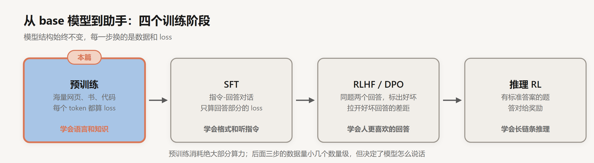
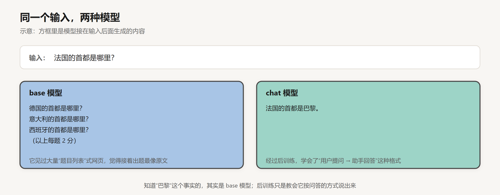
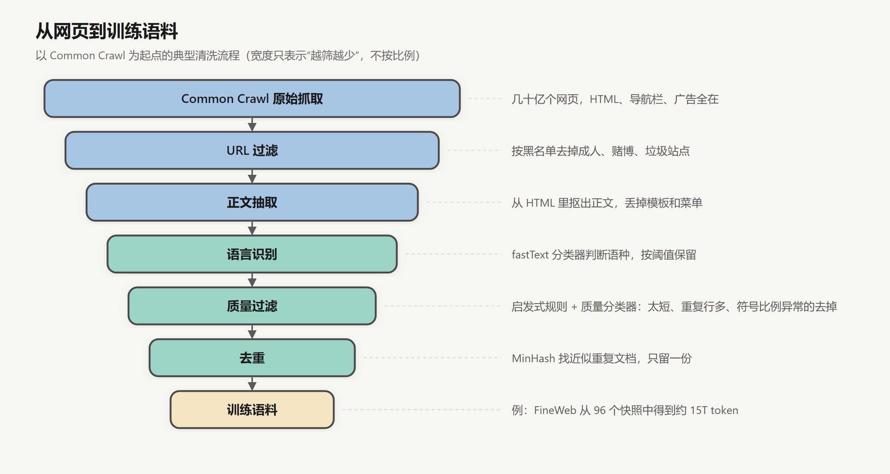
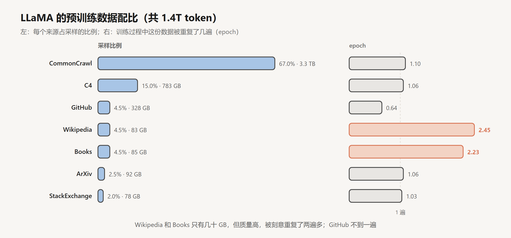
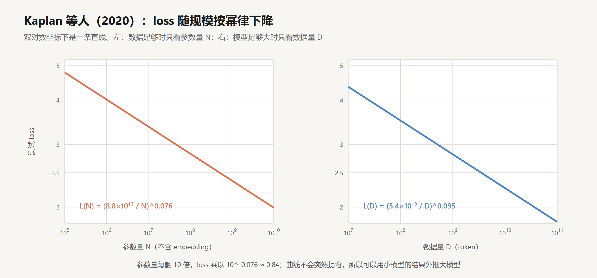
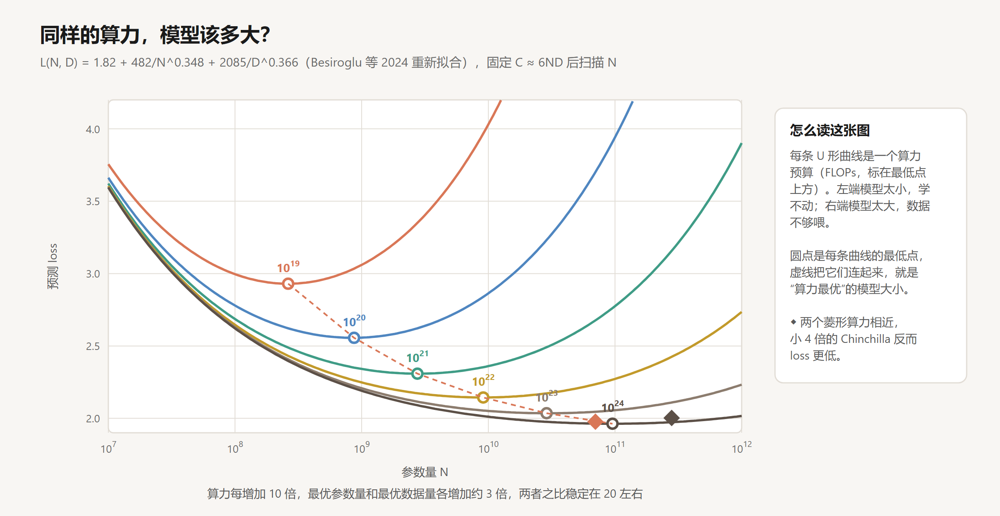
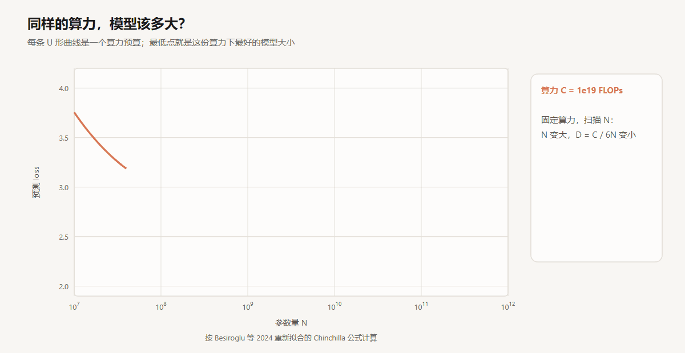
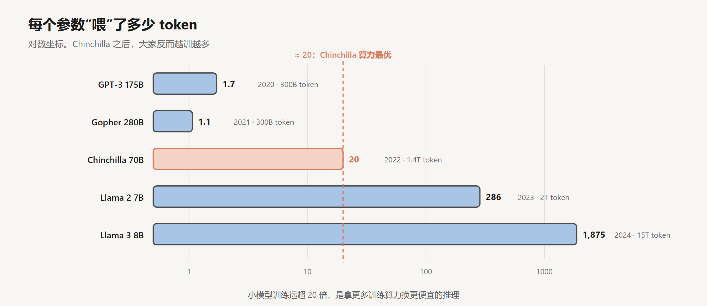

# 预训练与 Scaling Law

创建日期：2026-10-15

[Transformer 结构详解](../Transformer与大模型/02-Transformer结构详解.md) 讲了模型怎么从一段文字算出下一个 token，结尾提了一句：所有参数都来自同一个训练目标，在海量文本上预测下一个 token。这一篇把这句话展开：“海量文本”从哪来、怎么洗；训练一次要多少算力；同样的算力，模型做大一点好还是数据多一点好。最后看看预训练结束时，我们手里的 base 模型能做什么、不能做什么。

这是“大模型训练”系列的第一篇。后面三篇讲的 SFT、RLHF、推理 RL，都是在这一篇的产物上继续训练。



## 1. 一个目标，学到了什么

预训练的 loss 和 [损失函数与反向传播](../神经网络基础/02-损失函数与反向传播.md) 里讲的语言模型损失一样：对一段文本里的每个位置，模型给出下一个 token 的概率分布，取正确 token 概率的负对数，再对所有位置求平均。

$$
\mathcal{L} = -\frac{1}{T}\sum_{t=1}^{T} \log p_\theta(x_t \mid x_{<t})
$$

这个目标看着朴素，难度却没有上限。想在“法国的首都是”后面给“巴黎”高概率，模型得记住这个事实；想猜对一段 Python 函数的下一行，得大致明白代码在做什么；想猜对推理小说最后揭晓的凶手，得把前面的线索串起来。预测得越准，模型内部就越需要一个关于世界的压缩表示。知识、语法、一部分推理能力，都是被这个目标“逼”出来的。

但模型学到的始终是“这类文本接下来通常写什么”。问它一个问题，它不会觉得自己该回答，只会接着写最像原文的内容：



互联网上“一串问题排在一起”的网页（练习题、FAQ、考试卷）很多，所以 base 模型接着出题是合理的续写。它知道巴黎，只是没人教过它“看到问题就回答”。这件事留给下一篇的 SFT。

## 2. 数据

### 2.1 从网页到语料

公开资料里，几乎所有大模型的主体数据都来自 Common Crawl：一个非营利组织从 2008 年起持续抓取的网页存档，每隔一两个月放出一个快照，单个快照就有几十亿个网页。原始网页不能直接拿来训练，里面大部分是导航栏、广告、乱码、机器生成的垃圾页、成人内容和大量重复。



各家流程细节不同，大致都是上面几步：

- URL 过滤：按域名黑名单直接丢掉一批站点。
- 正文抽取：用 trafilatura 这类工具从 HTML 里取出正文。
- 语言识别：用 fastText 训练的语种分类器给每篇文档打分，低于阈值的丢掉。
- 质量过滤：一部分是手写规则，比如 Gopher 论文里的“文档少于 50 个词”“以省略号结尾的行超过 30%”“没有常见停用词”等；另一部分是训练一个分类器给文档打质量分。
- 去重：MinHash 计算文档之间的近似相似度，几乎一样的只留一份。

Hugging Face 公开的 FineWeb 是一个能完整看到每一步的例子：从 96 个 Common Crawl 快照出发，最后得到约 15T token。他们还做了一个 FineWeb-Edu，让 Llama-3-70B-Instruct 给几十万篇文档按“教育价值”打分，用这些标注训练一个小分类器，再用它去筛全量数据。筛出来的子集只有 1.3T token，在知识和推理类评测上明显好于全量数据。

去重单独说一下。Lee 等人在 2022 年检查了几个常用数据集，发现近似重复非常多，C4 里有一句 61 个词的英文重复出现了六万多次。重复数据会让模型把这些段落背下来，浪费训练预算，还增加了原样吐出训练数据的风险。去重之后，模型原样输出训练文本的频率降到原来的十分之一左右，达到同样效果需要的训练步数也更少。

### 2.2 配比

网页之外，一般还会混入代码、论文、书籍、百科、问答网站。各来源按什么比例混在一起，叫数据配比。LLaMA 第一代论文给出了完整的表：



注意右边的 epoch 列。Wikipedia 和 Books 加起来不到 200 GB，被重复训练了两遍多；体量大得多的 CommonCrawl 只过了一遍多一点。质量高的来源会被刻意上采样，这是一个很常见的做法。后来的模型普遍加大了代码和数学的比例，因为大家发现这两类数据对推理能力帮助很大，哪怕最终用途不是写代码。

配比没有公认的最优解，各家主要靠小模型实验来调：用不同配比训练一批小模型，看下游评测，再把好的配比用到大模型上。这种“先在小模型上试”的做法能成立，靠的是下一节的 Scaling Law。

## 3. 算力账

训练一个 Transformer 的总计算量有一个很好用的估算式：

$$
C \approx 6ND
$$

$N$ 是参数量，$D$ 是训练用的 token 数，$C$ 的单位是 FLOPs（浮点运算次数）。6 是这么来的：每个参数在每个 token 上，前向传播做一次乘加（2 次运算），反向传播大约是前向的两倍（4 次运算）。推导在 [损失函数与反向传播](../神经网络基础/02-损失函数与反向传播.md) 里做过，这里直接用。

代两个真实的数：

- GPT-3：$N = 175 \times 10^9$，$D = 300 \times 10^9$，$C = 6 \times 175\text{B} \times 300\text{B} \approx 3.15 \times 10^{23}$。论文里报的是 $3.14 \times 10^{23}$，几乎一样。
- Llama 2 7B：$N = 7 \times 10^9$，$D = 2 \times 10^{12}$，$C \approx 8.4 \times 10^{22}$。

Llama 2 论文报告 7B 模型用了 184,320 个 A100-80GB GPU 小时。把算力摊到每张卡每秒：

$$
\frac{8.4 \times 10^{22}}{184{,}320 \times 3600\ \text{s}} \approx 1.27 \times 10^{14}\ \text{FLOP/s} = 127\ \text{TFLOPS}
$$

A100 的 BF16 峰值是 312 TFLOPS，实际利用率大约 40%。这个比例叫 MFU（Model FLOPs Utilization），大规模训练能做到 40% 到 50% 就算不错了，剩下的时间花在通信、访存和各种等待上。

有了这个式子，“训练一个模型要花多少钱”就能在纸上估出来。反过来，手里的 GPU 数和时间定了，$C$ 也就定了。接下来的问题是：这份固定的算力，怎么在 $N$ 和 $D$ 之间分？

## 4. Scaling Law

### 4.1 loss 是可以预测的

2020 年，OpenAI 的 Kaplan 等人训练了一大批不同大小的模型，参数量从几百到十几亿，数据量和算力也各自变化，然后把测试 loss 画在双对数坐标上。结果是一条条很干净的直线：



左图是数据足够多时，loss 只取决于参数量 $N$：

$$
L(N) = \left(\frac{N_c}{N}\right)^{\alpha_N}, \quad N_c = 8.8 \times 10^{13},\ \alpha_N = 0.076
$$

右图是模型足够大时，loss 只取决于数据量 $D$，指数是 0.095。

指数 0.076 看着很小，意思是参数量翻 10 倍，loss 变成原来的 $10^{-0.076} \approx 0.84$ 倍，降 16%。每降一点都很贵。但这条线跨了五六个数量级都没有拐弯，这才是它重要的地方：用一批小模型画出直线，就能外推出大十倍、一百倍的模型 loss 大概是多少。前面说配比可以在小模型上调，依据就在这里。

Kaplan 的论文还给了一个建议：算力增加时，大部分应该花在加大模型上，数据只需要慢慢加。GPT-3 就是按这个思路做的，175B 参数只训练了 300B token。

### 4.2 Chinchilla：数据被低估了

2022 年，DeepMind 的 Hoffmann 等人重新做了这个实验，结论很不一样。他们训练了 400 多个模型，参数量从 7000 万到 160 亿，并且用了一种更直接的方法：固定一个算力预算，换不同的模型大小（数据量随之变化，保持 $6ND$ 不变），看哪个大小的 loss 最低。

他们把 loss 拟合成参数量和数据量两项之和：

$$
L(N, D) = E + \frac{A}{N^{\alpha}} + \frac{B}{D^{\beta}}
$$

$E$ 是文本本身的不确定性，再大的模型也消不掉；第二项是“模型不够大”造成的损失；第三项是“数据不够多”造成的损失。把 $D = C / 6N$ 代进去，固定 $C$ 扫描 $N$，每个算力预算得到一条 U 形曲线：



把算力预算一档一档加上去，看最低点怎么移动：



模型太小，第二项大；模型太大，分到每个参数的数据太少，第三项大。中间有个最低点。把各个预算的最低点连起来，就得到最优的 $N$ 和 $D$ 随算力怎么增长。

Hoffmann 等人的结论是：$N$ 和 $D$ 应该同比例增长，算力翻 10 倍，两者各翻约 $\sqrt{10} \approx 3.2$ 倍，最优比例大约是每个参数 20 个 token。

这张图里的系数我没有用 Chinchilla 论文原文给的那组。原文的公式拟合（论文里的第三种方法）按印出来的系数算，每个参数对应 50 到 100 个 token，和论文自己另外两种方法得到的 20 对不上。Epoch AI 的 Besiroglu 等人在 2024 年复现时指出了这个问题，他们从论文图里重新提取数据点，重新拟合出 $E=1.82,\ A=482,\ B=2085,\ \alpha=0.348,\ \beta=0.366$。用这组系数算，比例稳定在 18 到 22 之间，和“20”吻合。图上用的就是这组。

用这组系数手算一下 Chinchilla 本身。Chinchilla 是 70B 参数、1.4T token，算力：

$$
C = 6 \times 70 \times 10^9 \times 1.4 \times 10^{12} \approx 5.9 \times 10^{23}
$$

同等算力下，公式给出的最优模型大约 72B、1.33T token，几乎就是 Chinchilla 的配置。作为对比，DeepMind 之前的 Gopher 是 280B 参数、300B token，算力差不多（约 $5.0 \times 10^{23}$），在图上是右边那个深色菱形，落在曲线偏右的位置：模型太大，数据太少。实际评测里，小 4 倍的 Chinchilla 在大多数任务上都超过了 Gopher，MMLU 从 60.0% 提到了 67.6%。

这个结论意味着 GPT-3、Gopher 那一代模型普遍“训练不足”，同样的钱应该训一个小一些的模型、喂多得多的数据。

### 4.3 为什么现在的模型都“训过头”

按 Chinchilla 的比例，8B 模型训练 160B token 就够了。实际上 Llama 3 8B 训练了 15T token，是最优值的将近 100 倍。



这并不违背 Chinchilla。Chinchilla 回答的是“给定训练算力，怎样让 loss 最低”，只算了训练成本。模型训练完是要上线的，推理时每个 token 的计算量大约是 $2N$，模型越大，每次调用越贵，而且要服务成千上万次请求。如果一个模型要被调用几十亿次，花更多训练算力换一个更小、但同样好的模型，总账是划算的。

小模型多喂数据，loss 还会继续降吗？会，只是越来越慢。Llama 3 的技术报告提到，8B 和 70B 模型一直训练到 15T token，性能仍然按对数线性在提升。曲线没有饱和，只是每多花一份算力，换来的提升越来越少。

所以今天说 Scaling Law，已经很少有人直接套“20 倍”这个数了。它真正的用处在于：在花几千万美元训练之前，能用小实验把 loss 算个大概。

### 4.4 loss 降低和能力提升

还有一个容易混淆的地方：Scaling Law 预测的是 loss，不是“模型会不会做某件事”。

2022 年 Wei 等人整理了一批任务，比如多位数加法、某些推理题，小模型的正确率几乎是零，规模过了某个点突然跳上去，他们称之为“涌现”。2023 年 Schaeffer 等人反驳说，很多“突然跳上去”是评测指标造成的：完全匹配这类指标是非 0 即 1 的，模型每个 token 的正确率其实在平滑提升，乘起来过了某个阈值才显示为“会了”。换成连续的指标，曲线就变平滑了。

我更倾向后一种看法，但这不影响实际结论：loss 很好预测，具体某项能力什么时候出现，不太好预测。

## 5. 几个工程细节

预训练的优化器、学习率预热和余弦衰减、Pre-Norm 这些，在 [优化器与训练技巧](../神经网络基础/03-优化器与训练技巧.md) 里讲过。这里补三点预训练特有的。

**上下文长度分阶段拉长。** 注意力的计算量随序列长度平方增长，所以大部分 token 是在短上下文（比如 8K）下训练的，最后再用一小部分数据把上下文扩到 128K，同时调整 RoPE 的频率参数。Llama 3 就是这么做的。

**退火阶段换数据。** 训练快结束、学习率降到很低时，把数据换成质量更高的一小批（精选网页、数学、代码），能在评测上再提一截。Llama 3 和不少后来的模型都用了这个做法。

**loss spike。** 大模型训练中 loss 偶尔会突然跳高，有时自己回落，有时直接发散。常见的处理是回退到之前的检查点、跳过出问题的那批数据、调小学习率重新跑。这部分主要靠经验，论文里通常只有一两句话带过。

## 6. 预训练结束时，手里有什么

一个 base 模型。它见过的文本比任何人一辈子能读的都多，语言、知识、代码、一部分推理能力都在参数里。

它能做的事，GPT-3 论文已经展示过：给几个例子（few-shot），它就能照着格式往下写。比如：

```
英文：cheese → 法文：fromage
英文：apple → 法文：pomme
英文：book → 法文：
```

base 模型大概率会接上 `livre`。这叫 in-context learning，没有更新任何参数，模型只是从上下文里认出了“这是一个翻译列表”。

它做不好的事也很明显：

- 不会稳定地遵循指令，经常接着出题、跑题，或者写着写着停不下来；
- 不知道自己是一个“助手”，没有对话的概念；
- 有害内容和有用内容一视同仁，网上有什么，它就可能续写出什么。

这些都不是知识的问题，是格式和行为的问题。下一篇的 SFT 用几万条示范对话来教它，数据量不到预训练的万分之一。

## 小结

- 预训练只有一个目标：预测下一个 token。知识和能力都是为了把这件事做好而学出来的副产品，所以 base 模型只会续写，不会回答。
- 数据方面，网页要经过 URL 过滤、正文抽取、语言识别、质量过滤、去重；高质量来源会被上采样，代码和数学的比例越来越高。
- 训练算力约等于 $6ND$。用这个式子可以把 GPU 小时、MFU、训练成本放在一起算。
- Scaling Law 说明 loss 随规模的变化平滑、可预测。Chinchilla 给出的训练最优比例约为每参数 20 token；考虑推理成本后，现在的小模型普遍远超这个比例。

## 参考

- Kaplan et al., 2020. *Scaling Laws for Neural Language Models*. [arXiv:2001.08361](https://arxiv.org/abs/2001.08361)
- Brown et al., 2020. *Language Models are Few-Shot Learners*. [arXiv:2005.14165](https://arxiv.org/abs/2005.14165)
- Rae et al., 2021. *Scaling Language Models: Methods, Analysis & Insights from Training Gopher*. [arXiv:2112.11446](https://arxiv.org/abs/2112.11446)
- Hoffmann et al., 2022. *Training Compute-Optimal Large Language Models*. [arXiv:2203.15556](https://arxiv.org/abs/2203.15556)
- Besiroglu et al., 2024. *Chinchilla Scaling: A replication attempt*. [arXiv:2404.10102](https://arxiv.org/abs/2404.10102)
- Lee et al., 2022. *Deduplicating Training Data Makes Language Models Better*. [arXiv:2107.06499](https://arxiv.org/abs/2107.06499)
- Touvron et al., 2023. *LLaMA: Open and Efficient Foundation Language Models*. [arXiv:2302.13971](https://arxiv.org/abs/2302.13971)
- Touvron et al., 2023. *Llama 2: Open Foundation and Fine-Tuned Chat Models*. [arXiv:2307.09288](https://arxiv.org/abs/2307.09288)
- Penedo et al., 2024. *The FineWeb Datasets: Decanting the Web for the Finest Text Data at Scale*. [arXiv:2406.17557](https://arxiv.org/abs/2406.17557)
- Llama Team, 2024. *The Llama 3 Herd of Models*. [arXiv:2407.21783](https://arxiv.org/abs/2407.21783)
- Wei et al., 2022. *Emergent Abilities of Large Language Models*. [arXiv:2206.07682](https://arxiv.org/abs/2206.07682)
- Schaeffer et al., 2023. *Are Emergent Abilities of Large Language Models a Mirage?* [arXiv:2304.15004](https://arxiv.org/abs/2304.15004)
