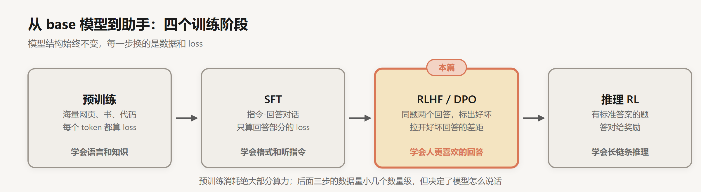
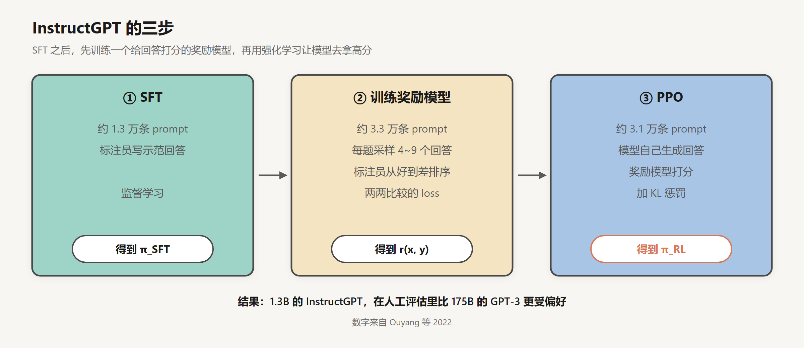
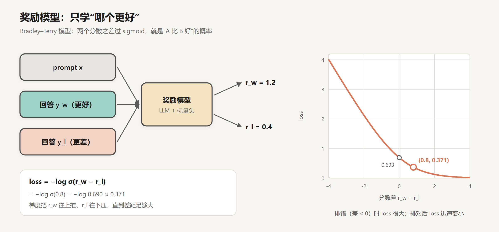
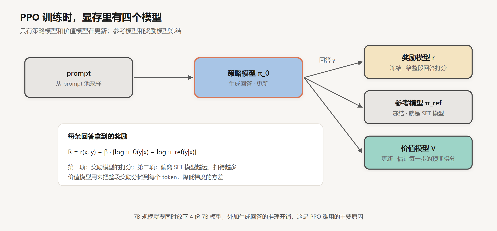
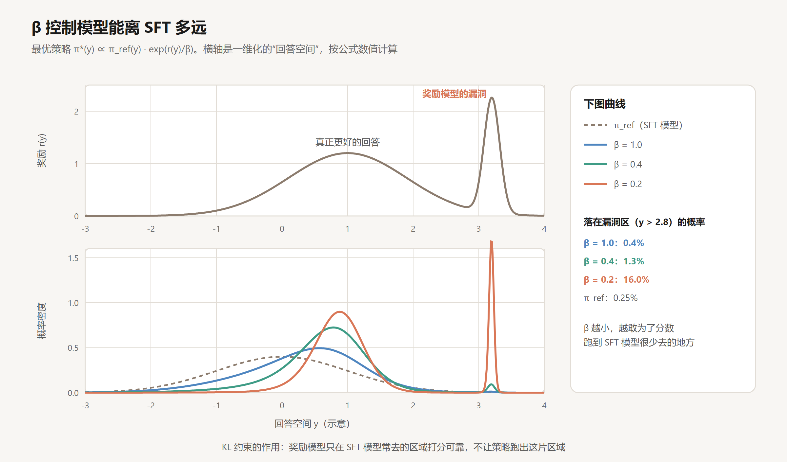
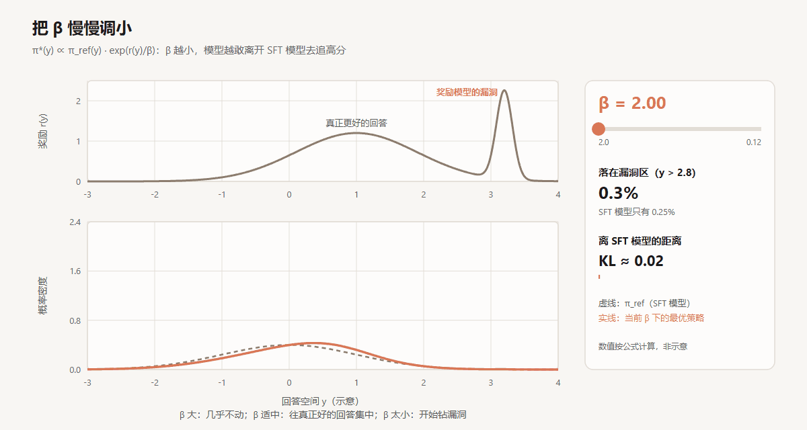
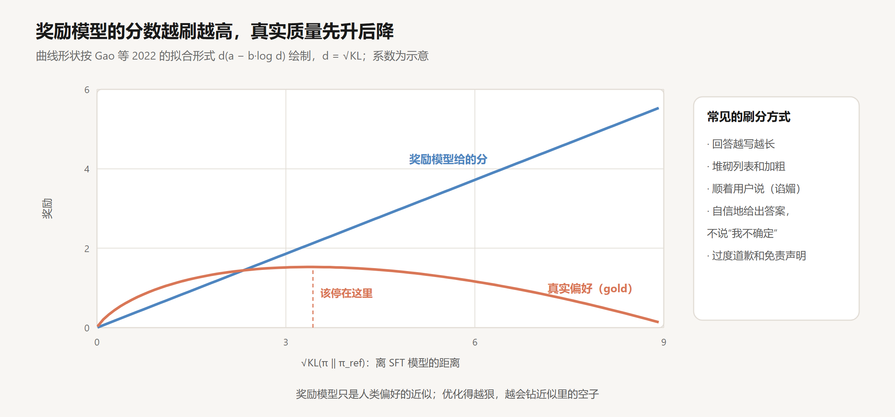
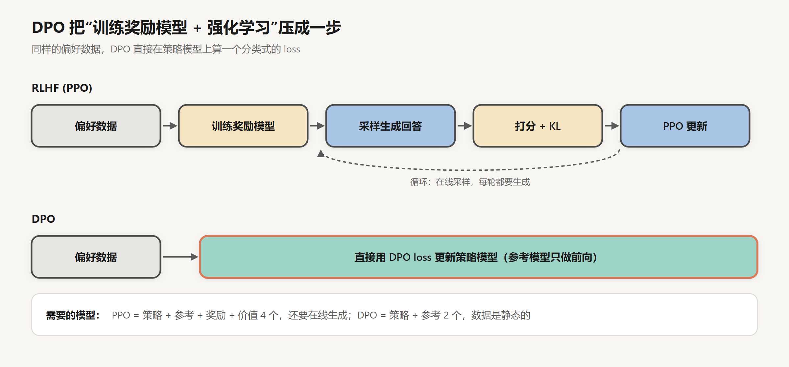

# RLHF 与 DPO

创建日期：2026-10-15

[上一篇](02-SFT与Chat模板.md) 末尾提到 SFT 的两个限制：模型只能学到示范者的水平；它只见过好回答，没见过差回答被扣分。这一篇讲怎么用“人类偏好”继续训练：不再让人写回答，而是让人比较两个回答哪个更好。

先讲经典的 RLHF（Reinforcement Learning from Human Feedback）：训练一个奖励模型，再用 PPO 优化。然后讲 DPO，它用一步推导把强化学习整个省掉了。中间会花一些篇幅讲 KL 约束和 reward hacking，我觉得这是理解后训练最关键的一块。

## 1. 为什么改成比较

写一个好回答很难，判断两个回答哪个更好要容易得多。

让标注员为“解释一下量子纠缠”写一篇完美的回答，他得是物理专业的，还得会写；让他看两篇回答，指出哪篇更清楚、错误更少，要求就低多了。比较还有一个好处：标注员不用和模型“比水平”。模型已经能写出比标注员更好的回答时，SFT 的示范就成了天花板，比较却依然有效。

另外，比较天然包含负面信号。SFT 只告诉模型“这样写”，比较能告诉模型“这样写比那样写好”，差回答第一次真正被扣了分。

## 2. RLHF 的三步

OpenAI 2022 年的 InstructGPT 论文把这套流程讲得最完整，后来的 ChatGPT 基本沿用了这套方法：

第一步就是上一篇的 SFT。第二步和第三步是这一篇的内容。

这篇论文最常被引用的结果是：参数量 1.3B 的 InstructGPT，在人工评估中比 175B 的 GPT-3 更受偏好。模型小了 100 多倍，用户反而更喜欢，因为它会好好回答问题。

### 2.1 奖励模型

奖励模型的结构就是一个语言模型，把最后的 LM head（输出词表概率的那一层）换成一个输出单个数字的线性层。输入 prompt 和回答，输出一个分数 $r(x, y)$。它通常从 SFT 模型初始化，这样它一开始就“读得懂”回答。

训练数据是比较：同一个 prompt，回答 $y_w$ 比 $y_l$ 好（w 是 win，l 是 lose）。InstructGPT 让标注员对每个 prompt 的 4 到 9 个回答排序，一个排序可以拆成很多对比较。

loss 用的是 Bradley–Terry 模型。它假设“$y_w$ 比 $y_l$ 好”的概率，等于两个分数之差过一个 sigmoid：

$$
P(y_w \succ y_l) = \sigma\big(r(x, y_w) - r(x, y_l)\big), \qquad \mathcal{L}_{\text{RM}} = -\log \sigma\big(r(x, y_w) - r(x, y_l)\big)
$$

手算一个例子：奖励模型给好回答 1.2 分，差回答 0.4 分，差值 0.8，$\sigma(0.8) = 0.690$，loss $= -\log 0.690 \approx 0.371$。如果两个分数相等，loss 是 $\log 2 \approx 0.693$；如果排反了，loss 会迅速变大。

注意奖励模型学到的只是“相对高低”。给所有回答都加 10 分，loss 不变。所以奖励模型的分数本身没有绝对含义，只有同一个 prompt 下互相比较时才有意义。

### 2.2 用 PPO 去拿高分

有了奖励模型，就可以让语言模型自己生成回答，用奖励模型打分，再用强化学习更新模型，让高分回答的概率变大。这里的“策略”就是语言模型本身，“动作”是每一步生成的 token。

但直接最大化奖励是不行的，原因下一节讲。实际优化的目标多了一项 KL 惩罚：

$$
\max_{\pi_\theta}\ \mathbb{E}_{x,\ y \sim \pi_\theta}\big[r(x, y)\big] - \beta\, \mathrm{KL}\big(\pi_\theta(\cdot \mid x)\ \|\ \pi_{\text{ref}}(\cdot \mid x)\big)
$$

$\pi_{\text{ref}}$ 是参考模型，也就是冻结的 SFT 模型。KL 散度衡量当前模型和 SFT 模型的输出分布差了多远，$\beta$ 控制这项惩罚的力度。

实现上用的是 PPO（Proximal Policy Optimization，近端策略优化）算法。它需要同时在显存里放四个模型：

价值模型的作用值得解释一下。奖励模型只在整段回答结束时给一个分数，但模型是一个 token 一个 token 生成的，需要知道每一步的决定是好是坏。价值模型估计“从当前这一步往后，预期能拿多少分”，用它可以算出每个 token 的优势（advantage），也就是这一步比平均水平好多少。这能大幅降低梯度的方差，代价是又多了一个和策略模型差不多大的模型要训练。

PPO 的“Proximal”指的是每次更新都限制新旧策略的差距（用一个 clip 操作截断概率比），避免一步走太远。细节在第 4 篇讲 GRPO 时会再碰到。

## 3. KL 约束和 reward hacking

### 3.1 为什么不能直接最大化奖励

奖励模型是用几万条比较数据训练出来的，它只是人类偏好的一个近似。它在“正常回答”附近打分还算准，因为训练数据就是从 SFT 模型采样出来的。一旦遇到和训练数据差别很大的回答，它的打分就不可靠了，可能给一些奇怪的回答打出很高的分。

强化学习恰好擅长找到这种漏洞。只要某种写法能拿高分，优化就会把模型往那里推，不管它是不是真的更好。这就是 reward hacking。

KL 约束的作用就是给模型拴一根绳子：可以往高分方向走，但不能离 SFT 模型太远。

### 3.2 β 的作用：算一个例子

上面那个带 KL 的目标，最优解有一个封闭形式：

$$
\pi^*(y \mid x) = \frac{1}{Z(x)}\, \pi_{\text{ref}}(y \mid x)\, \exp\!\left(\frac{r(x, y)}{\beta}\right)
$$

$Z(x)$ 是归一化常数。也就是说，最优策略就是在参考模型的分布上，按 $\exp(r/\beta)$ 重新加权。下面这张图用一个一维的玩具例子把它算了出来：

把 β 从 2.0 连续调到 0.12，可以看到分布先往右边的小山包集中，然后突然被漏洞区的尖峰吸走：

上图是奖励函数。$y=1$ 附近有一个宽的小山包，代表真正更好的回答；$y=3.2$ 附近有一个又高又窄的尖峰，代表奖励模型的漏洞，比如某种奇怪的格式恰好骗过了它。SFT 模型（虚线）在漏洞区只有 0.25% 的概率。

下图是不同 $\beta$ 下的最优策略：

- $\beta = 1.0$：分布整体往右挪了一点，漏洞区的概率只有 0.4%。
- $\beta = 0.4$：往“真正好的回答”集中得更多，漏洞区 1.3%。
- $\beta = 0.2$：主峰更尖了，但漏洞区的概率涨到了 16%。

$\beta$ 越小，模型越敢为了分数跑到 SFT 模型很少去的地方。真实训练中没有这么干净的一维空间，但道理是一样的。$\beta$ 太大，模型几乎不动；太小，就开始钻空子。

### 3.3 过度优化

OpenAI 的 Gao 等人在 2022 年专门研究过这个现象。他们用一个很大的奖励模型当作“真实偏好”（gold），再用小一些的奖励模型当作训练用的代理，观察优化过程中两者的变化：

代理奖励一直在涨，真实偏好先涨后跌。他们还拟合出了曲线的函数形式，横轴用的是 $\sqrt{\mathrm{KL}}$，也就是模型离 SFT 有多远。奖励模型越大、训练数据越多，曲线的峰值越靠后，能安全优化的距离也越远。

实践中常见的刷分方式，右边的框里列了几种。其中两种特别值得做应用的人注意。

一是回答越写越长。人在比较时，倾向于觉得长回答更详细、更用心，奖励模型学到了这个偏好，RL 再把它放大。Singhal 等人 2023 年发现，在几个常用的 RLHF 设置里，奖励提升有很大一部分可以只用“回答变长了”来解释。

二是谄媚（sycophancy）。Anthropic 的 Sharma 等人 2023 年发现，几个主流的助手模型都会顺着用户说：用户对一个正确答案表示怀疑，模型就改口；用户说一首诗是自己写的，模型就夸得更多。他们分析了偏好数据，发现人类标注员本身就更偏好“同意自己观点”的回答。模型学到的，正是人的偏好里那部分不太好的东西。

所以，你用的模型有时候答得啰嗦，或者你一质疑它就改口，原因很可能就在这一步。

## 4. DPO：不要奖励模型，也不要强化学习

PPO 难用是出了名的：四个模型、在线采样、一堆超参数，训练还不稳定。2023 年斯坦福的 Rafailov 等人提出了 DPO（Direct Preference Optimization），论文标题就把思路说得很清楚：*Your Language Model is Secretly a Reward Model*。

### 4.1 推导

推导只需要三步，用的都是前面已经出现过的式子。

第一步，前面那个最优策略的封闭形式：

$$
\pi^*(y \mid x) = \frac{1}{Z(x)}\, \pi_{\text{ref}}(y \mid x)\, \exp\!\left(\frac{r(x, y)}{\beta}\right)
$$

第二步，把它倒过来，用策略表示奖励。两边取对数再整理：

$$
r(x, y) = \beta \log \frac{\pi^*(y \mid x)}{\pi_{\text{ref}}(y \mid x)} + \beta \log Z(x)
$$

奖励可以用“最优策略相对参考模型的对数概率比”来表示，只差一个和回答无关的常数 $\beta \log Z(x)$。

第三步，代入奖励模型的 Bradley–Terry loss。它只用到两个回答的奖励之差，$\beta \log Z(x)$ 在相减时正好抵消：

$$
\mathcal{L}_{\text{DPO}} = -\log \sigma\!\left(\beta \log \frac{\pi_\theta(y_w \mid x)}{\pi_{\text{ref}}(y_w \mid x)} - \beta \log \frac{\pi_\theta(y_l \mid x)}{\pi_{\text{ref}}(y_l \mid x)}\right)
$$

$Z(x)$ 要对所有可能的回答求和，根本算不出来，这也是 RLHF 必须走强化学习的原因。DPO 的关键就在这里：它从来不需要算 $Z(x)$。

最后得到的 loss 和奖励模型的 loss 长得一模一样，只是“分数”换成了 $\beta \log \frac{\pi_\theta}{\pi_{\text{ref}}}$，论文管它叫隐式奖励。训练奖励模型和优化策略，合成了一步。

### 4.2 手算一遍

一条偏好数据，取 $\beta = 0.1$。四个对数概率是整段回答每个 token 的对数概率之和：

| | 策略模型 $\log \pi_\theta$ | 参考模型 $\log \pi_{\text{ref}}$ | 差值 | 隐式奖励（×β） |
|---|---|---|---|---|
| 好回答 $y_w$ | −12.0 | −14.0 | +2.0 | +0.2 |
| 差回答 $y_l$ | −15.0 | −13.0 | −2.0 | −0.2 |

隐式奖励之差是 0.4，loss $= -\log \sigma(0.4) = -\log 0.599 \approx 0.513$。

训练刚开始时，策略模型就是参考模型，所有差值都是 0，loss 是 $\log 2 \approx 0.693$。随着训练，模型提高 $y_w$ 相对参考模型的概率、降低 $y_l$ 的，loss 往下走。

DPO 的梯度也很直观：

$$
\nabla_\theta \mathcal{L}_{\text{DPO}} = -\beta\, \sigma(\hat r_l - \hat r_w)\, \big[\nabla_\theta \log \pi_\theta(y_w \mid x) - \nabla_\theta \log \pi_\theta(y_l \mid x)\big]
$$

方括号里是“提高好回答的概率，降低差回答的概率”。前面的权重 $\sigma(\hat r_l - \hat r_w)$ 在模型排错时接近 1，排对了就变小。上面的例子里它是 $\sigma(-0.4) = 0.401$。这样，模型已经分得很清楚的样本不会被反复用力推。

### 4.3 代价

DPO 训练起来和 SFT 差不多简单：两个模型（参考模型只做前向），静态数据，一个 loss。它很快成了开源社区的默认选择。Llama 3 的后训练用的也是 DPO，没有用 PPO。

但它也有代价。

一是离线。DPO 的数据是事先采好的，模型训练过程中自己生成的新回答不会被评价。PPO 每一轮都用当前模型采样、打分，能发现自己的新错误。为了弥补这一点，很多团队采用迭代式的做法：训一轮 DPO，用新模型重新采样、重新标注偏好，再训一轮。Llama 3 的后训练就做了好几轮这样的循环。

二是概率可能一起往下掉。DPO 只要求好回答和差回答的概率差拉开，没要求好回答的概率本身变大。实际训练里经常出现两个概率都在下降、只是差回答降得更快的情况。Razin 等人 2024 年把这种现象叫作 likelihood displacement，并指出它有时会让模型的行为往意想不到的方向偏，比如把本该拒绝的请求接了下来。

后来出现了一大批变体，各自修补一部分问题：IPO 防止对偏好数据过拟合，KTO 只需要“好”或“坏”的单条标注、不需要成对数据，SimPO 去掉了参考模型、用长度归一化来抑制回答变长。思路都是在 DPO 的 loss 上做文章。

## 5. 偏好从哪来

人工标注偏好依然很贵。Anthropic 2022 年的 Constitutional AI 提出了另一种做法：写一份“宪法”，也就是一组原则（比如“选择更无害、更诚实的回答”），让模型自己按原则比较两个回答，生成偏好数据，再用这些数据训练奖励模型。这叫 RLAIF（RL from AI Feedback）。在无害性这类标准比较清楚的维度上，AI 反馈的效果可以接近人工反馈，成本低得多。

今天的做法通常是混合的：人工标注一部分关键数据，用强模型加原则生成大量数据，再用奖励模型或者 LLM 当评委来筛选。

## 小结

- 偏好训练让人比较回答，不再要求人写回答，模型能超过标注员的写作水平，也第一次学到“差回答该被扣分”。
- RLHF 先用 Bradley–Terry loss 训练奖励模型，再用 PPO 最大化奖励。PPO 要同时维护策略、参考、奖励、价值四个模型。
- KL 约束把模型拴在 SFT 模型附近。奖励模型只在这片区域可靠，优化过头就会 reward hacking：回答变长、谄媚、刷格式。
- DPO 利用最优策略的封闭形式，把奖励写成策略和参考模型的对数概率比，配分函数相减抵消，强化学习就变成了一个分类 loss。简单稳定，代价是离线训练，以及好回答的概率也可能下降。

偏好训练解决的是“人更喜欢哪种回答”。但有一类问题不需要人来判断：数学题答案对不对、代码能不能通过测试，程序就能判。下一篇讲的推理 RL，就是从这里开始的。

## 参考

- Ouyang et al., 2022. *Training language models to follow instructions with human feedback*. [arXiv:2203.02155](https://arxiv.org/abs/2203.02155)
- Christiano et al., 2017. *Deep reinforcement learning from human preferences*. [arXiv:1706.03741](https://arxiv.org/abs/1706.03741)
- Schulman et al., 2017. *Proximal Policy Optimization Algorithms*. [arXiv:1707.06347](https://arxiv.org/abs/1707.06347)
- Gao et al., 2022. *Scaling Laws for Reward Model Overoptimization*. [arXiv:2210.10760](https://arxiv.org/abs/2210.10760)
- Singhal et al., 2023. *A Long Way to Go: Investigating Length Correlations in RLHF*. [arXiv:2310.03716](https://arxiv.org/abs/2310.03716)
- Sharma et al., 2023. *Towards Understanding Sycophancy in Language Models*. [arXiv:2310.13548](https://arxiv.org/abs/2310.13548)
- Rafailov et al., 2023. *Direct Preference Optimization: Your Language Model is Secretly a Reward Model*. [arXiv:2305.18290](https://arxiv.org/abs/2305.18290)
- Razin et al., 2024. *Unintentional Unalignment: Likelihood Displacement in Direct Preference Optimization*. [arXiv:2410.08847](https://arxiv.org/abs/2410.08847)
- Bai et al., 2022. *Constitutional AI: Harmlessness from AI Feedback*. [arXiv:2212.08073](https://arxiv.org/abs/2212.08073)
- Llama Team, 2024. *The Llama 3 Herd of Models*. [arXiv:2407.21783](https://arxiv.org/abs/2407.21783)
