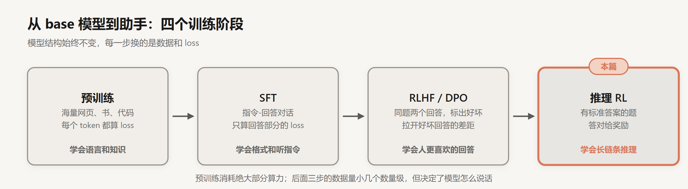
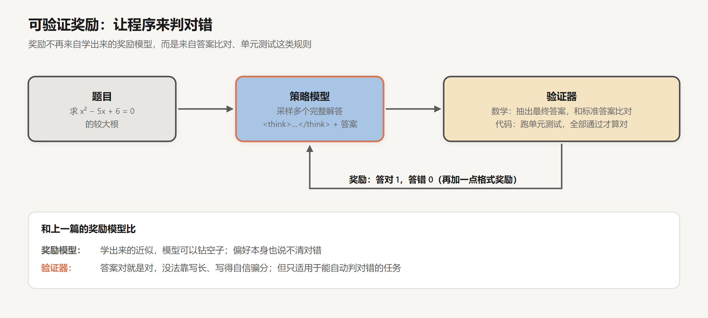
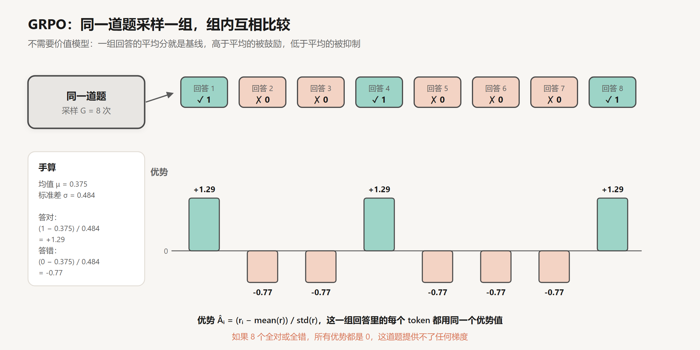
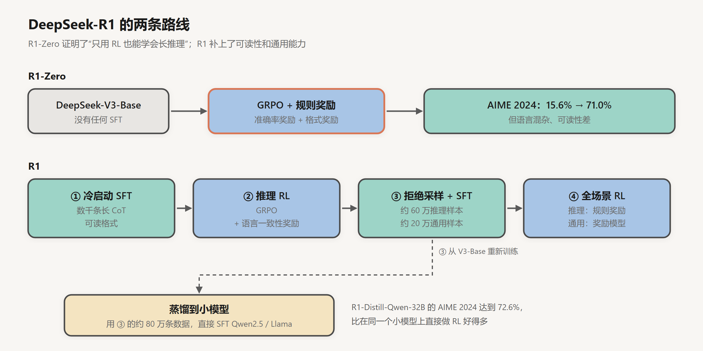
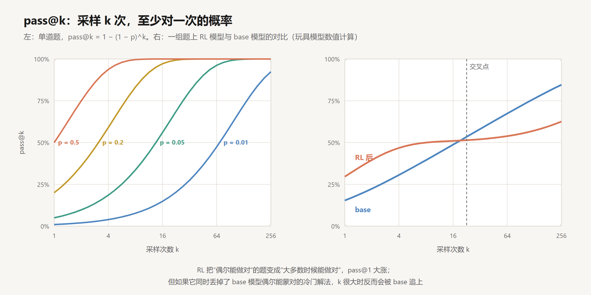

# 推理模型与强化学习

创建日期：2026-10-15

2024 年 9 月 OpenAI 发布 o1，2025 年 1 月 DeepSeek 发布 R1。这类模型回答前会先“想”很久，输出几千甚至上万个 token 的思考过程，在数学竞赛和编程题上的成绩比之前的模型高出一大截。

它们的结构和普通的 chat 模型没有区别，变的是训练方法。[上一篇](03-RLHF与DPO.md) 的 RLHF 用奖励模型模拟人的偏好；这一篇的强化学习换了一种奖励：答案对不对，交给程序来判。这篇讲这种奖励怎么用，GRPO 算法怎么算，DeepSeek-R1 的训练过程，以及“让模型多想一会儿”到底换来了什么。



## 1. 可验证奖励

### 1.1 让程序判对错

数学题有标准答案，代码有单元测试。这类任务不需要人来判断好坏，写个程序就能自动打分：



这种做法后来被叫作 RLVR（Reinforcement Learning with Verifiable Rewards），名字来自 2024 年 AI2 的 Tülu 3 技术报告，但思路更早就有人在用。

和上一篇的奖励模型相比，规则奖励最大的好处是没法糊弄。奖励模型是学出来的近似，模型可以把回答写长、写得更自信来骗分；规则奖励只看最终答案，答案错了，过程写得再漂亮也是 0 分。DeepSeek 在 R1 论文里明确说，他们做推理任务时没有用神经网络奖励模型，就是因为担心大规模 RL 中出现 reward hacking，而且重新训练奖励模型会让流程复杂很多。

代价是适用范围窄。“写一首好诗”“这个建议是否中肯”都没法用程序判，所以推理 RL 主要用在数学、代码、逻辑题这类有明确答案的任务上。有意思的是，在这些任务上练出来的推理习惯，会有一部分迁移到其他任务上。

### 1.2 奖励只看结果

注意，奖励只看最终答案，不看中间步骤。模型写了五千个 token 的推导，只要最后的数对了就拿 1 分。

这听起来很粗糙。一段很长的推理里，哪一步是关键的、哪一步是错的又被纠正了，模型都不知道，只知道整体结果。人们早就尝试过给每一步打分的过程奖励模型（PRM），但 DeepSeek 在 R1 论文的“失败的尝试”一节里写到：一般的推理里，“一步”很难定义；判断中间某一步是否正确也很难，人工标注没法扩展，自动标注又不准；而且只要引入神经网络奖励模型，reward hacking 就又回来了。

最后效果最好的反而是最简单的方法：只看结果，靠大量采样让模型自己摸索出哪些推理方式更容易得到正确答案。

## 2. GRPO

### 2.1 PPO 的麻烦

上一篇讲过，PPO 需要一个价值模型来估计每一步的预期得分，用来降低梯度方差。价值模型和策略模型差不多大，显存和计算都要多一份。在推理任务上还有一个额外的问题：回答长达上万个 token，奖励只在最后给一次，价值模型很难准确估计中间某个 token 的“预期得分”。

### 2.2 用组内平均分当基线

DeepSeek 在 2024 年的 DeepSeekMath 论文里提出了 GRPO（Group Relative Policy Optimization，组相对策略优化），去掉了价值模型。做法是：同一道题采样一组回答（比如 8 个），用这一组的平均得分作为基线。



一轮的完整过程：


每个回答的优势（advantage）是它的奖励减去组内均值，再除以组内标准差：

$$
\hat A_i = \frac{r_i - \mathrm{mean}(r_1, \dots, r_G)}{\mathrm{std}(r_1, \dots, r_G)}
$$

手算图里的例子。8 个回答中有 3 个答对，奖励是 $[1, 0, 0, 1, 0, 0, 0, 1]$：

- 均值 $\mu = 3/8 = 0.375$
- 标准差 $\sigma = \sqrt{0.375 \times 0.625} \approx 0.484$
- 答对的回答：$\hat A = (1 - 0.375) / 0.484 \approx +1.29$
- 答错的回答：$\hat A = (0 - 0.375) / 0.484 \approx -0.77$

这一组的优势加起来是 0。答对的 3 个回答里每个 token 的概率被往上推，答错的 5 个往下压。整段回答里的所有 token 共用同一个优势值。

直觉上，这就是“和同学比”。一道题大家都做对了，做对不值得奖励；大部分人做错、你做对了，才值得大力鼓励。

### 2.3 完整的目标函数

剩下的部分和 PPO 一样：用新旧策略的概率比乘以优势，并用 clip 限制每次更新的幅度；再加上一项和参考模型的 KL 惩罚。

$$
\mathcal{J}(\theta) = \mathbb{E}\left[\frac{1}{G}\sum_{i=1}^{G}\frac{1}{|o_i|}\sum_{t=1}^{|o_i|} \min\Big(\rho_{i,t}\hat A_i,\ \mathrm{clip}(\rho_{i,t}, 1-\varepsilon, 1+\varepsilon)\,\hat A_i\Big) - \beta\, \mathrm{KL}\big(\pi_\theta \,\|\, \pi_{\text{ref}}\big)\right]
$$

$o_i$ 是第 $i$ 个回答，$|o_i|$ 是它的 token 数，$\rho_{i,t} = \pi_\theta(o_{i,t} \mid q, o_{i,<t}) / \pi_{\theta_{\text{old}}}(o_{i,t} \mid q, o_{i,<t})$ 是第 $t$ 个 token 在新旧策略下的概率比。clip 的意思是：概率比超出 $[1-\varepsilon, 1+\varepsilon]$ 的部分不再产生梯度，一次更新不会把某个 token 的概率改得太猛。

### 2.4 一组全对或全错，就白算了

图下方那句红字是 GRPO 的一个实际问题：如果 8 个回答全对或者全错，所有优势都是 0，这道题算了 8 次完整的长回答，却一点梯度都没有。题太简单或太难，都在浪费算力。

2025 年字节跳动的 DAPO 针对这个问题和其他几处细节做了改进，几个改动都很实用：

- 动态采样：把全对、全错的组过滤掉，继续采样，直到 batch 里都是有效的题。
- 非对称 clip：把 clip 的上界放宽（比如下界 0.2、上界 0.28），让低概率的 token 有机会被大幅提升，避免模型过早地只会一种解法。
- token 级别的 loss 平均：上面公式里先在每个回答内部按长度平均，再在组内平均，长回答里每个 token 的权重就被稀释了。改成所有 token 一起平均。
- 对超长回答的惩罚做平滑处理，不要一刀切。

同年 Liu 等人的 Dr. GRPO 也指出，按回答长度归一化和按标准差归一化都会引入偏差：前者会让模型在答错时倾向于写得更长（错误回答越长，每个 token 分到的惩罚越小），后者会让模型过度关注太简单或太难的题。

这些都是 2025 年社区在复现 R1 时一点点踩出来的坑。

## 3. DeepSeek-R1

### 3.1 R1-Zero：只用 RL

DeepSeek-R1 论文里最让人意外的是 R1-Zero：直接拿 DeepSeek-V3-Base（预训练完、没做任何 SFT 的 base 模型），用 GRPO 和规则奖励训练，不给任何推理示范。

训练用的 prompt 模板很简单，大意是：

```
用户和助手之间的对话。用户提出问题，助手解决它。
助手先在脑中思考推理过程，再给出答案。
推理过程和答案分别放在 <think> </think> 和 <answer> </answer> 标签内。
User: {问题}
Assistant:
```

奖励只有两部分：答案对不对（准确率奖励），以及有没有按格式把思考放进 `<think>` 标签里（格式奖励）。

结果，R1-Zero 在 AIME 2024（美国数学邀请赛）上的 pass@1 从训练开始时的 15.6% 涨到了 71.0%；每题采样 64 次再多数投票，能达到 86.7%。

更有意思的是训练过程中的现象。论文报告，随着训练进行，回答的平均长度持续增长，从几百个 token 一路涨到上万个 token。没人教过它“多想一会儿”，它自己发现更长的思考更容易拿到奖励。模型还自发出现了反思和回头检查的行为。论文里展示了一段中间检查点的输出，模型解到一半停下来写道：

> Wait, wait. Wait. That's an aha moment I can flag here.

然后重新审视前面的步骤。作者把它叫作 aha moment。

这件事的意义在于：长链条推理、自我检查、换一种方法再试，这些能力不需要人一条条示范，只要奖励信号对，模型自己会长出来。当然，这建立在 base 模型足够强的前提上，DeepSeek-V3 本身是一个 671B 参数的 MoE 模型。

### 3.2 R1：补上可读性

R1-Zero 的问题是输出很难读：中英文混杂，格式混乱。正式的 R1 加了几个阶段：



1. 冷启动：先收集几千条格式规整、可读性好的长思维链数据，做一轮 SFT。
2. 推理 RL：和 R1-Zero 一样的 GRPO，额外加了一个语言一致性奖励（思考过程里目标语言的词占多少比例）。这个奖励让推理成绩略有下降，但输出更符合人的阅读习惯。
3. 拒绝采样 + SFT：用第 2 步的模型对大量题目采样，只保留答案正确、格式良好的回答，得到约 60 万条推理数据；再加上约 20 万条写作、问答等通用数据，从 V3-Base 重新做一次 SFT。
4. 全场景 RL：推理题继续用规则奖励，通用任务用奖励模型评估有用性和无害性。

最终 R1 在 AIME 2024 上达到 79.8%。

### 3.3 蒸馏比在小模型上直接 RL 更好

R1 论文还做了一件很实用的事：用第 3 步的约 80 万条数据，直接对 Qwen2.5 和 Llama 系列的小模型做 SFT，不做任何 RL。蒸馏出来的 R1-Distill-Qwen-32B 在 AIME 2024 上达到 72.6%。

作为对照，他们在同一个 Qwen-32B base 模型上直接做了大规模 RL，只达到 47.0%。

这说明，小模型自己通过 RL 很难摸索出大模型那样的推理模式，但它可以通过模仿大模型的推理过程学会。对资源有限的团队来说，结论很直接：先蒸馏，再考虑 RL。

## 4. 多想一会儿换来了什么

### 4.1 test-time compute

传统的 Scaling Law 讲的是训练算力：模型越大、数据越多，效果越好。o1 带来的新维度是推理时的算力：同一个模型，允许它在回答前生成更多 token，效果也会变好。OpenAI 发布 o1 时展示了两条曲线，训练时的 RL 算力和推理时的思考算力，横轴取对数，准确率都随之平稳上升。

增加推理算力的方式不只是拉长思考，还有采样多次：

- 多数投票（self-consistency）：采样多个回答，取出现最多的答案。R1-Zero 的 86.7% 就是这么来的。
- best-of-N：采样多个回答，用验证器或奖励模型选最好的。

Snell 等人 2024 年的研究发现，对于中等难度的题，把同样的算力花在推理时（多采样、多修改），在 FLOPs 相同的比较下，可以胜过一个大 14 倍的模型。但对于模型根本不会的难题，推理时花再多算力也没用，还是得靠更强的基础模型。

### 4.2 pass@k：RL 到底教会了什么

这里有一个值得想一想的问题：RL 是让模型学会了新的解题能力，还是只是让它更稳定地发挥已有的能力？

衡量这个问题常用 pass@k：每道题采样 $k$ 次，至少有一次答对的概率。如果单次答对的概率是 $p$，那么 $\text{pass@}k = 1 - (1-p)^k$。



左图是单道题的情况。即使 $p$ 只有 1%，采样 256 次也有 92% 的概率至少对一次。

Yue 等人 2025 年做了一个实验：在多个模型和数据集上，对比 RL 前后的 pass@k。结果是，$k$ 小的时候 RL 模型明显更好；但 $k$ 很大时，base 模型会追上，甚至反超。右图用一个玩具模型展示了这种现象：RL 把 base 模型“偶尔能做对”的题变成了“大多数时候能做对”，pass@1 大涨；但对于 base 模型只有极低概率蒙对的题，RL 模型反而更少去尝试那些解法。

他们的解读是：至少在他们的实验设置下，RLVR 主要是在 base 模型已有的能力范围内提高采样效率，没有让模型学会 base 模型完全不会的东西；真正扩展能力边界的，反而是从更强模型蒸馏。这个结论有争议，后来也有研究认为训练时间足够长、题目足够多样时，RL 能扩展边界。我目前的理解是：RL 很擅长把潜力变成稳定的表现，但潜力本身主要来自预训练。

### 4.3 思考过程可信吗

推理模型把思考过程展示出来，很容易让人以为能从中看到模型“真正”的推理。Anthropic 2025 年的一项研究（Chen 等）测试了这一点：在题目里悄悄塞一个提示（比如“一位教授认为答案是 A”），模型的答案受提示影响改变了，再看它的思考过程有没有承认用了这个提示。结果 Claude 3.7 Sonnet 只在约 25% 的情况下提到了提示，DeepSeek-R1 是约 39%。

所以思考过程是有用的参考，但不能当作模型推理的忠实记录。做 agent 时，用它来调试可以，用它来做安全审计就要谨慎。

## 小结

- 推理 RL 的奖励来自验证器：数学比对答案，代码跑测试。只看结果，不看过程，没法靠写长、写得自信来骗分，代价是只适用于能自动判对错的任务。
- GRPO 对同一题采样一组回答，用组内均值和标准差算优势，省掉了价值模型。全对或全错的组没有梯度，DAPO 等工作修补了这类问题。
- DeepSeek-R1-Zero 说明，只用 RL，模型就能自己长出长思考、自我检查这些行为；R1 又加了冷启动 SFT 和多阶段训练来提升可读性和通用能力。
- 对小模型，从强模型蒸馏推理过程比直接 RL 效果好得多。
- 推理时多花算力能换来更好的结果，但 RL 更多是提高已有能力的稳定性；思考过程也不一定忠实反映模型的实际推理。

## 参考

- OpenAI, 2024. *Learning to Reason with LLMs*. [博客](https://openai.com/index/learning-to-reason-with-llms/)
- Shao et al., 2024. *DeepSeekMath: Pushing the Limits of Mathematical Reasoning in Open Language Models*. [arXiv:2402.03300](https://arxiv.org/abs/2402.03300)
- DeepSeek-AI, 2025. *DeepSeek-R1: Incentivizing Reasoning Capability in LLMs via Reinforcement Learning*. [arXiv:2501.12948](https://arxiv.org/abs/2501.12948)
- Lambert et al., 2024. *Tülu 3: Pushing Frontiers in Open Language Model Post-Training*. [arXiv:2411.15124](https://arxiv.org/abs/2411.15124)
- Yu et al., 2025. *DAPO: An Open-Source LLM Reinforcement Learning System at Scale*. [arXiv:2503.14476](https://arxiv.org/abs/2503.14476)
- Liu et al., 2025. *Understanding R1-Zero-Like Training: A Critical Perspective*. [arXiv:2503.20783](https://arxiv.org/abs/2503.20783)
- Wang et al., 2022. *Self-Consistency Improves Chain of Thought Reasoning in Language Models*. [arXiv:2203.11171](https://arxiv.org/abs/2203.11171)
- Snell et al., 2024. *Scaling LLM Test-Time Compute Optimally can be More Effective than Scaling Model Parameters*. [arXiv:2408.03314](https://arxiv.org/abs/2408.03314)
- Yue et al., 2025. *Does Reinforcement Learning Really Incentivize Reasoning Capacity in LLMs Beyond the Base Model?* [arXiv:2504.13837](https://arxiv.org/abs/2504.13837)
- Chen et al., 2025. *Reasoning Models Don't Always Say What They Think*. [arXiv:2505.05410](https://arxiv.org/abs/2505.05410)
