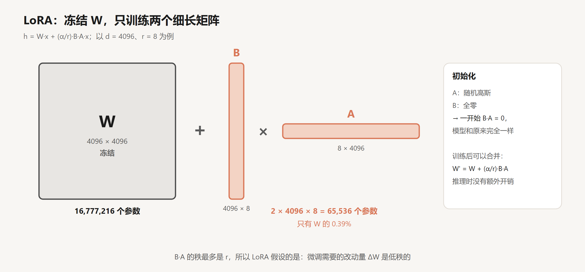
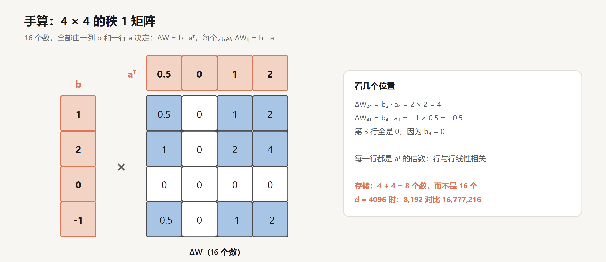
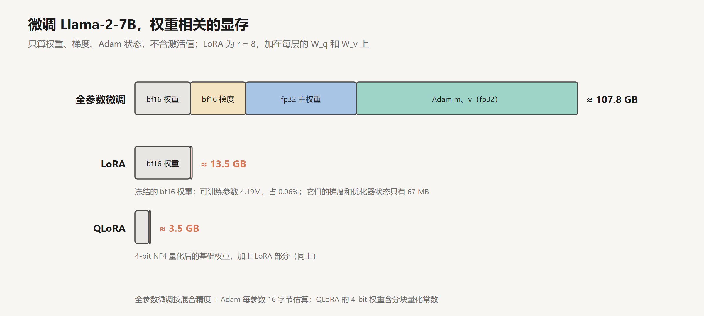
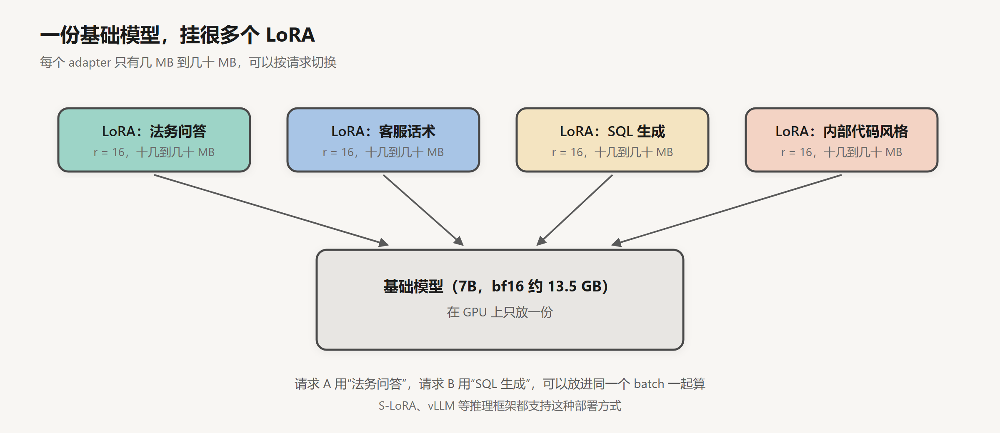

# LoRA 与参数高效微调

创建日期：2026-10-15

前四篇讲的是大模型厂商怎么从零训练出一个助手。这一篇换个视角：你手里已经有一个开源模型，想让它适应自己的任务，比如固定的输出格式、某个领域的写作风格、公司内部的代码规范，该怎么做？

最直接的办法是全参数微调，但它贵得多数团队用不起。LoRA 是目前最常用的替代方案：冻结原模型，只训练一小组新加的参数。这篇讲它为什么可行、怎么算、省了多少，以及它的局限。前置知识只需要矩阵乘法，读过 [Transformer 结构详解](../Transformer与大模型/02-Transformer结构详解.md) 知道模型里有哪些线性层会更好。

## 1. 全参数微调贵在哪

先算一笔账。用 Adam 优化器做混合精度训练，每个参数要占这么多显存：

| 内容 | 精度 | 字节 |
|---|---|---|
| 模型权重 | bf16 | 2 |
| 梯度 | bf16 | 2 |
| 主权重副本 | fp32 | 4 |
| Adam 一阶矩 m | fp32 | 4 |
| Adam 二阶矩 v | fp32 | 4 |
| 合计 | | 16 |

Llama-2-7B 有 67.4 亿参数，乘以 16 字节，约 108 GB。这还没算激活值。一张 80 GB 的 A100 放不下，得多卡分片。

存储也是问题。每微调一个任务，就要保存一份完整的 13.5 GB 模型。十个任务就是十份。

## 2. 微调需要改的东西不多

LoRA 的出发点来自 2020 年 Aghajanyan 等人的一项研究。他们问了一个问题：微调一个预训练模型，真的需要动所有参数吗？

他们的做法是，把所有参数的改动限制在一个随机选定的低维子空间里：只训练 $d$ 个数，再通过一个固定的随机投影映射到全部参数上。然后看 $d$ 至少要多大，才能达到全参数微调 90% 的效果。结果出人意料：在 RoBERTa 上微调 MRPC 这个句子对分类任务，$d$ 只要 200 左右就够了。而且预训练模型越大、预训练得越充分，需要的维度越低。

他们称之为“内在维度”（intrinsic dimension）。预训练已经把大部分能力学好了，微调只是在一个很小的方向空间里做调整。

## 3. LoRA

### 3.1 结构

2021 年微软的 Hu 等人提出了 LoRA（Low-Rank Adaptation），把这个想法落到了每一个权重矩阵上：微调带来的改动量 $\Delta W$ 也是低秩的，那就直接把它写成两个小矩阵的乘积。



原来的线性层是 $h = Wx$。LoRA 冻结 $W$，在旁边加一条支路：

$$
h = Wx + \frac{\alpha}{r} BAx, \qquad B \in \mathbb{R}^{d \times r},\ A \in \mathbb{R}^{r \times d},\ r \ll d
$$

$r$ 是秩，常用 8、16、32。$\alpha$ 是一个缩放系数，配合 $1/r$ 使用，好处是改变 $r$ 时不用重新调学习率。

两个矩阵的初始化方式不一样：$A$ 用随机高斯，$B$ 用全零。这样训练开始时 $BA = 0$，模型和原来完全一样，微调从原模型的状态平滑地开始。

写成代码就一行：

```python
h = x @ W.T + (alpha / r) * (x @ A.T) @ B.T
```

注意计算顺序：先算 $Ax$（得到 $r$ 维向量），再乘 $B$。永远不需要显式算出 $d \times d$ 的 $BA$。

### 3.2 手算一个秩 1 的例子

“低秩”可以用一个最小的例子来理解。$r = 1$ 时，$B$ 是一列 $b$，$A$ 是一行 $a^\top$，$\Delta W = b\,a^\top$：



每个元素 $\Delta W_{ij} = b_i \cdot a_j$。比如第 2 行第 4 列是 $2 \times 2 = 4$；第 3 行全是 0，因为 $b_3 = 0$。

这个 4×4 的矩阵有 16 个数，但只由 8 个数决定。它的每一行都是 $a^\top$ 的倍数，行与行之间完全线性相关，这就是“秩为 1”的意思。秩为 $r$ 的矩阵，可以看成 $r$ 个这样的矩阵相加。

放到实际尺寸：$d = 4096$、$r = 8$ 时，$B$ 和 $A$ 一共 $2 \times 4096 \times 8 = 65{,}536$ 个参数，是原矩阵 1677 万个参数的 0.39%。

### 3.3 加在哪些层上

LoRA 原论文在 GPT-3 上做实验，只加在注意力的 $W_q$ 和 $W_v$ 上，$r$ 取很小的值（1 到 8）效果就已经不错。他们报告，在 175B 的 GPT-3 上，可训练参数减少到原来的万分之一，训练显存从 1.2 TB 降到 350 GB，每个任务的检查点从 350 GB 降到 35 MB。

后来的经验是，加在所有线性层上（注意力的 Q、K、V、O 和 FFN 的三个矩阵）通常效果更好，尤其是 FFN 那几个矩阵。参数量会多几倍，但仍然只占全模型的 1% 左右。

用 Hugging Face 的 PEFT 库，几行就能配好：

```python
from peft import LoraConfig, get_peft_model

config = LoraConfig(r=8, lora_alpha=16, target_modules=["q_proj", "v_proj"],
                    lora_dropout=0.05, task_type="CAUSAL_LM")
model = get_peft_model(model, config)
model.print_trainable_parameters()
# trainable params: 4,194,304 || all params: 6,742,609,920 || trainable%: 0.0622
```

这个 4,194,304 可以手算出来：Llama-2-7B 有 32 层，每层 $W_q$、$W_v$ 两个矩阵，每个矩阵 $2 \times 4096 \times 8$ 个参数，$32 \times 2 \times 65{,}536 = 4{,}194{,}304$。

### 3.4 推理时可以合并

训练完以后，可以把 $\frac{\alpha}{r}BA$ 直接加回 $W$：

$$
W' = W + \frac{\alpha}{r} BA
$$

合并后模型结构和原来一模一样，推理没有任何额外开销。这是 LoRA 相比其他一些参数高效方法（比如在层之间插入小网络的 Adapter）的一个优势，后者推理时会多出几层计算，增加延迟。

## 4. 省了多少

### 4.1 显存



LoRA 省掉的是梯度和优化器状态：冻结的参数不需要梯度，也不需要 Adam 的 m 和 v。剩下的大头是 bf16 的模型权重本身，13.5 GB。可训练的 420 万个参数，连同梯度和优化器状态加起来只有 67 MB。

这张图只算了和参数有关的部分。实际训练时激活值也要占显存，和 batch size、序列长度成正比，序列一长可能比权重还大。通常会配合梯度检查点（gradient checkpointing）一起用，用重算换显存。

### 4.2 QLoRA

既然冻结的权重只参与前向和反向计算，不需要更新，那能不能把它压得更小？2023 年 Dettmers 等人的 QLoRA 就是这么做的：把冻结的基础模型量化到 4 bit，LoRA 部分保持 bf16。

几个关键设计：

- NF4（4-bit NormalFloat）：一种专门针对正态分布权重设计的 4 bit 数据类型。预训练模型的权重大致服从正态分布，NF4 让每个量化区间里落入的权重数量大致相等，比均匀的 int4 误差更小。
- 双重量化：分块量化需要为每一块（比如 64 个权重）存一个缩放系数，这些系数本身也占空间。QLoRA 把这些系数再量化一次。
- 分页优化器：显存不够时，把优化器状态临时挪到 CPU 内存，避免偶尔出现的长序列让训练直接 OOM。

计算时，4 bit 的权重会被临时反量化成 bf16 再参与矩阵乘法，所以精度损失主要来自量化本身，不来自计算。论文报告，QLoRA 可以在单张 48 GB 的 GPU 上微调 65B 的模型，效果和 16 bit 的全参数微调相当。

7B 模型用 QLoRA，权重只要 3.5 GB 左右，一张消费级显卡就能跑。这让个人和小团队也能微调大模型。

### 4.3 部署

LoRA 还改变了部署方式。不合并权重的话，可以在 GPU 上只放一份基础模型，同时挂很多个 LoRA adapter：



不同请求用不同的 adapter，甚至可以放进同一个 batch 里一起算：基础模型的矩阵乘法所有请求共享，各自的 LoRA 支路单独算。2023 年的 S-LoRA 论文展示了在单张 GPU 上同时服务几千个 adapter。vLLM 等主流推理框架也都支持多 LoRA。

如果你要给很多客户或者很多业务线各自定制模型，这比部署很多份完整模型便宜得多。

## 5. LoRA 和全参数微调的差距

LoRA 不是免费的。

Biderman 等人 2024 年的论文标题就是结论：*LoRA Learns Less and Forgets Less*。他们在代码和数学两个领域做了对比，包括大规模的继续预训练和指令微调。结果是，在这种需要学大量新东西的场景下，LoRA 明显不如全参数微调；但 LoRA 对原模型其他能力的破坏也更小，“遗忘”得更少。他们还分析了全参数微调得到的 $\Delta W$，发现它的秩比常用的 LoRA 配置高 10 到 100 倍。也就是说，学的东西一多，“改动量是低秩的”这个假设就不太成立了。

2025 年 Thinking Machines Lab 的一篇研究给出了更细的结论：在中小规模的 SFT 数据上，只要 LoRA 加在所有层上（特别是 FFN），并且把学习率调到全参数微调的 10 倍左右，效果基本能追平全参数微调。数据量一旦超出 LoRA 参数的“容量”，差距就会出现。他们还发现，强化学习对 LoRA 特别友好，秩取到 1 都行，原因是 RL 每个回答只提供一个奖励信号，总的信息量很少。这和 [第 4 篇](04-推理模型与强化学习.md) 里“RL 主要是在激发已有能力”的观察是一致的。

把这些放在一起，我的理解是：

- 改格式、改风格、学一个固定的任务、做 RL：LoRA 基本够用，而且更不容易把原模型的能力弄坏。
- 往模型里灌大量新知识（比如一门新的编程语言、大规模的领域语料）：全参数微调或继续预训练更合适。

## 6. 什么时候该微调

最后回到一个实际问题：手上有一个需求，该微调还是用 RAG，还是写好 prompt 就行？

结合整个系列，我会按这个顺序考虑：

1. 先试 prompt。很多需求靠清楚的指令和几个示例就能解决，成本最低，改起来也最快。
2. 需要模型知道它不知道的事实（公司文档、最新数据），用 RAG。[第 2 篇](02-SFT与Chat模板.md) 讲过，SFT 很难教会模型新知识，硬教还会增加幻觉。RAG 也方便更新和追溯来源。
3. 需要稳定地改变行为：固定的输出格式、特定的语气、某类任务的专门能力、更短的 prompt 以降低延迟和成本，这时再考虑 LoRA 微调。
4. 两者经常一起用：用 LoRA 教模型怎么更好地使用检索到的内容，用 RAG 提供内容本身。

更多关于 RAG 和微调的取舍，见 [RAG 系列第 12 章](../../RAG/RAG%20检索知识/ch12-rag-vs-finetuning.md)。

## 小结

- 全参数微调用 Adam 时每个参数约 16 字节显存，7B 模型就要 100 GB 以上，每个任务还要存一整份模型。
- 预训练模型的微调有很低的内在维度。LoRA 据此假设改动量 $\Delta W$ 是低秩的，写成 $BA$ 两个细长矩阵，冻结原权重只训练它们。
- $B$ 初始化为零，训练从原模型平滑开始；训练后可以合并回 $W$，推理无额外开销；不合并则可以一份基础模型挂多个 adapter。
- QLoRA 把冻结的权重量化到 4 bit，7B 模型的权重只要约 3.5 GB。
- LoRA 学得少、忘得也少。改格式、改风格和做 RL 时它基本够用；要灌大量新知识，还是全参数微调更合适。

## 参考

- Hu et al., 2021. *LoRA: Low-Rank Adaptation of Large Language Models*. [arXiv:2106.09685](https://arxiv.org/abs/2106.09685)
- Aghajanyan et al., 2020. *Intrinsic Dimensionality Explains the Effectiveness of Language Model Fine-Tuning*. [arXiv:2012.13255](https://arxiv.org/abs/2012.13255)
- Dettmers et al., 2023. *QLoRA: Efficient Finetuning of Quantized LLMs*. [arXiv:2305.14314](https://arxiv.org/abs/2305.14314)
- Sheng et al., 2023. *S-LoRA: Serving Thousands of Concurrent LoRA Adapters*. [arXiv:2311.03285](https://arxiv.org/abs/2311.03285)
- Biderman et al., 2024. *LoRA Learns Less and Forgets Less*. [arXiv:2405.09673](https://arxiv.org/abs/2405.09673)
- Schulman et al., 2025. *LoRA Without Regret*. [Thinking Machines Lab](https://thinkingmachines.ai/blog/lora/)
- Hugging Face. *PEFT 文档*. [huggingface.co/docs/peft](https://huggingface.co/docs/peft)
