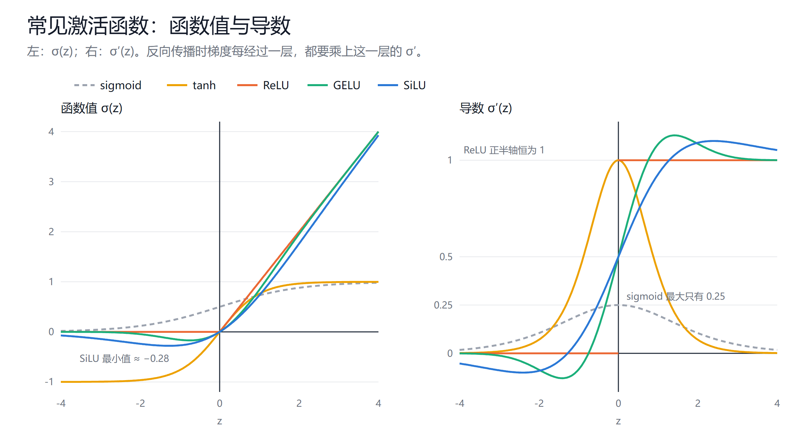

# 线性层与激活函数

创建日期：2026-10-14

神经网络的基本单元只有两样东西：一个线性变换，加一个逐元素的非线性函数。这篇讲这两样东西各自做什么，为什么缺了非线性就什么都学不会，以及常见的几种激活函数在形状和梯度上有什么区别。最后一节讲门控，它是今天大模型 FFN 里 SwiGLU 的来源。

## 1. 线性层

### 1.1 一个神经元

一个神经元接收 $n$ 个输入 $x_1, \dots, x_n$，每个输入乘一个权重，求和后加一个偏置，再过一个函数 $\sigma$：

$$
y = \sigma\Big(\sum_{i=1}^{n} w_i x_i + b\Big) = \sigma(w \cdot x + b)
$$

$w \cdot x$ 是点积，衡量输入和权重向量有多"像"。所以一个神经元做的事情可以理解为：检测输入里是否出现了 $w$ 这个模式，$b$ 调节触发的门槛，$\sigma$ 决定检测结果怎么输出。

### 1.2 一层神经元：矩阵乘法

把 $m$ 个神经元并排放，各有各的权重，就是一个线性层（也叫全连接层）。把所有权重排成矩阵 $W \in \mathbb{R}^{n \times m}$，一次矩阵乘法就算完了整层：

$$
z = x W + b,\qquad x \in \mathbb{R}^{n},\ z \in \mathbb{R}^{m}
$$

再对 $z$ 的每个元素分别做 $\sigma$，就是这一层的输出。$W$ 的第 $j$ 列，就是第 $j$ 个神经元的权重。

实际计算时一次处理一批样本，$x$ 是 $[B,\ n]$ 的矩阵，输出是 $[B,\ m]$。Transformer 里同理，一个序列的所有 token 排成 $[S,\ d]$，同一个线性层作用在每个 token 上。

参数量是 $n \times m + m$。现代大模型的线性层大多不带偏置，参数量就是 $n \times m$。

## 2. 为什么必须有非线性

### 2.1 线性叠线性还是线性

如果去掉 $\sigma$，两层线性层叠在一起：

$$
(x W_1) W_2 = x (W_1 W_2) = x W'
$$

结果等价于一个线性层。叠 100 层也一样，最后都能合并成一个矩阵。网络再深，表达能力也不会超过一层。

线性函数能做的事很有限：它只能把空间做旋转、缩放、投影，直线还是直线，平行还是平行。用来分类时，它只能画一条直线（高维是一个超平面）把两类分开。

### 2.2 一个例子：XOR

异或（XOR）是最经典的线性不可分问题：

| $x_1$ | $x_2$ | XOR |
|---|---|---|
| 0 | 0 | 0 |
| 0 | 1 | 1 |
| 1 | 0 | 1 |
| 1 | 1 | 0 |

在平面上，$(0,1)$ 和 $(1,0)$ 是一类，$(0,0)$ 和 $(1,1)$ 是另一类，它们对角分布，画一条直线不可能把两类分开。

加一个带 ReLU 的隐藏层，就能解决。取两个隐藏神经元：

$$
h_1 = \mathrm{ReLU}(x_1 + x_2),\qquad h_2 = \mathrm{ReLU}(x_1 + x_2 - 1),\qquad y = h_1 - 2h_2
$$

逐个验证：

| $x_1, x_2$ | $h_1$ | $h_2$ | $y$ |
|---|---|---|---|
| 0, 0 | 0 | 0 | 0 |
| 0, 1 | 1 | 0 | 1 |
| 1, 0 | 1 | 0 | 1 |
| 1, 1 | 2 | 1 | 0 |

关键在 $h_2$：它在 $x_1 + x_2 \le 1$ 时被 ReLU 截成 0，只在 $(1,1)$ 处才"打开"。正是这个截断，让输出在 $(1,1)$ 处被拉回 0。如果把 ReLU 换成恒等函数，$y = (x_1 + x_2) - 2(x_1 + x_2 - 1) = 2 - (x_1 + x_2)$，又变回了线性函数，$(0,0)$ 会输出 2，问题解决不了。

### 2.3 非线性在做什么

从几何上看，一个 ReLU 层把空间沿若干个超平面"折"一下：每个神经元对应一个超平面，一侧保持不变，另一侧被压到 0。多个神经元、多层叠加，就能把空间折出非常复杂的形状。一个 ReLU 网络整体是一个分段线性函数，段数随宽度和深度快速增长，足以逼近任意连续函数（这就是万能逼近定理的直观含义）。

所以分工是：线性层负责"混合"，把各个特征按权重组合起来；激活函数负责"弯曲"，让组合结果不再是一条直线。两者交替，网络才有表达能力。

## 3. 激活函数一览

选激活函数时要看两样东西：**函数的形状**，决定前向时输出长什么样；**导数的形状**，决定反向传播时梯度能不能顺利传回去。梯度每经过一层，都要乘上这一层激活函数的导数（具体见下一篇《损失函数与反向传播》），所以导数长期小于 1 的函数，在深网络里会让梯度越传越小。

### 3.1 sigmoid 与 tanh

$$
\mathrm{sigmoid}(z) = \frac{1}{1 + e^{-z}},\qquad \tanh(z) = \frac{e^{z} - e^{-z}}{e^{z} + e^{-z}} = 2\,\mathrm{sigmoid}(2z) - 1
$$

sigmoid 把任意实数压到 $(0, 1)$，tanh 压到 $(-1, 1)$。它们是早期神经网络的标准选择，形状平滑，也有"神经元放电率"的生物学解释。

问题出在导数上：

$$
\mathrm{sigmoid}'(z) = \mathrm{sigmoid}(z)\big(1 - \mathrm{sigmoid}(z)\big) \le 0.25,\qquad \tanh'(z) = 1 - \tanh^2(z) \le 1
$$

- **sigmoid 的导数最大只有 0.25**，而且只在 $z = 0$ 处取到。梯度每经过一层至少缩小到四分之一，10 层之后最多剩 $0.25^{10} \approx 10^{-6}$。这就是**梯度消失**，也是早年深层网络训练不动的主要原因之一。
- **两者都会饱和。** $|z|$ 一大，函数值贴近上下限，导数趋近于 0。神经元一旦落进饱和区，梯度几乎为零，参数就不再更新。
- **sigmoid 的输出不以 0 为中心**，总是正数。下一层权重收到的梯度方向会被这个偏置牵着走，收敛变慢。tanh 以 0 为中心，在这一点上好一些。

今天 sigmoid 很少用作隐藏层的激活函数，但仍然在两个地方常见：二分类的输出层（输出一个概率），以及门控（输出 0 到 1 之间的"开关"，见第 4 节）。

### 3.2 ReLU

$$
\mathrm{ReLU}(z) = \max(0, z),\qquad \mathrm{ReLU}'(z) = \begin{cases} 1 & z > 0 \\ 0 & z < 0 \end{cases}
$$

ReLU（Rectified Linear Unit）在 2010 年前后被广泛采用，是深度学习能够做深的关键改进之一：

- **正半轴的导数恒为 1。** 梯度经过激活状态的神经元时原样通过，不会被缩小，深层网络的梯度消失大大缓解。
- **计算极便宜。** 只是一次比较，没有指数运算。
- **输出稀疏。** 大约一半神经元输出 0，相当于每个输入只激活网络的一部分。

它的问题是**死 ReLU**（dying ReLU）：如果某个神经元的 $z$ 对所有输入都小于 0，它的输出恒为 0，导数也恒为 0，参数再也收不到梯度，这个神经元就永久"死"了。学习率太大、一次更新把偏置推得很负，就容易出现这种情况。

一个简单的补救是 Leaky ReLU：负半轴不取 0，而是取一个很小的斜率，比如 $0.01z$，保证梯度永远不为零。

### 3.3 GELU

$$
\mathrm{GELU}(z) = z \cdot \Phi(z)
$$

$\Phi$ 是标准正态分布的累积分布函数。实现中常用一个近似：

$$
\mathrm{GELU}(z) \approx 0.5\, z \Big(1 + \tanh\Big(\sqrt{2/\pi}\,\big(z + 0.044715\, z^3\big)\Big)\Big)
$$

GELU（Gaussian Error Linear Unit）可以理解为"按概率放行"：输入 $z$ 被乘上一个 0 到 1 之间的系数 $\Phi(z)$，$z$ 越大越接近全部放行，越小越接近全部挡住。ReLU 是硬开关，GELU 是软开关。

和 ReLU 相比：

- **处处平滑**，没有 $z = 0$ 处的折点，优化时的表现通常更好。
- **负半轴不完全为 0**，在 $z \approx -0.75$ 处有一个约 $-0.17$ 的小凹陷，负输入仍然有一点梯度，缓解了死神经元的问题。

BERT、GPT-2、GPT-3 都用 GELU，它是 SwiGLU 普及之前 Transformer 的标准激活函数。

### 3.4 SiLU（Swish）

$$
\mathrm{SiLU}(z) = z \cdot \mathrm{sigmoid}(z)
$$

SiLU 也叫 Swish，形状和 GELU 非常接近，只是把 $\Phi$ 换成了 sigmoid。负半轴的凹陷更深一些，最小值约为 $-0.28$，在 $z \approx -1.28$ 处取到。

它的结构值得注意：$z$ 自己乘上 $\mathrm{sigmoid}(z)$，相当于**用自己给自己开门**。sigmoid 部分是门，决定放行多少；$z$ 本身是内容。这个视角直接引出了下一节的门控。

### 3.5 对比

| 函数 | 公式 | 导数范围 | 主要问题 | 今天的用途 |
|---|---|---|---|---|
| sigmoid | $1/(1+e^{-z})$ | $(0, 0.25]$ | 梯度消失、饱和、非零中心 | 二分类输出、门控 |
| tanh | $\tanh z$ | $(0, 1]$ | 饱和 | RNN/LSTM 内部 |
| ReLU | $\max(0, z)$ | $\{0, 1\}$ | 死神经元 | CNN 等大量传统网络 |
| GELU | $z\,\Phi(z)$ | 约 $[-0.13, 1.13]$ | 计算稍贵 | BERT、GPT-2/3 |
| SiLU | $z\,\mathrm{sigmoid}(z)$ | 约 $[-0.10, 1.10]$ | 计算稍贵 | SwiGLU 中的门 |

GELU 和 SiLU 的导数会略大于 1，也会略小于 0，这是它们在 0 附近"弯一下"造成的，不影响训练。

## 4. 门控：从 GLU 到 SwiGLU

### 4.1 GLU

上面所有激活函数都是"一个输入、一个输出"：$z$ 进去，$\sigma(z)$ 出来，开关和内容是同一个数。

门控线性单元（GLU，Dauphin 等，2017）把两者分开，用两个独立的线性变换，一个产生内容，一个产生门：

$$
\mathrm{GLU}(x) = (x W) \odot \mathrm{sigmoid}(x V)
$$

$\odot$ 是逐元素相乘。$xW$ 是候选内容，$\mathrm{sigmoid}(xV)$ 是一组 0 到 1 之间的门，逐维度决定每个内容放行多少。门由输入本身算出来，所以放行多少是随输入变化的。

这个思路最早来自 LSTM：LSTM 用输入门、遗忘门、输出门控制信息的写入、保留和读出。GLU 把同样的思路用在了前馈网络里。

### 4.2 变体

把门里的 sigmoid 换成别的激活函数，就得到一系列变体（Shazeer，2020）：

| 名称 | 门 | 公式 |
|---|---|---|
| GLU | sigmoid | $(xW) \odot \mathrm{sigmoid}(xV)$ |
| ReGLU | ReLU | $(xW) \odot \mathrm{ReLU}(xV)$ |
| GEGLU | GELU | $(xW) \odot \mathrm{GELU}(xV)$ |
| SwiGLU | SiLU | $(xW) \odot \mathrm{SiLU}(xV)$ |

Shazeer 的实验里，GEGLU 和 SwiGLU 效果最好。之后 PaLM、Llama 选了 SwiGLU，它就成了大模型 FFN 的事实标准。

### 4.3 在 Transformer 里

Llama 的 FFN 就是 SwiGLU 再接一个降维矩阵：

$$
\mathrm{FFN}(x) = \Big(\mathrm{SiLU}(x W_{\text{gate}}) \odot (x W_{\text{up}})\Big)\, W_{\text{down}}
$$

$W_{\text{gate}}$ 对应上面的 $V$，$W_{\text{up}}$ 对应 $W$。门控为什么有效，目前没有严格的理论，一个常见的解释是：普通激活函数里，"要不要放行"和"放行什么"由同一个数决定；门控把两者交给两组参数分别学习，表达能力更强。代价是多了一个矩阵，所以隐藏层宽度从 $4d$ 缩到 $\frac{8}{3}d$，以保持参数量不变。详见 [Transformer 结构详解](../Transformer与大模型/02-Transformer结构详解.md) 的 5.5 节。

## 5. 输出层的激活函数

隐藏层的激活函数负责提供非线性，输出层的激活函数则由任务决定，作用是把网络的输出变成需要的形式：

| 任务 | 输出层 | 输出含义 |
|---|---|---|
| 回归 | 不加激活 | 任意实数 |
| 二分类 | sigmoid | 正类的概率 |
| 多分类 | softmax | 每一类的概率，总和为 1 |
| 语言模型 | softmax（在整个词表上） | 下一个 token 的概率分布 |

输出层和损失函数是配套选的：sigmoid 配二元交叉熵，softmax 配交叉熵。为什么这样配，下一篇会讲。

## 小结

- 线性层做加权组合，一次矩阵乘法算完一整层；只有线性层的话，网络再深也等价于一层。
- 激活函数提供非线性，让网络能把空间"折弯"，XOR 这样线性不可分的问题才能解决。
- 选激活函数要同时看函数形状和导数形状。sigmoid 的导数最大 0.25，深网络里梯度会消失；ReLU 正半轴导数为 1，解决了这个问题，但有死神经元；GELU 和 SiLU 是平滑版的 ReLU，是 Transformer 的常用选择。
- 门控把"放行多少"和"放行什么"拆给两组参数，SwiGLU 是今天大模型 FFN 的标准写法。

## 参考

- Glorot, Bordes & Bengio, 2011. *Deep Sparse Rectifier Neural Networks*. [PMLR](https://proceedings.mlr.press/v15/glorot11a.html)
- Hendrycks & Gimpel, 2016. *Gaussian Error Linear Units (GELUs)*. [arXiv:1606.08415](https://arxiv.org/abs/1606.08415)
- Ramachandran, Zoph & Le, 2017. *Searching for Activation Functions*. [arXiv:1710.05941](https://arxiv.org/abs/1710.05941)
- Dauphin et al., 2017. *Language Modeling with Gated Convolutional Networks*. [arXiv:1612.08083](https://arxiv.org/abs/1612.08083)
- Shazeer, 2020. *GLU Variants Improve Transformer*. [arXiv:2002.05202](https://arxiv.org/abs/2002.05202)
