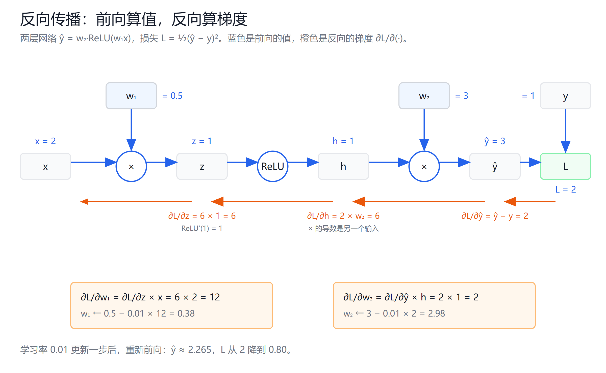

# 损失函数与反向传播

创建日期：2026-10-14

上一篇讲了网络长什么样：线性层加激活函数，一层层叠起来。这一篇讲网络怎么学：先用损失函数衡量"预测错了多少"，再用反向传播算出每个参数该往哪个方向改、改多少。最后讲深层网络特有的麻烦，梯度消失和梯度爆炸，以及残差连接、初始化这些手段为什么能解决它。

## 1. 训练在做什么

一个网络就是一个带参数的函数 $f_\theta$，$\theta$ 是所有权重和偏置。训练的目标，是找到一组 $\theta$，让网络在训练数据上的预测尽量准确。

"尽量准确"需要一个数来衡量，这个数就是**损失**（loss）$\mathcal{L}(\theta)$：预测越差，损失越大。于是训练变成了一个优化问题：找 $\theta$ 让 $\mathcal{L}$ 最小。

最基本的方法是**梯度下降**：

$$
\theta \leftarrow \theta - \eta\, \nabla_\theta \mathcal{L}
$$

梯度 $\nabla_\theta \mathcal{L}$ 指向损失上升最快的方向，沿反方向走一小步，损失就会下降。$\eta$ 是学习率，控制步子大小。

这里有两个问题：损失函数怎么定义（第 2 节），梯度怎么算（第 3 节）。一个 70 亿参数的模型，梯度就是一个 70 亿维的向量，必须有高效的算法。

## 2. 损失函数

### 2.1 回归：均方误差

预测一个实数时，最自然的损失是预测值和真实值之差的平方：

$$
\mathcal{L}_{\text{MSE}} = \frac{1}{N} \sum_{i=1}^{N} (\hat{y}_i - y_i)^2
$$

平方让正负误差都算作损失，并且对大误差惩罚更重。

### 2.2 分类：交叉熵

分类时，网络输出的是每一类的分数（logits）$z$，经过 softmax 变成概率分布 $p$。交叉熵损失只看一件事：**模型给正确答案分配了多少概率**。

$$
\mathcal{L}_{\text{CE}} = -\log p_{c}
$$

$c$ 是正确类别。模型对正确答案有十足把握（$p_c = 1$），损失为 0；给正确答案的概率越小，损失越大，$p_c \to 0$ 时趋向无穷。

举个例子：三分类，logits 是 $(2,\ 1,\ 0.1)$，正确答案是第 1 类。

$$
p = \mathrm{softmax}(2,\ 1,\ 0.1) = (0.659,\ 0.242,\ 0.099),\qquad \mathcal{L} = -\log 0.659 = 0.417
$$

这个名字来自信息论。真实分布 $y$ 是一个 one-hot 向量（正确类为 1，其余为 0），交叉熵 $H(y, p) = -\sum_k y_k \log p_k$ 中只有正确类那一项不为零，就是上面的 $-\log p_c$。最小化交叉熵，等价于让模型分布 $p$ 尽量接近真实分布 $y$，也等价于最大化训练数据的似然。

### 2.3 为什么分类不用均方误差

用 MSE 也能训练分类器，但效果明显更差，原因在梯度上。

**交叉熵配 softmax，对 logits 的梯度非常干净：**

$$
\frac{\partial \mathcal{L}_{\text{CE}}}{\partial z} = p - y
$$

就是"预测概率减去真实标签"。上面的例子里，梯度是 $(0.659 - 1,\ 0.242,\ 0.099) = (-0.341,\ 0.242,\ 0.099)$：正确类的分数被往上推，其他类被往下压，力度和错误的程度成正比。

**MSE 配 sigmoid，梯度里多了一个 sigmoid 的导数：**

以二分类为例，$p = \mathrm{sigmoid}(z)$，真实标签 $y = 1$，但模型很自信地错了，$p = 0.01$：

$$
\frac{\partial \mathcal{L}_{\text{MSE}}}{\partial z} = 2(p - y) \cdot p(1 - p) = 2 \times (-0.99) \times 0.0099 \approx -0.020
$$

$$
\frac{\partial \mathcal{L}_{\text{CE}}}{\partial z} = p - y = -0.99
$$

差了 50 倍。MSE 的问题在于 $p(1-p)$ 这一项：模型错得越自信，sigmoid 越饱和，这一项越小，梯度反而越弱。**错得最离谱的时候，学得最慢。**交叉熵的 $\log$ 正好抵消了 sigmoid 的指数，梯度只剩 $p - y$，错得越多梯度越大。

### 2.4 语言模型的损失

语言模型就是在整个词表上做分类：每个位置预测下一个 token，正确答案是文本里实际出现的那个 token。损失是所有位置交叉熵的平均：

$$
\mathcal{L} = -\frac{1}{T} \sum_{t=1}^{T} \log p_\theta(x_{t+1} \mid x_{\le t})
$$

这个数字有直观的参照：

- **训练刚开始**，模型参数随机，对每个 token 的预测接近均匀分布。词表大小为 32000 时，$-\log(1/32000) = \ln 32000 \approx 10.4$。大模型训练曲线的起点通常就在 10 左右。
- **困惑度**（perplexity）$= e^{\mathcal{L}}$，可以理解为"模型平均在多少个候选里犹豫"。损失降到 2，困惑度约为 7.4，相当于每一步只在七八个词之间拿不准。

## 3. 反向传播

### 3.1 链式法则

网络是一串函数的复合。最简单的情况，$y = f(g(x))$，求 $y$ 对 $x$ 的导数，用链式法则：

$$
\frac{dy}{dx} = \frac{dy}{dg} \cdot \frac{dg}{dx}
$$

一个深层网络就是很多层函数套在一起，损失对某个参数的导数，等于从损失一路往回、经过的每一步局部导数相乘。反向传播（backpropagation）就是系统地、从后往前地做这件事，并且把中间结果复用起来，避免重复计算。

### 3.2 手算一个例子

一个最小的两层网络，全是标量：

$$
z = w_1 x,\qquad h = \mathrm{ReLU}(z),\qquad \hat{y} = w_2 h,\qquad \mathcal{L} = \tfrac{1}{2}(\hat{y} - y)^2
$$

取 $x = 2$，$y = 1$，$w_1 = 0.5$，$w_2 = 3$。



**前向**，从左往右算出每个中间值：

$$
z = 0.5 \times 2 = 1,\quad h = \mathrm{ReLU}(1) = 1,\quad \hat{y} = 3 \times 1 = 3,\quad \mathcal{L} = \tfrac{1}{2}(3 - 1)^2 = 2
$$

**反向**，从右往左，每一步都用"上游传来的梯度 × 这一步的局部导数"：

| 节点 | 局部导数 | 梯度 |
|---|---|---|
| $\hat{y}$ | $\partial \mathcal{L} / \partial \hat{y} = \hat{y} - y$ | $3 - 1 = 2$ |
| $h$ | $\partial \hat{y} / \partial h = w_2$ | $2 \times 3 = 6$ |
| $z$ | $\partial h / \partial z = \mathrm{ReLU}'(1) = 1$ | $6 \times 1 = 6$ |

参数的梯度在相应的节点上分岔出去：

$$
\frac{\partial \mathcal{L}}{\partial w_2} = \frac{\partial \mathcal{L}}{\partial \hat{y}} \cdot h = 2 \times 1 = 2,\qquad
\frac{\partial \mathcal{L}}{\partial w_1} = \frac{\partial \mathcal{L}}{\partial z} \cdot x = 6 \times 2 = 12
$$

用学习率 $\eta = 0.01$ 更新一步：$w_1 = 0.5 - 0.12 = 0.38$，$w_2 = 3 - 0.02 = 2.98$。重新前向：$\hat{y} = 2.98 \times \mathrm{ReLU}(0.76) \approx 2.265$，损失从 2 降到 0.80。

这个例子里有几个规律，在任何网络里都成立：

- **乘法节点的局部导数是"另一个输入"。** $\hat{y} = w_2 h$ 对 $h$ 求导得 $w_2$，对 $w_2$ 求导得 $h$。所以反向传播需要前向时的中间值，这些值必须存下来。
- **ReLU 节点像一个开关。** 激活时梯度原样通过，没激活时梯度被截断为 0。如果这里 $z < 0$，$w_1$ 就完全收不到梯度，这正是上一篇说的死 ReLU。
- **每个梯度只算一次，被下游所有路径复用。** $\partial \mathcal{L}/\partial z = 6$ 算出来以后，求 $w_1$ 的梯度直接用它，不用从 $\mathcal{L}$ 重新推一遍。

### 3.3 矩阵形式

真实网络里，每一步都是矩阵运算。对线性层 $Y = XW$（$X$ 是 $[B,\ n]$，$W$ 是 $[n,\ m]$），已知上游梯度 $G = \partial \mathcal{L} / \partial Y$（形状和 $Y$ 一样，$[B,\ m]$），需要算两个梯度：

$$
\frac{\partial \mathcal{L}}{\partial W} = X^\top G \quad [n,\ m],\qquad
\frac{\partial \mathcal{L}}{\partial X} = G\, W^\top \quad [B,\ n]
$$

和标量情况一样："对权重的梯度要用输入，对输入的梯度要用权重"。形状可以用来检查：梯度的形状一定和对应的变量相同，按这个要求把矩阵摆对，公式基本就不会错。

### 3.4 计算量与显存

从矩阵形式可以直接数出反向传播的代价。前向时，线性层做一次矩阵乘法 $XW$；反向时要做两次，$X^\top G$ 和 $G W^\top$，大小和前向那次相同。所以**反向的计算量约为前向的 2 倍**，一次完整的训练步骤约为前向的 3 倍。

这就是常说的估算：前向每个 token 约 $2N$ 次浮点运算（$N$ 为参数量），训练约 $6N$。

显存方面，反向传播需要前向时的中间值（激活值），训练时必须把每一层的激活都存下来，直到反向用完。序列越长、批次越大，激活占的显存越多，常常超过参数本身。一个常用的折中是**激活重计算**（activation checkpointing）：只存一部分层的激活，反向时需要的其他激活重新前向算一遍，用约 1/3 的额外计算换大量显存。

### 3.5 自动微分

实际写代码时，不需要手推任何导数。PyTorch 等框架在前向时记录计算图，调用 `backward()` 就自动完成上面的全部过程：

```python
import torch

x, y = torch.tensor(2.0), torch.tensor(1.0)
w1 = torch.tensor(0.5, requires_grad=True)
w2 = torch.tensor(3.0, requires_grad=True)

loss = 0.5 * (w2 * torch.relu(w1 * x) - y) ** 2
loss.backward()
print(w1.grad, w2.grad)  # tensor(12.) tensor(2.)
```

框架里每种运算都预先写好了"前向怎么算、局部导数怎么算"，反向传播只是按计算图的逆序把它们串起来。

## 4. 梯度消失与梯度爆炸

### 4.1 连乘的问题

在一个 $L$ 层的网络里，损失对第 1 层参数的梯度，要经过 $L$ 层的局部导数连乘。粗略地说：

$$
\frac{\partial \mathcal{L}}{\partial x_1} = \frac{\partial \mathcal{L}}{\partial x_L} \cdot \prod_{l=1}^{L-1} \frac{\partial x_{l+1}}{\partial x_l}
$$

每一项 $\partial x_{l+1} / \partial x_l$ 包含这一层的权重矩阵和激活函数的导数。连乘的结果对每一项的大小极其敏感：

- **每一项都略小于 1**，比如 0.9，50 层后剩 $0.9^{50} \approx 0.005$。前面的层几乎收不到梯度，学不动。这是**梯度消失**。
- **每一项都略大于 1**，比如 1.1，50 层后变成 $1.1^{50} \approx 117$。梯度巨大，一步更新就把参数推飞，损失变成 NaN。这是**梯度爆炸**。

要让深层网络能训练，就要让每一层的"放大倍数"尽量接近 1。下面几个手段都是在做这件事。

### 4.2 换激活函数

sigmoid 的导数最大 0.25，必然导致梯度消失。ReLU 在激活区导数恰好为 1，GELU、SiLU 也接近 1，这是它们能取代 sigmoid 的主要原因（见上一篇第 3 节）。

### 4.3 合理的初始化

权重矩阵的大小同样决定放大倍数。设输入有 $n$ 维，每维方差为 1，权重从方差为 $\sigma^2$ 的分布里随机取，那么输出每一维的方差约为 $n\sigma^2$。

如果直接用标准正态分布（$\sigma = 1$）初始化一个 $4096 \times 4096$ 的矩阵，输出的方差就是 4096，标准差 64，每过一层放大 64 倍，几层之后数值就溢出了。

所以初始化要按维度缩放：

| 方法 | 方差 | 适用 |
|---|---|---|
| Xavier（Glorot） | $\dfrac{2}{n_{\text{in}} + n_{\text{out}}}$ | tanh、sigmoid |
| He（Kaiming） | $\dfrac{2}{n_{\text{in}}}$ | ReLU（一半神经元输出 0，所以要多乘 2） |

$n = 4096$ 时，He 初始化的标准差是 $\sqrt{2/4096} \approx 0.022$。大模型一般直接用一个固定的小标准差，比如 0.02，思路是一样的。

### 4.4 残差连接

初始化只能保证训练开始时放大倍数接近 1，训练过程中权重会变，这个平衡很容易被打破。残差连接从结构上解决了这个问题。

残差结构是 $x_{l+1} = x_l + f(x_l)$，它的局部导数是：

$$
\frac{\partial x_{l+1}}{\partial x_l} = I + \frac{\partial f}{\partial x_l}
$$

多了一个单位矩阵 $I$。把 $L$ 层的连乘展开，其中一定有一项是 $I \cdot I \cdots I = I$：**梯度可以沿着残差这条路，不经过任何权重和激活函数，原样传回第一层**。不管 $f$ 学成什么样，这条路径都在。

ResNet（2015）用这个结构第一次训练出了 152 层的网络，Transformer 的每个子层也都套在残差连接里。在 Transformer 的语境下，这条"直通路径"就是残差流，详见 [Transformer 结构详解](../Transformer与大模型/02-Transformer结构详解.md) 的 5.3 节。

### 4.5 归一化与梯度裁剪

另外两个常见的手段：

- **归一化**（LayerNorm、RMSNorm）：把每层输入的尺度拉回固定范围，防止数值逐层漂移。下一篇会讲它和残差连接配合时的细节。
- **梯度裁剪**：每次更新前计算全部梯度的总范数，超过阈值（大模型常用 1.0）就整体按比例缩小。它不能防止梯度消失，但能挡住偶发的梯度爆炸，避免一步更新毁掉整个训练。

## 小结

- 训练就是最小化损失。回归常用均方误差，分类用交叉熵；交叉熵配 softmax 时，对 logits 的梯度就是 $p - y$，错得越多梯度越大。
- 语言模型的损失是每个位置预测下一个 token 的交叉熵，初始值约为 $\ln(\text{词表大小})$。
- 反向传播是链式法则加上中间结果复用：前向存下中间值，反向从损失往回逐层相乘。反向的计算量约为前向的 2 倍，训练一步约 $6N$。
- 深层网络的梯度是很多项的连乘，容易消失或爆炸。ReLU 类激活函数、按维度缩放的初始化、残差连接、归一化、梯度裁剪，都是为了让每层的放大倍数保持在 1 附近。

## 参考

- Rumelhart, Hinton & Williams, 1986. *Learning Representations by Back-Propagating Errors*. Nature 323.
- Glorot & Bengio, 2010. *Understanding the Difficulty of Training Deep Feedforward Neural Networks*. [PMLR](https://proceedings.mlr.press/v9/glorot10a.html)
- He et al., 2015. *Delving Deep into Rectifiers*. [arXiv:1502.01852](https://arxiv.org/abs/1502.01852)
- He et al., 2015. *Deep Residual Learning for Image Recognition*. [arXiv:1512.03385](https://arxiv.org/abs/1512.03385)
- Pascanu, Mikolov & Bengio, 2013. *On the Difficulty of Training Recurrent Neural Networks*. [arXiv:1211.5063](https://arxiv.org/abs/1211.5063)
- Chen et al., 2016. *Training Deep Nets with Sublinear Memory Cost*. [arXiv:1604.06174](https://arxiv.org/abs/1604.06174)
