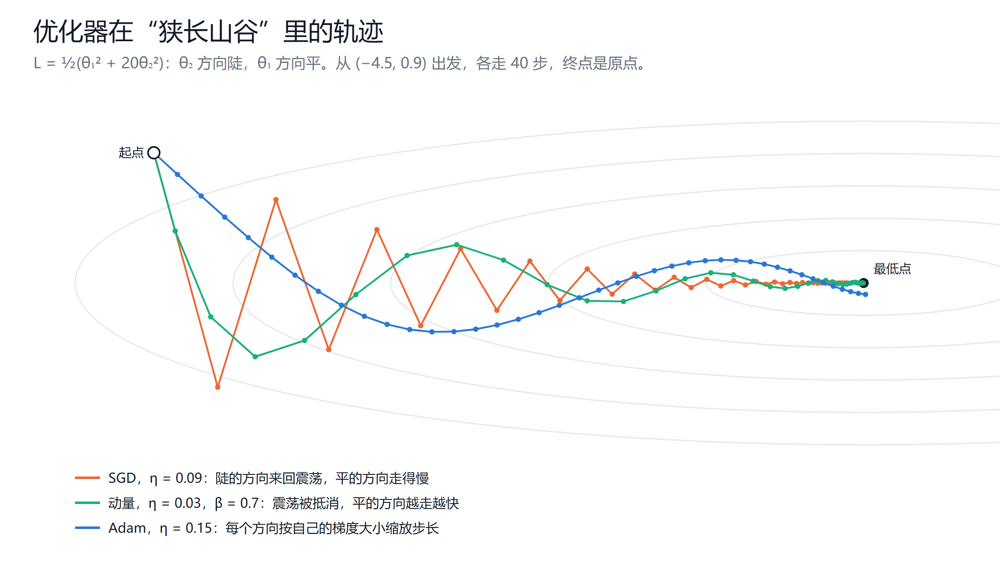
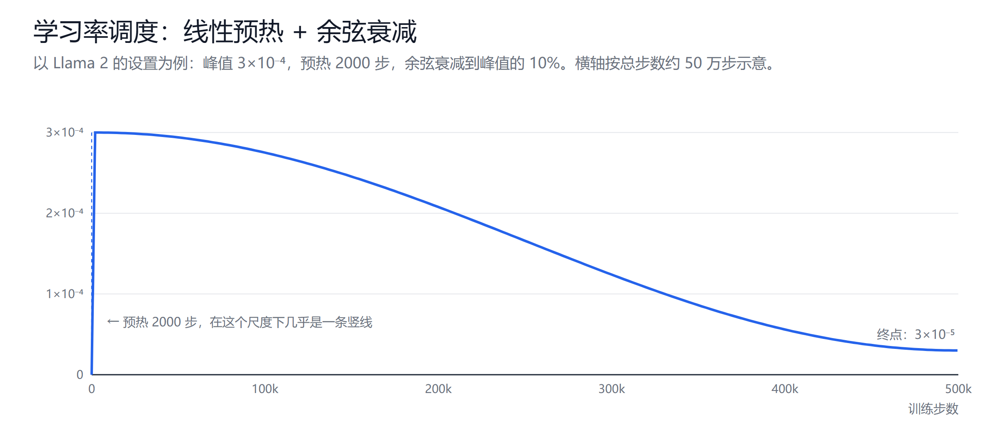

# 优化器与训练技巧

创建日期：2026-10-14

上一篇讲了怎么算梯度。有了梯度，下一步是决定怎么用它更新参数：每步走多远，朝哪个方向走，不同参数是不是该走不一样的步长。这一篇从最朴素的随机梯度下降讲起，一路讲到大模型训练的标准配置 AdamW 加余弦学习率，再讲归一化在训练稳定性里的作用，以及 Pre-Norm 结构遗留的一个问题。

## 1. 随机梯度下降

### 1.1 小批量

梯度下降的公式是 $\theta \leftarrow \theta - \eta \nabla \mathcal{L}$。严格来说，$\mathcal{L}$ 应该是整个训练集上的平均损失，但训练集有上万亿个 token，每走一步都把所有数据算一遍是不可能的。

实际做法是每次随机取一小批数据（mini-batch），用这一批的平均梯度近似全体的梯度，这就是**随机梯度下降**（SGD）。几个相关的术语：

- **batch size**：一批有多少样本。大模型通常按 token 数计，Llama 2 每一步是 400 万个 token。
- **step**：用一批数据更新一次参数。
- **epoch**：把整个训练集过一遍。大模型预训练的数据量很大，通常一遍都过不完，或者只过一遍左右。

小批量的梯度带有噪声，每一步的方向不完全准确。这不全是坏事：噪声让参数不会过早陷进一个很窄的极小值，往往还有利于泛化。

### 1.2 学习率决定一切

学习率太小，训练慢；太大，训练会发散。可以用一个最简单的例子看清楚边界在哪里。

设损失是一维的二次函数 $\mathcal{L} = \frac{1}{2} a \theta^2$（$a > 0$ 是曲率，越大越"陡"），最小值在 $\theta = 0$。梯度是 $a\theta$，更新一步：

$$
\theta \leftarrow \theta - \eta a \theta = (1 - \eta a)\,\theta
$$

每一步 $\theta$ 乘一个固定系数 $1 - \eta a$：

- $0 < \eta < 1/a$：系数在 0 到 1 之间，$\theta$ 单调地缩向 0。
- $1/a < \eta < 2/a$：系数在 -1 到 0 之间，$\theta$ 正负来回跳，但幅度越来越小，仍然收敛。
- $\eta > 2/a$：系数的绝对值大于 1，每一步跳得更远，**发散**。

所以学习率的上限由最陡的方向决定：$\eta < 2/a_{\max}$。

### 1.3 狭长山谷

真实的损失函数有成千上万个方向，每个方向的曲率差别很大。设两个方向，曲率分别是 1 和 20：

$$
\mathcal{L} = \tfrac{1}{2}\big(\theta_1^2 + 20\,\theta_2^2\big)
$$

等高线是一个狭长的椭圆，$\theta_2$ 方向很陡，$\theta_1$ 方向很平。学习率受陡的方向限制，必须小于 $2/20 = 0.1$。取 $\eta = 0.09$：

- 陡的方向，系数是 $1 - 0.09 \times 20 = -0.8$，来回震荡；
- 平的方向，系数是 $1 - 0.09 = 0.91$，每步只前进 9%，40 步后还剩 2% 没走完。

图里橙色的 SGD 轨迹就是这样：在山谷两壁之间来回弹，沿谷底方向慢慢挪。高维的损失函数里，各方向的曲率可以差几个数量级，这个问题会严重得多。下面的动量和 Adam 都是在解决它。

## 2. 动量

动量（momentum）的想法来自物理：一个小球从山坡滚下来，会带着之前的速度。更新时不只看当前梯度，还累积过去的梯度：

$$
v \leftarrow \beta v + g,\qquad \theta \leftarrow \theta - \eta v
$$

$\beta$ 通常取 0.9。$v$ 是过去梯度的指数加权和，越久远的梯度权重越小。

在狭长山谷里，它的效果是：

- **陡的方向**，梯度正负交替，累加时互相抵消，震荡被压住；
- **平的方向**，梯度一直朝同一个方向，不断累加，步子越走越大。方向稳定时，$v$ 最终会达到 $g/(1-\beta)$，$\beta = 0.9$ 时相当于把步长放大了 10 倍。

图里绿色的轨迹，前几步还有摆动，很快就被抵消，沿谷底加速走到了最低点。

## 3. Adam

### 3.1 每个参数一个步长

动量解决了震荡，但所有参数还是共用一个学习率。Adam 的想法更直接：**既然各方向的梯度大小差别很大，就给每个参数单独缩放步长**。梯度一直很大的参数，步子缩小；梯度一直很小的参数，步子放大。

Adam 为每个参数维护两个量：

$$
m \leftarrow \beta_1 m + (1 - \beta_1)\, g \qquad \text{（梯度的滑动平均，即动量）}
$$

$$
v \leftarrow \beta_2 v + (1 - \beta_2)\, g^2 \qquad \text{（梯度平方的滑动平均，衡量梯度的典型大小）}
$$

更新时，用 $m$ 除以 $\sqrt{v}$：

$$
\theta \leftarrow \theta - \eta\, \frac{\hat{m}}{\sqrt{\hat{v}} + \epsilon}
$$

$\hat{m}$、$\hat{v}$ 是偏差修正后的值：$m$ 和 $v$ 从 0 开始累积，最初几步会偏小，除以 $1 - \beta^t$ 来修正。$\epsilon$ 是一个很小的数，防止除以零。

关键在 $\hat{m}/\sqrt{\hat{v}}$ 这个比值：分子分母的量纲相同，梯度的绝对大小被约掉了。不管一个参数的梯度是 1000 还是 0.001，每一步的更新幅度都在 $\eta$ 的量级。在狭长山谷里，陡的方向和平的方向走的步子差不多大，这就相当于把椭圆"拉圆"了（图中蓝色轨迹）。

### 3.2 超参数

- $\beta_1 = 0.9$：动量的衰减。
- $\beta_2$：通常取 0.999。大模型训练常用 0.95，让 $v$ 更快跟上梯度的变化，遇到梯度突然变大时反应更快，训练更稳定。
- $\epsilon$：常见取值 $10^{-8}$，Llama 2 取 $10^{-5}$。

### 3.3 显存代价

Adam 的 $m$ 和 $v$ 每个参数各一份，而且一般用 fp32 存储。混合精度训练时，每个参数需要：

| 内容 | 精度 | 字节 |
|---|---|---|
| 参数（用于前向、反向计算） | bf16 | 2 |
| 梯度 | bf16 | 2 |
| 参数的 fp32 主副本（用于更新） | fp32 | 4 |
| Adam 的 $m$ | fp32 | 4 |
| Adam 的 $v$ | fp32 | 4 |
| **合计** | | **16** |

7B 模型仅这部分就要约 112 GB，还没算激活值。这就是为什么推理一张卡能放下的模型，训练要用很多张卡，也是 ZeRO、FSDP 这类技术要把优化器状态切分到多张卡上的原因。

## 4. AdamW：把权重衰减分出来

### 4.1 权重衰减

**权重衰减**（weight decay）每一步把参数往 0 拉一点，防止参数无限增大，起到正则化的作用。在普通 SGD 里，它等价于在损失上加一项 $\frac{\lambda}{2}\|\theta\|^2$（L2 正则）：

$$
\theta \leftarrow \theta - \eta\,(g + \lambda \theta)
$$

### 4.2 Adam 里的问题

如果在 Adam 里也用 L2 正则的写法，$\lambda\theta$ 这一项会被加进梯度 $g$，然后和梯度一起被除以 $\sqrt{v}$。结果是：梯度大的参数，衰减也被缩小了；梯度小的参数，衰减被放大了。衰减的力度变得和梯度大小纠缠在一起，不再是"每个参数按比例往 0 拉"。

AdamW（Loshchilov & Hutter，2017）把衰减从梯度里拿出来，单独作用在参数上：

$$
\theta \leftarrow \theta - \eta\left(\frac{\hat{m}}{\sqrt{\hat{v}} + \epsilon} + \lambda\,\theta\right)
$$

$\lambda\theta$ 不经过 $\sqrt{v}$ 的缩放，每个参数都按同样的比例衰减。这个改动很小，但效果明显更好，AdamW 成了训练 Transformer 的默认优化器。大模型常用 $\lambda = 0.1$，一般不对偏置和归一化层的 $\gamma$ 做衰减。

## 5. 学习率调度

学习率在训练中通常不是固定的。大模型的标准做法是**线性预热加余弦衰减**：

### 5.1 预热（warmup）

训练开始的几千步，学习率从 0 线性增长到峰值。原因有几个：

- **Adam 的 $v$ 还不准。** 最初几步，$v$ 只基于很少的梯度估计，可能偏小，导致 $\hat{m}/\sqrt{\hat{v}}$ 偏大，更新过猛。
- **初始参数是随机的。** 这时的梯度方向噪声很大，大步走容易把模型推到很差的区域。
- **Post-Norm 结构尤其需要。** 原始 Transformer 不预热就训不起来（见第 6 节）。

### 5.2 衰减

达到峰值后，学习率按余弦曲线慢慢下降到一个较小的值。前期学习率大，快速接近好的区域；后期学习率小，在最低点附近精细调整，不会因为步子太大在谷底来回跳。

Llama 2 的设置是：峰值 $3 \times 10^{-4}$（7B、13B；更大的模型用 $1.5 \times 10^{-4}$），预热 2000 步，余弦衰减到峰值的 10%。

一个经验规律：模型越大，峰值学习率越小。大模型对学习率更敏感，取大了容易出现损失突然飙升（loss spike）。

## 6. 归一化与训练稳定性

### 6.1 归一化做什么

上一篇说过，深层网络的数值会逐层放大或缩小。归一化在每一层把输入拉回到固定的尺度：

$$
\mathrm{LayerNorm}(x) = \gamma \odot \frac{x - \mu}{\sqrt{\sigma^2 + \epsilon}} + \beta,\qquad
\mathrm{RMSNorm}(x) = \gamma \odot \frac{x}{\sqrt{\frac{1}{d}\sum_i x_i^2 + \epsilon}}
$$

LayerNorm 减均值、除标准差；RMSNorm 省掉了减均值，只除以均方根，计算更便宜，效果相当，是今天大模型的主流。$\gamma$ 是可学习的缩放，让模型在需要时把尺度调回去。

不管上一层的输出变成多大，经过归一化后都回到标准尺度，下一层面对的输入分布就比较稳定，学习率也更容易设置。

### 6.2 BatchNorm 与 LayerNorm

CNN 里常用的是 BatchNorm：对每个特征，在一个 batch 的所有样本上算均值和方差。Transformer 用的是 LayerNorm：对每个样本（每个 token），在它自己的所有特征上算。

Transformer 不用 BatchNorm，是因为：

- **序列长度不固定**，不同样本的 padding 混在一起，统计量不干净；
- **结果依赖 batch**，batch 小时统计量噪声大，推理时又要换成训练时累积的统计量，前后不一致；
- **生成时一次只有一个 token**，根本没有 batch 可以统计。

LayerNorm 只看单个 token 自己的向量，和其他样本无关，这些问题都不存在。

### 6.3 归一化放在哪里

在 Transformer 里，归一化和残差连接配合使用，有两种放法：

$$
\text{Post-Norm：}\ x_{l+1} = \mathrm{Norm}\big(x_l + f(x_l)\big)
\qquad\qquad
\text{Pre-Norm：}\ x_{l+1} = x_l + f\big(\mathrm{Norm}(x_l)\big)
$$

原始 Transformer 用 Post-Norm。它每一层都对残差流做归一化，上一篇说的"残差直通路径"被打断了，梯度回传时每层都要经过一次归一化。层数一多，训练就不稳定，必须靠学习率预热小心地起步。

Pre-Norm 只对子层的输入归一化，残差流本身从头到尾不经过归一化，梯度可以沿残差路径直通。今天的大模型基本都用 Pre-Norm。

### 6.4 Pre-Norm 的代价：残差流越来越大

Pre-Norm 解决了训练稳定性，但留下了一个尺度不统一的问题。

注意 Pre-Norm 里归一化**只管子层的输入**。子层输出的增量 $f(\cdot)$ 没有被归一化，它的大小由输出投影矩阵（attention 的 $W_O$、FFN 的 $W_{\text{down}}$）决定，这些权重是学出来的。所以：

- **读的时候尺度统一。** 不管残差流已经累积到多大，每层看到的输入都是归一化后的，attention 的 softmax 不会因为数值过大而饱和。
- **写的时候尺度自由。** 每层往残差流上加的是绝对数值，和前面各层的贡献直接相加。

问题在于，每层都往上加东西，残差流的范数 $\|x_l\|$ 会随层数增长。如果各层增量的大小差不多，那么越深的层，增量占残差流的比例 $\|f\| / \|x_l\|$ 越小，对表示的改变越弱。实验中确实观察到，很多 Pre-Norm 大模型的后半部分层，删掉或跳过后效果下降不多（Sun 等，2025，*The Curse of Depth*）。模型自己也会补偿：深层的输出投影学出更大的范数，或者在少数维度上出现极大的激活值。

几种常见的修正：

| 做法 | 思路 | 例子 |
|---|---|---|
| 缩小残差分支的初始化 | 输出投影初始化时乘 $1/\sqrt{2L}$，开始训练时残差流不会增长太快 | GPT-2 |
| 子层输出也归一化 | $x + \mathrm{Norm}\big(f(\cdot)\big)$，增量的尺度也受控 | Gemma 2（输入、输出都归一化）、OLMo 2（只归一化输出） |
| 按深度缩放 | 第 $l$ 层的归一化输出再乘 $1/\sqrt{l}$ | LayerNorm Scaling |
| 回到 Post-Norm，放大残差 | $\mathrm{Norm}(\alpha x + f(x))$，$\alpha > 1$ | DeepNorm，训练到 1000 层 |

Pre-Norm 模型最后一层之后还要再做一次归一化（final norm），处理的也是同一件事：残差流到最后已经很大了，送进输出层之前要统一缩放一次。

## 7. 其他常见技巧

- **梯度裁剪**：每步把梯度的总范数限制在一个阈值内（常用 1.0），挡住偶发的梯度爆炸。
- **混合精度**：前向和反向用 bf16 计算，参数更新用 fp32。bf16 和 fp32 的指数位数相同，数值范围一样大，不容易溢出；fp16 范围小，需要额外的损失缩放（loss scaling）。
- **Dropout**：训练时随机把一部分激活置零，防止过拟合。数据量远大于参数量的大模型预训练，过拟合不是主要问题，通常不用 dropout；小数据上的微调可能会用。
- **损失突增**：大模型训练中偶尔会出现损失突然飙升。常见的处理是回退到之前的检查点，跳过出问题的那批数据，或降低学习率继续训练。

Llama 2 的完整配置可以作为一个参照：AdamW，$\beta_1 = 0.9$，$\beta_2 = 0.95$，$\epsilon = 10^{-5}$，权重衰减 0.1，梯度裁剪 1.0，余弦学习率，预热 2000 步，衰减到峰值的 10%，每步 400 万 token。这几乎就是当前大模型预训练的标准配置。

## 小结

- SGD 的学习率受最陡方向限制，在曲率差别很大的损失函数上，陡的方向震荡、平的方向缓慢。
- 动量累积过去的梯度，抵消震荡，在稳定的方向上加速。
- Adam 用梯度平方的滑动平均给每个参数单独缩放步长；AdamW 把权重衰减从梯度里分离出来，是训练 Transformer 的默认选择。Adam 的状态让训练的显存需求达到每个参数 16 字节。
- 学习率先预热、再余弦衰减。预热让 Adam 的统计量先稳定下来，衰减让后期精细收敛。
- 归一化把每层输入拉回固定尺度。Transformer 用 LayerNorm/RMSNorm，并采用 Pre-Norm 让残差路径保持直通；代价是残差流随深度增长，深层的相对贡献变小。

## 参考

- Kingma & Ba, 2014. *Adam: A Method for Stochastic Optimization*. [arXiv:1412.6980](https://arxiv.org/abs/1412.6980)
- Loshchilov & Hutter, 2017. *Decoupled Weight Decay Regularization*. [arXiv:1711.05101](https://arxiv.org/abs/1711.05101)
- Loshchilov & Hutter, 2016. *SGDR: Stochastic Gradient Descent with Warm Restarts*. [arXiv:1608.03983](https://arxiv.org/abs/1608.03983)
- Ba, Kiros & Hinton, 2016. *Layer Normalization*. [arXiv:1607.06450](https://arxiv.org/abs/1607.06450)
- Xiong et al., 2020. *On Layer Normalization in the Transformer Architecture*. [arXiv:2002.04745](https://arxiv.org/abs/2002.04745)
- Radford et al., 2019. *Language Models are Unsupervised Multitask Learners*（GPT-2）.
- Wang et al., 2022. *DeepNet: Scaling Transformers to 1,000 Layers*. [arXiv:2203.00555](https://arxiv.org/abs/2203.00555)
- Sun et al., 2025. *The Curse of Depth in Large Language Models*. [arXiv:2502.05795](https://arxiv.org/abs/2502.05795)
- Rajbhandari et al., 2019. *ZeRO: Memory Optimizations Toward Training Trillion Parameter Models*. [arXiv:1910.02054](https://arxiv.org/abs/1910.02054)
- Touvron et al., 2023. *Llama 2: Open Foundation and Fine-Tuned Chat Models*. [arXiv:2307.09288](https://arxiv.org/abs/2307.09288)
